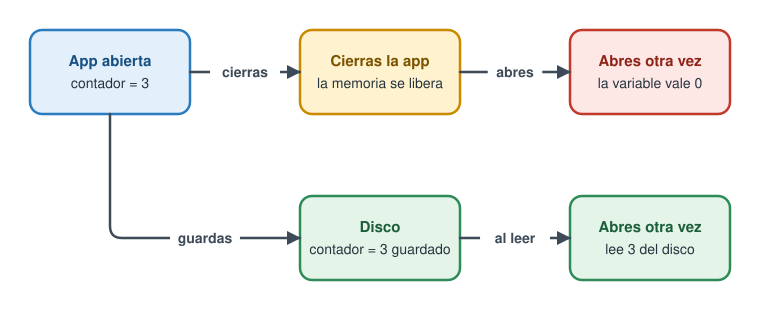
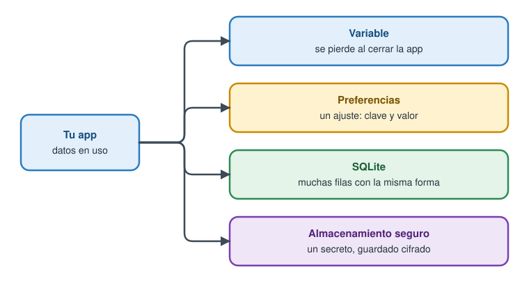
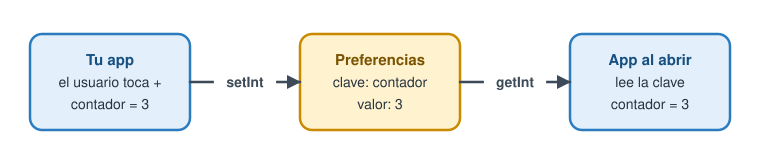
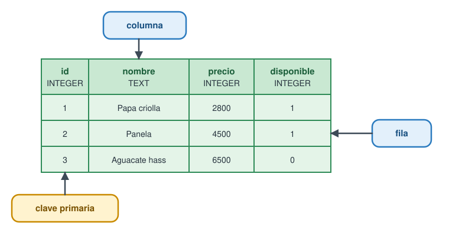
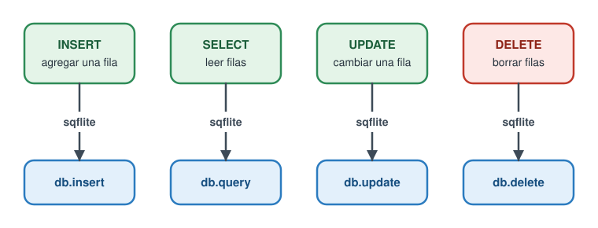
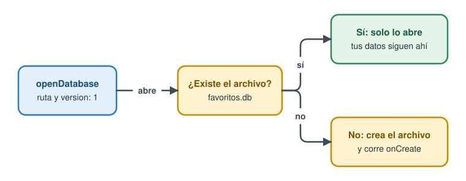
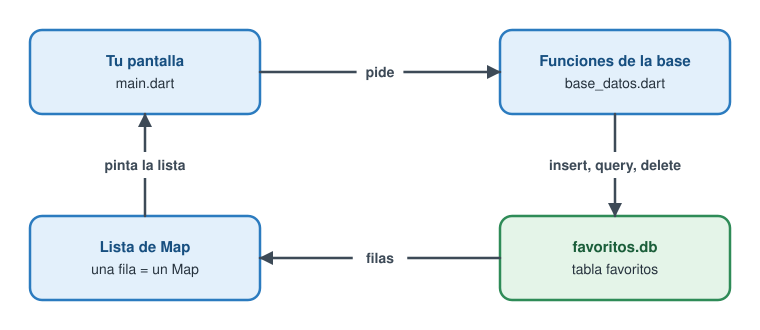
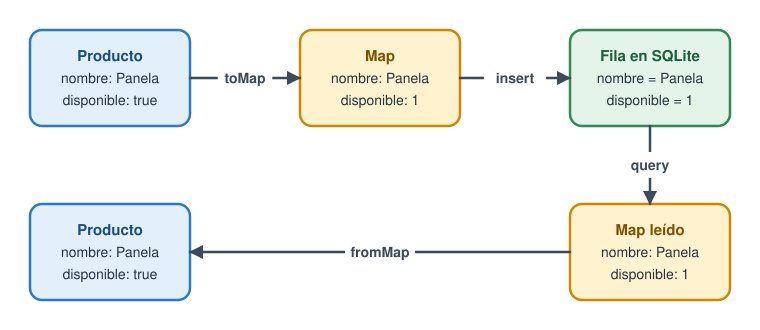
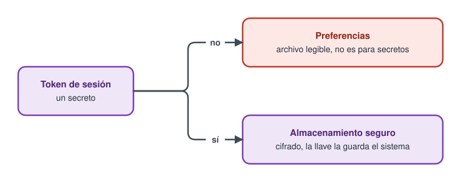
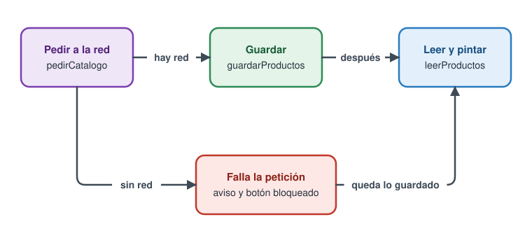

::: {.ficha}
|            |                                                        |
|------------|--------------------------------------------------------|
| Asignatura | Programación Móvil (IF2004)                             |
| Grupos     | 601 y 602 de Ingeniería Informática                     |
| Unidad     | Unidad 2. Interfaz, datos y persistencia                |
:::

::: {.acceso}
::: {.acceso-item}
Presentación interactiva de la sesión

[Abrir la presentación interactiva](presentacion-interactiva.html){.btn-doc target="_blank"}
:::
:::

## Lo que vas a lograr

En la semana de JSON y APIs REST tu app le pidió el catálogo a un servidor. Funciona mientras haya internet. Si el comprador abre la app en el bus, sin señal, la pantalla queda vacía aunque hace un rato tenía el catálogo completo. La especificación del proyecto pide lo contrario: sin conexión, el comprador debe poder **consultar** el último catálogo que descargó, aunque no pueda confirmar un pedido (regla RN-06).

Para eso la app necesita **guardar datos en el celular** y encontrarlos la próxima vez que se abra. Esta guía va de lo más simple a lo completo: cada parte agrega una sola idea, la explica y la prueba con un ejemplo que ya funciona, y solo al final se junta todo en el catálogo de Mercado Campesino.

Al terminar puedes:

1. Decir en qué lugar vive un dato (variable, preferencias, SQLite o almacenamiento seguro) y qué sobrevive al cerrar la app.
2. Guardar, leer y borrar un ajuste con `shared_preferences`.
3. Explicar qué es una tabla, una fila, una columna y una clave primaria, y escribir `INSERT`, `SELECT` con `WHERE`, `UPDATE` y `DELETE`.
4. Abrir una base con `sqflite`, crear una tabla, e insertar, leer y borrar filas, y mostrarlas en una lista.
5. Convertir un `Producto` en un `Map` (`toMap`) y de vuelta (`fromMap`).
6. Guardar un secreto con `flutter_secure_storage` y explicar por qué no va en preferencias.
7. Armar el catálogo que pide a la red, guarda en SQLite y, sin red, muestra lo último guardado con la confirmación bloqueada.

::: {.callout-note}
Los recuadros **Para memorizar** reúnen lo poco que conviene saber de memoria. Los recuadros **Para razonar** reúnen lo que se deduce del mecanismo. Antes de abrir cada respuesta oculta, escribe tu predicción.
:::

::: {.callout-note}
## Antes de empezar

Necesitas:

- Las semanas de JSON y APIs REST y de StatefulWidget ya vistas: peticiones con `http`, `async`/`await` y una pantalla que se redibuja cuando cambia un dato. Esta guía no las repite.
- Flutter 3.41.9 (canal stable) y Dart 3.11.5, las mismas versiones de las semanas anteriores.
- Un **emulador de Android** o un celular conectado. `sqflite` no corre en Chrome ni en Windows: ejecuta los ejemplos en el emulador.

**Versiones de los paquetes.** Estas son las versiones con las que se verificó la guía:

| Paquete | Versión | Para qué |
|---|---|---|
| `shared_preferences` | 2.5.5 | Preferencias (un ajuste sencillo) |
| `sqflite` | 2.4.2+1 | La base de datos SQLite |
| `path` | 1.9.1 | Armar la ruta del archivo de la base |
| `flutter_secure_storage` | 11.2.0 | Almacenamiento seguro |
| `http` | 1.6.0 | La petición de red, como en la semana de JSON y APIs REST |

**Un proyecto aparte.** Crea uno para esta semana y reemplaza el bloque `dependencies` de su `pubspec.yaml` por este:

```bash
flutter create practica_s08
cd practica_s08
```

```yaml
dependencies:
  flutter:
    sdk: flutter
  flutter_secure_storage: 11.2.0
  http: 1.6.0
  path: 1.9.1
  shared_preferences: 2.5.5
  sqflite: 2.4.2+1
```

Después ejecuta `flutter pub get`. En cada parte pegas el código en `lib/`, encima del anterior. Cuando un ejemplo trae dos archivos, `base_datos.dart` y `main.dart`, ambos van en `lib/`.

**La pantalla de cada ejemplo.** Casi todos los ejemplos usan la pantalla con estado de la semana de StatefulWidget. No se vuelve a explicar: en cada ejemplo se señala dónde está lo nuevo de esta semana.

**Permiso de internet.** Las versiones de depuración (`flutter run`) ya pueden usar internet. Para una versión de lanzamiento, agrega esta línea en `android/app/src/main/AndroidManifest.xml`, justo antes de la etiqueta `<application`:

```xml
<uses-permission android:name="android.permission.INTERNET"/>
```

**De dónde vienen los datos.** El catálogo de Mercado Campesino todavía no tiene servidor propio. El taller de la Parte 7 pide los productos a un servicio de práctica gratuito y público, `dummyjson.com`, categoría `groceries` (víveres, con nombres en inglés y precios en dólares). El código multiplica el precio por 4000 para tener pesos enteros. No es el servicio del proyecto.

**El modelo de datos.** La especificación (`alcance.md`) no define los campos de un producto. Esta guía usa el mínimo: un `Producto` con `id`, `nombre`, `precio` y `disponible`.
:::

::: {.callout-warning}
## Qué se comprobó y qué no

Todo el código de la guía pasa `flutter analyze` sin avisos y tiene pruebas automáticas. Esas pruebas usan una base SQLite simulada en el computador, un almacén seguro de pruebas y una red falsa para el modo sin conexión. **No se ejecutó en un emulador ni en un teléfono**: el aspecto en pantalla, el cifrado real del almacén seguro, el modo avión de verdad y el texto exacto de los errores en Android quedan por comprobar cuando tú lo ejecutes. Si algo se ve distinto en tu dispositivo, es información valiosa.
:::

## Parte 1. Memoria y disco: por qué se pierde un dato

### El problema real

El comprador suma tres productos al contador de su pedido, cierra la app y la abre otra vez: el contador vuelve a cero. No es un fallo de tu código. Es la forma en que viven los datos en un programa, y antes de guardar algo hay que saber dónde está.

**Predice primero.** Un contador vive en una variable de la pantalla y vale 3. El comprador desliza la app fuera de las apps recientes y la abre de nuevo. ¿Cuánto vale?

::: {.callout-warning collapse="true"}
## Comprueba tu predicción

Vale 0. Una variable vive en la **memoria** (RAM) del proceso de tu app. Cuando el sistema cierra el proceso libera esa memoria y todo lo que había ahí se pierde. Al abrir la app, Flutter arranca de cero y la variable recibe su valor inicial.
:::

### Concepto: memoria frente a disco

La **memoria** es rápida y se borra al cerrar la app. El **disco** (el almacenamiento del celular) es más lento, pero guarda el dato aunque la app se cierre. Para que un dato sobreviva hay que escribirlo en el disco y leerlo cuando la app arranca.

::: {.diagrama}
{fig-alt="Dos caminos al cerrar la app. Arriba: la app tiene contador 3, se cierra y se libera la memoria, y al abrirla la variable vale 0. Abajo: la app guarda contador 3 en el disco y al abrirla de nuevo lo lee y recupera el 3"}

Dos caminos al cerrar la app: la variable se pierde, el dato en disco se recupera.
:::

### Ejemplo mínimo: un contador en una variable

Pega este código en `lib/main.dart` y ejecuta la app. Es la versión que **no** guarda nada.

```dart
import 'package:flutter/material.dart';

void main() => runApp(const MaterialApp(home: ContadorPantalla()));

class ContadorPantalla extends StatefulWidget {
  const ContadorPantalla({super.key});

  @override
  State<ContadorPantalla> createState() => _ContadorPantallaState();
}

class _ContadorPantallaState extends State<ContadorPantalla> {
  int contador = 0; // vive solo en memoria

  void sumar() {
    setState(() => contador++);
  }

  @override
  Widget build(BuildContext context) {
    return Scaffold(
      appBar: AppBar(title: const Text('Contador en memoria')),
      body: Center(
        child: Text('$contador', style: Theme.of(context).textTheme.displayLarge),
      ),
      floatingActionButton: FloatingActionButton(
        onPressed: sumar,
        child: const Icon(Icons.add),
      ),
    );
  }
}
```

La pantalla es la misma de la semana de StatefulWidget. Lo único que importa aquí es la línea `int contador = 0; // vive solo en memoria`: el contador es una variable común, y cada toque en el botón le suma uno.

Pruébalo: toca el botón tres veces, cierra la app por completo y ábrela de nuevo. El contador vuelve a 0.

### Cuatro lugares, cuatro duraciones

Esta semana usas cuatro lugares para un dato. Cada uno guarda bien un tipo de dato distinto:

::: {.diagrama}
{fig-alt="Tu app guarda sus datos en cuatro lugares: una variable que se pierde al cerrar la app, preferencias para un ajuste de clave y valor, SQLite para muchas filas con la misma forma y almacenamiento seguro para un secreto cifrado"}

Los cuatro lugares. Las Partes 2, 3 a 5 y 6 recorren cada uno.
:::

| Lugar | Qué guarda | ¿Sobrevive al cerrar la app? | Parte |
|---|---|---|---|
| Variable | Lo que se ve ahora en la pantalla | No | 1 |
| Preferencias | Un ajuste sencillo: un número, un texto | Sí | 2 |
| SQLite | Muchas filas con la misma forma: el catálogo | Sí | 3 a 5 |
| Almacenamiento seguro | Un secreto: la ficha de sesión | Sí | 6 |

::: {.callout-important}
## Para memorizar

- Una variable vive solo mientras la app corre. Para que un dato sobreviva, hay que guardarlo en el disco.
- Preferencias: un ajuste. SQLite: muchas filas. Almacenamiento seguro: un secreto.
:::

::: {.callout-note}
## Para razonar, no para memorizar

Ante un dato nuevo no preguntes "qué herramienta uso". Pregunta tres cosas: qué tan largo es, si es un secreto y cuánto debe durar. Con esas respuestas el lugar sale solo.
:::

### Conexión con el proyecto

La lista de productos que el comprador ve ahora es una variable: está bien, porque solo importa mientras mira la pantalla. El catálogo que descargó, en cambio, tiene que sobrevivir para poder consultarlo sin señal (RN-06). Ese es el trabajo de las partes siguientes.

## Parte 2. Preferencias: guardar un ajuste sencillo

### El problema real

El comprador escribe su municipio y quiere que la app lo recuerde la próxima vez. Es un solo texto. No necesita una base de datos: necesita un cuaderno donde apuntar "municipio: Envigado" y consultarlo después.

### Concepto: un cuaderno de clave y valor

Las **preferencias** son un archivo pequeño de pares **clave y valor**. La clave es un nombre que tú escoges (`'contador'`) y el valor es el dato (`3`). Guardar es escribir un par y leer es preguntar por la clave.

::: {.diagrama}
{fig-alt="El usuario toca el botón y la app guarda contador igual a 3 en las preferencias con setInt; al abrir la app de nuevo lee la clave con getInt y recupera contador igual a 3"}

El ciclo de una preferencia: se escribe con `setInt` y se lee con `getInt`.
:::

Cada tipo tiene su par de métodos:

| Dato | Guardar | Leer |
|---|---|---|
| Número entero | `setInt` | `getInt` |
| Número decimal | `setDouble` | `getDouble` |
| Verdadero o falso | `setBool` | `getBool` |
| Texto | `setString` | `getString` |
| Lista de textos | `setStringList` | `getStringList` |
| Borrar una clave | `remove` | |

Guardar y leer tocan el disco, que es más lento que la memoria, así que **todos son asíncronos**: devuelven un `Future` y se usan con `await`. Y leer una clave que nunca se guardó devuelve `null`.

::: {.callout-note}
La documentación recomienda `SharedPreferencesAsync` para código nuevo. Existe también la clase clásica `SharedPreferences.getInstance()`, que verás en tutoriales antiguos y que la documentación avisa que se dejará de usar. Aquí usas solo `SharedPreferencesAsync`.
:::

### Ejemplo 1: el contador que sobrevive

Es el mismo contador de la Parte 1, ahora guardado. Pega este código en `lib/main.dart`:

```dart
import 'package:flutter/material.dart';
import 'package:shared_preferences/shared_preferences.dart';

void main() => runApp(const MaterialApp(home: ContadorPantalla()));

class ContadorPantalla extends StatefulWidget {
  const ContadorPantalla({super.key});

  @override
  State<ContadorPantalla> createState() => _ContadorPantallaState();
}

class _ContadorPantallaState extends State<ContadorPantalla> {
  final prefs = SharedPreferencesAsync();
  int contador = 0;

  @override
  void initState() {
    super.initState();
    cargar();
  }

  Future<void> cargar() async {
    final guardado = await prefs.getInt('contador') ?? 0;
    setState(() => contador = guardado);
  }

  Future<void> sumar() async {
    setState(() => contador++);
    await prefs.setInt('contador', contador);
  }

  @override
  Widget build(BuildContext context) {
    return Scaffold(
      appBar: AppBar(title: const Text('Contador guardado')),
      body: Center(
        child: Text('$contador', style: Theme.of(context).textTheme.displayLarge),
      ),
      floatingActionButton: FloatingActionButton(
        onPressed: sumar,
        child: const Icon(Icons.add),
      ),
    );
  }
}
```

La pantalla es la misma de la semana de StatefulWidget: lo nuevo está en estas tres partes.

- `final prefs = SharedPreferencesAsync();` crea el objeto que escribe y lee las preferencias.
- `cargar()` lee la clave `'contador'` con `getInt`. Como la primera vez no hay nada guardado, `getInt` devuelve `null`, y `?? 0` pone un valor por defecto. Después pinta el valor guardado.
- `sumar()` suma uno y lo guarda con `setInt('contador', contador)`.

`cargar()` se llama una vez cuando la pantalla nace, como en la semana de StatefulWidget. Pruébalo: toca el botón tres veces, cierra la app por completo y ábrela. El contador sigue en 3.

**Qué pasa si...** quitas el `?? 0`. `getInt` devuelve un número que puede ser `null`, y Dart no permite asignarlo a un `int` común: el analizador marca el error antes de ejecutar. Por eso toda lectura de preferencias lleva su valor por defecto.

### Ejemplo 2: guardar y borrar un texto

Ahora un texto, el municipio, con un botón para guardarlo y otro para borrarlo:

```dart
import 'package:flutter/material.dart';
import 'package:shared_preferences/shared_preferences.dart';

void main() => runApp(const MaterialApp(home: MunicipioPantalla()));

class MunicipioPantalla extends StatefulWidget {
  const MunicipioPantalla({super.key});

  @override
  State<MunicipioPantalla> createState() => _MunicipioPantallaState();
}

class _MunicipioPantallaState extends State<MunicipioPantalla> {
  final prefs = SharedPreferencesAsync();
  final campo = TextEditingController();
  String? municipio;

  @override
  void initState() {
    super.initState();
    cargar();
  }

  Future<void> cargar() async {
    final guardado = await prefs.getString('municipio');
    setState(() => municipio = guardado);
  }

  Future<void> guardar() async {
    await prefs.setString('municipio', campo.text);
    await cargar();
  }

  Future<void> borrar() async {
    await prefs.remove('municipio');
    await cargar();
  }

  @override
  Widget build(BuildContext context) {
    return Scaffold(
      appBar: AppBar(title: const Text('Mi municipio')),
      body: Padding(
        padding: const EdgeInsets.all(16),
        child: Column(
          children: [
            Text(municipio ?? 'Sin municipio guardado'),
            TextField(
              controller: campo,
              decoration: const InputDecoration(labelText: 'Municipio'),
            ),
            Row(
              children: [
                FilledButton(onPressed: guardar, child: const Text('Guardar')),
                TextButton(onPressed: borrar, child: const Text('Borrar')),
              ],
            ),
          ],
        ),
      ),
    );
  }
}
```

La pantalla es la misma de la semana de StatefulWidget: lo nuevo está en `cargar()`, `guardar()` y `borrar()`.

- `cargar()` lee con `getString('municipio')`. El resultado puede ser `null`, y por eso la variable es `String?` y el texto en pantalla usa `municipio ?? 'Sin municipio guardado'`.
- `guardar()` escribe lo que haya en el campo con `setString('municipio', campo.text)` y vuelve a llamar a `cargar()`.
- `borrar()` quita la clave con `remove('municipio')` y vuelve a llamar a `cargar()`.

Fíjate en el patrón: **cambiar el dato guardado y volver a leerlo**. Así la pantalla siempre muestra lo que realmente quedó guardado y no lo que creías haber guardado.

**Qué pasa si...** escribes la clave distinta al leer y al guardar (`'Municipio'` y `'municipio'`). Las claves distinguen mayúsculas: lees `null` y parece que no se guardó nada. Escribe cada clave una sola vez en una constante cuando tu app crezca.

### Cuándo no bastan las preferencias

Un ajuste es un valor. El catálogo son 27 productos con cuatro datos cada uno. Con preferencias tendrías que inventar claves como `producto_1_nombre` y `producto_1_precio`, o meter todo en un texto gigante. Y no podrías pedir "solo los disponibles". Eso lo resuelven las tablas.

::: {.callout-important}
## Para memorizar

- Preferencias: pares clave y valor para ajustes pequeños.
- `SharedPreferencesAsync`: `setInt`/`getInt`, `setString`/`getString`, `setBool`/`getBool`, `remove`. Todos con `await`.
- Leer una clave que no existe devuelve `null`: usa `?? valorPorDefecto`.
:::

::: {.callout-note}
## Para razonar, no para memorizar

¿Por qué leer y guardar son asíncronos? Porque tocan el disco, mucho más lento que la memoria. Un `Future` deja que la app siga funcionando mientras espera, igual que con la petición de red de la semana de JSON y APIs REST.
:::

### Conexión con el proyecto

El municipio del comprador es justo un dato para preferencias: un texto, sin estructura. El catálogo no lo es. Para él necesitas una tabla.

## Parte 3. Tablas y SQL mínimo

### El problema real

El catálogo tiene muchos productos con la misma forma: cada uno con `id`, `nombre`, `precio` y `disponible`. Necesitas guardarlos todos, buscar los que están disponibles y cambiar el precio de uno sin tocar los demás. Una tabla hace eso.

### Concepto: una tabla es una hoja de cuaderno

Una **tabla** es una hoja con columnas fijas, como un cuaderno de inventario. Cada **columna** es un dato con nombre y tipo (`nombre`, `precio`). Cada **fila** es un producto completo. La **clave primaria** es la columna que identifica cada fila sin repetirse: ningún `id` aparece dos veces.

::: {.diagrama}
{fig-alt="Una tabla de productos con las columnas id, nombre, precio y disponible y tres filas: papa criolla, panela y aguacate hass. Una flecha señala la columna nombre, otra señala la fila de la panela y otra la clave primaria, que es la columna id"}

Las partes de una tabla: columnas, filas y clave primaria.
:::

Cada columna tiene un tipo. SQLite usa pocos, y algunos de Dart no existen allí:

| En Dart | En SQLite | Nota |
|---|---|---|
| `int` | `INTEGER` | |
| `String` | `TEXT` | |
| `double` | `REAL` | |
| `bool` | `INTEGER` | Se guarda como `1` (verdadero) o `0` (falso) |

### SQL mínimo en cinco sentencias

**SQL** es el lenguaje para hablarle a la tabla. Estas sentencias se ejecutaron en SQLite con datos del mercado, y la salida que ves es la real. Puedes probarlas en cualquier consola de SQLite.

**Crear la tabla.** `CREATE TABLE` define las columnas, sus tipos y la clave primaria:

```sql
-- 1. Crear la tabla
CREATE TABLE productos(id INTEGER PRIMARY KEY, nombre TEXT, precio INTEGER, disponible INTEGER);
```

**Insertar filas.** `INSERT` agrega una fila: primero las columnas, después los valores en el mismo orden. Los textos van entre comillas simples:

```sql
-- 2. Insertar filas
INSERT INTO productos(id, nombre, precio, disponible) VALUES (1, 'Papa criolla', 2800, 1);
INSERT INTO productos(id, nombre, precio, disponible) VALUES (2, 'Panela', 4500, 1);
INSERT INTO productos(id, nombre, precio, disponible) VALUES (3, 'Tomate chonto', 3200, 1);
INSERT INTO productos(id, nombre, precio, disponible) VALUES (4, 'Aguacate hass', 6500, 0);
INSERT INTO productos(id, nombre, precio, disponible) VALUES (5, 'Plátano', 2500, 1);
```

**Leer.** `SELECT` pide filas. El asterisco significa "todas las columnas":

```sql
-- 3. SELECT: leer todo
SELECT * FROM productos;
```

```text
sqlite> SELECT * FROM productos;
id | nombre | precio | disponible
1 | Papa criolla | 2800 | 1
2 | Panela | 4500 | 1
3 | Tomate chonto | 3200 | 1
4 | Aguacate hass | 6500 | 0
5 | Plátano | 2500 | 1
(5 filas)
```

**Filtrar con `WHERE`.** Sin `WHERE` obtienes todo. Con `WHERE` obtienes solo las filas que cumplen la condición, y `SELECT` puede pedir columnas concretas:

```sql
-- 4. SELECT con WHERE: solo los disponibles
SELECT nombre, precio FROM productos WHERE disponible = 1;
```

```text
sqlite> SELECT nombre, precio FROM productos WHERE disponible = 1;
nombre | precio
Papa criolla | 2800
Panela | 4500
Tomate chonto | 3200
Plátano | 2500
(4 filas)
```

Las condiciones también comparan números:

```sql
-- 5. SELECT con WHERE: los que cuestan más de 3000
SELECT nombre, precio FROM productos WHERE precio > 3000;
```

```text
sqlite> SELECT nombre, precio FROM productos WHERE precio > 3000;
nombre | precio
Panela | 4500
Tomate chonto | 3200
Aguacate hass | 6500
(3 filas)
```

**Cambiar una fila.** `UPDATE` modifica columnas, y el `WHERE` dice **cuál** fila:

```sql
UPDATE productos SET precio = 5000 WHERE id = 2;
SELECT * FROM productos WHERE id = 2;
```

```text
sqlite> UPDATE productos SET precio = 5000 WHERE id = 2;
(filas afectadas: 1)
sqlite> SELECT * FROM productos WHERE id = 2;
id | nombre | precio | disponible
2 | Panela | 5000 | 1
(1 fila)
```

**Borrar filas.** `DELETE` quita las filas que cumplan el `WHERE`:

```sql
DELETE FROM productos WHERE id = 4;
SELECT * FROM productos;
```

```text
sqlite> DELETE FROM productos WHERE id = 4;
(filas afectadas: 1)
sqlite> SELECT * FROM productos;
id | nombre | precio | disponible
1 | Papa criolla | 2800 | 1
2 | Panela | 5000 | 1
3 | Tomate chonto | 3200 | 1
5 | Plátano | 2500 | 1
(4 filas)
```

::: {.callout-warning}
## La trampa: `DELETE` o `UPDATE` sin `WHERE`

Sin `WHERE`, la sentencia afecta **todas** las filas. Esta es la salida real de borrar sin condición:

```sql
DELETE FROM productos;
SELECT COUNT(*) FROM productos;
```

```text
sqlite> DELETE FROM productos;
(filas afectadas: 4)
sqlite> SELECT COUNT(*) FROM productos;
COUNT(*)
0
(1 fila)
```

Cuatro filas afectadas y la tabla quedó vacía. Antes de ejecutar un `UPDATE` o un `DELETE`, comprueba que tiene su `WHERE`.
:::

::: {.diagrama}
{fig-alt="Las cuatro operaciones y su método de sqflite: INSERT corresponde a db.insert, SELECT a db.query, UPDATE a db.update y DELETE a db.delete; DELETE está en rojo porque borra filas"}

Cada sentencia tiene su método en `sqflite`. Los verás en la Parte 4.
:::

::: {.callout-tip}
## Reto 1. Los productos baratos

Escribe la sentencia que muestra el nombre y el precio de los productos que cuestan menos de 3000.
:::

::: {.callout-note collapse="true"}
## Solución del Reto 1

```sql
SELECT nombre, precio FROM productos WHERE precio < 3000;
```

Con los cinco productos de arriba devuelve `Papa criolla | 2800` y `Plátano | 2500`.
:::

::: {.callout-important}
## Para memorizar

- Tabla: columnas (dato con tipo), filas (un producto completo) y clave primaria (identifica la fila sin repetirse).
- `INSERT` agrega, `SELECT` lee, `UPDATE` cambia, `DELETE` borra.
- `WHERE` limita a qué filas afecta. `UPDATE` y `DELETE` sin `WHERE` afectan todas.
- `bool` se guarda como `1` o `0`.
:::

::: {.callout-note}
## Para razonar, no para memorizar

Las cuatro sentencias son las cuatro cosas que haces con una lista: agregar, mirar, corregir y quitar. Si sabes cuál necesitas, la sentencia sale de la forma `VERBO ... tabla ... WHERE condición`.
:::

### Conexión con el proyecto

La tabla `productos` de esta parte es la del catálogo de Mercado Campesino. En la Parte 4 no escribirás estas sentencias a mano: `sqflite` te da un método de Dart para cada una.

## Parte 4. `sqflite`: de abrir la base a mostrar la lista

### El problema real

SQLite vive en un archivo dentro del celular. Desde Dart necesitas abrirlo, crear la tabla la primera vez, y después insertar, leer y borrar. Lo haces con el paquete `sqflite`, y empiezas por lo más pequeño: una tabla con un solo dato, los **favoritos** del comprador.

**Predice primero.** Un ejemplo abre la base, agrega un favorito fijo y muestra cuántos hay. Partes de una instalación nueva y lo ejecutas tres veces seguidas, cerrando la app entre una y otra. ¿Qué número ves en la tercera?

::: {.callout-warning collapse="true"}
## Comprueba tu predicción

Ves `Favoritos guardados: 3`. El archivo de la base persiste entre ejecuciones, así que cada ejecución suma una fila más.
:::

### Concepto: abrir la base y crear la tabla una sola vez

`openDatabase` recibe la ruta del archivo, una `version` y una función `onCreate`. Si el archivo **no existe**, lo crea y ejecuta `onCreate`, donde va el `CREATE TABLE`. Si ya existe, solo lo abre y `onCreate` no corre.

::: {.diagrama}
{fig-alt="openDatabase recibe la ruta y la version 1 y pregunta si existe el archivo favoritos punto db. Si existe, solo lo abre y los datos siguen ahí. Si no existe, crea el archivo y corre onCreate"}

`onCreate` corre solo cuando el archivo es nuevo.
:::

### Ejemplo 1: abrir, insertar y leer

Son dos archivos en `lib/`. El primero, `base_datos.dart`, reúne todo lo que toca la base:

```dart
import 'package:path/path.dart';
import 'package:sqflite/sqflite.dart';

Future<Database> abrirBase() async {
  final ruta = join(await getDatabasesPath(), 'favoritos.db');
  return openDatabase(
    ruta,
    version: 1,
    onCreate: (db, version) {
      return db.execute(
        'CREATE TABLE favoritos(id INTEGER PRIMARY KEY AUTOINCREMENT, nombre TEXT)',
      );
    },
  );
}

Future<void> agregarFavorito(Database db, String nombre) async {
  await db.insert('favoritos', {'nombre': nombre});
}

Future<List<Map<String, Object?>>> leerFavoritos(Database db) {
  return db.query('favoritos');
}

Future<void> borrarFavorito(Database db, int id) async {
  await db.delete('favoritos', where: 'id = ?', whereArgs: [id]);
}
```

Qué hace cada parte, de arriba abajo:

- `getDatabasesPath()` devuelve la carpeta donde Android guarda las bases de tu app, y `join` (del paquete `path`) le pega el nombre `'favoritos.db'` para formar la ruta del archivo.
- `openDatabase(ruta, version: 1, onCreate: ...)` abre el archivo. Si es nuevo, `onCreate` ejecuta el `CREATE TABLE` con `db.execute`. La columna `id` es clave primaria y `AUTOINCREMENT` hace que SQLite la numere sola.
- `agregarFavorito` usa `db.insert('favoritos', {'nombre': nombre})`: la tabla y un `Map` con la columna y su valor. Es el `INSERT` de la Parte 3.
- `leerFavoritos` usa `db.query('favoritos')`, el `SELECT *`. Devuelve una lista de filas, y cada fila es un `Map` de columna a valor.
- `borrarFavorito` usa `db.delete('favoritos', where: 'id = ?', whereArgs: [id])`. El `?` es un hueco que se llena con el valor de `whereArgs`.

El segundo archivo, `main.dart`, usa esas funciones:

```dart
import 'package:flutter/material.dart';

import 'base_datos.dart';

Future<void> main() async {
  WidgetsFlutterBinding.ensureInitialized();
  final db = await abrirBase();
  await agregarFavorito(db, 'Papa criolla');
  final favoritos = await leerFavoritos(db);
  runApp(
    MaterialApp(
      home: Scaffold(
        body: Center(child: Text('Favoritos guardados: ${favoritos.length}')),
      ),
    ),
  );
}
```

- `main` es `async` porque abrir la base toma tiempo. Antes de eso necesita `WidgetsFlutterBinding.ensureInitialized()`, que deja listos los paquetes que hablan con el sistema antes de `runApp`.
- Abre la base, agrega `'Papa criolla'`, lee los favoritos y pinta cuántos hay con `favoritos.length`.

Ejecútalo varias veces: cada vez sube el número, porque la fila queda en el archivo.

**Qué pasa si...** en `borrarFavorito` quitas el `where` y `whereArgs`. `db.delete('favoritos')` borra **todos** los favoritos, igual que el `DELETE` sin `WHERE` de la Parte 3.

::: {.callout-warning}
## No armes el `where` con texto

`where: 'id = $id'` también funciona, pero pega el dato dentro de la sentencia. Si ese dato viene de un campo de texto, quien lo escribe puede alterar la sentencia. Con `where: 'id = ?'` y `whereArgs: [id]` el valor viaja aparte y nunca se confunde con SQL. Úsalo siempre así.
:::

### Ejemplo 2: mostrar la lista, agregar y borrar

Ahora los favoritos se ven en una lista, con un campo para agregar y un toque para borrar. El archivo `base_datos.dart` es **idéntico** al del ejemplo anterior, no lo cambies. Reemplaza solo `main.dart`:

```dart
import 'package:flutter/material.dart';
import 'package:sqflite/sqflite.dart';

import 'base_datos.dart';

Future<void> main() async {
  WidgetsFlutterBinding.ensureInitialized();
  final db = await abrirBase();
  runApp(MaterialApp(home: FavoritosPantalla(db: db)));
}

class FavoritosPantalla extends StatefulWidget {
  const FavoritosPantalla({super.key, required this.db});

  final Database db;

  @override
  State<FavoritosPantalla> createState() => _FavoritosPantallaState();
}

class _FavoritosPantallaState extends State<FavoritosPantalla> {
  final campo = TextEditingController();
  List<Map<String, Object?>> favoritos = [];

  @override
  void initState() {
    super.initState();
    cargar();
  }

  Future<void> cargar() async {
    final filas = await leerFavoritos(widget.db);
    setState(() => favoritos = filas);
  }

  Future<void> agregar() async {
    if (campo.text.isEmpty) return;
    await agregarFavorito(widget.db, campo.text);
    campo.clear();
    await cargar();
  }

  Future<void> borrar(int id) async {
    await borrarFavorito(widget.db, id);
    await cargar();
  }

  @override
  Widget build(BuildContext context) {
    return Scaffold(
      appBar: AppBar(title: const Text('Favoritos')),
      body: Column(
        children: [
          Padding(
            padding: const EdgeInsets.all(16),
            child: Row(
              children: [
                Expanded(
                  child: TextField(
                    controller: campo,
                    decoration: const InputDecoration(labelText: 'Producto'),
                  ),
                ),
                IconButton(onPressed: agregar, icon: const Icon(Icons.add)),
              ],
            ),
          ),
          Expanded(
            child: ListView(
              children: [
                for (final f in favoritos)
                  ListTile(
                    title: Text(f['nombre'] as String),
                    subtitle: const Text('Toca para borrar'),
                    onTap: () => borrar(f['id'] as int),
                  ),
              ],
            ),
          ),
        ],
      ),
    );
  }
}
```

La pantalla es la misma de la semana de StatefulWidget: lo nuevo está en `cargar()`, `agregar()` y `borrar()`.

- `cargar()` lee las filas con `leerFavoritos` y las guarda en la variable `favoritos`, que es lo que pinta la lista.
- `agregar()` no hace nada si el campo está vacío; si no, inserta con `agregarFavorito`, limpia el campo y vuelve a llamar a `cargar()`.
- `borrar(id)` borra con `borrarFavorito` y vuelve a llamar a `cargar()`.
- En la lista, `f['nombre'] as String` y `f['id'] as int` sacan el dato del `Map` de cada fila. Dart no sabe de qué tipo es cada valor del mapa, por eso hace falta el `as`.

Es el mismo patrón de la Parte 2: **cambiar la base y volver a leerla**. Cierra la app y ábrela: los favoritos siguen ahí.

::: {.diagrama}
{fig-alt="Ciclo en el sentido de las agujas del reloj: tu pantalla main punto dart pide a las funciones de base_datos punto dart, que ejecutan insert, query o delete sobre el archivo favoritos punto db; el archivo devuelve filas como lista de Map y la lista se pinta de nuevo en la pantalla"}

El camino de un dato: pantalla, funciones de la base, archivo, filas y otra vez la pantalla.
:::

::: {.callout-important}
## Para memorizar

- `openDatabase(ruta, version: 1, onCreate: ...)`: `onCreate` crea la tabla solo si el archivo es nuevo.
- `db.insert(tabla, mapa)`, `db.query(tabla)`, `db.delete(tabla, where: 'id = ?', whereArgs: [id])`.
- `db.query` devuelve una lista de `Map`. Cada fila es un `Map` de columna a valor.
- Después de cambiar la base, vuelve a leerla para pintar.
- Todo es asíncrono: usa `await`.
:::

::: {.callout-note}
## Para razonar, no para memorizar

¿Por qué `onCreate` y no un `CREATE TABLE` en cada arranque? Porque crear una tabla que ya existe falla, y porque una base con datos no debe recrearse. `onCreate` corre una sola vez en la vida del archivo, y por eso cambiar el `CREATE TABLE` después no tiene efecto (ver Errores frecuentes).
:::

### Conexión con el proyecto

Los favoritos son un `Map` con un solo dato. Un producto del catálogo tiene cuatro, y uno de ellos es un `bool`. Convertir esos `Map` en objetos sin errores es el tema de la Parte 5.

## Parte 5. Guardar un objeto: `Producto`, `toMap` y `fromMap`

### El problema real

Con favoritos leías `f['nombre'] as String`. Con un producto serían cuatro claves de texto repartidas por toda la app, y escribir `'nobmre'` no da error hasta ejecutar. Además `disponible` es un `bool` en Dart y SQLite no tiene `bool`. Necesitas una frontera clara: **un solo lugar** donde un `Producto` se convierte en `Map` para guardarlo y de `Map` en `Producto` para usarlo.

### Concepto: dos conversiones

`toMap()` va del objeto a un `Map` que `sqflite` sabe insertar. `fromMap()` hace el camino contrario con una fila leída. Ahí se resuelve el `bool`: `true` se guarda como `1` y `false` como `0`, y al leer, `1` vuelve a ser `true`.

::: {.diagrama}
{fig-alt="Ida y vuelta de un Producto: toMap lo convierte en un Map con disponible igual a 1 e insert lo guarda como fila en SQLite; query lee la fila como Map y fromMap la convierte otra vez en un Producto con disponible verdadero"}

Ida con `toMap` e `insert`, vuelta con `query` y `fromMap`.
:::

### Ejemplo: guardar y leer productos

Archivo `base_datos.dart`. Aquí viven el modelo y todo lo que toca la base:

```dart
import 'package:path/path.dart';
import 'package:sqflite/sqflite.dart';

class Producto {
  const Producto({
    required this.id,
    required this.nombre,
    required this.precio,
    required this.disponible,
  });

  final int id;
  final String nombre;
  final int precio;
  final bool disponible;

  // bool en Dart, 0 o 1 en SQLite
  Map<String, Object?> toMap() {
    return {
      'id': id,
      'nombre': nombre,
      'precio': precio,
      'disponible': disponible ? 1 : 0,
    };
  }

  factory Producto.fromMap(Map<String, Object?> mapa) {
    return Producto(
      id: mapa['id'] as int,
      nombre: mapa['nombre'] as String,
      precio: mapa['precio'] as int,
      disponible: mapa['disponible'] == 1,
    );
  }
}

Future<Database> abrirBase() async {
  final ruta = join(await getDatabasesPath(), 'mercado.db');
  return openDatabase(
    ruta,
    version: 1,
    onCreate: (db, version) {
      return db.execute(
        'CREATE TABLE productos(id INTEGER PRIMARY KEY, nombre TEXT, '
        'precio INTEGER, disponible INTEGER)',
      );
    },
  );
}

// Borra todo y reinserta, en una sola transacción
Future<void> guardarProductos(Database db, List<Producto> productos) async {
  await db.transaction((txn) async {
    final lote = txn.batch();
    lote.delete('productos');
    for (final p in productos) {
      lote.insert('productos', p.toMap());
    }
    await lote.commit(noResult: true);
  });
}

Future<List<Producto>> leerProductos(Database db) async {
  final filas = await db.query('productos');
  return [for (final fila in filas) Producto.fromMap(fila)];
}

Future<void> borrarProductos(Database db) async {
  await db.delete('productos');
}
```

- `Producto` guarda los cuatro datos en campos `final`. `disponible` es un `bool`.
- `toMap()` arma el `Map`. La línea nueva es `'disponible': disponible ? 1 : 0`: convierte el `bool` en `1` o `0`.
- `Producto.fromMap(mapa)` hace lo contrario: `mapa['disponible'] == 1` devuelve `true` si guardaste `1`. Los `as int` y `as String` le dicen a Dart el tipo de cada valor.
- `abrirBase()` es la de la Parte 4, con otro archivo, `'mercado.db'`, y la tabla `productos` de la Parte 3.
- `guardarProductos` **borra todo y vuelve a insertar**, y lo hace dentro de una **transacción**: o se hace todo o no se hace nada. `txn.batch()` junta las operaciones y `lote.commit(noResult: true)` las ejecuta de una vez.
- `leerProductos` lee las filas con `db.query('productos')` y las convierte con `fromMap`.
- `borrarProductos` borra todas las filas con `db.delete('productos')`.

Archivo `main.dart`:

```dart
import 'package:flutter/material.dart';

import 'base_datos.dart';

Future<void> main() async {
  WidgetsFlutterBinding.ensureInitialized();
  final db = await abrirBase();
  await guardarProductos(db, const [
    Producto(id: 1, nombre: 'Papa criolla', precio: 2800, disponible: true),
    Producto(id: 2, nombre: 'Panela', precio: 4500, disponible: true),
    Producto(id: 3, nombre: 'Aguacate hass', precio: 6500, disponible: false),
  ]);
  final productos = await leerProductos(db);
  runApp(MaterialApp(home: ProductosPantalla(productos: productos)));
}

class ProductosPantalla extends StatelessWidget {
  const ProductosPantalla({super.key, required this.productos});

  final List<Producto> productos;

  @override
  Widget build(BuildContext context) {
    return Scaffold(
      appBar: AppBar(title: const Text('Productos guardados')),
      body: ListView(
        children: [
          for (final p in productos)
            ListTile(
              title: Text(p.nombre),
              subtitle: Text('\$${p.precio}'),
              trailing: Text(p.disponible ? 'Disponible' : 'Agotado'),
            ),
        ],
      ),
    );
  }
}
```

`main` abre la base, guarda tres productos de prueba, los lee de vuelta y le pasa la lista a la pantalla. Esta pantalla solo recibe la lista y la pinta. Fíjate en el producto agotado: `disponible: false` se guardó como `0` y volvió como `false`, por eso la última fila dice `Agotado`.

**Qué pasa si...** insertas dos veces el mismo `id`. La clave primaria no se puede repetir, y esto es lo que muestra el error real:

```text
UNIQUE constraint failed: productos.id
```

Por eso `guardarProductos` borra antes de insertar. Y como todo ocurre en una transacción, si una inserción falla, **se deshace todo** y queda lo que había antes: nunca una tabla a medias.

::: {.callout-important}
## Para memorizar

- `toMap()` de objeto a `Map` para guardar. `fromMap()` de `Map` a objeto para usar.
- `bool` en Dart, `1` o `0` en SQLite: `disponible ? 1 : 0` y `mapa['disponible'] == 1`.
- `guardarProductos` usa una transacción con `batch`: borra todo y reinserta.
:::

::: {.callout-note}
## Para razonar, no para memorizar

¿Por qué borrar todo y reinsertar en lugar de actualizar fila por fila? Porque el servidor es la fuente de verdad: lo que llega es el catálogo completo, y un producto que ya no viene debe desaparecer. Reemplazar todo en una transacción es más simple que comparar uno por uno.
:::

### Conexión con el proyecto

Este `Producto` con `toMap` y `fromMap`, y estas funciones `abrirBase`, `guardarProductos` y `leerProductos`, son las que usa el taller de la Parte 7.

## Parte 6. Almacenamiento seguro

### El problema real

Cuando el comprador inicia sesión, el servidor le da una ficha (un **token**) que la app envía en cada petición. Si alguien la copia, puede actuar como el comprador. ¿Dónde se guarda?

### Concepto: un secreto no va en preferencias

Las preferencias no están pensadas para secretos: son un archivo de ajustes sin cifrar. Para un secreto existe `flutter_secure_storage`, que guarda el dato **cifrado** con las herramientas del sistema (el Keystore de Android y el Keychain de iOS, según su documentación). Su uso se parece al de preferencias: una clave y un valor.

::: {.diagrama}
{fig-alt="El token de sesión es un secreto. El camino hacia las preferencias, un archivo legible que no es para secretos, está marcado como incorrecto. El camino hacia el almacenamiento seguro, cifrado con la llave guardada por el sistema, está marcado como correcto"}

Un secreto va al almacenamiento seguro, no a preferencias.
:::

### Ejemplo: guardar, leer y borrar un token

```dart
import 'package:flutter/material.dart';
import 'package:flutter_secure_storage/flutter_secure_storage.dart';

void main() => runApp(const MaterialApp(home: TokenPantalla()));

class TokenPantalla extends StatefulWidget {
  const TokenPantalla({super.key});

  @override
  State<TokenPantalla> createState() => _TokenPantallaState();
}

class _TokenPantallaState extends State<TokenPantalla> {
  final almacen = const FlutterSecureStorage();
  String? token;

  @override
  void initState() {
    super.initState();
    leer();
  }

  Future<void> escribir() async {
    await almacen.write(key: 'token', value: 'token-de-prueba-123');
    await leer();
  }

  Future<void> leer() async {
    final guardado = await almacen.read(key: 'token');
    setState(() => token = guardado);
  }

  Future<void> borrar() async {
    await almacen.delete(key: 'token');
    await leer();
  }

  @override
  Widget build(BuildContext context) {
    return Scaffold(
      appBar: AppBar(title: const Text('Token seguro')),
      body: Padding(
        padding: const EdgeInsets.all(16),
        child: Column(
          children: [
            Text(token ?? 'Sin token guardado'),
            Row(
              children: [
                FilledButton(onPressed: escribir, child: const Text('Guardar')),
                TextButton(onPressed: borrar, child: const Text('Borrar')),
              ],
            ),
          ],
        ),
      ),
    );
  }
}
```

La pantalla es la misma de la semana de StatefulWidget: lo nuevo está en `almacen`, `escribir()`, `leer()` y `borrar()`.

- `const FlutterSecureStorage()` crea el almacén.
- `escribir()` guarda con `write(key: 'token', value: ...)`. Lo que guarda es un texto de prueba (`'token-de-prueba-123'`): nunca pongas un token real en el código.
- `leer()` usa `read(key: 'token')`. Si la clave no existe, devuelve `null`, y la pantalla muestra `Sin token guardado`.
- `borrar()` usa `delete(key: 'token')` y vuelve a leer.

Pruébalo: guarda, cierra la app y ábrela. El token sigue ahí. Borra y vuelve a abrir: `Sin token guardado`.

**Qué pasa si...** lees una clave que nunca escribiste: no hay error, solo `null`. Es la misma regla de las preferencias.

| Dato | Dónde va | Por qué |
|---|---|---|
| Lista que se ve ahora | Variable | Solo importa mientras se mira |
| Contador, municipio | Preferencias | Un valor sencillo |
| Catálogo de productos | SQLite | Muchas filas con la misma forma |
| Token de sesión | Almacenamiento seguro | Es un secreto |

::: {.callout-important}
## Para memorizar

- Un secreto (token, clave) va en `flutter_secure_storage`, no en preferencias.
- `write(key:, value:)`, `read(key:)` y `delete(key:)`. Leer una clave inexistente devuelve `null`.
- Nunca escribas un secreto real dentro del código.
:::

::: {.callout-note}
## Para razonar, no para memorizar

Pregunta qué pasaría si alguien copiara el archivo. Con un ajuste, nada grave. Con un token, esa persona entra como el comprador. Esa diferencia decide el lugar, no el tamaño del dato.
:::

### Conexión con el proyecto

La ficha de sesión del comprador de Mercado Campesino iría aquí. El catálogo no es un secreto: va en SQLite, como en la parte siguiente.

## Parte 7. Taller: el catálogo que funciona sin conexión {#taller}

### El problema real

La regla RN-06 del proyecto dice: sin conexión, el comprador puede **consultar** el último catálogo que descargó, pero no puede **confirmar** un pedido. Vas a construirlo en cuatro pasos cortos. Cada paso cambia una sola cosa y el resultado se puede ejecutar.

### La idea: primero la red, después lo guardado

Con conexión, la app pide el catálogo a la red, lo **guarda** en SQLite y **pinta lo que leyó de SQLite**, no lo que recibió. Sin conexión, la petición falla, no se guarda nada y la app pinta lo último que ya estaba guardado. Pintar siempre lo guardado hace que las dos situaciones usen el mismo camino.

::: {.diagrama}
{fig-alt="Con conexión: pedir a la red, guardar en SQLite, leer y pintar. Sin conexión: la petición falla, se muestra un aviso y el botón de confirmar queda bloqueado, y se pinta lo último que ya estaba guardado"}

Con red se guarda y se lee. Sin red la petición falla y se lee lo que ya estaba guardado.
:::

### [1]{.paso} Pedir a la red y pintar

Una sola pantalla en `main.dart`, sin base de datos todavía:

```dart
import 'dart:convert';

import 'package:flutter/material.dart';
import 'package:http/http.dart' as http;

class Producto {
  const Producto({
    required this.id,
    required this.nombre,
    required this.precio,
    required this.disponible,
  });

  final int id;
  final String nombre;
  final int precio;
  final bool disponible;

  factory Producto.fromJson(Map<String, dynamic> json) {
    return Producto(
      id: json['id'] as int,
      nombre: json['title'] as String,
      precio: ((json['price'] as num) * 4000).round(),
      disponible: (json['stock'] as int) > 0,
    );
  }
}

Future<List<Producto>> pedirCatalogo() async {
  final url = Uri.parse('https://dummyjson.com/products/category/groceries');
  final respuesta = await http.get(url).timeout(const Duration(seconds: 8));
  if (respuesta.statusCode != 200) {
    throw Exception('El servidor respondió ${respuesta.statusCode}');
  }
  final datos = jsonDecode(respuesta.body) as Map<String, dynamic>;
  return [
    for (final item in datos['products'] as List)
      Producto.fromJson(item as Map<String, dynamic>),
  ];
}

void main() => runApp(const MaterialApp(home: CatalogoPantalla()));

class CatalogoPantalla extends StatefulWidget {
  const CatalogoPantalla({super.key});

  @override
  State<CatalogoPantalla> createState() => _CatalogoPantallaState();
}

class _CatalogoPantallaState extends State<CatalogoPantalla> {
  List<Producto> productos = [];

  @override
  void initState() {
    super.initState();
    cargar();
  }

  Future<void> cargar() async {
    final recibidos = await pedirCatalogo();
    setState(() => productos = recibidos);
  }

  @override
  Widget build(BuildContext context) {
    return Scaffold(
      appBar: AppBar(title: const Text('Catálogo')),
      body: ListView(
        children: [
          for (final p in productos)
            ListTile(
              title: Text(p.nombre),
              subtitle: Text('\$${p.precio}'),
              trailing: Text(p.disponible ? 'Disponible' : 'Agotado'),
            ),
        ],
      ),
    );
  }
}
```

`Producto.fromJson` y `pedirCatalogo` son los de la semana de JSON y APIs REST y no se explican de nuevo. Solo tres detalles de este servicio: la URL de la categoría `groceries`, un `.timeout(const Duration(seconds: 8))` para no esperar para siempre, y el precio multiplicado por 4000 para tener pesos enteros. La pantalla es la misma de la semana de StatefulWidget: `cargar()` pide el catálogo y lo pinta.

Ejecuta con conexión: ves los productos de víveres. **Qué pasa si...** no hay red: `pedirCatalogo` lanza una excepción que nadie captura y la lista queda vacía. Eso es lo que arreglan los pasos siguientes.

### [2]{.paso} Guardar en SQLite y pintar lo guardado

Ahora `Producto` se mueve a `base_datos.dart` y gana `toMap` y `fromMap` (Parte 5). En `lib/` hay dos archivos. Primero `base_datos.dart`:

```dart
import 'package:path/path.dart';
import 'package:sqflite/sqflite.dart';

class Producto {
  const Producto({
    required this.id,
    required this.nombre,
    required this.precio,
    required this.disponible,
  });

  final int id;
  final String nombre;
  final int precio;
  final bool disponible;

  factory Producto.fromJson(Map<String, dynamic> json) {
    return Producto(
      id: json['id'] as int,
      nombre: json['title'] as String,
      precio: ((json['price'] as num) * 4000).round(),
      disponible: (json['stock'] as int) > 0,
    );
  }

  // bool en Dart, 0 o 1 en SQLite
  Map<String, Object?> toMap() {
    return {
      'id': id,
      'nombre': nombre,
      'precio': precio,
      'disponible': disponible ? 1 : 0,
    };
  }

  factory Producto.fromMap(Map<String, Object?> mapa) {
    return Producto(
      id: mapa['id'] as int,
      nombre: mapa['nombre'] as String,
      precio: mapa['precio'] as int,
      disponible: mapa['disponible'] == 1,
    );
  }
}

Future<Database> abrirBase() async {
  final ruta = join(await getDatabasesPath(), 'mercado.db');
  return openDatabase(
    ruta,
    version: 1,
    onCreate: (db, version) {
      return db.execute(
        'CREATE TABLE productos(id INTEGER PRIMARY KEY, nombre TEXT, '
        'precio INTEGER, disponible INTEGER)',
      );
    },
  );
}

// Borra todo y reinserta, en una sola transacción
Future<void> guardarProductos(Database db, List<Producto> productos) async {
  await db.transaction((txn) async {
    final lote = txn.batch();
    lote.delete('productos');
    for (final p in productos) {
      lote.insert('productos', p.toMap());
    }
    await lote.commit(noResult: true);
  });
}

Future<List<Producto>> leerProductos(Database db) async {
  final filas = await db.query('productos');
  return [for (final fila in filas) Producto.fromMap(fila)];
}
```

Es el de la Parte 5 con dos diferencias: `Producto` suma el `fromJson` del paso 1, porque el modelo ahora sirve para la red y para la base, y ya no está `borrarProductos`. Y `main.dart`:

```dart
import 'dart:convert';

import 'package:flutter/material.dart';
import 'package:http/http.dart' as http;

import 'base_datos.dart';

Future<List<Producto>> pedirCatalogo() async {
  final url = Uri.parse('https://dummyjson.com/products/category/groceries');
  final respuesta = await http.get(url).timeout(const Duration(seconds: 8));
  if (respuesta.statusCode != 200) {
    throw Exception('El servidor respondió ${respuesta.statusCode}');
  }
  final datos = jsonDecode(respuesta.body) as Map<String, dynamic>;
  return [
    for (final item in datos['products'] as List)
      Producto.fromJson(item as Map<String, dynamic>),
  ];
}

void main() => runApp(const MaterialApp(home: CatalogoPantalla()));

class CatalogoPantalla extends StatefulWidget {
  const CatalogoPantalla({super.key});

  @override
  State<CatalogoPantalla> createState() => _CatalogoPantallaState();
}

class _CatalogoPantallaState extends State<CatalogoPantalla> {
  List<Producto> productos = [];

  @override
  void initState() {
    super.initState();
    cargar();
  }

  Future<void> cargar() async {
    final db = await abrirBase();
    await guardarProductos(db, await pedirCatalogo());
    final guardados = await leerProductos(db);
    setState(() => productos = guardados);
  }

  @override
  Widget build(BuildContext context) {
    return Scaffold(
      appBar: AppBar(title: const Text('Catálogo')),
      body: ListView(
        children: [
          for (final p in productos)
            ListTile(
              title: Text(p.nombre),
              subtitle: Text('\$${p.precio}'),
              trailing: Text(p.disponible ? 'Disponible' : 'Agotado'),
            ),
        ],
      ),
    );
  }
}
```

`pedirCatalogo` y la pantalla ya no definen `Producto`: lo importan de `base_datos.dart`. Lo nuevo está en `cargar()`:

1. `abrirBase()` abre la base.
2. `guardarProductos(db, await pedirCatalogo())` pide a la red y guarda lo recibido.
3. `leerProductos(db)` lee lo guardado.
4. Pinta `guardados`, **lo leído de SQLite**, no `recibidos`.

Ejecuta con conexión: ves el mismo catálogo, ahora pasando por la base. **Qué pasa si...** no hay red: `pedirCatalogo` falla **antes** de leer y la pantalla sigue vacía, aunque el catálogo ya estuviera guardado de una ejecución anterior. Todavía no se aprovecha.

### [3]{.paso} Sin red: el último catálogo y un aviso

Cambia solo `main.dart`. `base_datos.dart` queda **idéntico** al del paso 2.

```dart
import 'dart:convert';

import 'package:flutter/material.dart';
import 'package:http/http.dart' as http;

import 'base_datos.dart';

Future<List<Producto>> pedirCatalogo() async {
  final url = Uri.parse('https://dummyjson.com/products/category/groceries');
  final respuesta = await http.get(url).timeout(const Duration(seconds: 8));
  if (respuesta.statusCode != 200) {
    throw Exception('El servidor respondió ${respuesta.statusCode}');
  }
  final datos = jsonDecode(respuesta.body) as Map<String, dynamic>;
  return [
    for (final item in datos['products'] as List)
      Producto.fromJson(item as Map<String, dynamic>),
  ];
}

void main() => runApp(const MaterialApp(home: CatalogoPantalla()));

class CatalogoPantalla extends StatefulWidget {
  const CatalogoPantalla({super.key});

  @override
  State<CatalogoPantalla> createState() => _CatalogoPantallaState();
}

class _CatalogoPantallaState extends State<CatalogoPantalla> {
  List<Producto> productos = [];
  bool sinConexion = false;

  @override
  void initState() {
    super.initState();
    cargar();
  }

  Future<void> cargar() async {
    final db = await abrirBase();
    var fallo = false;
    try {
      await guardarProductos(db, await pedirCatalogo());
    } catch (_) {
      fallo = true; // sin red: se queda lo último guardado
    }
    final guardados = await leerProductos(db);
    setState(() {
      productos = guardados;
      sinConexion = fallo;
    });
  }

  @override
  Widget build(BuildContext context) {
    return Scaffold(
      appBar: AppBar(title: const Text('Catálogo')),
      body: Column(
        children: [
          if (sinConexion)
            Container(
              width: double.infinity,
              color: Colors.amber.shade200,
              padding: const EdgeInsets.all(12),
              child: const Text('Sin conexión, mostrando el último catálogo'),
            ),
          Expanded(
            child: ListView(
              children: [
                for (final p in productos)
                  ListTile(
                    title: Text(p.nombre),
                    subtitle: Text('\$${p.precio}'),
                    trailing: Text(p.disponible ? 'Disponible' : 'Agotado'),
                  ),
              ],
            ),
          ),
        ],
      ),
    );
  }
}
```

Lo nuevo:

- La variable `sinConexion` recuerda si la petición falló.
- En `cargar()`, `guardarProductos(db, await pedirCatalogo())` queda dentro de un `try`. Si falla, el `catch` solo marca `fallo = true` y **no guarda nada**: queda lo último guardado.
- Después, con o sin fallo, se lee de SQLite y se pinta. Con `sinConexion` en verdadero, la pantalla muestra el aviso `Sin conexión, mostrando el último catálogo`.
- El cuerpo pasa de `ListView` a una `Column` con el aviso arriba y la lista en un `Expanded`.

**Qué pasa si...** abres la app sin red por primera vez y no hay nada guardado: ves el aviso y una lista vacía, porque no hay catálogo que mostrar.

### [4]{.paso} Bloquear la confirmación (RN-06)

También cambia solo `main.dart`, y `base_datos.dart` sigue idéntico.

```dart
import 'dart:convert';

import 'package:flutter/material.dart';
import 'package:http/http.dart' as http;

import 'base_datos.dart';

Future<List<Producto>> pedirCatalogo() async {
  final url = Uri.parse('https://dummyjson.com/products/category/groceries');
  final respuesta = await http.get(url).timeout(const Duration(seconds: 8));
  if (respuesta.statusCode != 200) {
    throw Exception('El servidor respondió ${respuesta.statusCode}');
  }
  final datos = jsonDecode(respuesta.body) as Map<String, dynamic>;
  return [
    for (final item in datos['products'] as List)
      Producto.fromJson(item as Map<String, dynamic>),
  ];
}

void main() => runApp(const MaterialApp(home: CatalogoPantalla()));

class CatalogoPantalla extends StatefulWidget {
  const CatalogoPantalla({super.key});

  @override
  State<CatalogoPantalla> createState() => _CatalogoPantallaState();
}

class _CatalogoPantallaState extends State<CatalogoPantalla> {
  List<Producto> productos = [];
  bool sinConexion = false;

  @override
  void initState() {
    super.initState();
    cargar();
  }

  Future<void> cargar() async {
    final db = await abrirBase();
    var fallo = false;
    try {
      await guardarProductos(db, await pedirCatalogo());
    } catch (_) {
      fallo = true; // sin red: se queda lo último guardado
    }
    final guardados = await leerProductos(db);
    setState(() {
      productos = guardados;
      sinConexion = fallo;
    });
  }

  void confirmar() {
    ScaffoldMessenger.of(context).showSnackBar(
      const SnackBar(content: Text('Pedido confirmado')),
    );
  }

  @override
  Widget build(BuildContext context) {
    return Scaffold(
      appBar: AppBar(title: const Text('Catálogo')),
      body: Column(
        children: [
          if (sinConexion)
            Container(
              width: double.infinity,
              color: Colors.amber.shade200,
              padding: const EdgeInsets.all(12),
              child: const Text('Sin conexión, mostrando el último catálogo'),
            ),
          Expanded(
            child: ListView(
              children: [
                for (final p in productos)
                  ListTile(
                    title: Text(p.nombre),
                    subtitle: Text('\$${p.precio}'),
                    trailing: Text(p.disponible ? 'Disponible' : 'Agotado'),
                  ),
              ],
            ),
          ),
          Padding(
            padding: const EdgeInsets.all(16),
            child: FilledButton(
              onPressed: sinConexion ? null : confirmar,
              child: const Text('Confirmar pedido'),
            ),
          ),
        ],
      ),
    );
  }
}
```

Lo nuevo:

- `confirmar()` muestra un aviso `Pedido confirmado`.
- El botón `Confirmar pedido` usa `onPressed: sinConexion ? null : confirmar`. Un botón con `onPressed: null` se ve gris y no responde. Así se cumple RN-06: el catálogo guardado se **consulta**, pero sin conexión no se **confirma** un pedido.

### Probar con y sin conexión

1. Abre la app **con conexión**. Ves el catálogo y el botón `Confirmar pedido` activo.
2. Cierra la app y activa el **modo avión**.
3. Ábrela de nuevo. Debes ver el aviso `Sin conexión, mostrando el último catálogo`, los mismos productos y el botón gris.
4. Desactiva el modo avión y reabre la app: el aviso desaparece y el botón se activa.

Esta prueba se hizo con una red falsa, no con un teléfono en modo avión. Cuéntale al docente si en tu dispositivo se ve distinto.

::: {.callout-important}
## Para memorizar

- Con red: pedir, guardar en SQLite, leer y pintar **lo leído**.
- Sin red: la petición falla, no se guarda nada y se pinta lo último guardado, con un aviso.
- RN-06: sin conexión se consulta el catálogo, pero el botón de confirmar queda bloqueado (`onPressed: null`).
:::

::: {.callout-note}
## Para razonar, no para memorizar

¿Por qué el `try` rodea solo la petición y el guardado, y no la lectura? Porque la lectura de SQLite no depende de la red y debe ocurrir siempre. El fallo de la red cambia el aviso, no el origen de lo que se pinta.
:::

## Errores frecuentes

Estos mensajes salieron de ejecutar el código de la guía con `sqflite` en el computador. En un teléfono el texto que envuelve el mensaje cambia, pero la frase central de SQLite es la misma. Léelos completos: casi siempre dicen dónde mirar.

### no such table

```text
while preparing statement, no such table: productos, SQL logic error (code 1)
Causing statement: SELECT * FROM productos
```

Consultaste una tabla que no existe. Dos causas: el nombre está mal escrito, o **cambiaste el `CREATE TABLE` después de ejecutar la app**. El archivo ya existía, `onCreate` no volvió a correr (la versión sigue en 1) y la tabla nueva nunca se creó. Desinstala la app del emulador para borrar el archivo, o sube `version` y migra. Es la causa que más confunde, porque tu código "se ve bien".

### near "SELEC": syntax error

```text
while preparing statement, near "SELEC": syntax error, SQL logic error (code 1)
Causing statement (at position 0): SELEC * FROM productos
```

Escribiste mal una palabra de SQL. El mensaje cita la palabra exacta y la sentencia completa.

### database_closed

```text
DatabaseException(error database_closed)
```

Usaste una base después de llamar a `db.close()`. Mientras la app viva no necesitas cerrarla.

### UNIQUE constraint failed

```text
while executing statement, UNIQUE constraint failed: productos.id, constraint failed (code 1555)
```

Insertaste dos veces el mismo `id`. La clave primaria no se repite. `guardarProductos` lo evita borrando antes de insertar.

### Olvidar el `await`

Una función que lee la base devuelve un `Future`. Si no la esperas, Dart ve un `Future` y no una lista, y al imprimirlo aparece esto:

```text
Instance of 'Future<List<Producto>>'
```

Usarlo como lista (`.length`) da este error del analizador:

```text
error - The getter 'length' isn't defined for the type 'Future<List<Producto>>'
```

Cuando veas `Future<...>` donde esperabas el dato, falta un `await`, y la función donde lo escribes debe ser `async`.

### Otros tropiezos

- **Probar `sqflite` en Chrome o en Windows.** No corre allí. Usa el emulador de Android.
- **Leer `null` de una preferencia.** Revisa que la clave se escriba igual al guardar y al leer, y usa `?? valorPorDefecto`.
- **Desinstalar la app borra todo.** Con ella se van sus preferencias y su base de datos: no es un fallo, es la carpeta privada de la app.

## Lo que debes poder explicar

Esta lista es solo para que compruebes tu comprensión.

::: {.checklist}
- [ ] Qué se pierde y qué se conserva al cerrar la app, según dónde vive el dato.
- [ ] Cómo decidir entre una variable, preferencias, SQLite y almacenamiento seguro.
- [ ] Por qué guardar y leer preferencias es asíncrono y qué devuelve leer una clave inexistente.
- [ ] Qué son tabla, fila, columna y clave primaria, y qué hace cada sentencia SQL.
- [ ] Por qué `UPDATE` y `DELETE` sin `WHERE` afectan todas las filas.
- [ ] Qué hace `onCreate` y por qué solo corre cuando el archivo de la base es nuevo.
- [ ] Cómo se convierte un `Producto` en un `Map` y de vuelta, y por qué `bool` se guarda como 1 o 0.
- [ ] Por qué un token no va en preferencias y qué usa `flutter_secure_storage`.
- [ ] Por qué el catálogo pinta siempre lo leído de SQLite, y cómo se bloquea la confirmación sin conexión.
:::

## Autoevaluación formativa

Ocho preguntas para comprobar si el mecanismo quedó claro. No tienen nota: sirven para ti. Responde primero por escrito, y después abre la respuesta.

**1. Una variable guarda el municipio del comprador. Cierra la app y la abre. ¿Qué pasa con el municipio y qué cambiarías?**

::: {.callout-note collapse="true"}
## Ver la respuesta

Se pierde: una variable vive en la memoria y el sistema la libera al cerrar el proceso. Para que sobreviva, se guarda en preferencias con `setString('municipio', ...)` y se lee al arrancar la pantalla.
:::

**2. ¿Qué devuelve `getInt('contador')` la primera vez que se abre la app y cómo lo manejas?**

::: {.callout-note collapse="true"}
## Ver la respuesta

Devuelve `null`, porque esa clave nunca se guardó. Se maneja con un valor por defecto: `await prefs.getInt('contador') ?? 0`.
:::

**3. `UPDATE productos SET disponible = 0` sin `WHERE`, ¿qué hace?**

::: {.callout-note collapse="true"}
## Ver la respuesta

Cambia `disponible` a 0 en **todas** las filas, no en una sola. `WHERE id = 2` limita el cambio a las filas que cumplen la condición.
:::

**4. Cambiaste el `CREATE TABLE` de `onCreate`, ejecutaste la app y sigues viendo el error `no such table`. ¿Por qué?**

::: {.callout-note collapse="true"}
## Ver la respuesta

`onCreate` solo corre cuando el archivo de la base **no existe**. Como ya lo creaste en una ejecución anterior, tu cambio nunca se aplica. Se soluciona desinstalando la app (borra el archivo) o subiendo la `version` y migrando.
:::

**5. ¿Para qué sirven `toMap` y `fromMap`, y qué pasa con `disponible` en cada uno?**

::: {.callout-note collapse="true"}
## Ver la respuesta

`toMap` convierte el `Producto` en un `Map` para guardarlo, y `fromMap` convierte una fila leída en un `Producto`. SQLite no tiene `bool`, así que `toMap` guarda `disponible ? 1 : 0` y `fromMap` lee `mapa['disponible'] == 1`.
:::

**6. ¿Por qué un token de sesión no va en preferencias?**

::: {.callout-note collapse="true"}
## Ver la respuesta

Las preferencias no están pensadas para secretos y se guardan sin cifrar. Un secreto va en `flutter_secure_storage`, que lo guarda cifrado con las herramientas del sistema.
:::

**7. ¿Por qué el catálogo pinta lo leído de SQLite y no lo recibido de la red?**

::: {.callout-note collapse="true"}
## Ver la respuesta

Porque así las dos situaciones usan el mismo camino. Con red, se guarda y se lee; sin red, no se guarda nada y se lee lo que ya estaba. La pantalla no necesita saber de dónde vino el catálogo.
:::

**8. Sin conexión, la app muestra el último catálogo y bloquea `Confirmar pedido`. ¿Qué regla es y cómo se bloquea el botón?**

::: {.callout-note collapse="true"}
## Ver la respuesta

Es RN-06: el catálogo guardado se puede consultar, pero sin conexión no se confirma un pedido. El botón usa `onPressed: sinConexion ? null : confirmar`: con `onPressed: null` queda gris y no responde.
:::

## Recursos

- Presentación interactiva de la sesión: [abrir la presentación interactiva](presentacion-interactiva.html){.btn-doc target="_blank"}
- Persistir datos con SQLite, Flutter: [docs.flutter.dev/cookbook/persistence/sqlite](https://docs.flutter.dev/cookbook/persistence/sqlite)
- Guardar datos clave y valor en disco, Flutter: [docs.flutter.dev/cookbook/persistence/key-value](https://docs.flutter.dev/cookbook/persistence/key-value)
- Paquete `sqflite`: [pub.dev/packages/sqflite](https://pub.dev/packages/sqflite)
- Paquete `shared_preferences`: [pub.dev/packages/shared_preferences](https://pub.dev/packages/shared_preferences)
- Paquete `flutter_secure_storage`: [pub.dev/packages/flutter_secure_storage](https://pub.dev/packages/flutter_secure_storage)
- Paquete `path`: [pub.dev/packages/path](https://pub.dev/packages/path)
- Paquete `http`: [pub.dev/packages/http](https://pub.dev/packages/http)
- La sentencia `INSERT` de SQLite: [sqlite.org/lang_insert.html](https://sqlite.org/lang_insert.html)
- Servicio de práctica con productos de víveres: [dummyjson.com/products/category/groceries](https://dummyjson.com/products/category/groceries)

::: {.pie-doc}
Programación Móvil (IF2004). Institución Universitaria de Envigado. Facultad de Ingenierías. Semestre 2026-02.

**Transparencia.** La redacción de esta guía contó con el apoyo de inteligencia artificial, usando el modelo Claude Sonnet 5.5 de Anthropic. Todo el contenido fue revisado y validado.
:::
