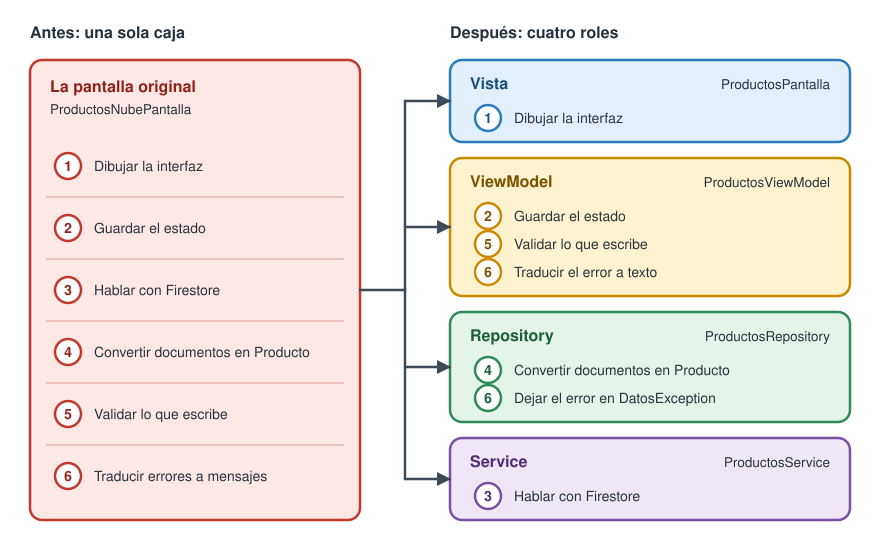
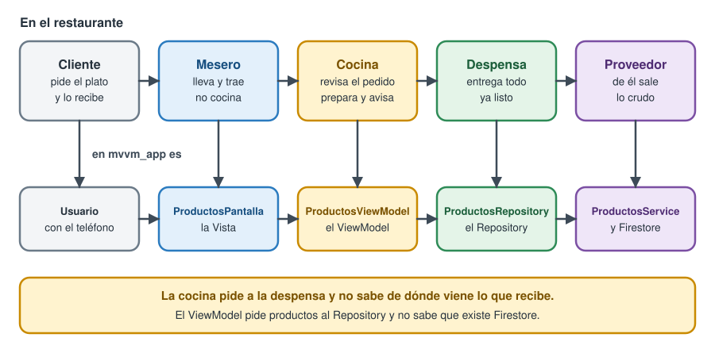
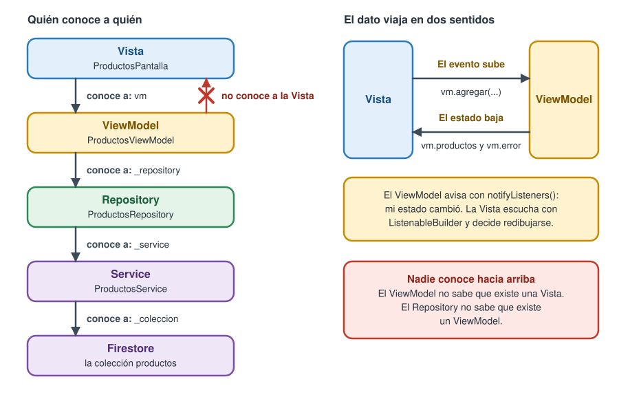
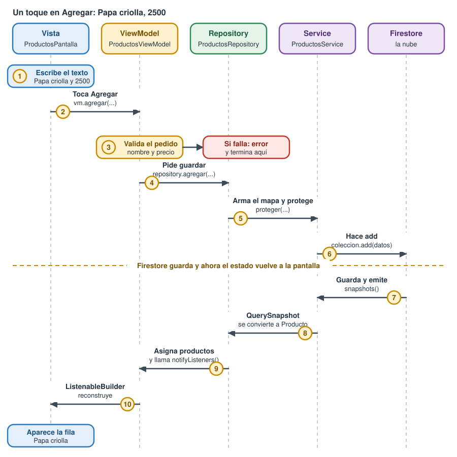
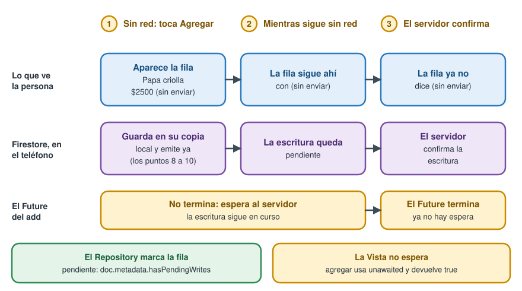
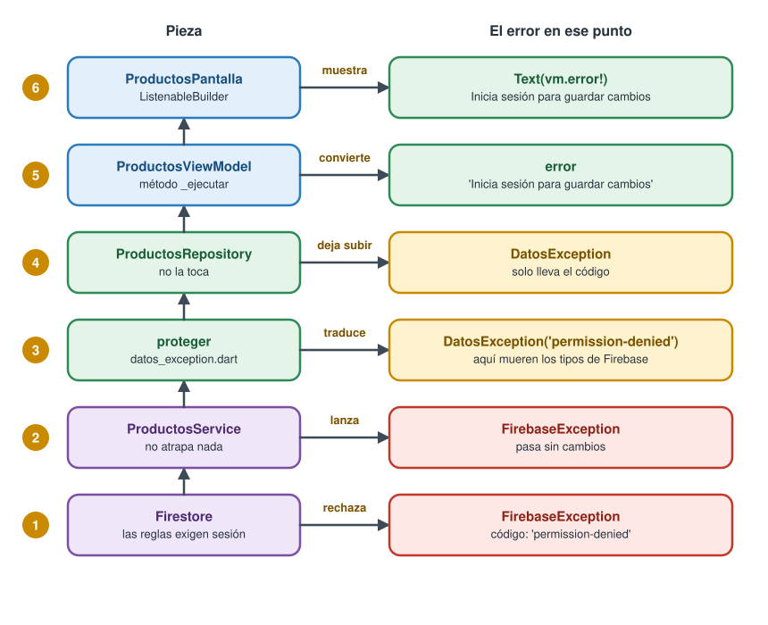
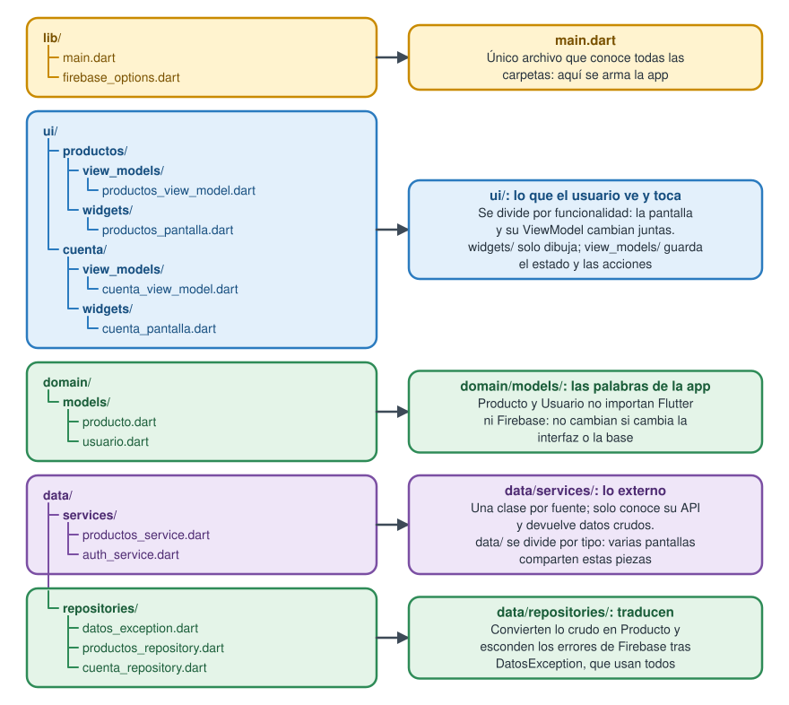
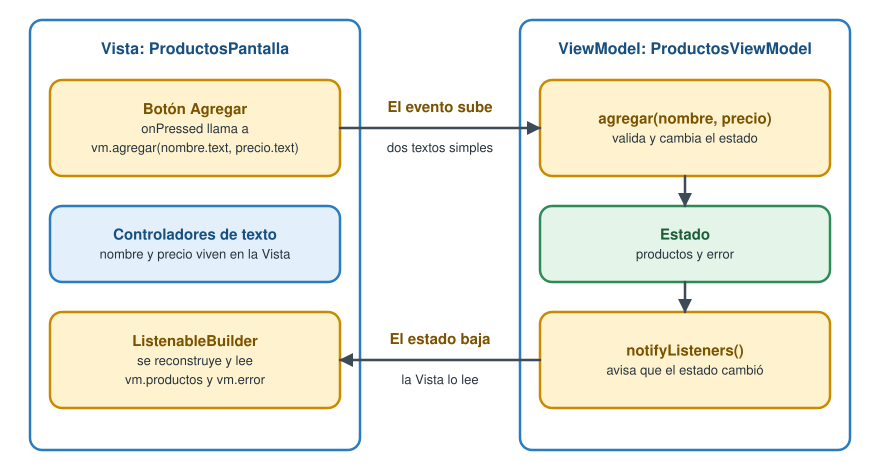
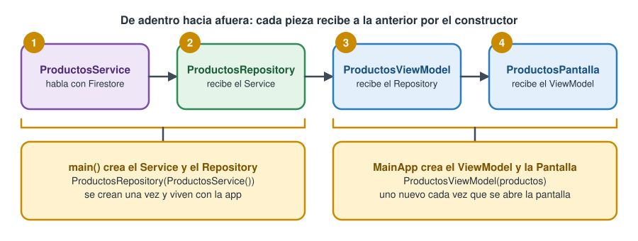
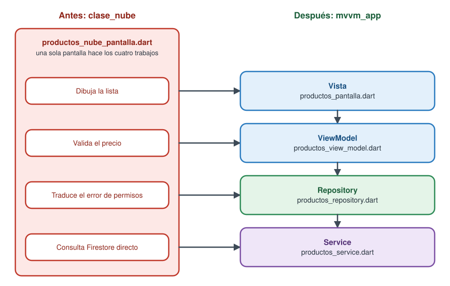

::: {.ficha}
|                 |                                                                                     |
|-----------------|-------------------------------------------------------------------------------------|
| Qué construyes  | **mvvm_app**, la misma app de productos y cuentas de `clase_nube`, reorganizada en Vista, ViewModel, Repository y Service, con pruebas que no necesitan Firebase |
| Prerrequisitos  | La guía de persistencia local y Firebase: ya tienes una app que guarda productos en Firestore y permite registrar, iniciar y cerrar sesión. No necesitas el código de esa app, se reconstruye aquí |
| Herramientas    | Flutter 3.41.9, Dart 3.11.5, VS Code, un emulador o un teléfono con Android, Node.js y una cuenta de Google |
:::

::: {.acceso}
::: {.acceso-item}
Presentación interactiva: las tres piezas de MVVM en movimiento y el recorrido de un toque en Agregar, de punta a punta

[Abrir la presentación](presentacion-interactiva.html){.btn-doc target="_blank"}
:::
:::


Ya tienes una app que guarda productos en Firestore y permite registrar, iniciar y cerrar sesión. Funciona, pero cada pantalla hace demasiado: dibuja la interfaz, guarda el estado, habla con Firebase, convierte los documentos en objetos, valida lo que escribe el usuario y traduce los errores a mensajes. Esta guía construye la misma funcionalidad con otra organización: Vista, ViewModel y Repository. No se agrega ninguna función nueva; lo que cambia es dónde vive cada trabajo y, por eso, qué archivo hay que abrir cuando algo cambia.

Construyes un proyecto nuevo llamado `mvvm_app`, desde cero, un archivo a la vez y de adentro hacia afuera: primero lo que no depende de nada (los modelos), al final lo que depende de todo (la pantalla y el `main`). Así cada archivo que escribes compila apenas lo guardas. En cada paso encuentras qué se hace y por qué, el archivo completo, qué debes ver al terminar, el error más probable y cómo se compara con el código "antes", el de la pantalla original de `clase_nube`.

::: {.callout-note}
## Recuerda antes de empezar

**Instalar y preparar**

- **Versiones.** El código de esta guía se verificó con Flutter 3.41.9 (Dart 3.11.5) y con los paquetes en la versión exacta que se indica abajo.
- **Dependencias con versión fija.** `flutter pub add cloud_firestore:7.1.0 firebase_auth:7.0.1 firebase_core:5.1.0`. Sin versión se instala la última, y una versión mayor puede cambiar la API.
- **Herramientas de Firebase, una sola vez por equipo.** `dart pub global activate flutterfire_cli` y `firebase login`.

**Conectar con Firebase**

- **Conectar la app.** `flutterfire configure` se ejecuta desde la carpeta `mvvm_app`, después de instalar `firebase_core`. Elige el proyecto de Firebase de siempre, deja marcada solo `android` y confirma que el identificador sea `co.edu.iue.mvvm_app`. Genera `lib/firebase_options.dart` y `android/app/google-services.json`; no se editan a mano.
- **Consola de Firebase.** Authentication con el método de correo y contraseña habilitado. Base de Firestore creada, con la colección `productos`. Reglas: `allow read: if true;` y `allow write: if request.auth != null;`. Sin esas reglas, o sin sesión iniciada, toda escritura responde `permission-denied` y la app muestra "Inicia sesión para guardar cambios".
- **Inicio en `main.dart`.** `WidgetsFlutterBinding.ensureInitialized()` y `await Firebase.initializeApp(options: DefaultFirebaseOptions.currentPlatform)` van antes de `runApp`. Sin ellos, Firebase avisa que no existe la app por defecto.
- **Sin internet.** Firestore guarda una copia local en Android: la lista se lee sin conexión y las escrituras quedan pendientes y el producto aparece con "(sin enviar)" mientras el servidor no confirme. El `Future` de `agregar` no termina hasta que el servidor confirma, y por eso la vista no espera su resultado.

**Probar**

- **Dónde probar.** En el emulador de Android o en un teléfono; el proyecto se crea solo con la plataforma `android`.
- **Comprobaciones.** `flutter analyze` debe responder `No issues found!` y `flutter test` debe pasar. Las pruebas no necesitan Firebase, porque usan un repositorio falso.

:::

::: {.callout-warning collapse="true"}
## Si la compilación para Android falla con "Module was compiled with an incompatible version of Kotlin"

Con las versiones fijadas de Firebase, el plugin de Kotlin que genera `flutter create` (2.2.20) es demasiado viejo: `firebase_auth` falla con `Module was compiled with an incompatible version of Kotlin`. En `android/settings.gradle.kts` cambia la versión del plugin `org.jetbrains.kotlin.android` a `2.3.21`. En `android/app/build.gradle.kts` quita el bloque `kotlinOptions { jvmTarget = ... }` y, fuera del bloque `android { }`, escribe `kotlin { compilerOptions { jvmTarget = org.jetbrains.kotlin.gradle.dsl.JvmTarget.JVM_17 } }`. Con ese cambio `flutter build apk --debug` compila (verificado con este proyecto).
:::

::: {.diagrama}
{fig-alt="Una caja roja con seis trabajos numerados (dibujar, guardar el estado, hablar con Firestore, convertir documentos, validar, traducir errores) se reparte entre cuatro cajas de colores: Vista, ViewModel, Repository y Service. Cada caja lista los números de los trabajos que le tocan."}

La pantalla original hacía seis trabajos a la vez; ahora cada uno vive en un solo rol.
:::


Los seis trabajos de la pantalla original, y el rol que se queda con cada uno al terminar esta guía:

| Trabajo que hacía la pantalla | Dónde cae ahora | Archivo |
|---|---|---|
| Dibujar la interfaz | Vista | `ui/productos/widgets/productos_pantalla.dart` |
| Guardar el estado (la lista, el error) | ViewModel | `ui/productos/view_models/productos_view_model.dart` |
| Hablar con Firestore | Service | `data/services/productos_service.dart` |
| Convertir documentos en `Producto` | Repository | `data/repositories/productos_repository.dart` |
| Validar lo que escribe el usuario | ViewModel | `ui/productos/view_models/productos_view_model.dart` |
| Traducir errores a mensajes | Repository (excepción propia) y ViewModel (texto) | `datos_exception.dart` y el ViewModel |

## Cómo funciona MVVM antes de escribir código

Antes del Paso 0 conviene ver la arquitectura funcionando en el papel: quién hace qué y por dónde viaja un toque del usuario. Esta sección es la versión escrita de las dos diapositivas que explican MVVM en movimiento. No se escribe código todavía; los fragmentos son copias exactas de los archivos que construyes en los pasos 2 a 13, y cada punto del recorrido dice en qué paso de la guía se escribe el archivo.

### La analogía del restaurante

Un restaurante separa tres trabajos para que nadie haga todo a la vez. El cliente pide, el mesero lleva y trae, y la cocina decide y prepara. La cocina tampoco compra en el mercado: de eso se encarga la despensa, que a su vez tiene un proveedor.

::: {.diagrama}
{fig-alt="Dos filas de cinco cajas unidas por flechas: arriba Cliente, Mesero, Cocina, Despensa y Proveedor, abajo su equivalente en la app: Usuario, ProductosPantalla, ProductosViewModel, ProductosRepository y ProductosService con Firestore. Una nota explica que la cocina no sabe de dónde viene lo que recibe."}

Cada pieza del restaurante tiene su pareja exacta en mvvm_app.
:::

| En el restaurante | En `mvvm_app` | Qué es |
|---|---|---|
| El cliente | El usuario con el teléfono | Quien toca y escribe |
| El mesero | `ProductosPantalla`, la Vista | Muestra la carta (la lista) y anota el pedido (lo que se escribe y se toca). No cocina |
| La cocina | `ProductosViewModel`, el ViewModel | Revisa el pedido, decide si es válido, lo prepara y avisa cuando el plato está listo. No sale al salón |
| La despensa | `ProductosRepository`, el Repository | Entrega los ingredientes ya listos, como `Producto`. La cocina no sabe de dónde vienen |
| El proveedor | `ProductosService` y Firestore | De donde sale el ingrediente crudo. Solo él conoce la nube |
| El plato | `Producto`, el modelo de dominio | La palabra que usan todos para hablar de lo mismo |

Lo importante está en la despensa: la cocina pide ingredientes a la despensa y no le importa si el proveedor es una granja o un supermercado. Del mismo modo, el ViewModel pide productos al Repository y no sabe si vienen de Firestore.

### Qué hace cada pieza y qué no

| Pieza | Qué hace | Qué NO hace |
|---|---|---|
| Vista (`ProductosPantalla`) | Dibuja el estado que tiene el ViewModel. Guarda lo que es solo de la interfaz, los controladores de texto. Avisa al ViewModel lo que el usuario tocó | No valida, no decide, no guarda el estado de la app y no habla con Firestore |
| ViewModel (`ProductosViewModel`) | Guarda el estado (`productos` y `error`), valida lo que se escribe, traduce los errores a texto y avisa con `notifyListeners()` cuando algo cambia | No importa ningún widget, no conoce la Vista y no conoce Firestore ni sus tipos |
| Repository (`ProductosRepository`) | Ofrece los datos como `Producto`, convierte los documentos, arma el mapa que se guarda y deja los errores de Firebase en un `DatosException` | No dibuja, no valida lo que escribe el usuario y no decide qué texto ve la persona |
| Service (`ProductosService`) | Habla con la colección `productos` de Firestore y devuelve datos crudos | No convierte, no valida y no atrapa errores |
| Modelo de dominio (`Producto`) | Representa un producto con sus campos, todos `final` | No importa Flutter ni Firebase y no cambia: si algo cambia, llega otro `Producto` |

### Quién conoce a quién

La Vista conoce al ViewModel, el ViewModel conoce al Repository y el Repository conoce al Service. Nadie conoce hacia arriba: el ViewModel no sabe que existe una Vista y el Repository no sabe que existe un ViewModel.

::: {.diagrama}
{fig-alt="Una pila de cinco cajas (Vista, ViewModel, Repository, Service, Firestore) con flechas hacia abajo que dicen conoce a, y una flecha roja tachada del ViewModel a la Vista. A la derecha, dos flechas entre Vista y ViewModel muestran que el evento sube con vm.agregar y el estado baja con vm.productos y vm.error."}

Cada pieza conoce solo a la de abajo; al ViewModel le basta avisar que su estado cambió.
:::

```
Vista (ProductosPantalla)
   |  conoce a
   v
ViewModel (ProductosViewModel)
   |  conoce a
   v
Repository (ProductosRepository)
   |  conoce a
   v
Service (ProductosService), que habla con Firestore
```

Cada "conoce a" es un campo que la pieza recibe por el constructor, tal como queda escrito en el código:

```dart
  ProductosViewModel get vm => widget.viewModel;
```

```dart
  final ProductosRepository _repository;
```

```dart
  final ProductosService _service;
```

Como el ViewModel no conoce a la Vista, no puede decirle "dibújate de nuevo". Lo que hace es avisar "mi estado cambió" a quien quiera escuchar, y la Vista es quien decide escuchar. Por eso se dice: los eventos suben, el estado baja.

| Sentido | Qué viaja | Cómo viaja | En el código |
|---|---|---|---|
| Sube (Vista a ViewModel) | El evento: algo que el usuario hizo | Una llamada a una función del ViewModel | `vm.agregar(nombre.text, precio.text)` |
| Baja (ViewModel a Vista) | El estado: lo que hay que mostrar ahora | El ViewModel llama a `notifyListeners()` y el `ListenableBuilder` de la Vista vuelve a ejecutar su `builder` | `vm.productos` y `vm.error` |

El estado nunca se le entrega a la Vista como respuesta de una función: la Vista lo lee del ViewModel cada vez que se redibuja. Con eso, la Vista es una función del estado: el mismo estado produce siempre la misma pantalla.

### Recorrido de un toque en Agregar, de punta a punta

El usuario escribe `Papa criolla` y `2500` y toca Agregar. Estos son los diez puntos, en el orden exacto en que ocurren, con la línea real que ejecuta cada uno.

::: {.diagrama}
{fig-alt="Diagrama de secuencia con cinco columnas (Vista, ViewModel, Repository, Service, Firestore) y diez flechas numeradas desde que se escribe el texto hasta que aparece la fila Papa criolla. Una línea punteada separa el viaje del evento hacia Firestore del regreso del estado, y una rama marca que si la validación falla el recorrido termina en el paso 3."}

Los diez pasos de un toque en Agregar, con el evento hacia Firestore y el estado de vuelta a la pantalla.
:::

**1. El usuario escribe.** Los dos campos de texto tienen un `TextEditingController`. Ellos guardan lo escrito dentro de la Vista; todavía no existe ningún evento. Archivo `ProductosPantalla` (clase `_ProductosPantallaState`). Se escribe en el paso 11 de la guía.

```dart
  final nombre = TextEditingController();
  final precio = TextEditingController();
```

**2. Toca Agregar y el evento sube.** El botón llama al método `agregar` de la Vista, que le pasa el texto crudo al ViewModel con `vm.agregar(...)`. Este es el evento que sube. Archivo `ProductosPantalla`, método `agregar`. Se escribe en el paso 11 de la guía.

```dart
  void agregar() {
    if (vm.agregar(nombre.text, precio.text)) {
      nombre.clear();
      precio.clear();
    }
  }
```

**3. El ViewModel valida.** Intenta convertir el precio con `int.tryParse` y comprueba que el nombre no esté vacío y que el precio sea mayor que cero. Si algo falla, asigna `error`, notifica y devuelve `false`: ahí termina el recorrido y la Vista muestra el mensaje. Archivo `ProductosViewModel`, método `agregar`. Se escribe en el paso 9 de la guía.

```dart
    final valor = int.tryParse(precio);
    if (nombre.trim().isEmpty || valor == null || valor <= 0) {
      error = 'Escribe un nombre y un precio mayor que cero';
      _notificar();
      return false;
    }
```

**4. Si es válido, llama al Repository.** El ViewModel no espera el resultado: lanza la escritura con `unawaited` y devuelve `true` de inmediato, por eso la Vista vacía los campos. Archivo `ProductosViewModel`, método `agregar`. Se escribe en el paso 9 de la guía.

```dart
    unawaited(_ejecutar(() => _repository.agregar(nombre.trim(), valor)));
```

**5. El Repository arma el mapa y protege la llamada.** Convierte los valores en el formato que se guarda en Firestore y llama al Service dentro de `proteger`, que convertirá cualquier error de Firebase en un `DatosException`. Archivo `ProductosRepository`, método `agregar`. Se escribe en el paso 7 de la guía; `proteger` se escribe en el paso 6 de la guía.

```dart
    return proteger(
      () => _service.agregar({
        'nombre': nombre,
        'precio': precio,
        'disponible': true,
      }),
```

**6. El Service hace `add` en Firestore.** Es la única línea de la app que agrega un documento a la colección. Aquí el pedido sale del teléfono hacia la nube. Archivo `ProductosService`, método `agregar`. Se escribe en el paso 4 de la guía.

```dart
  Future<void> agregar(Map<String, dynamic> datos) => _coleccion.add(datos);
```

**7. Firestore guarda y emite el cambio.** Firestore avisa a quien esté escuchando la colección: el flujo `snapshots()` entrega un nuevo `QuerySnapshot` con todos los documentos. Este es el camino de vuelta: el dato regresa como estado, no como respuesta del `add`. Archivo `ProductosService`, método `observar`. Se escribe en el paso 4 de la guía.

```dart
  Stream<QuerySnapshot<Map<String, dynamic>>> observar() {
    return _coleccion.snapshots();
  }
```

**8. El Repository convierte cada documento en `Producto`.** Recibe el `QuerySnapshot` crudo y entrega una `List<Producto>`; el ViewModel nunca ve un documento. Archivo `ProductosRepository`, método `observar` (la conversión de cada documento está en `_aProducto`). Se escribe en el paso 7 de la guía.

```dart
  Stream<List<Producto>> observar() {
    return _service.observar().map(
      (datos) => [for (final doc in datos.docs) _aProducto(doc)],
    );
  }
```

**9. El ViewModel asigna `productos` y notifica.** La lista nueva queda en el estado y `_notificar()` llama a `notifyListeners()`. El estado baja. Archivo `ProductosViewModel`, constructor. Se escribe en el paso 9 de la guía.

```dart
      (lista) {
        productos = lista;
        _notificar();
      },
```

**10. `ListenableBuilder` reconstruye.** Como la Vista escucha al ViewModel, vuelve a ejecutar el `builder`, lee `vm.productos` y la fila `Papa criolla` aparece. Archivo `ProductosPantalla`, método `build`. Se escribe en el paso 11 de la guía.

```dart
        child: ListenableBuilder(
          listenable: vm,
          builder: (context, _) {
            final lista = vm.productos;
```

En resumen: el evento sube por los puntos 1 a 6 (Vista, ViewModel, Repository, Service, Firestore) y el estado baja por los puntos 7 a 10 (Firestore, Service, Repository, ViewModel, Vista). Por eso la Vista nunca pregunta "¿ya se guardó?": solo dibuja el estado cuando le llega.

Por último, la pieza que une todo es `main.dart` (paso 13 de la guía): crea el Service, con él el Repository, y entrega el Repository al ViewModel cuando se abre la pantalla. Ninguna de las otras piezas crea a la que tiene abajo.

### Sin internet

Con el teléfono sin conexión, el recorrido llega hasta el punto 6 y se comporta distinto. Firestore guarda el cambio en su copia local y emite enseguida el punto 7 desde esa copia, así que los puntos 8 a 10 ocurren aunque el servidor no haya confirmado. El Repository marca el producto como pendiente con una sola línea:

::: {.diagrama}
{fig-alt="Tres fases (sin red, mientras sigue sin red, el servidor confirma) en tres filas: lo que ve la persona, Firestore en el teléfono y el Future del add. La fila aparece con (sin enviar), el Future no termina hasta que el servidor confirma, y al confirmar la marca desaparece."}

Sin red la fila aparece pendiente al instante, y el Future espera al servidor sin detener la pantalla.
:::

```dart
      pendiente: doc.metadata.hasPendingWrites,
```

La Vista usa ese campo para mostrar el texto "(sin enviar)" junto al precio:

```dart
      subtitle: Text(
        p.pendiente ? '\$${p.precio} (sin enviar)' : '\$${p.precio}',
      ),
```

El `Future` del `add` no termina hasta que el servidor confirma. Por eso el punto 4 usa `unawaited` y devuelve `true` sin esperar: si la Vista esperara, la pantalla quedaría detenida mientras no haya red. Mientras el servidor no confirme, el producto sigue marcado como pendiente.

### Recorrido de un error: `permission-denied`

Sin sesión iniciada, las reglas de Firestore rechazan la escritura. El error viaja en sentido contrario al evento, y en cada pieza cambia de forma:

::: {.diagrama}
{fig-alt="Seis pasos numerados de abajo hacia arriba muestran cómo cambia de forma un error de permisos: Firestore rechaza, el Service lanza, proteger lo traduce a DatosException, el Repository lo deja subir, el ViewModel lo convierte en el texto del campo error y la Vista lo muestra."}

El error sube por las capas y cambia de forma en cada una, hasta quedar convertido en el texto que lee la persona.
:::

1. **Firestore y el Service.** El `add` falla con una `FirebaseException` cuyo código es `permission-denied`. El Service no atrapa nada y la deja pasar.
2. **El Repository.** `proteger` la atrapa y la convierte en un `DatosException` que lleva solo el código. Aquí mueren los tipos de Firebase. Archivo `datos_exception.dart`, función `proteger`. Se escribe en el paso 6 de la guía.

```dart
  try {
    await accion();
  } on FirebaseException catch (e) {
    throw DatosException(e.code);
  }
```

3. **El ViewModel.** `_ejecutar` atrapa el `DatosException`, traduce el código a un texto para la persona y notifica. Como `agregar` lanzó `_ejecutar` con `unawaited`, el error se maneja aquí adentro y no escapa. Archivo `ProductosViewModel`, método `_ejecutar`. Se escribe en el paso 9 de la guía.

```dart
    } on DatosException catch (e) {
      error = e.codigo == 'permission-denied'
          ? 'Inicia sesión para guardar cambios'
          : 'Error: ${e.codigo}';
      _notificar();
```

4. **La Vista.** Al notificar, el `ListenableBuilder` se ejecuta de nuevo y la línea `if (vm.error != null) Text(vm.error!)` muestra "Inicia sesión para guardar cambios".

```dart
                if (vm.error != null) Text(vm.error!),
```

El texto del mensaje vive en un solo lugar, el ViewModel. El Repository solo deja pasar el código, y la Vista solo muestra lo que hay en `error`. Si mañana el mensaje cambia, se edita `_ejecutar` y no se toca ninguna otra pieza.

## Paso 0. Crear el proyecto, las dependencias y la conexión a Firebase

Qué se hace: crear el proyecto, instalar los tres paquetes de Firebase con versión fija y conectarlo con el proyecto de Firebase que ya usaste.

```
flutter create --empty --org co.edu.iue --platforms=android mvvm_app
cd mvvm_app
flutter pub add cloud_firestore:7.1.0 firebase_auth:7.0.1 firebase_core:5.1.0
```

- `--empty` deja `lib/main.dart` casi vacío, sin la app del contador.
- `--org co.edu.iue` define el identificador de la app en Android: `co.edu.iue.mvvm_app`. Ese identificador se registra en Firebase y no conviene cambiarlo después.
- `flutter pub add` escribe los paquetes en `pubspec.yaml` y los descarga. Las versiones van fijas porque el código de esta guía se verificó con ellas; sin versión se instalaría la última, y una versión mayor puede cambiar la API.

Al terminar, la sección `dependencies:` de `pubspec.yaml` queda así (el resto del archivo lo escribe `flutter create`; no lo cambies):

**pubspec.yaml**

```yaml
dependencies:
  cloud_firestore: 7.1.0
  firebase_auth: 7.0.1
  firebase_core: 5.1.0
  flutter:
    sdk: flutter
```

Conexión a Firebase. Esta guía no repite cómo crear el proyecto en la consola de Firebase, activar Authentication, crear la base de Firestore ni publicar sus reglas: eso está en la guía de persistencia local y nube, en las etapas de Firebase y Authentication y de Firestore. Si ya hiciste esas etapas con `clase_nube`, reutiliza el mismo proyecto de Firebase. Lo único que repites es conectar esta app nueva, desde la carpeta `mvvm_app`:

```
flutterfire configure
```

En las preguntas, elige el proyecto de Firebase de siempre, deja marcada solo `android` y comprueba que el identificador sea `co.edu.iue.mvvm_app`. El comando genera `lib/firebase_options.dart`, genera `android/app/google-services.json` y ajusta los archivos de Gradle. El archivo `firebase_options.dart` se genera ahí: no se escribe ni se edita a mano, y por eso esta guía no lo muestra.

Qué debe verse al terminar: existen `lib/firebase_options.dart` y `android/app/google-services.json`, y `flutter analyze` responde `No issues found!`.

Error más probable: ejecutar `flutterfire configure` antes de instalar `firebase_core`. El archivo generado queda con el error `Target of URI doesn't exist: 'package:firebase_core/firebase_core.dart'`. Se arregla instalando el paquete y volviendo a ejecutar `flutter pub get`. Otro error común es no tener las reglas de Firestore de la guía anterior: sin ellas, la app corre pero toda escritura falla con `permission-denied`.

No toques `lib/main.dart` hasta el paso 13; mientras tanto, la app sigue mostrando la pantalla vacía que dejó `flutter create`.

## Paso 1. La estructura de carpetas, y por qué es así

Qué se hace: crear las carpetas vacías dentro de `lib`. Antes de escribir una sola línea de lógica, el proyecto ya dice dónde va cada cosa.

::: {.diagrama}
{fig-alt="Árbol de la carpeta lib de mvvm_app con cada capa de un color: raíz, ui, domain, data/services y data/repositories, con sus archivos reales. A la derecha, una frase explica por qué existe cada carpeta."}

Cada carpeta tiene su color de capa y una razón para existir: la dirección de las dependencias empieza en ui y termina en data.
:::

```
lib
+-- main.dart
+-- firebase_options.dart
+-- domain
|   +-- models
|       +-- producto.dart
|       +-- usuario.dart
+-- data
|   +-- services
|   |   +-- productos_service.dart
|   |   +-- auth_service.dart
|   +-- repositories
|       +-- datos_exception.dart
|       +-- productos_repository.dart
|       +-- cuenta_repository.dart
+-- ui
    +-- productos
    |   +-- view_models
    |   |   +-- productos_view_model.dart
    |   +-- widgets
    |       +-- productos_pantalla.dart
    +-- cuenta
        +-- view_models
        |   +-- cuenta_view_model.dart
        +-- widgets
            +-- cuenta_pantalla.dart
```

Cada carpeta existe por una razón:

- `ui` guarda lo que el usuario ve y toca. Se divide por funcionalidad (`productos`, `cuenta`) porque cada funcionalidad tiene su propia pantalla y su propio ViewModel, y esas dos piezas cambian juntas: si cambia la pantalla de productos, no abres nada de `cuenta`.
- `ui/<funcionalidad>/widgets` guarda la Vista: los widgets que dibujan. Aquí no hay lógica, solo interfaz.
- `ui/<funcionalidad>/view_models` guarda el ViewModel: el estado de la pantalla y las acciones que el usuario puede hacer. No dibuja nada y no importa ningún widget.
- `domain/models` guarda el modelo de dominio: `Producto` y `Usuario`, las palabras que usa la app para hablar de sus cosas. No importan Flutter ni Firebase, así que no cambian cuando cambia la interfaz o la base.
- `data` guarda todo lo que sabe de dónde vienen y adónde van los datos. Se divide por tipo (`services` y `repositories`) y no por funcionalidad, porque estas piezas se comparten: en una app más grande, varias pantallas leen los mismos productos, y la traducción de errores de `datos_exception.dart` la usan todos los repositorios.
- `data/services` guarda los Services: una clase por fuente externa (Firestore, Authentication) que solo conoce la API de esa fuente y devuelve datos crudos.
- `data/repositories` guarda los Repository: reciben los datos crudos del Service, los convierten a modelos de dominio y esconden los errores de Firebase detrás de una excepción propia.
- `main.dart` queda en la raíz porque es el único archivo que conoce todas las carpetas: es donde se arma la app.

La regla que hace que el orden tenga sentido es la dirección de las dependencias: la Vista conoce al ViewModel; el ViewModel conoce al Repository y a los modelos; el Repository conoce al Service y a los modelos; el Service solo conoce a Firebase. Nunca al revés, y la Vista jamás importa un Service.

Qué debe verse al terminar: en el explorador del editor, las carpetas `domain/models`, `data/services`, `data/repositories`, `ui/productos/view_models`, `ui/productos/widgets`, `ui/cuenta/view_models` y `ui/cuenta/widgets` dentro de `lib`.

Error más probable: poner todo plano en `lib`, o crear `ui/view_models` y `ui/widgets` sin separar por funcionalidad. Funciona, pero cuando agregues una tercera pantalla ya no sabrás qué ViewModel va con qué Vista. También fallan los nombres con mayúsculas o tildes: en Dart los archivos van en minúsculas y con guion bajo.

Contraste con el "antes": en `clase_nube` no había carpetas para esto. `productos_nube_pantalla.dart` (120 líneas) y `cuenta.dart` (121 líneas) vivían junto a `producto_nube.dart` en `lib`, y cada pantalla era a la vez Vista, ViewModel, Repository y Service.

## Paso 2. El modelo de dominio Producto

Qué se hace: crear el objeto que representa un producto en toda la app.

**lib/domain/models/producto.dart**

```dart
class Producto {
  const Producto({
    required this.id,
    required this.nombre,
    required this.precio,
    required this.disponible,
    this.pendiente = false,
  });

  final String id;
  final String nombre;
  final int precio;
  final bool disponible;
  final bool pendiente;
}
```

Por qué así:

- Todos los campos son `final` y el constructor es `const`: un `Producto` no cambia; si cambia algo, llega otro `Producto` desde la base.
- `id` es `String` porque Firestore genera ids de texto. Si copias el `Producto` de la etapa de SQLite, ahí el id era `int`.
- `pendiente` empieza en `false`. Será `true` cuando el producto se guardó en el teléfono pero el servidor todavía no lo confirmó; la Vista usará ese dato para mostrar "(sin enviar)".
- El archivo no tiene ningún `import`: no sabe que existe Firestore. Esa ignorancia es lo que permite cambiar la base sin tocarlo.

Qué debe verse al terminar: `flutter analyze` sin problemas. Todavía no hay nada que ejecutar.

Error más probable: olvidar `required` en un campo y que el editor marque error al construir un `Producto` más adelante.

Contraste con el "antes": el modelo era `ProductoNube` (`producto_nube.dart`, líneas 3 a 25) y tenía un `factory ProductoNube.fromDoc(DocumentSnapshot...)` que leía el documento de Firestore (líneas 15 a 24), así que el archivo importaba `cloud_firestore`: el modelo conocía a la base. Además, el dato de "sin enviar" no estaba en el modelo; la pantalla lo leía directo del documento (`doc.metadata.hasPendingWrites`, línea 110 de `productos_nube_pantalla.dart`). Ahora la conversión se mudó al Repository (paso 7) y `Producto` quedó limpio.

## Paso 3. El modelo de dominio Usuario

Qué se hace: crear el objeto que representa a quien tiene la sesión iniciada.

**lib/domain/models/usuario.dart**

```dart
class Usuario {
  const Usuario(this.correo);

  final String correo;
}
```

Por qué así: la app solo necesita saber el correo de quien inició sesión. Firebase entrega un objeto `User` con muchos más datos; `Usuario` es lo único que el resto de la app va a conocer. Si la cuenta pasa a manejarse con otro proveedor, la Vista y el ViewModel siguen igual.

Qué debe verse al terminar: `flutter analyze` sin problemas.

Error más probable: ninguno propio de este archivo. Lo habitual es dudar de que una clase tan pequeña valga un archivo; vale: es la frontera entre lo que entrega Firebase y lo que usa la app.

Contraste con el "antes": `cuenta.dart` usaba el `User` de Firebase directamente en la interfaz: `StreamBuilder<User?>` y `usuario.email` (líneas 74 a 81). La pantalla dependía del tipo del paquete.

## Paso 4. El Service de productos

Qué se hace: crear la única clase que habla con la colección `productos` de Firestore.

**lib/data/services/productos_service.dart**

```dart
import 'package:cloud_firestore/cloud_firestore.dart';

class ProductosService {
  final _coleccion = FirebaseFirestore.instance.collection('productos');

  Stream<QuerySnapshot<Map<String, dynamic>>> observar() {
    return _coleccion.snapshots();
  }

  Future<void> agregar(Map<String, dynamic> datos) => _coleccion.add(datos);

  Future<void> actualizar(String id, Map<String, dynamic> datos) {
    return _coleccion.doc(id).update(datos);
  }

  Future<void> borrar(String id) => _coleccion.doc(id).delete();
}
```

Por qué así:

- Es un Service: solo conoce la API de Firestore. Recibe y devuelve datos crudos (`Map<String, dynamic>` y `QuerySnapshot`), no `Producto`.
- No valida, no convierte y no atrapa errores. Cada una de esas decisiones pertenece a otra capa.
- Es el único lugar donde aparece el nombre de la colección, `'productos'`. Si la colección cambia de nombre, se edita una línea en un archivo.
- `_coleccion` se calcula al crear el Service, y eso exige que Firebase ya esté inicializado en ese momento. Por eso el `main` (paso 13) inicializa Firebase antes de crear el Service.

Qué debe verse al terminar: `flutter analyze` sin problemas.

Error más probable: crear el Service antes de que termine `Firebase.initializeApp`; en ejecución aparece `No Firebase App '[DEFAULT]' has been created`.

Contraste con el "antes": estas cuatro operaciones estaban repartidas dentro de la pantalla: la colección en la línea 13 de `productos_nube_pantalla.dart`, el `snapshots()` en la línea 71, el `add` en la línea 40, el `update` en la línea 106 y el `delete` en la línea 116. Cada operación quedaba mezclada con widgets.

## Paso 5. El Service de cuenta

Qué se hace: crear la clase que habla con Firebase Authentication.

**lib/data/services/auth_service.dart**

```dart
import 'package:firebase_auth/firebase_auth.dart';

class AuthService {
  final _auth = FirebaseAuth.instance;

  Stream<User?> sesion() => _auth.authStateChanges();

  Future<void> registrar(String correo, String clave) {
    return _auth.createUserWithEmailAndPassword(email: correo, password: clave);
  }

  Future<void> iniciar(String correo, String clave) {
    return _auth.signInWithEmailAndPassword(email: correo, password: clave);
  }

  Future<void> salir() => _auth.signOut();
}
```

Por qué así: igual que el Service anterior, solo expone las operaciones de Authentication con su API original. `sesion()` entrega el flujo de `User?` de Firebase; quien lo consuma (el Repository, en el paso 8) lo convertirá en `Usuario`. El tipo `User` no sale de la carpeta `data`.

Qué debe verse al terminar: `flutter analyze` sin problemas.

Error más probable: el mismo del paso 4: crear `AuthService` antes de inicializar Firebase, porque `FirebaseAuth.instance` se pide al construirlo.

Contraste con el "antes": `cuenta.dart` tenía `final auth = FirebaseAuth.instance;` en la línea 12 y llamaba a `auth.createUserWithEmailAndPassword` (línea 19), `auth.signInWithEmailAndPassword` (línea 28), `auth.authStateChanges()` (línea 75) y `auth.signOut` (línea 83), todo dentro de la clase de la pantalla.

## Paso 6. La excepción propia y proteger

Qué se hace: crear `DatosException` y la función `proteger`, el único punto donde se atrapan los errores de Firebase.

**lib/data/repositories/datos_exception.dart**

```dart
import 'package:firebase_core/firebase_core.dart';

class DatosException implements Exception {
  const DatosException(this.codigo);

  final String codigo;
}

Future<void> proteger(Future<void> Function() accion) async {
  try {
    await accion();
  } on FirebaseException catch (e) {
    throw DatosException(e.code);
  }
}
```

Por qué así:

- `DatosException` lleva solo el `codigo` del error (por ejemplo `permission-denied`). Es el idioma de errores de la app: el ViewModel atrapa `DatosException`, nunca `FirebaseException`.
- `proteger` recibe una función (`Future<void> Function()`), no un `Future` ya iniciado. Por eso ejecuta la acción dentro del `try`: si la acción ya estuviera corriendo, el error escaparía antes de entrar.
- Se atrapa `FirebaseException` porque es la clase base: `FirebaseAuthException` también es un `FirebaseException`, así que `proteger` sirve para productos y para cuenta.
- Vive en `data/repositories` porque la usan todos los Repository, y porque es el límite: los errores de Firebase mueren aquí y no suben.
- Solo protege las acciones que devuelven `Future<void>`. Los errores de un flujo (la lectura en vivo de productos) no pasan por aquí: llegan al `onError` del ViewModel.

Qué debe verse al terminar: `flutter analyze` sin problemas.

Error más probable: pasar la llamada ya hecha en lugar de la función, como `proteger(_service.salir())`. El editor lo marca como error de tipo; lo correcto es pasar la función sin paréntesis (`_service.salir`) o dentro de una flecha (`() => _service.registrar(...)`).

Contraste con el "antes": el `try` y el `on FirebaseException catch (e)` estaban dentro de `probar`, un método de cada pantalla (líneas 18 a 30 de `productos_nube_pantalla.dart` y líneas 35 a 42 de `cuenta.dart`). Eran dos copias del mismo mecanismo, una con `FirebaseException` y otra con `FirebaseAuthException`. Ahora hay una sola.

## Paso 7. El Repository de productos

Qué se hace: crear la clase que ofrece los productos al resto de la app como `Producto`, sin que se note Firestore.

**lib/data/repositories/productos_repository.dart**

```dart
import 'package:cloud_firestore/cloud_firestore.dart';
import 'package:mvvm_app/data/repositories/datos_exception.dart';
import 'package:mvvm_app/data/services/productos_service.dart';
import 'package:mvvm_app/domain/models/producto.dart';

class ProductosRepository {
  ProductosRepository(this._service);

  final ProductosService _service;

  Stream<List<Producto>> observar() {
    return _service.observar().map(
      (datos) => [for (final doc in datos.docs) _aProducto(doc)],
    );
  }

  Future<void> agregar(String nombre, int precio) {
    return proteger(
      () => _service.agregar({
        'nombre': nombre,
        'precio': precio,
        'disponible': true,
      }),
    );
  }

  Future<void> cambiarDisponible(String id, bool disponible) {
    return proteger(() => _service.actualizar(id, {'disponible': disponible}));
  }

  Future<void> borrar(String id) => proteger(() => _service.borrar(id));

  Producto _aProducto(QueryDocumentSnapshot<Map<String, dynamic>> doc) {
    final d = doc.data();
    return Producto(
      id: doc.id,
      nombre: d['nombre'] as String,
      precio: d['precio'] as int,
      disponible: d['disponible'] as bool,
      pendiente: doc.metadata.hasPendingWrites,
    );
  }
}
```

Por qué así:

- Recibe el Service por el constructor (`ProductosRepository(this._service)`): no lo crea él. Quien arma la app decide qué Service le da.
- `observar()` toma el flujo crudo del Service y lo convierte: cada actualización de Firestore sale como una `List<Producto>`. El ViewModel nunca ve un documento.
- `agregar` arma el mapa que se guarda, con `'disponible': true` para todo producto nuevo. El formato de los datos en Firestore se decide solo en este archivo.
- `agregar`, `cambiarDisponible` y `borrar` pasan por `proteger`, así que fallan con `DatosException`.
- `_aProducto` es la conversión: lee los campos del documento y copia `doc.metadata.hasPendingWrites` al campo `pendiente`.

Qué debe verse al terminar: `flutter analyze` sin problemas.

Error más probable: `type 'double' is not a subtype of type 'int' in type cast` en `_aProducto`, cuando alguien escribió el precio con decimales a mano en la consola de Firestore. El código asume que `precio` es entero, como lo guarda la app.

Contraste con el "antes": la conversión estaba en `ProductoNube.fromDoc` (`producto_nube.dart`) y se llamaba desde la pantalla (línea 101 de `productos_nube_pantalla.dart`); el armado del mapa estaba en `agregar` de la pantalla (líneas 33 a 37); y el `StreamBuilder` consumía `QuerySnapshot` directamente (líneas 70 a 76). Ahora esos tres trabajos están en un solo archivo que no dibuja nada.

## Paso 8. El Repository de cuenta

Qué se hace: crear la clase que ofrece la sesión y las acciones de cuenta sin exponer los tipos de Firebase.

**lib/data/repositories/cuenta_repository.dart**

```dart
import 'package:mvvm_app/data/repositories/datos_exception.dart';
import 'package:mvvm_app/data/services/auth_service.dart';
import 'package:mvvm_app/domain/models/usuario.dart';

class CuentaRepository {
  CuentaRepository(this._service);

  final AuthService _service;

  Stream<Usuario?> sesion() {
    return _service.sesion().map(
      (user) => user == null ? null : Usuario(user.email ?? ''),
    );
  }

  Future<void> registrar(String correo, String clave) {
    return proteger(() => _service.registrar(correo, clave));
  }

  Future<void> iniciar(String correo, String clave) {
    return proteger(() => _service.iniciar(correo, clave));
  }

  Future<void> salir() => proteger(_service.salir);
}
```

Por qué así:

- `sesion()` convierte el flujo de `User?` de Firebase en un flujo de `Usuario?`: `null` significa que no hay sesión. Si Firebase no entrega correo, se usa un texto vacío.
- `registrar`, `iniciar` y `salir` pasan por `proteger`, igual que en productos. Fíjate en `proteger(_service.salir)`: se pasa la función sin paréntesis.
- Este Repository no sabe qué mensaje verá el usuario; solo deja pasar el código del error.

Qué debe verse al terminar: `flutter analyze` sin problemas.

Error más probable: escribir `Usuario(correo: ...)`. El constructor de `Usuario` recibe el correo como parámetro posicional, sin nombre.

Contraste con el "antes": `registrar` e `iniciar` vivían en la pantalla (líneas 17 a 33 de `cuenta.dart`) y atrapaban `FirebaseAuthException` en la línea 39. La pantalla además decidía el formato del correo con `correo.text.trim()`; ese recorte ahora está en el ViewModel (paso 10).

## Paso 9. El ViewModel de productos

Qué se hace: crear la clase que guarda el estado de la pantalla de productos y ofrece las acciones que el usuario puede hacer.

**lib/ui/productos/view_models/productos_view_model.dart**

```dart
import 'dart:async';

import 'package:flutter/foundation.dart';
import 'package:mvvm_app/data/repositories/datos_exception.dart';
import 'package:mvvm_app/data/repositories/productos_repository.dart';
import 'package:mvvm_app/domain/models/producto.dart';

class ProductosViewModel extends ChangeNotifier {
  ProductosViewModel(this._repository) {
    _suscripcion = _repository.observar().listen(
      (lista) {
        productos = lista;
        _notificar();
      },
      onError: (_) {
        productos = const [];
        error = 'No se pudo leer los productos';
        _notificar();
      },
    );
  }

  final ProductosRepository _repository;
  late final StreamSubscription<List<Producto>> _suscripcion;
  bool _cerrado = false;

  List<Producto>? productos;
  String? error;

  bool agregar(String nombre, String precio) {
    final valor = int.tryParse(precio);
    if (nombre.trim().isEmpty || valor == null || valor <= 0) {
      error = 'Escribe un nombre y un precio mayor que cero';
      _notificar();
      return false;
    }
    unawaited(_ejecutar(() => _repository.agregar(nombre.trim(), valor)));
    return true;
  }

  Future<void> cambiarDisponible(String id, bool disponible) {
    return _ejecutar(() => _repository.cambiarDisponible(id, disponible));
  }

  Future<void> borrar(String id) => _ejecutar(() => _repository.borrar(id));

  Future<void> _ejecutar(Future<void> Function() accion) async {
    error = null;
    _notificar();
    try {
      await accion();
    } on DatosException catch (e) {
      error = e.codigo == 'permission-denied'
          ? 'Inicia sesión para guardar cambios'
          : 'Error: ${e.codigo}';
      _notificar();
    }
  }

  void _notificar() {
    if (!_cerrado) notifyListeners();
  }

  @override
  void dispose() {
    _cerrado = true;
    _suscripcion.cancel();
    super.dispose();
  }
}
```

Por qué así:

- Extiende `ChangeNotifier`: cuando su estado cambia llama a `notifyListeners()` (dentro de `_notificar`), y quien lo escuche se redibuja. Es el mecanismo del que se cuelga la Vista.
- El estado son dos campos públicos: `productos` y `error`. `productos` vale `null` mientras carga; la Vista lo usa para mostrar el indicador de progreso. Si la lectura falla, `productos` pasa a lista vacía y `error` explica por qué, para que el indicador no quede girando para siempre.
- `agregar` es donde cae la validación: el nombre no puede estar vacío y el precio debe ser un entero mayor que cero. Si no se cumple, deja el mensaje en `error` y devuelve `false`, y no llama al Repository. Si se cumple, devuelve `true`.
- `agregar` devuelve un `bool` de inmediato en lugar de un `Future` porque la escritura de Firestore, sin internet, no termina hasta que el servidor confirma. Por eso la llamada va con `unawaited`: la pantalla no se queda esperando; el producto aparece enseguida con `pendiente` en `true`.
- `_ejecutar` es el equivalente de `probar`: limpia el error, ejecuta la acción y, si llega un `DatosException`, lo traduce a texto para el usuario. Es el único lugar con ese texto.
- `_cerrado` y `_notificar` evitan llamar a `notifyListeners()` después de `dispose()`. Una escritura puede terminar cuando la pantalla ya se cerró.
- `dispose` cancela la suscripción al flujo del Repository. Sin eso, la lectura seguiría activa con la pantalla cerrada.
- No importa `package:flutter/material.dart`. Solo `foundation.dart` (para `ChangeNotifier`). Un ViewModel sin widgets se puede probar sin pantalla (paso 14).

Qué debe verse al terminar: `flutter analyze` sin problemas.

Error más probable: olvidar el `dispose`. No marca error; el síntoma es que, tras abrir y cerrar la pantalla varias veces, hay varias suscripciones vivas leyendo la base.

Contraste con el "antes": aquí se juntan cuatro trabajos que estaban en `_ProductosNubePantallaState`. La variable `error` era la línea 16; `probar` ocupaba las líneas 18 a 30, con el texto `'Inicia sesión para guardar cambios'` dentro de la clase de la pantalla; `agregar` tomaba `int.tryParse(precio.text) ?? 0` (línea 35), de modo que un precio inválido se guardaba como cero sin avisar; y los campos se vaciaban antes de saber si se guardó (líneas 38 y 39). La comprobación `if (!mounted) return;` de la línea 23 se reemplaza por `_cerrado`.

## Paso 10. El ViewModel de cuenta

Qué se hace: crear el ViewModel de la pantalla de cuenta, con el mismo molde que el anterior.

**lib/ui/cuenta/view_models/cuenta_view_model.dart**

```dart
import 'dart:async';

import 'package:flutter/foundation.dart';
import 'package:mvvm_app/data/repositories/cuenta_repository.dart';
import 'package:mvvm_app/data/repositories/datos_exception.dart';
import 'package:mvvm_app/domain/models/usuario.dart';

class CuentaViewModel extends ChangeNotifier {
  CuentaViewModel(this._repository) {
    _suscripcion = _repository.sesion().listen((u) {
      usuario = u;
      _notificar();
    });
  }

  final CuentaRepository _repository;
  late final StreamSubscription<Usuario?> _suscripcion;
  bool _cerrado = false;

  Usuario? usuario;
  String? error;

  Future<void> registrar(String correo, String clave) {
    return _ejecutar(() => _repository.registrar(correo.trim(), clave));
  }

  Future<void> iniciar(String correo, String clave) {
    return _ejecutar(() => _repository.iniciar(correo.trim(), clave));
  }

  Future<void> salir() => _ejecutar(_repository.salir);

  Future<void> _ejecutar(Future<void> Function() accion) async {
    error = null;
    _notificar();
    try {
      await accion();
    } on DatosException catch (e) {
      error = _mensajeDe(e.codigo);
      _notificar();
    }
  }

  String _mensajeDe(String codigo) {
    switch (codigo) {
      case 'email-already-in-use':
        return 'Ese correo ya tiene una cuenta';
      case 'weak-password':
        return 'La contraseña es muy corta: usa al menos 6 caracteres';
      case 'invalid-email':
        return 'El correo no tiene un formato válido';
      case 'invalid-credential':
        return 'Correo o contraseña incorrectos';
      case 'network-request-failed':
        return 'Sin conexión: revisa tu internet';
      default:
        return 'Error: $codigo';
    }
  }

  void _notificar() {
    if (!_cerrado) notifyListeners();
  }

  @override
  void dispose() {
    _cerrado = true;
    _suscripcion.cancel();
    super.dispose();
  }
}
```

Por qué así:

- El estado es `usuario` (nulo si no hay sesión) y `error`. El constructor escucha `sesion()` del Repository: cada cambio de sesión actualiza `usuario` y avisa a la Vista.
- `registrar` e `iniciar` recortan los espacios del correo con `trim()`. Es una regla de entrada, y por eso está aquí y no en la pantalla.
- `_mensajeDe` traduce cada código de error al texto para el usuario. Es el mismo texto de siempre; solo cambió de archivo.
- `_ejecutar`, `_notificar`, `_cerrado` y `dispose` cumplen el mismo papel que en el ViewModel de productos (paso 9).

Qué debe verse al terminar: `flutter analyze` sin problemas.

Error más probable: escribir `_repository.salir()` con paréntesis al llamar a `_ejecutar`. `_ejecutar` espera una función, no el resultado de llamarla; se pasa como `_repository.salir`.

Contraste con el "antes": `mensajeDe` vivía en la pantalla (líneas 44 a 59 de `cuenta.dart`), junto con `probar` (líneas 35 a 42) y `setState` para el error (líneas 36 y 40). El `if (mounted)` de la línea 40 vuelve a ser `_cerrado`. Comparado con la pantalla de productos, `probar` estaba repetido casi igual: ahora cada ViewModel tiene su `_ejecutar`, con la parte de Firebase ya resuelta por `proteger`.

## Paso 11. La Vista de productos

Qué se hace: crear la pantalla que dibuja el estado del ViewModel y le avisa de lo que el usuario hace.

::: {.diagrama}
{fig-alt="A la izquierda la Vista (botón Agregar, controladores de texto, ListenableBuilder) y a la derecha el ViewModel (agregar, estado, notifyListeners). Una flecha hacia el ViewModel lleva el evento con dos textos simples, y otra hacia la Vista lleva el aviso de que el estado cambió."}

El evento sube como una llamada con valores simples y el estado baja con notifyListeners; los controladores de texto se quedan en la Vista.
:::

**lib/ui/productos/widgets/productos_pantalla.dart**

```dart
import 'package:flutter/material.dart';
import 'package:mvvm_app/domain/models/producto.dart';
import 'package:mvvm_app/ui/productos/view_models/productos_view_model.dart';

class ProductosPantalla extends StatefulWidget {
  const ProductosPantalla({super.key, required this.viewModel});

  final ProductosViewModel viewModel;

  @override
  State<ProductosPantalla> createState() => _ProductosPantallaState();
}

class _ProductosPantallaState extends State<ProductosPantalla> {
  final nombre = TextEditingController();
  final precio = TextEditingController();

  ProductosViewModel get vm => widget.viewModel;

  void agregar() {
    if (vm.agregar(nombre.text, precio.text)) {
      nombre.clear();
      precio.clear();
    }
  }

  @override
  void dispose() {
    nombre.dispose();
    precio.dispose();
    vm.dispose();
    super.dispose();
  }

  @override
  Widget build(BuildContext context) {
    return Scaffold(
      appBar: AppBar(title: const Text('Productos en la nube')),
      body: Padding(
        padding: const EdgeInsets.all(16),
        child: ListenableBuilder(
          listenable: vm,
          builder: (context, _) {
            final lista = vm.productos;
            return Column(
              children: [
                TextField(
                  controller: nombre,
                  decoration: const InputDecoration(labelText: 'Nombre'),
                ),
                TextField(
                  controller: precio,
                  decoration: const InputDecoration(labelText: 'Precio'),
                  keyboardType: TextInputType.number,
                ),
                FilledButton(onPressed: agregar, child: const Text('Agregar')),
                if (vm.error != null) Text(vm.error!),
                Expanded(
                  child: lista == null
                      ? const Center(child: CircularProgressIndicator())
                      : ListView(children: [for (final p in lista) filaDe(p)]),
                ),
              ],
            );
          },
        ),
      ),
    );
  }

  Widget filaDe(Producto p) {
    return ListTile(
      leading: Switch(
        value: p.disponible,
        onChanged: (v) => vm.cambiarDisponible(p.id, v),
      ),
      title: Text(p.nombre),
      subtitle: Text(
        p.pendiente ? '\$${p.precio} (sin enviar)' : '\$${p.precio}',
      ),
      trailing: IconButton(
        icon: const Icon(Icons.delete),
        onPressed: () => vm.borrar(p.id),
      ),
    );
  }
}
```

Por qué así:

- La pantalla recibe el ViewModel por el constructor (`required this.viewModel`): no lo crea. Quien la abre decide con qué ViewModel (paso 13).
- Sigue siendo un `StatefulWidget` porque es dueña de lo que es solo de la interfaz: los `TextEditingController` de los dos campos. Los controladores no son estado de la app; son detalles de la Vista.
- `ListenableBuilder(listenable: vm, ...)` redibuja el bloque cada vez que el ViewModel notifica. Dentro solo hay lectura: `vm.productos`, `vm.error`.
- `lista == null` muestra el indicador de progreso; si no, la lista de filas. `if (vm.error != null) Text(vm.error!)` muestra el mensaje.
- Los eventos suben por funciones del ViewModel: `vm.agregar(...)`, `vm.cambiarDisponible(...)`, `vm.borrar(...)`. La función `agregar` de la pantalla vacía los campos solo si el ViewModel devolvió `true`.
- Esta pantalla es dueña del ViewModel que recibe: en `dispose` llama a `vm.dispose()`, junto con los controladores. El ViewModel vive tanto como la pantalla.
- La Vista no tiene un solo `if` de negocio: no sabe qué es un precio válido, ni qué dice un error de permisos.

Qué debe verse al terminar: `flutter analyze` sin problemas. Todavía no se puede abrir porque falta el `main` (paso 13).

Error más probable: `A ChangeNotifier was used after being disposed`. Pasa cuando algo más, por ejemplo el `main`, también llama a `vm.dispose()`. Solo debe hacerlo quien es dueño, y aquí es la pantalla.

Contraste con el "antes": la pantalla original tenía `FirebaseFirestore.instance.collection('productos')` (línea 13), un `StreamBuilder<QuerySnapshot...>` leyendo de Firestore (líneas 70 a 91) y filas construidas con `QueryDocumentSnapshot` (línea 100). Ahora el `StreamBuilder` es un `ListenableBuilder`; la rama `if (snap.hasError)` de las líneas 73 y 74 pasó a ser `vm.error`; `ProductoNube.fromDoc` de la línea 101 ya no se llama aquí; y `hasPendingWrites` de la línea 110 es `p.pendiente`. La pantalla ya no importa `cloud_firestore`. Una diferencia a propósito: el encabezado de la versión original que decía si los datos venían del teléfono o del servidor (líneas 79 a 83) no se rehízo.

## Paso 12. La Vista de cuenta

Qué se hace: crear la pantalla de cuenta con el mismo molde: solo lee el ViewModel y le pasa los eventos.

**lib/ui/cuenta/widgets/cuenta_pantalla.dart**

```dart
import 'package:flutter/material.dart';
import 'package:mvvm_app/ui/cuenta/view_models/cuenta_view_model.dart';

class CuentaPantalla extends StatefulWidget {
  const CuentaPantalla({super.key, required this.viewModel});

  final CuentaViewModel viewModel;

  @override
  State<CuentaPantalla> createState() => _CuentaPantallaState();
}

class _CuentaPantallaState extends State<CuentaPantalla> {
  final correo = TextEditingController();
  final clave = TextEditingController();

  CuentaViewModel get vm => widget.viewModel;

  @override
  void dispose() {
    correo.dispose();
    clave.dispose();
    vm.dispose();
    super.dispose();
  }

  @override
  Widget build(BuildContext context) {
    return Scaffold(
      appBar: AppBar(title: const Text('Cuenta')),
      body: Padding(
        padding: const EdgeInsets.all(16),
        child: ListenableBuilder(
          listenable: vm,
          builder: (context, _) {
            final usuario = vm.usuario;
            if (usuario != null) {
              return Column(
                children: [
                  Text('Sesión iniciada: ${usuario.correo}'),
                  FilledButton(
                    onPressed: vm.salir,
                    child: const Text('Cerrar sesión'),
                  ),
                ],
              );
            }
            return Column(
              children: [
                TextField(
                  controller: correo,
                  decoration: const InputDecoration(labelText: 'Correo'),
                  keyboardType: TextInputType.emailAddress,
                ),
                TextField(
                  controller: clave,
                  decoration: const InputDecoration(labelText: 'Contraseña'),
                  obscureText: true,
                ),
                if (vm.error != null) Text(vm.error!),
                Row(
                  children: [
                    FilledButton(
                      onPressed: () => vm.registrar(correo.text, clave.text),
                      child: const Text('Registrar'),
                    ),
                    TextButton(
                      onPressed: () => vm.iniciar(correo.text, clave.text),
                      child: const Text('Iniciar sesión'),
                    ),
                  ],
                ),
              ],
            );
          },
        ),
      ),
    );
  }
}
```

Por qué así:

- `vm.usuario` decide qué mostrar: si no es nulo, el correo y el botón de cerrar sesión; si es nulo, el formulario.
- Los botones llaman al ViewModel con los textos de los campos: `vm.registrar(correo.text, clave.text)`. La Vista no recorta ni valida nada.
- El botón de cerrar sesión usa `vm.salir` sin paréntesis: es la función misma, no su resultado.
- Igual que antes, la pantalla es dueña del ViewModel: lo libera en `dispose`.

Qué debe verse al terminar: `flutter analyze` sin problemas.

Error más probable: escribir `onPressed: vm.registrar(correo.text, clave.text)` sin la flecha `() =>`. Eso ejecuta el registro al dibujar la pantalla, no al tocar el botón.

Contraste con el "antes": el `StreamBuilder<User?>` sobre `auth.authStateChanges()` (líneas 74 a 76) es ahora un `ListenableBuilder`, y el `onPressed: auth.signOut` de la línea 83 es `vm.salir`. Los métodos `registrar`, `iniciar`, `probar` y `mensajeDe` que ocupaban las líneas 17 a 59 ya no están en el archivo.

## Paso 13. La composición en main.dart

Qué se hace: armar la app. `main.dart` es el único archivo que conoce todas las piezas y las conecta.

::: {.diagrama}
{fig-alt="Cuatro cajas numeradas de izquierda a derecha: Service, Repository, ViewModel y Pantalla, cada una recibe a la anterior por el constructor. Dos llaves muestran que main crea las dos primeras y MainApp crea las dos últimas."}

La app se arma de adentro hacia afuera: main crea el Service y el Repository, y MainApp crea el ViewModel y la Pantalla al abrirla.
:::

**lib/main.dart**

```dart
import 'package:firebase_core/firebase_core.dart';
import 'package:flutter/material.dart';
import 'package:mvvm_app/data/repositories/cuenta_repository.dart';
import 'package:mvvm_app/data/repositories/productos_repository.dart';
import 'package:mvvm_app/data/services/auth_service.dart';
import 'package:mvvm_app/data/services/productos_service.dart';
import 'package:mvvm_app/firebase_options.dart';
import 'package:mvvm_app/ui/cuenta/view_models/cuenta_view_model.dart';
import 'package:mvvm_app/ui/cuenta/widgets/cuenta_pantalla.dart';
import 'package:mvvm_app/ui/productos/view_models/productos_view_model.dart';
import 'package:mvvm_app/ui/productos/widgets/productos_pantalla.dart';

Future<void> main() async {
  WidgetsFlutterBinding.ensureInitialized();
  await Firebase.initializeApp(options: DefaultFirebaseOptions.currentPlatform);
  runApp(
    MaterialApp(
      home: MainApp(
        productos: ProductosRepository(ProductosService()),
        cuenta: CuentaRepository(AuthService()),
      ),
    ),
  );
}

class MainApp extends StatelessWidget {
  const MainApp({super.key, required this.productos, required this.cuenta});

  final ProductosRepository productos;
  final CuentaRepository cuenta;

  void abrir(BuildContext context, Widget pantalla) {
    Navigator.push(context, MaterialPageRoute(builder: (_) => pantalla));
  }

  @override
  Widget build(BuildContext context) {
    return Scaffold(
      appBar: AppBar(title: const Text('mvvm_app')),
      body: ListView(
        children: [
          ListTile(
            title: const Text('Cuenta'),
            onTap: () => abrir(
              context,
              CuentaPantalla(viewModel: CuentaViewModel(cuenta)),
            ),
          ),
          ListTile(
            title: const Text('Productos en la nube'),
            onTap: () => abrir(
              context,
              ProductosPantalla(viewModel: ProductosViewModel(productos)),
            ),
          ),
        ],
      ),
    );
  }
}
```

Por qué así, quién crea qué:

- `main` inicializa Firebase primero (`await Firebase.initializeApp(...)`), con las opciones que generó `flutterfire configure`. Solo después crea los Services, y por eso no falla el problema del paso 4.
- `main` crea los Services y, con cada uno, su Repository: `ProductosRepository(ProductosService())` y `CuentaRepository(AuthService())`. Se crean una sola vez y viven mientras viva la app.
- `MainApp` recibe los Repository por el constructor, no los crea.
- El ViewModel lo crea `MainApp` en el momento de abrir la pantalla (`onTap`): `ProductosViewModel(productos)`. Cada vez que el usuario entra, hay un ViewModel nuevo, y al salir lo libera la propia pantalla (pasos 11 y 12). La regla: quien crea no es dueño; el dueño es la pantalla que lo recibe y lo libera.
- Esta es la composición hecha a mano: cada pieza se entrega a quien la necesita, de afuera hacia adentro.

Qué debe verse al terminar: `flutter analyze` sin problemas. Ejecuta la app (`flutter run`) y comprueba cada funcionalidad. El menú muestra "Cuenta" y "Productos en la nube". En Cuenta, registra un usuario: aparece "Sesión iniciada" con tu correo; cierra sesión y vuelve a iniciar; con una clave de menos de seis caracteres aparece el mensaje de contraseña corta. En Productos, la lista aparece sola; agrega uno con nombre y precio; un precio de cero o un nombre vacío muestra "Escribe un nombre y un precio mayor que cero" y no escribe nada; el interruptor cambia la disponibilidad y el icono borra; sin sesión iniciada, cualquier escritura muestra "Inicia sesión para guardar cambios".

Error más probable: crear el ViewModel dentro del `build` de la pantalla en lugar de pasarlo desde fuera. Cada redibujo crearía un ViewModel nuevo y se perdería el estado. Si no ves ningún producto y no hay error, revisa que la colección de Firestore se llame `productos`, como en el Service.

Contraste con el "antes": el menú de `clase_nube` abría `ProductosNubePantalla()` y `CuentaPantalla()` sin parámetros, y cada una creaba sus propias conexiones a Firebase por dentro. Ahora las pantallas reciben sus dependencias.

## Paso 14. Las pruebas

Qué se hace: probar el ViewModel de productos sin pantalla, sin internet y sin Firebase.

**test/productos_view_model_test.dart**

```dart
import 'dart:async';

import 'package:flutter_test/flutter_test.dart';
import 'package:mvvm_app/data/repositories/datos_exception.dart';
import 'package:mvvm_app/data/repositories/productos_repository.dart';
import 'package:mvvm_app/domain/models/producto.dart';
import 'package:mvvm_app/ui/productos/view_models/productos_view_model.dart';

class RepositorioFalso implements ProductosRepository {
  final lista = StreamController<List<Producto>>();
  final agregados = <(String, int)>[];
  DatosException? fallo;

  @override
  Stream<List<Producto>> observar() => lista.stream;

  @override
  Future<void> agregar(String nombre, int precio) async {
    if (fallo != null) throw fallo!;
    agregados.add((nombre, precio));
  }

  @override
  Future<void> cambiarDisponible(String id, bool disponible) async {
    if (fallo != null) throw fallo!;
  }

  @override
  Future<void> borrar(String id) async {
    if (fallo != null) throw fallo!;
  }
}

Future<void> esperar() => Future<void>.delayed(Duration.zero);

void main() {
  late RepositorioFalso repo;
  late ProductosViewModel vm;

  setUp(() {
    repo = RepositorioFalso();
    vm = ProductosViewModel(repo);
  });

  tearDown(() => vm.dispose());

  test('empieza cargando y muestra la lista cuando llega', () async {
    expect(vm.productos, isNull);
    repo.lista.add(const [
      Producto(id: '1', nombre: 'Panela', precio: 3500, disponible: true),
    ]);
    await esperar();
    expect(vm.productos!.single.nombre, 'Panela');
  });

  test('rechaza un precio que no es mayor que cero', () async {
    expect(vm.agregar('Papa criolla', '0'), isFalse);
    expect(vm.agregar('Papa criolla', 'abc'), isFalse);
    expect(vm.agregar('  ', '2000'), isFalse);
    expect(vm.error, 'Escribe un nombre y un precio mayor que cero');
    await esperar();
    expect(repo.agregados, isEmpty);
  });

  test('agrega un producto valido y limpia el error', () async {
    vm.agregar('Papa criolla', 'x');
    expect(vm.agregar(' Papa criolla ', '2500'), isTrue);
    await esperar();
    expect(repo.agregados.single, ('Papa criolla', 2500));
    expect(vm.error, isNull);
  });

  test('traduce permission-denied a un mensaje para el usuario', () async {
    repo.fallo = const DatosException('permission-denied');
    await vm.borrar('1');
    expect(vm.error, 'Inicia sesión para guardar cambios');
  });

  test('otros errores muestran su codigo', () async {
    repo.fallo = const DatosException('unavailable');
    await vm.cambiarDisponible('1', false);
    expect(vm.error, 'Error: unavailable');
  });

  test('un error al leer deja la lista vacia y avisa', () async {
    repo.lista.addError('boom');
    await esperar();
    expect(vm.productos, isEmpty);
    expect(vm.error, 'No se pudo leer los productos');
  });
}
```

Por qué así:

- `RepositorioFalso implements ProductosRepository`: en Dart toda clase también sirve como interfaz, así que el falso reemplaza al Repository real sin cambiar el ViewModel. Su `StreamController` deja que la prueba decida cuándo llega la lista o un error.
- Con `fallo` la prueba obliga al falso a lanzar un `DatosException`, sin necesidad de que Firebase falle.
- `esperar()` da una vuelta al ciclo de eventos para que el ViewModel reciba lo que acaba de entrar al flujo.
- Cada prueba cubre una regla del ViewModel: empieza en `null`, valida el precio y el nombre, traduce `permission-denied`, muestra el código de otros errores y avisa si la lectura falla.
- Que esto funcione sin pantalla y sin Firebase es la ganancia de la organización: la regla "el precio debe ser positivo" se prueba en un instante, sin abrir la app.

Para ejecutar las pruebas y el análisis, desde la carpeta del proyecto:

```
flutter test
flutter analyze
```

Qué debe verse al terminar: `flutter test` termina con `All tests passed!` (seis pruebas) y `flutter analyze` con `No issues found!`.

Error más probable: `Target of URI doesn't exist: 'package:mvvm_app/...'` cuando el proyecto no se llama `mvvm_app`. Los imports de toda la guía usan ese nombre; si usaste otro, cámbialo en cada `import`. Si la carpeta `test` no existe, créala en la raíz del proyecto, al lado de `lib`.

Contraste con el "antes": probar la validación o la traducción de errores en la pantalla original exigía levantar Firebase y la interfaz, porque todo estaba en el mismo `State`.

## Paso 15. Antes y después, por requisito

La prueba real de una arquitectura es qué pasa cuando cambia un requisito. Esta tabla dice qué archivo hay que abrir en cada versión.

::: {.diagrama}
{fig-alt="A la izquierda, en rojo, una sola pantalla hace cuatro trabajos mezclados. A la derecha, cuatro cajas separadas (Vista, ViewModel, Repository y Service), cada una con su archivo real, y cada trabajo apunta al rol que lo recibe."}

Los mismos cuatro trabajos que antes vivían en una pantalla ahora están repartidos, cada uno en su archivo.
:::

| Requisito que cambia | Antes (`clase_nube`) | Después (`mvvm_app`) |
|---|---|---|
| Cambiar un mensaje de error (por ejemplo el de permisos) | `productos_nube_pantalla.dart`, dentro de `probar` (líneas 25 a 27); y si el mensaje es de cuenta, otra copia en `cuenta.dart` (`mensajeDe`) | `productos_view_model.dart` (`_ejecutar`) para productos, `cuenta_view_model.dart` (`_mensajeDe`) para cuenta |
| Que el precio sea positivo | `productos_nube_pantalla.dart`, en `agregar` (línea 35, un precio inválido se vuelve cero) | `productos_view_model.dart`, en `agregar`; la prueba `rechaza un precio que no es mayor que cero` ya lo comprueba |
| Cambiar la base (de Firestore a otra fuente) | `productos_nube_pantalla.dart` completo y `producto_nube.dart`, porque la consulta, el modelo y la interfaz estaban mezclados | `productos_service.dart` y `productos_repository.dart`; el ViewModel, la Vista y los modelos no se tocan |
| Comprobar que la regla funciona | Ejecutar la app con Firebase y probar a mano | `flutter test`, sin pantalla ni internet |

El tercer requisito merece una advertencia honesta. En esta versión `ProductosRepository` todavía importa `cloud_firestore` y `_aProducto` recibe un `QueryDocumentSnapshot`. Cambiar de base obliga entonces a editar dos archivos de `data`, el Service y el Repository, aunque la parte de arriba (ViewModel, Vista y modelos) queda intacta. Poder cambiar de base tocando un solo lugar es lo que resuelve el siguiente tema, Clean Architecture; aquí se llega solo hasta mover el problema fuera de la interfaz.

## Lo que no se cubre

Esta guía muestra una sola forma de manejar el estado: `ChangeNotifier` con `ListenableBuilder`, que ya vienen con Flutter. Existen otros gestores de estado, en paquetes externos, que resuelven lo mismo con otras convenciones; no se tratan aquí. Tampoco se cubre la presentación de la interfaz más allá de lo mínimo necesario: las pantallas son simples a propósito, para que se vea la arquitectura y no el diseño.

## Ejercicio

Para practicar lo visto, implementa una pantalla completa con MVVM y Firebase.

[Abrir el ejercicio](ejercicio-mvvm.html){.btn-doc target="_blank"}
