::: {.ficha}
|                 |                                                                                     |
|-----------------|-------------------------------------------------------------------------------------|
| Qué construyes  | **clean_app**, la misma app en tres capas (presentación, dominio y datos), con una fuente de datos intercambiable entre Firestore y SQLite y pruebas con una fuente en memoria |
| Prerrequisitos  | La guía de MVVM y Repository Pattern: se parte de la misma funcionalidad y se reorganiza para que el dominio no dependa de nada. No necesitas el código de esa guía, se reconstruye aquí |
| Herramientas    | Flutter 3.41.9, Dart 3.11.5, VS Code, un emulador o un teléfono con Android, Node.js y una cuenta de Google |
:::

::: {.acceso}
::: {.acceso-item}
Presentación interactiva: los anillos de Clean Architecture, la regla de dependencia y cómo se cambia Firestore por SQLite sin tocar el resto

[Abrir la presentación](presentacion-interactiva.html){.btn-doc target="_blank"}
:::
:::


Con MVVM y Repository la pantalla dejó de hacer seis trabajos a la vez, pero queda un límite: el `ProductosViewModel` de `mvvm_app` guarda un `ProductosRepository` que es una clase concreta, y el archivo de esa clase importa `cloud_firestore` y recibe un `QueryDocumentSnapshot`. El ViewModel no importa Firestore, pero depende de algo que sí lo hace. Por eso guardar los productos en el teléfono en vez de la nube obliga a reescribir el Service y el Repository, y en `clase_nube` ya viste el resultado de tener las dos fuentes sin un límite claro: dos modelos (`Producto` con id entero y `ProductoNube` con id de texto) y dos pantallas casi iguales (`productos_pantalla.dart` y `productos_nube_pantalla.dart`). Clean Architecture resuelve ese límite con tres capas y una sola regla: las dependencias apuntan hacia adentro, y lo más interno (el dominio) no conoce a nadie.

Construyes un proyecto nuevo llamado `clean_app`, desde cero, un archivo a la vez y de adentro hacia afuera: primero el dominio, que no depende de nada; después los datos, que implementan lo que el dominio pide; después la presentación, que usa lo que el dominio ofrece; y al final el `main`, que conecta todo. El nombre del proyecto importa: cada `import` de esta guía empieza con `package:clean_app/`. En cada paso encuentras qué se hace y por qué, el archivo completo, qué debes ver al terminar, el error más probable y el contraste con `mvvm_app` o con el código "antes" de `clase_nube`.

::: {.callout-note}
## Recuerda antes de empezar

**Instalar y preparar**

- **Versiones.** El código de esta guía se verificó con Flutter 3.41.9 (Dart 3.11.5) y con los paquetes en la versión exacta que se indica abajo.
- **Dependencias con versión fija.** `flutter pub add cloud_firestore:7.1.0 firebase_auth:7.0.1 firebase_core:5.1.0 sqflite:2.4.2+1 path:1.9.1`. Sin versión se instala la última, y una versión mayor puede cambiar la API.
- **Nombre del proyecto.** Debe ser `clean_app`: cada `import` de la guía empieza con `package:clean_app/`.
- **Herramientas de Firebase, una sola vez por equipo.** `dart pub global activate flutterfire_cli` y `firebase login`.

**Conectar con Firebase**

- **Conectar la app.** `flutterfire configure` se ejecuta desde la carpeta `clean_app`, después de instalar `firebase_core`. Elige el proyecto de Firebase de siempre, deja marcada solo `android` y confirma que el identificador sea `co.edu.iue.clean_app`. Genera `lib/firebase_options.dart` y `android/app/google-services.json`; no se editan a mano.
- **Consola de Firebase.** Authentication con el método de correo y contraseña habilitado. Base de Firestore creada, con la colección `productos`. Reglas: `allow read: if true;` y `allow write: if request.auth != null;`. Sin esas reglas, o sin sesión iniciada, toda escritura en la nube responde `permission-denied` y la app muestra "Inicia sesión para guardar cambios".
- **Dos fuentes, dos requisitos distintos.** La fuente de la nube necesita Firebase, reglas y sesión. La fuente del teléfono (SQLite) no necesita cuenta ni internet; su archivo `mercado_clean.db` se crea la primera vez que se abre.
- **Inicio en `main.dart`.** `WidgetsFlutterBinding.ensureInitialized()` y `await Firebase.initializeApp(options: DefaultFirebaseOptions.currentPlatform)` van antes de `runApp`. La base SQLite se abre con `await SqliteProductosRepository.abrir()` antes de construir la app.
- **Sin internet.** Firestore guarda una copia local en Android: la lista se lee sin conexión y las escrituras quedan pendientes y el producto aparece con "(sin enviar)" mientras el servidor no confirme. SQLite siempre responde, con o sin red.

**Probar**

- **Dónde probar.** En el emulador de Android o en un teléfono. `sqflite` no corre en Chrome ni en Windows. `flutter test` no usa SQLite ni Firebase: las pruebas trabajan con `ProductosEnMemoria`.
- **Comprobaciones.** `flutter analyze` debe responder `No issues found!`, `flutter test` debe pasar y, al final, el comando del último paso comprueba que el dominio no importa a las otras capas.

:::

::: {.callout-warning collapse="true"}
## Si la compilación para Android falla con "Module was compiled with an incompatible version of Kotlin"

Con las versiones fijadas de Firebase, el plugin de Kotlin que genera `flutter create` (2.2.20) es demasiado viejo: `firebase_auth` falla con `Module was compiled with an incompatible version of Kotlin`. En `android/settings.gradle.kts` cambia la versión del plugin `org.jetbrains.kotlin.android` a `2.3.21`. En `android/app/build.gradle.kts` quita el bloque `kotlinOptions { jvmTarget = ... }` y, fuera del bloque `android { }`, escribe `kotlin { compilerOptions { jvmTarget = org.jetbrains.kotlin.gradle.dsl.JvmTarget.JVM_17 } }`. Con ese cambio `flutter build apk --debug` compila (verificado con este proyecto).
:::

Las tres capas, y lo que cada una puede conocer:

| Capa | Carpeta | Qué contiene | Qué puede importar |
|---|---|---|---|
| Presentación | `lib/presentation` | Pantallas y ViewModels | `domain` y Flutter. Nunca `data` |
| Dominio | `lib/domain` | Entidades, fallas, contratos de repositorio y casos de uso | Solo `domain`. Es Dart puro |
| Datos | `lib/data` | DTO y un repositorio por fuente de datos | `domain`, Firebase y sqflite |

Solo `main.dart` conoce las tres capas, porque es el lugar donde se arma la app.

## Cómo funciona Clean Architecture antes de escribir código

Antes del primer archivo conviene tener el mapa completo de lo que vas a construir. Esta sección explica la arquitectura con los nombres reales de `clean_app`: qué hay en cada anillo, qué regla los une, qué hace y qué no hace cada pieza, y cómo recorre un pedido (agregar un producto) la app de punta a punta. Es la versión escrita de las diapositivas `c1-clean` y `c1-flujo` de la presentación. Cada pieza que aparece aquí se escribe más adelante, en el paso que se indica.

### Los anillos: de lo que casi nunca cambia a lo que cambia

Clean Architecture se dibuja como anillos concéntricos. Cuanto más al centro está una pieza, más tiempo vive y menos depende de herramientas. Cuanto más afuera, más cambia.

::: {.diagrama}
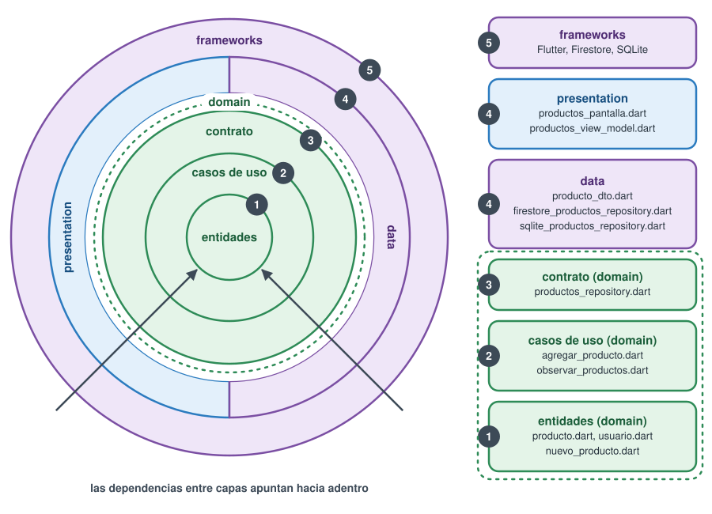{fig-alt="Cinco círculos concéntricos: en el centro las entidades, luego los casos de uso, el contrato, un anillo de adaptadores partido en presentation y data, y afuera los frameworks. Un contorno punteado agrupa los tres anillos interiores como domain, y dos flechas entran desde afuera hacia el centro."}

Cuanto más al centro está una pieza, menos depende de herramientas, y las dependencias de código apuntan siempre hacia adentro.
:::

```
+----------------------------------------------------------------+
| 5. Herramientas externas: Flutter, Firestore, SQLite           |
|  +----------------------------------------------------------+  |
|  | 4. Adaptadores: presentation y data                      |  |
|  |  +----------------------------------------------------+  |  |
|  |  | 3. Contrato: ProductosRepository                   |  |  |
|  |  |  +----------------------------------------------+  |  |  |
|  |  |  | 2. Casos de uso: AgregarProducto y otros     |  |  |  |
|  |  |  |  +----------------------------------------+  |  |  |  |
|  |  |  |  | 1. Centro: Producto, NuevoProducto     |  |  |  |  |
|  |  |  |  +----------------------------------------+  |  |  |  |
|  |  |  +----------------------------------------------+  |  |  |
|  |  +----------------------------------------------------+  |  |
|  +----------------------------------------------------------+  |
+----------------------------------------------------------------+
```

1. **El centro: entidades y reglas.** `Producto` (`domain/entities/producto.dart`) y `NuevoProducto` (`domain/entities/nuevo_producto.dart`), con `Usuario` y `Falla` al lado. Es lo que seguiría siendo cierto aunque cambiara toda la app: un producto tiene nombre, precio y disponibilidad, y un precio debe ser mayor que cero. `NuevoProducto` guarda esa regla en su constructor.
2. **Casos de uso.** `ObservarProductos`, `AgregarProducto`, `CambiarDisponible` y `BorrarProducto`, en `domain/usecases`. Son lo que la app hace: una clase por acción, con nombre propio.
3. **El contrato.** `ProductosRepository` (`domain/repositories/productos_repository.dart`), en el borde del dominio. Dice qué necesita la app de afuera (observar, agregar, cambiar la disponibilidad, borrar) sin decir cómo se hace. Los casos de uso y el contrato son dominio: viven en la misma carpeta y los primeros usan el segundo.
4. **Adaptadores.** Son dos carpetas. `presentation` (`ProductosPantalla`, `ProductosViewModel`) traduce entre el usuario y el dominio. `data` (`ProductoDto`, `FirestoreProductosRepository`, `SqliteProductosRepository`, `proteger`) traduce entre el dominio y cada fuente de datos.
5. **Herramientas externas (frameworks).** Flutter (los widgets), Firestore (`cloud_firestore`) y SQLite (`sqflite`). No son archivos del proyecto sino paquetes, y son lo que más cambia: una versión nueva, otra base de datos, otro marco de interfaz.

La tabla de las tres capas de arriba agrupa por carpeta; los anillos agrupan por cuánto cambia cada cosa. Una capa no es un anillo: la carpeta `domain` contiene los tres anillos interiores, y `presentation` y `data` son los dos adaptadores, uno a cada lado.

### La regla de dependencia, con evidencia

Una sola regla sostiene el dibujo: las dependencias de código apuntan hacia adentro. Una capa puede conocer (importar) su propia capa y las más internas, y nunca una más externa: `presentation` y `data` importan `domain` y no se importan entre sí. Dentro de `domain`, el caso de uso importa el contrato, que es el borde de la misma carpeta. Los adaptadores usan las herramientas del anillo exterior (Flutter en `presentation`, `cloud_firestore` y `sqflite` en `data`), porque ese es su trabajo: son el único lugar de la app, además de `main.dart`, donde las herramientas entran al código. En el proyecto significa: `presentation` conoce `domain`, `data` conoce `domain`, y `domain` no conoce a nadie.

::: {.diagrama}
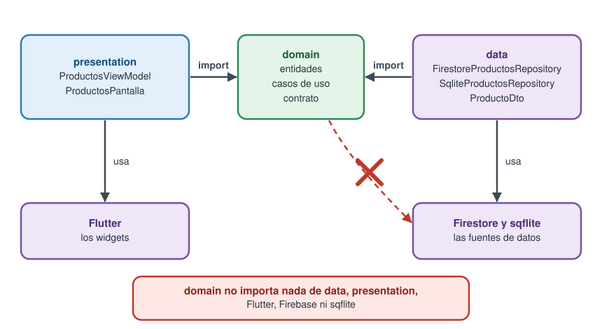{fig-alt="Tres cajas: presentation, domain y data, con flechas de import desde presentation y desde data hacia domain. Una flecha punteada roja y tachada va de domain hacia Firestore y sqflite, con la nota de que el dominio no importa nada de data, presentation, Flutter, Firebase ni sqflite."}

presentation y data conocen a domain, pero domain no importa a nadie.
:::

La evidencia está en los `import`. Los archivos del dominio de `clean_app` tienen diez `import` en total, y todos empiezan con `package:clean_app/domain/`: ninguno trae Flutter, Firebase ni sqflite. El contrato, por ejemplo, solo importa dos entidades:

**lib/domain/repositories/productos_repository.dart**

```dart
import 'package:clean_app/domain/entities/nuevo_producto.dart';
import 'package:clean_app/domain/entities/producto.dart';
```

En la capa de datos el `import` va en sentido contrario: el repositorio de Firestore importa el contrato del dominio, y el dominio nunca importa ese archivo.

**lib/data/firestore/firestore_productos_repository.dart**

```dart
import 'package:clean_app/domain/repositories/productos_repository.dart';
```

El contraste con `mvvm_app` está en el mismo tipo de línea. Allí el ViewModel importa una clase que vive en `data` y que a su vez importa Firestore; aquí el ViewModel solo importa el dominio.

**mvvm_app: lib/ui/productos/view_models/productos_view_model.dart**

```dart
import 'package:mvvm_app/data/repositories/productos_repository.dart';
```

**clean_app: lib/presentation/productos/productos_view_model.dart**

```dart
import 'package:clean_app/domain/usecases/agregar_producto.dart';
```

Lo que la regla prohíbe es una flecha del dominio hacia Firestore, por ejemplo un `import 'package:cloud_firestore/cloud_firestore.dart';` dentro de `domain`. Si apareciera, el dominio dependería de una herramienta que cambia y dejaría de ser Dart puro. En el Paso 17 hay un comando que lista los `import` del dominio para comprobarlo en tu propio código.

### Quién hace qué, y quién no

Una arquitectura es también una lista de cosas que cada pieza se niega a hacer. Esa negativa es lo que permite cambiar una pieza sin tocar las demás.

::: {.diagrama}
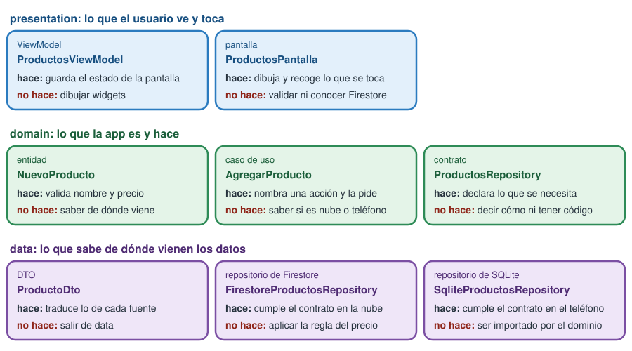{fig-alt="Ocho tarjetas agrupadas por capa y color: presentation (ViewModel y pantalla), domain (entidad, caso de uso y contrato) y data (DTO y repositorios de Firestore y SQLite). Cada una dice en una línea qué hace y en otra qué no hace."}

Cada pieza tiene un trabajo y una negativa, y esa negativa permite cambiar una sin tocar las demás.
:::

| Capa o pieza | Qué hace | Qué NO hace |
|---|---|---|
| `Producto` (Paso 2) | Representa un producto de la app, con sus cinco campos fijos | No sabe de dónde viene ni cómo se dibuja; no tiene conversiones |
| `NuevoProducto` (Paso 4) | Representa un producto que todavía no existe y aplica la regla: nombre no vacío y precio mayor que cero, o lanza `Falla('datos-invalidos')` | No tiene `id`, no guarda nada y no escribe mensajes para el usuario |
| Casos de uso, como `AgregarProducto` (Paso 6) | Dan nombre a una acción de la app y se la piden al contrato | No saben si los datos están en la nube o en el teléfono; todavía no agregan reglas propias |
| `ProductosRepository` (Paso 5) | Declara lo que el dominio necesita de afuera | No tiene código y no importa ninguna implementación |
| `ProductosPantalla` (Paso 14) | Dibuja y recoge lo que el usuario escribe y toca | No valida, no decide mensajes y no conoce Firestore ni SQLite |
| `ProductosViewModel` (Paso 12) | Guarda el estado (`productos`, `error`), crea el `NuevoProducto`, llama a los casos de uso y traduce cada `Falla` a un texto | No dibuja widgets y no importa `data` |
| `ProductoDto` (Paso 7) | Traduce lo que entrega cada fuente a un `Producto` | No sale de `data`: hacia afuera solo viaja la entidad |
| `FirestoreProductosRepository` (Paso 9) y `SqliteProductosRepository` (Paso 11) | Cumplen el contrato con una fuente real y convierten sus errores en `Falla` | No aplican la regla del precio (llega ya validada) y el dominio no los importa |
| `main.dart` (Paso 16) | Arma la app: elige la fuente y construye los casos de uso | No tiene reglas ni dibuja la pantalla de productos |

### La analogía del tomacorriente

Piensa en una casa. La casa define el tomacorriente: su forma y su voltaje. La lámpara se adapta al tomacorriente, no al revés. Si cambias de lámpara no abres la pared, y si la pared tiene un enchufe distinto, cada lámpara cambia su clavija, no la casa.

::: {.diagrama}
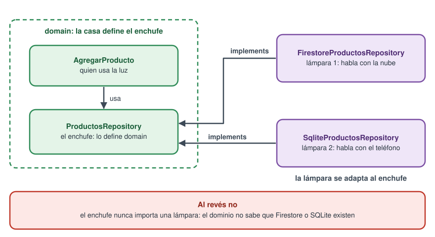{fig-alt="En el dominio, AgregarProducto usa ProductosRepository, que hace de enchufe. Las lámparas FirestoreProductosRepository y SqliteProductosRepository apuntan con implements hacia el enchufe, y una nota en rojo aclara que el enchufe nunca importa una lámpara."}

El dominio define el enchufe y cada lámpara se adapta a él, nunca al revés.
:::

Traducido a `clean_app`, la casa es el dominio:

- El tomacorriente es `ProductosRepository`. Lo define el dominio y dice qué se puede pedir: observar, agregar, cambiar la disponibilidad y borrar.
- Las lámparas son `FirestoreProductosRepository` y `SqliteProductosRepository`. Cada una se adapta al contrato, y una tercera, `ProductosEnMemoria`, hace lo mismo en las pruebas (Paso 17).
- Quien usa la luz, `AgregarProducto`, solo sabe que hay un tomacorriente y nunca pregunta qué lámpara tiene detrás.

Esa adaptación es la inversión de dependencias, y se ve en una palabra: `implements`. Primero el contrato, en el dominio:

**lib/domain/repositories/productos_repository.dart**

```dart
abstract interface class ProductosRepository {
```

Y después la lámpara, en `data`, que declara que cumple ese contrato:

**lib/data/firestore/firestore_productos_repository.dart**

```dart
class FirestoreProductosRepository implements ProductosRepository {
```

**lib/data/sqlite/sqlite_productos_repository.dart**

```dart
class SqliteProductosRepository implements ProductosRepository {
```

Hay dos direcciones y no coinciden. En la ejecución el pedido sale hacia afuera: la pantalla llama al ViewModel, este al caso de uso, este al contrato y, en tiempo de ejecución, el contrato responde con Firestore. En el código la dependencia apunta hacia adentro: el archivo de Firestore importa el contrato y declara `implements`, pero el contrato no sabe que Firestore existe. Sin `implements`, el caso de uso tendría que llamar a Firestore directamente y el dominio tendría que importar `data`. Con `implements`, la dependencia de código se invierte justo en ese punto, y por eso se llama inversión.

| Pieza | Orden en que se ejecuta | Qué importa de la app |
|---|---|---|
| `ProductosPantalla` | 1 | `ProductosViewModel` y la entidad `Producto` |
| `ProductosViewModel` | 2 | Solo `domain`: entidades, `Falla` y casos de uso |
| `AgregarProducto` | 3 | Solo `domain`: el contrato y la entidad |
| `ProductosRepository` | 4 (el borde) | Solo `domain`: las entidades |
| `FirestoreProductosRepository` | 5 | `domain` (el contrato y las entidades) y `data` (`ProductoDto`, `proteger`) |
| Firestore | 6 | Es un paquete externo: no importa nada de la app |

Leída de arriba abajo, la columna del medio avanza hacia afuera; la última columna solo apunta a `domain` o a la propia capa; el salto del caso de uso al contrato ocurre dentro de `domain`.

### Un pedido de punta a punta: agregar un producto

Sigue un pedido real. El usuario escribe `Papa criolla` y `2500` y toca Agregar. Cada paso muestra el fragmento exacto del proyecto (archivo y método) y remite al paso de la guía donde se escribe ese archivo. Es el mismo recorrido de la diapositiva `c1-flujo`.

::: {.diagrama}
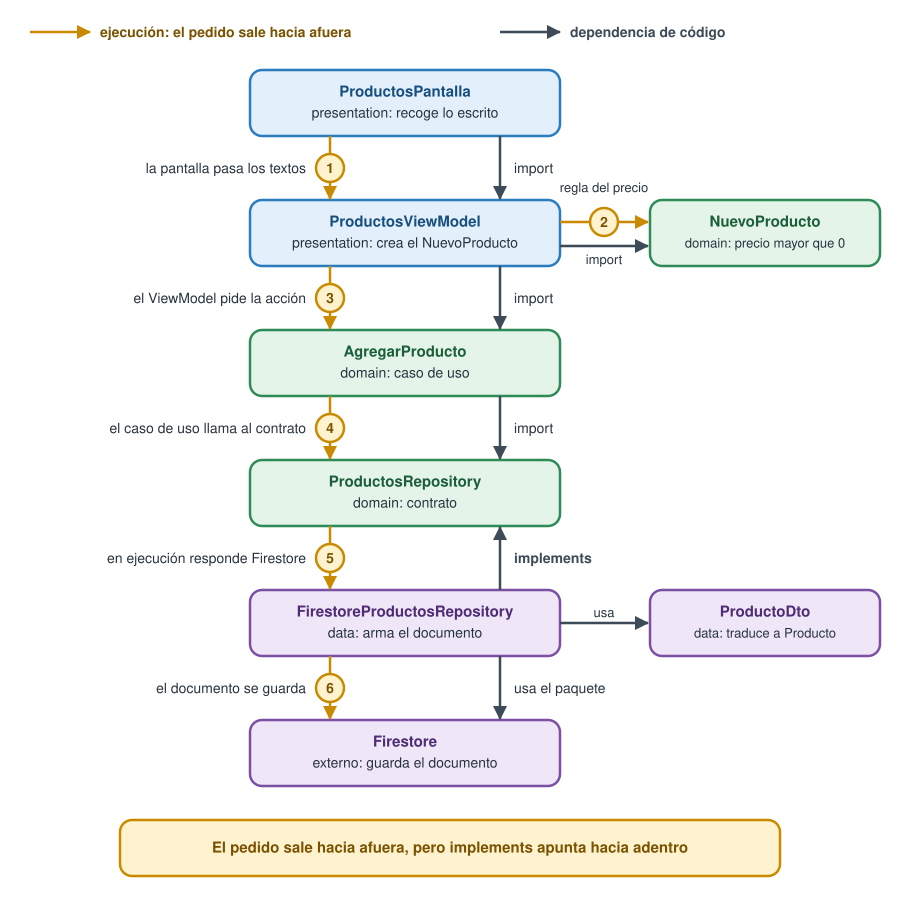{fig-alt="Una columna de piezas desde ProductosPantalla hasta Firestore, con NuevoProducto y ProductoDto a un lado. Seis pasos numerados en amarillo bajan hacia afuera, mientras las flechas grises de dependencia bajan también, salvo implements, que sube del repositorio de Firestore al contrato."}

El pedido sale hacia afuera, pero implements apunta hacia adentro, y ahí se invierte la dependencia.
:::

1. **La pantalla recoge el pedido.** `ProductosPantalla` no valida nada: les pasa al ViewModel los textos que están en sus dos controladores y, solo si el ViewModel responde `true`, limpia los campos. Se escribe en el Paso 14.

   **lib/presentation/productos/productos_pantalla.dart, método `agregar`**

   ```dart
     void agregar() {
       if (vm.agregar(nombre.text, precio.text)) {
         nombre.clear();
         precio.clear();
       }
     }
   ```

2. **El ViewModel crea un `NuevoProducto`, y ahí se aplica la regla.** `ProductosViewModel` convierte el texto del precio en número (un texto que no es número queda en `0`) y construye un `NuevoProducto`. Si la regla falla, atrapa la `Falla`, guarda el mensaje, avisa a la pantalla y devuelve `false`; el pedido muere aquí y la pantalla conserva lo escrito. El ViewModel se escribe en el Paso 12 y la regla en el Paso 4.

   **lib/presentation/productos/productos_view_model.dart, método `agregar`**

   ```dart
       try {
         nuevo = NuevoProducto(nombre, int.tryParse(precio) ?? 0);
       } on Falla catch (e) {
         error = _mensajeDe(e.codigo);
         _notificar();
         return false;
   ```

   **lib/domain/entities/nuevo_producto.dart, constructor**

   ```dart
     NuevoProducto(String nombre, this.precio) : nombre = nombre.trim() {
       if (this.nombre.isEmpty || precio <= 0) {
         throw const Falla('datos-invalidos');
       }
     }
   ```

3. **El caso de uso nombra la acción.** Con un `NuevoProducto` válido, el ViewModel lanza `AgregarProducto` sin esperar la respuesta de la red. El caso de uso solo conoce el tipo del contrato, no una implementación. Se escribe en el Paso 6.

   **lib/domain/usecases/agregar_producto.dart, método `call`**

   ```dart
     final ProductosRepository _repository;

     Future<void> call(NuevoProducto nuevo) => _repository.agregar(nuevo);
   ```

4. **El contrato es el borde.** `ProductosRepository` declara `agregar` y nada más. Hasta aquí todo es dominio y Dart puro; a partir de aquí el pedido sale hacia afuera. Se escribe en el Paso 5.

   **lib/domain/repositories/productos_repository.dart**

   ```dart
   abstract interface class ProductosRepository {
     Stream<List<Producto>> observar();

     Future<void> agregar(NuevoProducto nuevo);
   ```

5. **El repositorio de Firestore arma el documento.** Quien responde es `FirestoreProductosRepository`, la implementación que `main` entregó. Escribe el mapa a partir del `NuevoProducto`, que ya llega válido, y lo envuelve en `proteger` para que cualquier error de Firebase salga como `Falla`. Se escribe en el Paso 9 (y `proteger` en el Paso 8).

   **lib/data/firestore/firestore_productos_repository.dart, método `agregar`**

   ```dart
       return proteger(
         () => _coleccion.add({
           'nombre': nuevo.nombre,
           'precio': nuevo.precio,
           'disponible': true,
         }),
   ```

6. **Firestore guarda.** El documento llega a la colección `productos`, una herramienta externa. Sin internet, Firestore lo guarda en el teléfono y lo marca como pendiente hasta que el servidor confirme. La colección se obtiene en el repositorio (Paso 9).

   **lib/data/firestore/firestore_productos_repository.dart, campo `_coleccion`**

   ```dart
     final _coleccion = FirebaseFirestore.instance.collection('productos');
   ```

7. **El estado regresa por `observar()`.** Firestore emite el cambio por `snapshots()` y el repositorio convierte cada documento en un `Producto` con `ProductoDto.desdeFirestore(doc).aEntidad()`. De `data` solo sale la entidad. Se escribe en el Paso 9, y el DTO en el Paso 7.

   **lib/data/firestore/firestore_productos_repository.dart, método `observar`**

   ```dart
       return _coleccion.snapshots().map(
         (datos) => [
           for (final doc in datos.docs)
             ProductoDto.desdeFirestore(doc).aEntidad(),
         ],
       );
   ```

8. **El ViewModel recibe la lista nueva.** `observar()` es el caso de uso `ObservarProductos`, que llama al mismo contrato (Paso 6). Cuando llega la lista, el ViewModel la asigna a `productos` y avisa con `_notificar()`. Se escribe en el Paso 12.

   **lib/presentation/productos/productos_view_model.dart, constructor**

   ```dart
       _suscripcion = observar().listen(
         (lista) {
           productos = lista;
           _notificar();
         },
   ```

9. **La pantalla se redibuja.** `ListenableBuilder` escucha al ViewModel y vuelve a construir la lista: la fila `Papa criolla` aparece, y si el servidor todavía no confirmó, con `(sin enviar)`. Se escribe en el Paso 14.

   **lib/presentation/productos/productos_pantalla.dart, método `build`**

   ```dart
           child: ListenableBuilder(
             listenable: vm,
             builder: (context, _) {
               final lista = vm.productos;
   ```

El pedido salió hacia afuera en los tramos 1 a 6 del recorrido y volvió como estado en los tramos 7 a 9. En ningún tramo una capa interna importó una externa.

### El intercambio: cambiar la fuente no toca nada más

Todo lo anterior se paga en un momento: cambiar de fuente. `main.dart` es el único archivo que conoce las dos implementaciones y las entrega a `MainApp` como `ProductosRepository`. Se escribe en el Paso 16.

::: {.diagrama}
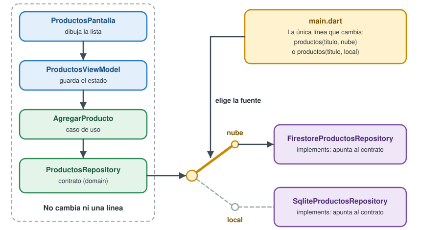{fig-alt="Cuatro cajas apiladas (ProductosPantalla, ProductosViewModel, AgregarProducto y el contrato ProductosRepository) enmarcadas como lo que no cambia. A su derecha un interruptor conecta el contrato con FirestoreProductosRepository o SqliteProductosRepository, y main.dart, en amarillo, marca la única línea que cambia."}

Cambiar de la nube al teléfono es cambiar un argumento en main.dart; todo lo demás queda igual.
:::

**lib/main.dart, función `main`**

```dart
        nube: FirestoreProductosRepository(),
        local: await SqliteProductosRepository.abrir(),
        cuenta: FirebaseCuentaRepository(),
```

Después, el método `productos` construye la misma pantalla y el mismo ViewModel con los mismos casos de uso, y solo cambia el argumento `fuente`.

**lib/main.dart, clase `MainApp`, método `productos`**

```dart
  Widget productos(String titulo, ProductosRepository fuente) {
    return ProductosPantalla(
      titulo: titulo,
      viewModel: ProductosViewModel(
        observar: ObservarProductos(fuente),
        agregar: AgregarProducto(fuente),
```

**lib/main.dart, clase `MainApp`, método `build`**

```dart
                abrir(context, productos('Productos en la nube', nube)),
```

```dart
                abrir(context, productos('Productos en el teléfono', local)),
```

La misma `ProductosPantalla` abre las dos listas. Para pasar de la nube al teléfono no cambian la pantalla, el ViewModel, los casos de uso, el contrato ni las entidades: cambia el argumento, `nube` o `local`, y con él la lámpara que está detrás del tomacorriente. Esa es la prueba de la arquitectura, y es lo que verás en el Paso 16: la misma pantalla con las dos fuentes.

## Paso 0. Crear el proyecto, las dependencias y la conexión a Firebase

Qué se hace: crear el proyecto, instalar los paquetes con versión fija y conectarlo con el proyecto de Firebase que ya usaste.

```
flutter create --empty --org co.edu.iue --platforms=android clean_app
cd clean_app
flutter pub add cloud_firestore:7.1.0 firebase_auth:7.0.1 firebase_core:5.1.0 sqflite:2.4.2+1 path:1.9.1
```

- `--empty` deja `lib/main.dart` casi vacío, sin la app del contador.
- `--org co.edu.iue` define el identificador de la app en Android: `co.edu.iue.clean_app`. Ese identificador se registra en Firebase y no conviene cambiarlo después.
- Los tres paquetes de Firebase son los mismos de `mvvm_app`. Se agregan `sqflite` (la base SQLite del teléfono) y `path` (arma la ruta del archivo de la base con `join`), que ya usaste en la guía de persistencia local.
- Las versiones van fijas porque el código de esta guía se verificó con ellas; sin versión se instalaría la última, y una versión mayor puede cambiar la API.

Al terminar, la sección `dependencies:` de `pubspec.yaml` queda así (el resto del archivo lo escribe `flutter create`; no lo cambies):

**pubspec.yaml**

```yaml
dependencies:
  cloud_firestore: 7.1.0
  firebase_auth: 7.0.1
  firebase_core: 5.1.0
  flutter:
    sdk: flutter
  path: 1.9.1
  sqflite: 2.4.2+1
```

Conexión a Firebase. Esta guía no repite cómo crear el proyecto en la consola de Firebase, activar Authentication, crear la base de Firestore ni publicar sus reglas: eso está en la guía de persistencia local y nube, en las etapas de Firebase y Authentication y de Firestore. Si ya hiciste esas etapas, reutiliza el mismo proyecto de Firebase. Lo único que repites es conectar esta app nueva, desde la carpeta `clean_app`:

```
flutterfire configure
```

En las preguntas, elige el proyecto de Firebase de siempre, deja marcada solo `android` y comprueba que el identificador sea `co.edu.iue.clean_app`. El comando genera `lib/firebase_options.dart`, genera `android/app/google-services.json` y ajusta los archivos de Gradle. El archivo `firebase_options.dart` se genera ahí: no se escribe ni se edita a mano, y por eso esta guía no lo muestra ni lo cuenta entre los archivos del proyecto.

Qué debe verse al terminar: existen `lib/firebase_options.dart` y `android/app/google-services.json`, y `flutter analyze` responde `No issues found!`.

Error más probable: ejecutar `flutterfire configure` antes de instalar `firebase_core`. El archivo generado queda con el error `Target of URI doesn't exist: 'package:firebase_core/firebase_core.dart'`. Se arregla instalando el paquete y volviendo a ejecutar `flutter pub get`. Otro error común es no tener las reglas de Firestore de la guía de persistencia y nube: sin ellas, la app corre pero las escrituras en la nube fallan con `permission-denied`.

No toques `lib/main.dart` hasta el paso 16; mientras tanto, la app sigue mostrando la pantalla que dejó `flutter create`.

## Paso 1. La estructura de carpetas, y por qué es así

Qué se hace: crear las carpetas vacías dentro de `lib`. Antes de escribir una sola línea de lógica, el proyecto ya dice dónde va cada cosa. Este es el árbol final, con los archivos que escribirás en los pasos siguientes:

::: {.diagrama}
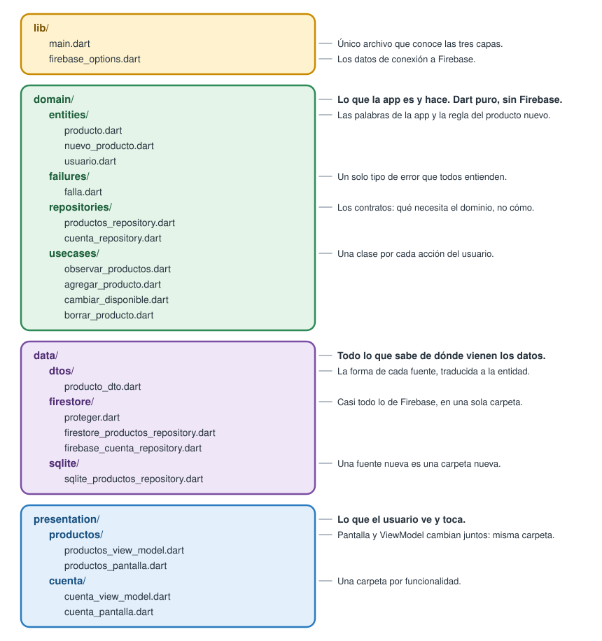{fig-alt="Árbol de la carpeta lib de clean_app con sus archivos reales, coloreado por capa: domain en verde, data en morado, presentation en azul y main.dart en amarillo. A la derecha, una frase explica por qué existe cada carpeta."}

Cada carpeta tiene un color de capa y una sola razón de ser.
:::

```
lib
+-- main.dart
+-- firebase_options.dart
+-- domain
|   +-- entities
|   |   +-- producto.dart
|   |   +-- nuevo_producto.dart
|   |   +-- usuario.dart
|   +-- failures
|   |   +-- falla.dart
|   +-- repositories
|   |   +-- productos_repository.dart
|   |   +-- cuenta_repository.dart
|   +-- usecases
|       +-- observar_productos.dart
|       +-- agregar_producto.dart
|       +-- cambiar_disponible.dart
|       +-- borrar_producto.dart
+-- data
|   +-- dtos
|   |   +-- producto_dto.dart
|   +-- firestore
|   |   +-- proteger.dart
|   |   +-- firestore_productos_repository.dart
|   |   +-- firebase_cuenta_repository.dart
|   +-- sqlite
|       +-- sqlite_productos_repository.dart
+-- presentation
    +-- productos
    |   +-- productos_view_model.dart
    |   +-- productos_pantalla.dart
    +-- cuenta
        +-- cuenta_view_model.dart
        +-- cuenta_pantalla.dart
```

Cada carpeta existe por una razón:

- `domain` guarda lo que la app es y hace, sin saber cómo se muestra ni dónde se guarda. Es Dart puro: ningún archivo de esta carpeta importa Flutter, Firebase ni sqflite. Por eso es la parte que más tiempo vive: cambiar la interfaz o la base no la toca.
- `domain/entities` guarda las palabras de la app (`Producto`, `Usuario`) y la regla de qué es un producto nuevo válido (`NuevoProducto`).
- `domain/failures` guarda el tipo de error propio de la app, `Falla`. Así los errores de cualquier fuente se vuelven un solo tipo que la presentación entiende sin importar nada de `data`.
- `domain/repositories` guarda los contratos: interfaces que dicen qué necesita el dominio de la capa de datos (observar, agregar, borrar), sin decir cómo. Esta es la diferencia central con MVVM: el contrato vive en el dominio, no en `data`. El dominio define el qué; `data` aporta el cómo.
- `domain/usecases` guarda una clase por cada acción que el usuario puede hacer sobre los productos. Son el punto de entrada que usa la presentación.
- `data` guarda todo lo que sabe de dónde vienen y adónde van los datos. Se divide por fuente de datos (`firestore`, `sqlite`) y no por tipo, como en `mvvm_app`. La razón es que el intercambio se vea en las carpetas: agregar o quitar una fuente es agregar o quitar una carpeta, y casi todo lo que use Firestore o Authentication está en `data/firestore`.
- `data/dtos` guarda el DTO (data transfer object): la forma en que cada fuente entrega un producto, con su traducción a la entidad. Queda fuera de las carpetas por fuente porque lo comparten las dos: tiene una entrada para Firestore y otra para SQLite.
- `data/firestore` agrupa lo que usa Firebase. La carpeta lleva el nombre de la nube, pero también guarda el repositorio de la cuenta, que usa Authentication y no Firestore: es un compromiso de nombre, no de estructura.
- `presentation` guarda lo que el usuario ve y toca, dividido por funcionalidad (`productos`, `cuenta`). Pantalla y ViewModel de una funcionalidad cambian juntos, así que viven en la misma carpeta; en `mvvm_app` iban en subcarpetas `widgets` y `view_models`, que aquí no hacen falta porque cada funcionalidad tiene solo dos archivos.
- `main.dart` queda en la raíz porque es el único archivo que conoce las tres capas.

La regla que da sentido a todo es la de dependencia. La presentación conoce el dominio. Los datos conocen el dominio. El dominio no conoce a nadie. Las flechas siempre apuntan hacia adentro, hacia `domain`, y nunca al revés. Al final de la guía (paso 17) hay un comando que comprueba esa regla sobre tu propio código.

Qué debe verse al terminar: en el explorador del editor, las carpetas `domain/entities`, `domain/failures`, `domain/repositories`, `domain/usecases`, `data/dtos`, `data/firestore`, `data/sqlite`, `presentation/productos` y `presentation/cuenta` dentro de `lib`.

Error más probable: dejar el contrato (`ProductosRepository`) en `data`, porque en `mvvm_app` el Repository estaba ahí. Funciona, pero entonces el dominio y los casos de uso tendrían que importar `data` y la regla de dependencia se rompe. También fallan los nombres con mayúsculas o tildes: en Dart los archivos van en minúsculas y con guion bajo.

Contraste con `mvvm_app`: allí `lib` se dividía en `ui`, `domain/models` y `data/{services,repositories}`. Aquí `domain` crece (contratos, casos de uso, fallas) y `data` se parte por fuente. Contraste con el "antes": `clase_nube` no tenía carpetas para esto; los dos modelos, las dos pantallas y `base_datos.dart` vivían juntos en `lib`.

## Paso 2. Las entidades Producto y Usuario

Qué se hace: crear los dos objetos que representan las cosas de la app: un producto y quien tiene la sesión iniciada.

**lib/domain/entities/producto.dart**

```dart
class Producto {
  const Producto({
    required this.id,
    required this.nombre,
    required this.precio,
    required this.disponible,
    this.pendiente = false,
  });

  final String id;
  final String nombre;
  final int precio;
  final bool disponible;
  final bool pendiente;
}
```

**lib/domain/entities/usuario.dart**

```dart
class Usuario {
  const Usuario(this.correo);

  final String correo;
}
```

Por qué así:

- Todos los campos de `Producto` son `final` y el constructor es `const`: un `Producto` no cambia; si algo cambia, llega otro `Producto` desde la fuente.
- `id` es `String` porque es el tipo que la app usa para identificar un producto sin importar la fuente: Firestore genera ids de texto, y SQLite genera enteros que el DTO convierte a texto (paso 7).
- `pendiente` empieza en `false`. Solo Firestore lo vuelve `true`, cuando el producto se guardó en el teléfono pero el servidor todavía no lo confirmó; la pantalla muestra entonces "(sin enviar)". SQLite nunca lo usa.
- `Usuario` solo guarda el correo, porque es lo único que la app necesita de quien inició sesión. Firebase entrega un objeto `User` con muchos más datos; este es el único que el resto de la app conoce.
- Ningún archivo tiene `import`: no saben que existen Flutter, Firestore o SQLite. Esa ignorancia es lo que permite cambiar la fuente sin tocarlos.

Qué debe verse al terminar: `flutter analyze` sin problemas. Todavía no hay nada que ejecutar.

Error más probable: olvidar `required` en un campo de `Producto` y que el editor marque error al construirlo más adelante.

Contraste: en `clase_nube` había dos modelos, `Producto` (`producto.dart`, id entero, con `toMap` y `fromMap`) y `ProductoNube` (`producto_nube.dart`, id de texto, con `fromDoc` que leía el documento de Firestore). Aquí hay una sola entidad sin ninguna conversión adentro. En `mvvm_app` este archivo era idéntico y se llamaba `domain/models/producto.dart`: cambia la carpeta (`entities`), no el contenido.

## Paso 3. La Falla

Qué se hace: crear el único tipo de error que el resto de la app va a conocer.

**lib/domain/failures/falla.dart**

```dart
class Falla implements Exception {
  const Falla(this.codigo);

  final String codigo;
}
```

Por qué así:

- Una `Falla` lleva un `codigo` de texto, por ejemplo `permission-denied`, `datos-invalidos` o `base-local`. La capa de datos convierte los errores de cada fuente en una `Falla`, y la presentación convierte el código en un mensaje para el usuario.
- Implementa `Exception` por convención: marca un error esperado, que el código atrapa con `on Falla catch`.
- Vive en el dominio porque los tres lados la necesitan: `data` la lanza, el dominio la lanza al validar (paso 4) y la presentación la atrapa. Si viviera en `data`, la presentación tendría que importar `data` solo para atrapar un error.

Qué debe verse al terminar: `flutter analyze` sin problemas.

Error más probable: poner el mensaje para el usuario dentro de la `Falla`. Funciona, pero entonces el dominio decide cómo habla la interfaz. El mensaje es de la presentación; la falla solo dice qué pasó.

Contraste con `mvvm_app`: allí la excepción se llamaba `DatosException` y estaba en `data/repositories/datos_exception.dart`, junto con `proteger`, así que el ViewModel importaba un archivo de `data` para atrapar errores. Aquí la `Falla` está en el dominio y `proteger` se mudó a `data` (paso 8).

## Paso 4. NuevoProducto: la regla del precio

Qué se hace: crear el objeto que representa un producto que todavía no existe en ninguna fuente, y que no se puede construir si sus datos son inválidos.

**lib/domain/entities/nuevo_producto.dart**

```dart
import 'package:clean_app/domain/failures/falla.dart';

class NuevoProducto {
  NuevoProducto(String nombre, this.precio) : nombre = nombre.trim() {
    if (this.nombre.isEmpty || precio <= 0) {
      throw const Falla('datos-invalidos');
    }
  }

  final String nombre;
  final int precio;
}
```

Por qué así:

- `NuevoProducto` no tiene `id`: el id lo asigna la fuente al guardar. Por eso es distinto de `Producto`.
- La regla está en el constructor: el nombre se recorta con `trim()` y, si queda vacío o el precio no es mayor que cero, se lanza `Falla('datos-invalidos')`. Un `NuevoProducto` que existe es siempre válido, así que ningún repositorio tiene que volver a revisarlo.
- Dentro del cuerpo del constructor, `nombre` es el parámetro sin recortar y `this.nombre` es el campo ya recortado. Por eso la revisión usa `this.nombre.isEmpty`.
- La regla vive en el dominio y no en el ViewModel porque es una regla de la app, no de una pantalla: cualquier pantalla o fuente futura la hereda sin copiarla.

Qué debe verse al terminar: `flutter analyze` sin problemas. En el paso 17 la prueba de este archivo verifica que `'  Tomate chonto '` queda como `'Tomate chonto'` y que `0`, `-5` y un nombre vacío se rechazan.

Error más probable: escribir `nombre.isEmpty` en lugar de `this.nombre.isEmpty`. Revisa el parámetro sin recortar, así que un nombre de solo espacios pasa la regla.

Contraste con `mvvm_app`: la regla estaba en el `if` de `ProductosViewModel.agregar` (líneas 31 a 36 de `productos_view_model.dart`), mezclada con el estado y el mensaje de error. Contraste con el "antes": en `clase_nube` no había regla; `int.tryParse(precio.text) ?? 0` (línea 35 de `productos_nube_pantalla.dart`) dejaba pasar un precio de cero.

## Paso 5. Los contratos de repositorio

Qué se hace: crear las dos interfaces que dicen qué necesita el dominio de la capa de datos.

**lib/domain/repositories/productos_repository.dart**

```dart
import 'package:clean_app/domain/entities/nuevo_producto.dart';
import 'package:clean_app/domain/entities/producto.dart';

abstract interface class ProductosRepository {
  Stream<List<Producto>> observar();

  Future<void> agregar(NuevoProducto nuevo);

  Future<void> cambiarDisponible(String id, bool disponible);

  Future<void> borrar(String id);
}
```

**lib/domain/repositories/cuenta_repository.dart**

```dart
import 'package:clean_app/domain/entities/usuario.dart';

abstract interface class CuentaRepository {
  Stream<Usuario?> sesion();

  Future<void> registrar(String correo, String clave);

  Future<void> iniciar(String correo, String clave);

  Future<void> salir();
}
```

Por qué así:

- `abstract interface class` es un contrato: solo declara métodos, no los implementa, y una clase solo puede cumplirlo con `implements`. No se puede extender ni crear una instancia de él.
- El contrato habla el idioma del dominio: recibe un `NuevoProducto` ya validado y devuelve `Stream<List<Producto>>`, nunca un documento de Firestore ni una fila de SQLite. Por eso cualquier fuente lo puede cumplir.
- `observar` devuelve un `Stream`: la lista se actualiza sola cuando cambia la fuente. Quien lo escuche no sabe si los cambios vienen de un servidor o de un archivo local.
- `CuentaRepository.sesion()` emite un `Usuario?`: `null` significa que no hay sesión.
- Los contratos viven en el dominio porque es el dominio quien los exige. Los datos los implementan; el dominio nunca importa una implementación.

Qué debe verse al terminar: `flutter analyze` sin problemas.

Error más probable: escribir `extends ProductosRepository` en lugar de `implements ProductosRepository` en una implementación. El analizador responde `The class 'ProductosRepository' can't be extended outside of its library because it's an interface class`. Un contrato se cumple con `implements`.

Contraste con `mvvm_app`: `ProductosRepository` era una clase concreta en `data/repositories` que importaba `cloud_firestore`, y el ViewModel dependía de ella (línea 5 de su `productos_view_model.dart`). Aquí el nombre es el mismo pero lo que existe en el dominio es solo el contrato.

## Paso 6. Los casos de uso

Qué se hace: crear una clase por cada acción que el usuario puede hacer con los productos.

**lib/domain/usecases/observar_productos.dart**

```dart
import 'package:clean_app/domain/entities/producto.dart';
import 'package:clean_app/domain/repositories/productos_repository.dart';

class ObservarProductos {
  ObservarProductos(this._repository);

  final ProductosRepository _repository;

  Stream<List<Producto>> call() => _repository.observar();
}
```

**lib/domain/usecases/agregar_producto.dart**

```dart
import 'package:clean_app/domain/entities/nuevo_producto.dart';
import 'package:clean_app/domain/repositories/productos_repository.dart';

class AgregarProducto {
  AgregarProducto(this._repository);

  final ProductosRepository _repository;

  Future<void> call(NuevoProducto nuevo) => _repository.agregar(nuevo);
}
```

**lib/domain/usecases/cambiar_disponible.dart**

```dart
import 'package:clean_app/domain/repositories/productos_repository.dart';

class CambiarDisponible {
  CambiarDisponible(this._repository);

  final ProductosRepository _repository;

  Future<void> call(String id, bool disponible) {
    return _repository.cambiarDisponible(id, disponible);
  }
}
```

**lib/domain/usecases/borrar_producto.dart**

```dart
import 'package:clean_app/domain/repositories/productos_repository.dart';

class BorrarProducto {
  BorrarProducto(this._repository);

  final ProductosRepository _repository;

  Future<void> call(String id) => _repository.borrar(id);
}
```

Por qué así:

- Cada caso de uso recibe el contrato `ProductosRepository` en el constructor, no una implementación concreta. Con el repositorio de Firestore funciona; con el de SQLite, también; con uno falso en una prueba, también.
- El método se llama `call`, así que el objeto se usa como una función: `agregar(nuevo)`. El ViewModel los recibe y los invoca así.
- Ahora mismo los cuatro solo delegan: llaman al repositorio y nada más. Es el costo honesto de esta capa (se retoma al final de la guía). Existen porque son el lugar natural para una regla que crezca, por ejemplo "no agregar dos productos con el mismo nombre", que necesitaría consultar la lista antes de agregar; esa lógica iría aquí, no en la pantalla ni en el repositorio.
- Los casos de uso solo importan el dominio.

Qué debe verse al terminar: `flutter analyze` sin problemas.

Error más probable: importar la implementación en lugar del contrato (`firestore_productos_repository.dart` en vez de `productos_repository.dart`). Con el autocompletado del editor es fácil elegir el archivo equivocado, y rompe la regla de dependencia sin que nada falle de inmediato.

Contraste con `mvvm_app`: el ViewModel llamaba directamente a `_repository.agregar(...)`. Aquí hay un archivo más por acción, a cambio de que la acción tenga nombre propio y un lugar para crecer.

## Paso 7. El DTO: traducir lo que entrega cada fuente

Qué se hace: crear el objeto que sabe leer un producto tal como lo entrega cada fuente y convertirlo en la entidad.

::: {.diagrama}
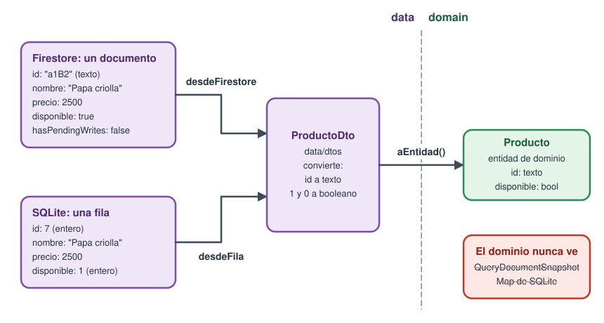{fig-alt="Un documento de Firestore y una fila de SQLite, cada uno con su forma, entran por desdeFirestore y desdeFila a ProductoDto. De allí sale aEntidad hacia la entidad Producto, al otro lado de la frontera entre data y domain. Una caja roja indica que el dominio nunca ve un documento de Firestore ni el Map de SQLite."}

El DTO es la única puerta de entrada: de data solo sale una entidad.
:::

**lib/data/dtos/producto_dto.dart**

```dart
import 'package:clean_app/domain/entities/producto.dart';
import 'package:cloud_firestore/cloud_firestore.dart';

class ProductoDto {
  const ProductoDto({
    required this.id,
    required this.nombre,
    required this.precio,
    required this.disponible,
    this.pendiente = false,
  });

  factory ProductoDto.desdeFirestore(
    QueryDocumentSnapshot<Map<String, dynamic>> doc,
  ) {
    final d = doc.data();
    return ProductoDto(
      id: doc.id,
      nombre: d['nombre'] as String,
      precio: d['precio'] as int,
      disponible: d['disponible'] as bool,
      pendiente: doc.metadata.hasPendingWrites,
    );
  }

  factory ProductoDto.desdeFila(Map<String, Object?> fila) {
    return ProductoDto(
      id: (fila['id'] as int).toString(),
      nombre: fila['nombre'] as String,
      precio: fila['precio'] as int,
      disponible: fila['disponible'] == 1,
    );
  }

  final String id;
  final String nombre;
  final int precio;
  final bool disponible;
  final bool pendiente;

  Producto aEntidad() {
    return Producto(
      id: id,
      nombre: nombre,
      precio: precio,
      disponible: disponible,
      pendiente: pendiente,
    );
  }
}
```

Por qué así:

- Cada fuente entrega el mismo producto con otra forma. Firestore: un documento con `id` de texto y `disponible` booleano, más `metadata.hasPendingWrites` para saber si falta enviarlo. SQLite: una fila con `id` entero y `disponible` como `1` o `0`.
- `desdeFirestore` y `desdeFila` son las dos entradas; `aEntidad()` es la única salida, hacia `Producto`. Lo que sale de `data` es siempre una entidad, nunca un DTO.
- `desdeFila` convierte el id entero a texto con `toString()` y `disponible == 1` a booleano. Esa conversión es lo que permite que aquí haya un solo modelo donde `clase_nube` tenía dos.
- Este archivo sí importa `cloud_firestore` (por `QueryDocumentSnapshot`), así que `data/dtos` no está libre de Firebase. La regla que se cumple no es "ninguna carpeta de `data` es neutra", sino la que importa: Firebase y sqflite aparecen solo dentro de `data`, salvo `main.dart` y `firebase_options.dart`, que inicializan Firebase.
- La escritura no usa el DTO: cada repositorio arma su propio mapa al guardar (pasos 9 y 11).

Qué debe verse al terminar: `flutter analyze` sin problemas. La prueba del paso 17 verifica `desdeFila` sin base de datos: pasa una fila escrita a mano.

Error más probable: si un documento de Firestore guardó el precio como texto, `d['precio'] as int` falla en ejecución con `type 'String' is not a subtype of type 'int' in type cast`. El DTO es el lugar para arreglarlo: la conversión se corrige una vez y el resto de la app no se entera.

Contraste con `mvvm_app`: la conversión estaba en `_aProducto`, un método privado de `ProductosRepository` que solo conocía Firestore. Contraste con el "antes": `ProductoNube.fromDoc` y `Producto.fromMap` eran dos modelos con su propia conversión; ahora son dos entradas de un mismo DTO.

## Paso 8. proteger: traducir los errores de Firebase

Qué se hace: crear la función que atrapa los errores de Firebase y los convierte en `Falla`.

**lib/data/firestore/proteger.dart**

```dart
import 'package:clean_app/domain/failures/falla.dart';
import 'package:firebase_core/firebase_core.dart';

Future<void> proteger(Future<void> Function() accion) async {
  try {
    await accion();
  } on FirebaseException catch (e) {
    throw Falla(e.code);
  }
}
```

Por qué así:

- Recibe una acción asíncrona, la ejecuta y, si Firebase lanza una `FirebaseException`, la vuelve una `Falla` con el mismo código. El código llega intacto: `permission-denied` sigue siendo `permission-denied`.
- Solo atrapa `FirebaseException`. Un error de programación (por ejemplo, un `null` donde no debía) no se disfraza: sigue su camino y se ve.
- Vive en `data/firestore` porque conoce un tipo de Firebase. Los repositorios de Firestore y de cuenta la comparten.
- SQLite no la usa: su repositorio traduce `DatabaseException` por su cuenta (paso 11).

Qué debe verse al terminar: `flutter analyze` sin problemas.

Error más probable: importar `FirebaseException` desde `cloud_firestore` o `firebase_auth` en vez de `firebase_core`. Funciona, pero el archivo queda atado a un paquete de más; el tipo base está en `firebase_core`, que sirve para los dos.

Contraste con `mvvm_app`: era la misma función, dentro de `datos_exception.dart`, y lanzaba `DatosException`. Contraste con el "antes": el `try` y el `catch` de `probar` (líneas 18 a 30 de `productos_nube_pantalla.dart`) estaban en la pantalla, que además decidía el texto del mensaje.

## Paso 9. El repositorio de productos en Firestore

Qué se hace: crear la primera implementación del contrato, la que guarda los productos en la nube.

**lib/data/firestore/firestore_productos_repository.dart**

```dart
import 'package:clean_app/data/dtos/producto_dto.dart';
import 'package:clean_app/data/firestore/proteger.dart';
import 'package:clean_app/domain/entities/nuevo_producto.dart';
import 'package:clean_app/domain/entities/producto.dart';
import 'package:clean_app/domain/repositories/productos_repository.dart';
import 'package:cloud_firestore/cloud_firestore.dart';

class FirestoreProductosRepository implements ProductosRepository {
  final _coleccion = FirebaseFirestore.instance.collection('productos');

  @override
  Stream<List<Producto>> observar() {
    return _coleccion.snapshots().map(
      (datos) => [
        for (final doc in datos.docs)
          ProductoDto.desdeFirestore(doc).aEntidad(),
      ],
    );
  }

  @override
  Future<void> agregar(NuevoProducto nuevo) {
    return proteger(
      () => _coleccion.add({
        'nombre': nuevo.nombre,
        'precio': nuevo.precio,
        'disponible': true,
      }),
    );
  }

  @override
  Future<void> cambiarDisponible(String id, bool disponible) {
    return proteger(
      () => _coleccion.doc(id).update({'disponible': disponible}),
    );
  }

  @override
  Future<void> borrar(String id) => proteger(() => _coleccion.doc(id).delete());
}
```

Por qué así:

- `implements ProductosRepository` es la promesa: esta clase cumple el contrato del dominio. Cada método lleva `@override` y el compilador exige los cuatro.
- `observar` toma el `snapshots()` de la colección y convierte cada documento con `ProductoDto.desdeFirestore(doc).aEntidad()`. Quien lo escuche recibe `Producto`, nunca un documento.
- `agregar` recibe un `NuevoProducto`, ya válido, y escribe su mapa con `disponible: true`. `cambiarDisponible` y `borrar` usan el id de texto del documento.
- Las tres escrituras pasan por `proteger`, así que cualquier fallo de Firebase llega a la presentación como `Falla`.
- Aquí se junta lo que en `mvvm_app` eran dos archivos: el Service (hablar con Firestore) y el Repository (convertir). En Clean la conversión se delegó al DTO y el contrato al dominio, y lo que queda en este archivo es un solo trabajo.
- La colección se obtiene al construir el repositorio, así que Firebase debe estar inicializado antes. Por eso `main` (paso 16) llama a `Firebase.initializeApp` antes de crearlo.
- Sin internet, `add` no termina hasta que el servidor confirma, pero el producto aparece de inmediato en la lista con `pendiente` en `true`: la pantalla lo muestra con "(sin enviar)".

Qué debe verse al terminar: `flutter analyze` sin problemas.

Error más probable: crear el repositorio antes de que termine `Firebase.initializeApp`; en ejecución aparece `No Firebase App '[DEFAULT]' has been created`.

Contraste con el "antes": la colección (línea 13), el `snapshots()` (línea 71), el `add` (línea 40), el `update` (línea 106) y el `delete` (línea 116) de `productos_nube_pantalla.dart` estaban repartidos entre widgets. Ahora están juntos en un archivo que ninguna pantalla importa.

## Paso 10. El repositorio de cuenta

Qué se hace: crear la implementación de `CuentaRepository` con Firebase Authentication.

**lib/data/firestore/firebase_cuenta_repository.dart**

```dart
import 'package:clean_app/data/firestore/proteger.dart';
import 'package:clean_app/domain/entities/usuario.dart';
import 'package:clean_app/domain/repositories/cuenta_repository.dart';
import 'package:firebase_auth/firebase_auth.dart';

class FirebaseCuentaRepository implements CuentaRepository {
  final _auth = FirebaseAuth.instance;

  @override
  Stream<Usuario?> sesion() {
    return _auth.authStateChanges().map(
      (user) => user == null ? null : Usuario(user.email ?? ''),
    );
  }

  @override
  Future<void> registrar(String correo, String clave) {
    return proteger(
      () =>
          _auth.createUserWithEmailAndPassword(email: correo, password: clave),
    );
  }

  @override
  Future<void> iniciar(String correo, String clave) {
    return proteger(
      () => _auth.signInWithEmailAndPassword(email: correo, password: clave),
    );
  }

  @override
  Future<void> salir() => proteger(_auth.signOut);
}
```

Por qué así:

- `sesion()` convierte lo que emite `authStateChanges()` en `Usuario?`: `null` si no hay sesión, y `Usuario(user.email ?? '')` si la hay. El `User` de Firebase no sale de este archivo.
- `registrar`, `iniciar` y `salir` pasan por `proteger`, así que sus errores (`email-already-in-use`, `weak-password`, `invalid-credential`) llegan como `Falla` con el código de Firebase.
- Por qué está en `data/firestore`: ver el paso 1. Usa Authentication, pero comparte `proteger` con el repositorio de productos y la carpeta agrupa lo que depende de Firebase.

Qué debe verse al terminar: `flutter analyze` sin problemas.

Error más probable: llamar a `FirebaseAuth.instance` antes de inicializar Firebase, igual que en el paso 9.

Contraste con el "antes": `cuenta.dart` usaba el `User` de Firebase directamente en la interfaz (`StreamBuilder<User?>` en la línea 74 y `usuario.email` en la línea 81) y atrapaba `FirebaseAuthException` dentro de la pantalla. Ahora la pantalla solo conoce `Usuario` y `Falla`.

## Paso 11. El repositorio de productos en SQLite

Qué se hace: crear la segunda implementación del mismo contrato, la que guarda los productos en el teléfono. Es el paso que demuestra para qué sirvió todo lo anterior.

**lib/data/sqlite/sqlite_productos_repository.dart**

```dart
import 'dart:async';

import 'package:clean_app/data/dtos/producto_dto.dart';
import 'package:clean_app/domain/entities/nuevo_producto.dart';
import 'package:clean_app/domain/entities/producto.dart';
import 'package:clean_app/domain/failures/falla.dart';
import 'package:clean_app/domain/repositories/productos_repository.dart';
import 'package:path/path.dart';
import 'package:sqflite/sqflite.dart';

class SqliteProductosRepository implements ProductosRepository {
  SqliteProductosRepository(this._db);

  final Database _db;
  final _cambios = StreamController<void>.broadcast();

  static Future<SqliteProductosRepository> abrir() async {
    final ruta = join(await getDatabasesPath(), 'mercado_clean.db');
    final db = await openDatabase(
      ruta,
      version: 1,
      onCreate: (db, version) {
        return db.execute(
          'CREATE TABLE productos(id INTEGER PRIMARY KEY AUTOINCREMENT, '
          'nombre TEXT, precio INTEGER, disponible INTEGER)',
        );
      },
    );
    return SqliteProductosRepository(db);
  }

  @override
  Stream<List<Producto>> observar() async* {
    // shortcut: un cambio que llegue durante la primera lectura se pierde, usar un controlador con onListen si importa.
    yield await _leer();
    await for (final _ in _cambios.stream) {
      yield await _leer();
    }
  }

  @override
  Future<void> agregar(NuevoProducto nuevo) {
    return _escribir(
      () => _db.insert('productos', {
        'nombre': nuevo.nombre,
        'precio': nuevo.precio,
        'disponible': 1,
      }),
    );
  }

  @override
  Future<void> cambiarDisponible(String id, bool disponible) {
    return _escribir(
      () => _db.update(
        'productos',
        {'disponible': disponible ? 1 : 0},
        where: 'id = ?',
        whereArgs: [int.parse(id)],
      ),
    );
  }

  @override
  Future<void> borrar(String id) {
    return _escribir(
      () =>
          _db.delete('productos', where: 'id = ?', whereArgs: [int.parse(id)]),
    );
  }

  Future<List<Producto>> _leer() async {
    final filas = await _db.query('productos');
    return [for (final fila in filas) ProductoDto.desdeFila(fila).aEntidad()];
  }

  Future<void> _escribir(Future<Object?> Function() accion) async {
    try {
      await accion();
      _cambios.add(null);
    } on DatabaseException {
      throw const Falla('base-local');
    }
  }
}
```

Por qué así:

- `abrir()` es un método estático asíncrono que crea o abre el archivo `mercado_clean.db` y su tabla `productos`, y devuelve el repositorio ya listo. El constructor recibe la base abierta, así que el repositorio no se encarga de abrirla.
- La tabla usa `id INTEGER PRIMARY KEY AUTOINCREMENT`: la base asigna el id, y por eso `NuevoProducto` no lo trae. En `clase_nube` la pantalla inventaba el id con `DateTime.now().millisecondsSinceEpoch` (línea 37 de `productos_pantalla.dart`).
- SQLite no avisa cuando cambian los datos, y el contrato promete un `Stream`. El repositorio lo fabrica: `observar` emite la lista una vez y la vuelve a emitir cada vez que `_cambios`, un controlador de difusión, recibe un aviso. `_escribir` avisa después de cada escritura que termina bien.
- El comentario `shortcut:` del código es un límite conocido y aceptado: si una escritura ocurre mientras se hace la primera lectura, el aviso se pierde y la lista no se actualiza hasta el siguiente cambio. Para esta app no importa; para una que sí lo necesite, el comentario dice qué cambiar.
- `_escribir` también traduce: si la base lanza una `DatabaseException`, la vuelve `Falla('base-local')`. Es el equivalente de `proteger` para esta fuente.
- El contrato usa ids de texto y la tabla usa enteros: por eso `cambiarDisponible` y `borrar` hacen `int.parse(id)`, y la lectura pasa por `ProductoDto.desdeFila`. `pendiente` nunca es `true` aquí: no hay servidor al que esperar.
- Importante: `sqflite` no corre en Chrome ni en Windows. Esta fuente solo se prueba en un emulador de Android o en un teléfono. La prueba de `flutter test` del paso 17 no la usa.

Qué debe verse al terminar: `flutter analyze` sin problemas. La ejecución de este archivo se verá en el paso 16, en el emulador o el teléfono.

Error más probable: cambiar las columnas de la tabla después de haber ejecutado la app una vez. `onCreate` solo corre cuando el archivo de la base no existe, así que la tabla vieja se queda. Se arregla desinstalando la app del emulador o cambiando el nombre del archivo.

Contraste con el "antes": en `clase_nube`, `base_datos.dart` tenía funciones sueltas que recibían la `Database`, y la pantalla de SQLite (99 líneas) guardaba la base, la lista y llamaba a `cargar()` después de cada cambio. Ahora toda esa mecánica está detrás del contrato y la pantalla no la ve.

## Paso 12. ProductosViewModel

Qué se hace: crear el ViewModel de la pantalla de productos, ahora hecho solo con piezas del dominio.

**lib/presentation/productos/productos_view_model.dart**

```dart
import 'dart:async';

import 'package:clean_app/domain/entities/nuevo_producto.dart';
import 'package:clean_app/domain/entities/producto.dart';
import 'package:clean_app/domain/failures/falla.dart';
import 'package:clean_app/domain/usecases/agregar_producto.dart';
import 'package:clean_app/domain/usecases/borrar_producto.dart';
import 'package:clean_app/domain/usecases/cambiar_disponible.dart';
import 'package:clean_app/domain/usecases/observar_productos.dart';
import 'package:flutter/foundation.dart';

class ProductosViewModel extends ChangeNotifier {
  ProductosViewModel({
    required ObservarProductos observar,
    required AgregarProducto agregar,
    required CambiarDisponible cambiar,
    required BorrarProducto borrar,
  }) : _agregar = agregar,
       _cambiar = cambiar,
       _borrar = borrar {
    _suscripcion = observar().listen(
      (lista) {
        productos = lista;
        _notificar();
      },
      onError: (_) {
        productos = const [];
        error = 'No se pudo leer los productos';
        _notificar();
      },
    );
  }

  final AgregarProducto _agregar;
  final CambiarDisponible _cambiar;
  final BorrarProducto _borrar;
  late final StreamSubscription<List<Producto>> _suscripcion;
  bool _cerrado = false;

  List<Producto>? productos;
  String? error;

  bool agregar(String nombre, String precio) {
    final NuevoProducto nuevo;
    try {
      nuevo = NuevoProducto(nombre, int.tryParse(precio) ?? 0);
    } on Falla catch (e) {
      error = _mensajeDe(e.codigo);
      _notificar();
      return false;
    }
    unawaited(_ejecutar(() => _agregar(nuevo)));
    return true;
  }

  Future<void> cambiarDisponible(String id, bool disponible) {
    return _ejecutar(() => _cambiar(id, disponible));
  }

  Future<void> borrar(String id) => _ejecutar(() => _borrar(id));

  Future<void> _ejecutar(Future<void> Function() accion) async {
    error = null;
    _notificar();
    try {
      await accion();
    } on Falla catch (e) {
      error = _mensajeDe(e.codigo);
      _notificar();
    }
  }

  String _mensajeDe(String codigo) {
    switch (codigo) {
      case 'datos-invalidos':
        return 'Escribe un nombre y un precio mayor que cero';
      case 'permission-denied':
        return 'Inicia sesión para guardar cambios';
      default:
        return 'Error: $codigo';
    }
  }

  void _notificar() {
    if (!_cerrado) notifyListeners();
  }

  @override
  void dispose() {
    _cerrado = true;
    _suscripcion.cancel();
    super.dispose();
  }
}
```

Por qué así:

- Extiende `ChangeNotifier`: guarda el estado (`productos`, `error`) y avisa con `notifyListeners()` cuando cambia. La pantalla se reconstruye sola.
- Recibe los cuatro casos de uso en el constructor y se suscribe a `observar()`. No sabe si los productos vienen de la nube o del teléfono; por eso la misma clase sirve para las dos pantallas de `main`.
- `productos` es `null` mientras carga la primera lista y `error` es `null` mientras no haya falla; la pantalla se apoya en esos dos valores.
- `agregar` construye un `NuevoProducto` con `int.tryParse(precio) ?? 0`: un precio que no es número se vuelve `0` y la regla del dominio lo rechaza. Si el constructor lanza una `Falla`, el ViewModel la atrapa, guarda el mensaje y devuelve `false` para que la pantalla no borre lo escrito. Si todo está bien, lanza el caso de uso con `unawaited` y devuelve `true`: la pantalla no espera a la red, que puede tardar o no responder sin conexión.
- `_mensajeDe` traduce el código de la `Falla` al texto que ve el usuario. Los mensajes viven aquí, en la presentación, porque son de la interfaz.
- `_cerrado` evita llamar a `notifyListeners()` después de `dispose()`: una escritura puede terminar cuando la pantalla ya se cerró.
- Solo importa el dominio y `flutter/foundation`: no hay ningún `import` de `data`, de Firebase ni de sqflite.

Qué debe verse al terminar: `flutter analyze` sin problemas.

Error más probable: si quitas `_cerrado`, al cerrar la pantalla mientras una escritura termina aparece `A ProductosViewModel was used after being disposed`.

Contraste con `mvvm_app`: el ViewModel guardaba un `ProductosRepository` concreto y hacía la validación con un `if` propio. Aquí recibe casos de uso y la validación es una línea, `NuevoProducto(nombre, ...)`, porque la regla ya no es suya.

## Paso 13. CuentaViewModel

Qué se hace: crear el ViewModel de la cuenta, con el mismo patrón.

**lib/presentation/cuenta/cuenta_view_model.dart**

```dart
import 'dart:async';

import 'package:clean_app/domain/entities/usuario.dart';
import 'package:clean_app/domain/failures/falla.dart';
import 'package:clean_app/domain/repositories/cuenta_repository.dart';
import 'package:flutter/foundation.dart';

class CuentaViewModel extends ChangeNotifier {
  CuentaViewModel(this._repository) {
    _suscripcion = _repository.sesion().listen((u) {
      usuario = u;
      _notificar();
    });
  }

  final CuentaRepository _repository;
  late final StreamSubscription<Usuario?> _suscripcion;
  bool _cerrado = false;

  Usuario? usuario;
  String? error;

  Future<void> registrar(String correo, String clave) {
    return _ejecutar(() => _repository.registrar(correo.trim(), clave));
  }

  Future<void> iniciar(String correo, String clave) {
    return _ejecutar(() => _repository.iniciar(correo.trim(), clave));
  }

  Future<void> salir() => _ejecutar(_repository.salir);

  Future<void> _ejecutar(Future<void> Function() accion) async {
    error = null;
    _notificar();
    try {
      await accion();
    } on Falla catch (e) {
      error = _mensajeDe(e.codigo);
      _notificar();
    }
  }

  String _mensajeDe(String codigo) {
    switch (codigo) {
      case 'email-already-in-use':
        return 'Ese correo ya tiene una cuenta';
      case 'weak-password':
        return 'La contraseña es muy corta: usa al menos 6 caracteres';
      case 'invalid-email':
        return 'El correo no tiene un formato válido';
      case 'invalid-credential':
        return 'Correo o contraseña incorrectos';
      case 'network-request-failed':
        return 'Sin conexión: revisa tu internet';
      default:
        return 'Error: $codigo';
    }
  }

  void _notificar() {
    if (!_cerrado) notifyListeners();
  }

  @override
  void dispose() {
    _cerrado = true;
    _suscripcion.cancel();
    super.dispose();
  }
}
```

Por qué así:

- Recibe el contrato `CuentaRepository` directamente. Aquí no hay casos de uso: registrar, iniciar y salir no tienen reglas propias, y envolverlos en tres clases más solo agregaría archivos. Es una decisión consciente y la sección "El costo, sin maquillaje" la retoma.
- Escucha `sesion()` y guarda el `Usuario?`; la pantalla muestra el formulario si es `null` y el correo si no.
- `registrar` e `iniciar` recortan el correo con `trim()` antes de llamar al repositorio. La contraseña no se recorta: los espacios pueden ser parte de ella.
- `_ejecutar` limpia el error, corre la acción y atrapa una `Falla`; `_mensajeDe` convierte su código en texto: correo repetido, contraseña corta, correo mal escrito, credenciales incorrectas o sin conexión.
- Igual que el anterior, solo importa el dominio y `flutter/foundation`.

Qué debe verse al terminar: `flutter analyze` sin problemas.

Error más probable: al registrar con una contraseña de menos de 6 caracteres, el mensaje es `La contraseña es muy corta: usa al menos 6 caracteres`. No es un error del código: es la regla de Firebase Authentication.

Contraste con el "antes": `cuenta.dart` (121 líneas) tenía los mensajes en un `switch` dentro de la pantalla (líneas 44 a 59). Es el mismo `switch`, ahora fuera de ella y en una clase que se puede probar sin dibujar nada.

## Paso 14. ProductosPantalla

Qué se hace: crear la pantalla de productos. Es la misma para la nube y para el teléfono.

**lib/presentation/productos/productos_pantalla.dart**

```dart
import 'package:clean_app/domain/entities/producto.dart';
import 'package:clean_app/presentation/productos/productos_view_model.dart';
import 'package:flutter/material.dart';

class ProductosPantalla extends StatefulWidget {
  const ProductosPantalla({
    super.key,
    required this.titulo,
    required this.viewModel,
  });

  final String titulo;
  final ProductosViewModel viewModel;

  @override
  State<ProductosPantalla> createState() => _ProductosPantallaState();
}

class _ProductosPantallaState extends State<ProductosPantalla> {
  final nombre = TextEditingController();
  final precio = TextEditingController();

  ProductosViewModel get vm => widget.viewModel;

  void agregar() {
    if (vm.agregar(nombre.text, precio.text)) {
      nombre.clear();
      precio.clear();
    }
  }

  @override
  void dispose() {
    nombre.dispose();
    precio.dispose();
    vm.dispose();
    super.dispose();
  }

  @override
  Widget build(BuildContext context) {
    return Scaffold(
      appBar: AppBar(title: Text(widget.titulo)),
      body: Padding(
        padding: const EdgeInsets.all(16),
        child: ListenableBuilder(
          listenable: vm,
          builder: (context, _) {
            final lista = vm.productos;
            return Column(
              children: [
                TextField(
                  controller: nombre,
                  decoration: const InputDecoration(labelText: 'Nombre'),
                ),
                TextField(
                  controller: precio,
                  decoration: const InputDecoration(labelText: 'Precio'),
                  keyboardType: TextInputType.number,
                ),
                FilledButton(onPressed: agregar, child: const Text('Agregar')),
                if (vm.error != null) Text(vm.error!),
                Expanded(
                  child: lista == null
                      ? const Center(child: CircularProgressIndicator())
                      : ListView(children: [for (final p in lista) filaDe(p)]),
                ),
              ],
            );
          },
        ),
      ),
    );
  }

  Widget filaDe(Producto p) {
    return ListTile(
      leading: Switch(
        value: p.disponible,
        onChanged: (v) => vm.cambiarDisponible(p.id, v),
      ),
      title: Text(p.nombre),
      subtitle: Text(
        p.pendiente ? '\$${p.precio} (sin enviar)' : '\$${p.precio}',
      ),
      trailing: IconButton(
        icon: const Icon(Icons.delete),
        onPressed: () => vm.borrar(p.id),
      ),
    );
  }
}
```

Por qué así:

- La pantalla recibe un `titulo` y un `ProductosViewModel`. Es todo lo que la distingue entre "Productos en la nube" y "Productos en el teléfono": no sabe de dónde vienen los datos.
- `ListenableBuilder` escucha al ViewModel y reconstruye la lista cada vez que `notifyListeners()` se llama. No hay lógica: solo se dibuja lo que el ViewModel tiene.
- `agregar()` limpia los campos solo si el ViewModel devolvió `true`; si la regla rechazó los datos, lo escrito se queda y el mensaje de error aparece arriba de la lista.
- `lista == null` muestra el indicador de carga; cuando llega la primera lista, se dibujan las filas con `filaDe`.
- La pantalla es dueña del ViewModel que recibe: lo desecha en `dispose()`, junto con los controladores de texto.
- `p.pendiente` decide si el precio se muestra con "(sin enviar)". Solo Firestore lo vuelve `true`.
- Sus únicos `import` de la app son la entidad `Producto` y el ViewModel; no hay nada de `data`.

Qué debe verse al terminar: `flutter analyze` sin problemas.

Error más probable: dejar el `Text(vm.error!)` fuera del `ListenableBuilder`. El mensaje no aparece hasta que otra cosa reconstruya la pantalla, porque nada le avisa que el ViewModel cambió. Todo lo que dependa del estado va dentro del `builder`.

Contraste con el "antes": `productos_nube_pantalla.dart` (120 líneas) y `productos_pantalla.dart` (99 líneas) eran dos pantallas casi iguales, una por fuente. Ahora hay una sola, y es lo que hace que cambiar de fuente sea cambiar un argumento.

## Paso 15. CuentaPantalla

Qué se hace: crear la pantalla de la cuenta.

**lib/presentation/cuenta/cuenta_pantalla.dart**

```dart
import 'package:clean_app/presentation/cuenta/cuenta_view_model.dart';
import 'package:flutter/material.dart';

class CuentaPantalla extends StatefulWidget {
  const CuentaPantalla({super.key, required this.viewModel});

  final CuentaViewModel viewModel;

  @override
  State<CuentaPantalla> createState() => _CuentaPantallaState();
}

class _CuentaPantallaState extends State<CuentaPantalla> {
  final correo = TextEditingController();
  final clave = TextEditingController();

  CuentaViewModel get vm => widget.viewModel;

  @override
  void dispose() {
    correo.dispose();
    clave.dispose();
    vm.dispose();
    super.dispose();
  }

  @override
  Widget build(BuildContext context) {
    return Scaffold(
      appBar: AppBar(title: const Text('Cuenta')),
      body: Padding(
        padding: const EdgeInsets.all(16),
        child: ListenableBuilder(
          listenable: vm,
          builder: (context, _) {
            final usuario = vm.usuario;
            if (usuario != null) {
              return Column(
                children: [
                  Text('Sesión iniciada: ${usuario.correo}'),
                  FilledButton(
                    onPressed: vm.salir,
                    child: const Text('Cerrar sesión'),
                  ),
                ],
              );
            }
            return Column(
              children: [
                TextField(
                  controller: correo,
                  decoration: const InputDecoration(labelText: 'Correo'),
                  keyboardType: TextInputType.emailAddress,
                ),
                TextField(
                  controller: clave,
                  decoration: const InputDecoration(labelText: 'Contraseña'),
                  obscureText: true,
                ),
                if (vm.error != null) Text(vm.error!),
                Row(
                  children: [
                    FilledButton(
                      onPressed: () => vm.registrar(correo.text, clave.text),
                      child: const Text('Registrar'),
                    ),
                    TextButton(
                      onPressed: () => vm.iniciar(correo.text, clave.text),
                      child: const Text('Iniciar sesión'),
                    ),
                  ],
                ),
              ],
            );
          },
        ),
      ),
    );
  }
}
```

Por qué así:

- Tiene dos estados que dependen del ViewModel: si `vm.usuario` no es `null`, muestra "Sesión iniciada" con el correo y el botón de cerrar sesión; si es `null`, muestra el formulario de correo y contraseña con los botones de registrar e iniciar.
- Los botones solo llaman al ViewModel (`vm.registrar(...)`, `vm.iniciar(...)`, `vm.salir`). No atrapan errores ni arman mensajes.
- `obscureText: true` oculta la contraseña mientras se escribe.
- Igual que la pantalla de productos, es dueña del ViewModel: lo desecha en `dispose()`.

Qué debe verse al terminar: `flutter analyze` sin problemas. Con esta pantalla ya están todas las piezas; falta conectarlas.

Error más probable: escribir `if (vm.usuario != null)` y después `vm.usuario.correo`. Dart marca `The property 'correo' can't be unconditionally accessed because the receiver can be 'null'`, porque no puede asegurar que `vm.usuario` siga sin ser `null` entre las dos lecturas. Por eso el código copia el valor a la variable local `usuario` y revisa esa variable.

Contraste con el "antes": la pantalla original decidía si mostrar el formulario con `StreamBuilder<User?>` y leía `usuario.email` del tipo de Firebase. Ahora lee `vm.usuario` y `usuario.correo`, que son del dominio.

## Paso 16. main.dart: la composición

Qué se hace: reemplazar `lib/main.dart` por el archivo que arma la app. Es el único lugar donde las tres capas se encuentran.

::: {.diagrama}
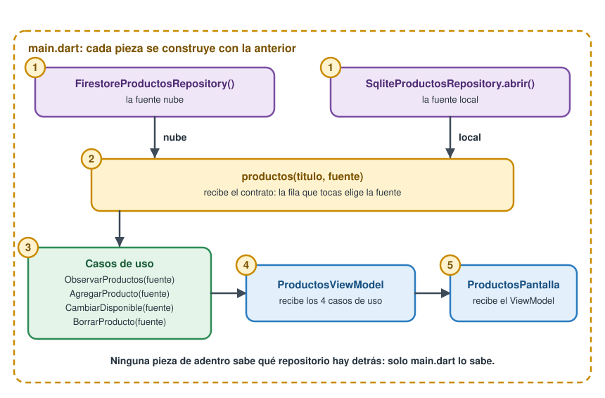{fig-alt="Dentro de un marco que representa main.dart, cinco pasos numerados: los repositorios concretos de Firestore y SQLite, la función productos donde entra la elección, los casos de uso, el ProductosViewModel y la ProductosPantalla, cada uno recibiendo al anterior."}

main.dart construye cada pieza con la anterior y es el único que sabe qué repositorio hay detrás.
:::

**lib/main.dart**

```dart
import 'package:clean_app/data/firestore/firebase_cuenta_repository.dart';
import 'package:clean_app/data/firestore/firestore_productos_repository.dart';
import 'package:clean_app/data/sqlite/sqlite_productos_repository.dart';
import 'package:clean_app/domain/repositories/cuenta_repository.dart';
import 'package:clean_app/domain/repositories/productos_repository.dart';
import 'package:clean_app/domain/usecases/agregar_producto.dart';
import 'package:clean_app/domain/usecases/borrar_producto.dart';
import 'package:clean_app/domain/usecases/cambiar_disponible.dart';
import 'package:clean_app/domain/usecases/observar_productos.dart';
import 'package:clean_app/firebase_options.dart';
import 'package:clean_app/presentation/cuenta/cuenta_pantalla.dart';
import 'package:clean_app/presentation/cuenta/cuenta_view_model.dart';
import 'package:clean_app/presentation/productos/productos_pantalla.dart';
import 'package:clean_app/presentation/productos/productos_view_model.dart';
import 'package:firebase_core/firebase_core.dart';
import 'package:flutter/material.dart';

Future<void> main() async {
  WidgetsFlutterBinding.ensureInitialized();
  await Firebase.initializeApp(options: DefaultFirebaseOptions.currentPlatform);
  runApp(
    MaterialApp(
      home: MainApp(
        nube: FirestoreProductosRepository(),
        local: await SqliteProductosRepository.abrir(),
        cuenta: FirebaseCuentaRepository(),
      ),
    ),
  );
}

class MainApp extends StatelessWidget {
  const MainApp({
    super.key,
    required this.nube,
    required this.local,
    required this.cuenta,
  });

  final ProductosRepository nube;
  final ProductosRepository local;
  final CuentaRepository cuenta;

  void abrir(BuildContext context, Widget pantalla) {
    Navigator.push(context, MaterialPageRoute(builder: (_) => pantalla));
  }

  Widget productos(String titulo, ProductosRepository fuente) {
    return ProductosPantalla(
      titulo: titulo,
      viewModel: ProductosViewModel(
        observar: ObservarProductos(fuente),
        agregar: AgregarProducto(fuente),
        cambiar: CambiarDisponible(fuente),
        borrar: BorrarProducto(fuente),
      ),
    );
  }

  @override
  Widget build(BuildContext context) {
    return Scaffold(
      appBar: AppBar(title: const Text('clean_app')),
      body: ListView(
        children: [
          ListTile(
            title: const Text('Cuenta'),
            onTap: () => abrir(
              context,
              CuentaPantalla(viewModel: CuentaViewModel(cuenta)),
            ),
          ),
          ListTile(
            title: const Text('Productos en la nube'),
            onTap: () =>
                abrir(context, productos('Productos en la nube', nube)),
          ),
          ListTile(
            title: const Text('Productos en el teléfono'),
            onTap: () =>
                abrir(context, productos('Productos en el teléfono', local)),
          ),
        ],
      ),
    );
  }
}
```

Por qué así:

- `main()` inicializa Firebase y abre la base SQLite (`SqliteProductosRepository.abrir()` espera a que el archivo exista) antes de `runApp`. Después crea los tres repositorios y los entrega a `MainApp`.
- `MainApp` recibe `nube` y `local` como `ProductosRepository`: el tipo es el contrato, no la clase concreta. Ahí es donde se elige la fuente, y es el único archivo que tiene que saber qué repositorio hay detrás.
- `productos(titulo, fuente)` arma una `ProductosPantalla` con un `ProductosViewModel` nuevo y los cuatro casos de uso apuntando a la misma `fuente`. La misma función abre "Productos en la nube" con `nube` y "Productos en el teléfono" con `local`.
- Las tres filas de la lista llevan a la pantalla de cuenta, a la de productos en la nube y a la de productos en el teléfono. Los datos de cada lista son independientes: cada fuente guarda lo suyo.
- Cambiar de fuente es cambiar el argumento que se pasa a `productos(...)`: una línea, en este archivo.

Qué debe verse al terminar: ejecuta `flutter run` en un emulador de Android o en un teléfono. La app abre con el título "clean_app" y tres filas: "Cuenta", "Productos en la nube" y "Productos en el teléfono".

- En "Cuenta", registra un usuario o inicia sesión: aparece "Sesión iniciada" con tu correo.
- En "Productos en el teléfono", agrega "Panela" con precio `3500`: aparece en la lista, sin internet y sin sesión. Cierra la app y ábrela: el producto sigue ahí.
- En "Productos en la nube", con sesión iniciada, agrega un producto: aparece en la lista y, si el servidor aún no confirmó, con "(sin enviar)". Sin sesión, el mensaje es `Inicia sesión para guardar cambios`, según las reglas de la guía de persistencia y nube.
- En cualquiera de las dos, un precio de `0` o un nombre vacío muestra `Escribe un nombre y un precio mayor que cero` y no borra lo escrito.

Error más probable: ejecutar la app en Chrome o en Windows. `sqflite` no corre allí, y como `main` abre la base antes de `runApp`, la app falla al arrancar con un error de sqflite. Usa un emulador de Android o un teléfono. Otro error frecuente es olvidar `WidgetsFlutterBinding.ensureInitialized()` antes de `Firebase.initializeApp`.

Contraste con `mvvm_app`: allí `main` armaba Service, Repository y ViewModel de una sola fuente. Aquí arma dos fuentes y las deja intercambiables con una sola pantalla.

## Paso 17. Las pruebas, sin Firebase ni SQLite

Qué se hace: escribir tres archivos de prueba. El primero es un repositorio falso en memoria que reemplaza a Firestore y a SQLite; los otros dos son pruebas que lo usan o que no necesitan ninguna fuente.

::: {.diagrama}
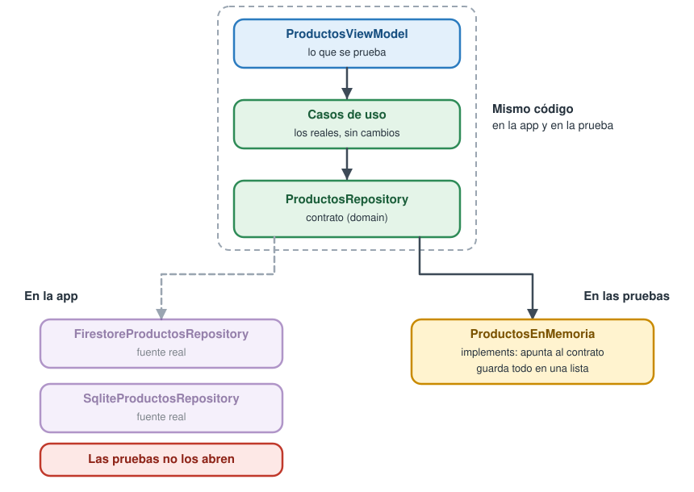{fig-alt="El ProductosViewModel, los casos de uso y el contrato ProductosRepository quedan iguales en la app y en las pruebas. En la app el contrato se conecta con Firestore y SQLite, en gris porque las pruebas no los abren; en las pruebas se conecta con ProductosEnMemoria, un falso que implementa el mismo contrato."}

Mismo ViewModel, mismos casos de uso y mismo contrato: solo cambia la fuente que hay detrás.
:::

Primero la fuente falsa. Cumple el mismo contrato que los repositorios reales, pero guarda todo en una lista.

**test/fakes/productos_en_memoria.dart**

```dart
import 'dart:async';

import 'package:clean_app/domain/entities/nuevo_producto.dart';
import 'package:clean_app/domain/entities/producto.dart';
import 'package:clean_app/domain/repositories/productos_repository.dart';

class ProductosEnMemoria implements ProductosRepository {
  ProductosEnMemoria() {
    _emitir();
  }

  final _productos = <Producto>[];
  final _salida = StreamController<List<Producto>>();
  var _siguiente = 1;

  @override
  Stream<List<Producto>> observar() => _salida.stream;

  @override
  Future<void> agregar(NuevoProducto nuevo) async {
    _productos.add(
      Producto(
        id: '${_siguiente++}',
        nombre: nuevo.nombre,
        precio: nuevo.precio,
        disponible: true,
      ),
    );
    _emitir();
  }

  @override
  Future<void> cambiarDisponible(String id, bool disponible) async {
    final i = _productos.indexWhere((p) => p.id == id);
    final p = _productos[i];
    _productos[i] = Producto(
      id: p.id,
      nombre: p.nombre,
      precio: p.precio,
      disponible: disponible,
    );
    _emitir();
  }

  @override
  Future<void> borrar(String id) async {
    _productos.removeWhere((p) => p.id == id);
    _emitir();
  }

  void _emitir() => _salida.add(List.of(_productos));
}
```

Después la prueba del ViewModel. Usa los casos de uso reales con la fuente falsa:

**test/productos_view_model_test.dart**

```dart
import 'package:clean_app/domain/usecases/agregar_producto.dart';
import 'package:clean_app/domain/usecases/borrar_producto.dart';
import 'package:clean_app/domain/usecases/cambiar_disponible.dart';
import 'package:clean_app/domain/usecases/observar_productos.dart';
import 'package:clean_app/presentation/productos/productos_view_model.dart';
import 'package:flutter_test/flutter_test.dart';

import 'fakes/productos_en_memoria.dart';

Future<void> esperar() => Future<void>.delayed(Duration.zero);

void main() {
  late ProductosViewModel vm;

  setUp(() {
    final fuente = ProductosEnMemoria();
    vm = ProductosViewModel(
      observar: ObservarProductos(fuente),
      agregar: AgregarProducto(fuente),
      cambiar: CambiarDisponible(fuente),
      borrar: BorrarProducto(fuente),
    );
  });

  tearDown(() => vm.dispose());

  test('muestra la lista vacia de la fuente al empezar', () async {
    await esperar();
    expect(vm.productos, isEmpty);
  });

  test('agrega un producto valido y aparece en la lista', () async {
    expect(vm.agregar(' Panela ', '3500'), isTrue);
    await esperar();
    expect(vm.productos!.single.nombre, 'Panela');
    expect(vm.productos!.single.precio, 3500);
    expect(vm.error, isNull);
  });

  test('rechaza datos invalidos con el mensaje de la regla', () async {
    expect(vm.agregar('Panela', '0'), isFalse);
    expect(vm.agregar('Panela', 'abc'), isFalse);
    expect(vm.agregar('  ', '2000'), isFalse);
    expect(vm.error, 'Escribe un nombre y un precio mayor que cero');
    await esperar();
    expect(vm.productos, isEmpty);
  });

  test('cambia la disponibilidad y borra', () async {
    vm.agregar('Papa criolla', '2500');
    await esperar();
    final id = vm.productos!.single.id;
    await vm.cambiarDisponible(id, false);
    await esperar();
    expect(vm.productos!.single.disponible, isFalse);
    await vm.borrar(id);
    await esperar();
    expect(vm.productos, isEmpty);
  });
}
```

Y la prueba del dominio y del DTO:

**test/dominio_y_datos_test.dart**

```dart
import 'package:clean_app/data/dtos/producto_dto.dart';
import 'package:clean_app/domain/entities/nuevo_producto.dart';
import 'package:clean_app/domain/failures/falla.dart';
import 'package:flutter_test/flutter_test.dart';

void main() {
  group('NuevoProducto', () {
    test('recorta el nombre', () {
      final nuevo = NuevoProducto('  Tomate chonto ', 1800);
      expect(nuevo.nombre, 'Tomate chonto');
    });

    test('rechaza un nombre vacio o un precio que no es mayor que cero', () {
      for (final (nombre, precio) in [
        ('', 100),
        ('Aguacate hass', 0),
        ('x', -5),
      ]) {
        expect(
          () => NuevoProducto(nombre, precio),
          throwsA(
            isA<Falla>().having((f) => f.codigo, 'codigo', 'datos-invalidos'),
          ),
        );
      }
    });
  });

  group('ProductoDto.desdeFila', () {
    test('convierte el id entero a texto y 1 o 0 a booleano', () {
      final disponible = ProductoDto.desdeFila({
        'id': 7,
        'nombre': 'Platano',
        'precio': 2200,
        'disponible': 1,
      }).aEntidad();
      final agotado = ProductoDto.desdeFila({
        'id': 8,
        'nombre': 'Platano',
        'precio': 2200,
        'disponible': 0,
      }).aEntidad();
      expect(disponible.id, '7');
      expect(disponible.disponible, isTrue);
      expect(agotado.disponible, isFalse);
    });
  });
}
```

Por qué así:

- `ProductosEnMemoria implements ProductosRepository`: es la prueba de que el contrato vale. El ViewModel no distingue entre este falso, Firestore y SQLite.
- El falso emite la lista vacía al construirse. El controlador de un `Stream` guarda lo que se emite hasta que alguien escucha, así que el ViewModel recibe esa primera lista apenas se suscribe.
- `esperar()` cede el turno una vez (`Future.delayed(Duration.zero)`) para que los eventos del `Stream` lleguen antes de revisar el estado.
- La prueba del ViewModel cubre agregar un producto válido (el nombre llega recortado), rechazar datos inválidos con el mensaje de la regla, y cambiar la disponibilidad y borrar.
- La prueba del dominio fija la regla del precio en un solo lugar y el DTO convierte `7` en `'7'` y `1` y `0` en booleanos.
- Ninguna prueba abre Firebase ni SQLite. El ViewModel y los casos de uso no importan ninguno de los dos, y `producto_dto.dart` solo usa un tipo de Firestore, sin inicializarlo.

Ejecuta las pruebas y el análisis:

```
flutter test
flutter analyze
```

Qué debe verse al terminar: `flutter test` termina con `All tests passed!` (siete pruebas) y `flutter analyze` con `No issues found!`.

Comprueba también la regla de dependencia sobre tu propio código, en PowerShell, desde la carpeta `clean_app`:

```
Select-String -Path "lib\presentation\*\*.dart" -Pattern "clean_app/data"
Select-String -Path "lib\domain\*\*.dart" -Pattern "^import"
```

El primer comando no debe mostrar nada: la presentación no importa `data`. El segundo lista los `import` del dominio, y todos deben empezar con `package:clean_app/domain/`: ni Flutter, ni Firebase, ni sqflite.

Error más probable: en `test/productos_view_model_test.dart`, el ViewModel se crea en `setUp` y se desecha en `tearDown`. Si quitas el `tearDown`, la suscripción al `Stream` sigue viva entre pruebas y puede mezclar eventos de una prueba con la siguiente. Otro error frecuente es no llamar a `await esperar()` antes de revisar `vm.productos`: la lista todavía es `null`.

## Antes y después

La medida de una arquitectura es qué pasa cuando cambia un requisito. Tres requisitos, y el archivo que se toca en cada versión:

| Requisito | `clase_nube` (antes) | `mvvm_app` | `clean_app` |
|---|---|---|---|
| Cambiar la regla del precio (por ejemplo, un precio mínimo) | No había regla (línea 35 de `productos_nube_pantalla.dart`); ponerla era editar `agregar` en esa pantalla y repetirla en `productos_pantalla.dart` | `ui/productos/view_models/productos_view_model.dart` (el `if` de `agregar`, mezclado con el mensaje) | `domain/entities/nuevo_producto.dart`. Si cambia también el texto, además `_mensajeDe` en `presentation/productos/productos_view_model.dart` |
| Cambiar de fuente de datos (de la nube al teléfono) | Usar otra pantalla y otro modelo: `productos_pantalla.dart`, `producto.dart` y `base_datos.dart` en vez de `productos_nube_pantalla.dart` y `producto_nube.dart` | Reescribir `data/services/productos_service.dart` y `data/repositories/productos_repository.dart`, que reciben tipos de Firestore. El ViewModel y la Vista no cambian si el nuevo Repository conserva el nombre y los métodos | Una línea en `main.dart`: pasar `local` en vez de `nube` a `productos(...)`. Una fuente nueva es un archivo nuevo en `data/<fuente>/` que implemente el contrato. `domain` y `presentation` no se tocan |
| Probar sin Firebase | No se puede: la pantalla crea `FirebaseFirestore.instance.collection('productos')` en su propio estado (línea 13) | Se puede con un falso que implementa la clase concreta (`test/productos_view_model_test.dart`), pero el ViewModel importa el archivo del Repository, que importa `cloud_firestore` | `ProductosEnMemoria` en `test/fakes/`. El ViewModel y los casos de uso no importan Firebase ni sqflite |

## El costo, sin maquillaje

Clean Architecture no es gratis, y esta guía no la defiende por ser "mejor". Estas son las cifras de la app que acabas de construir.

::: {.diagrama}
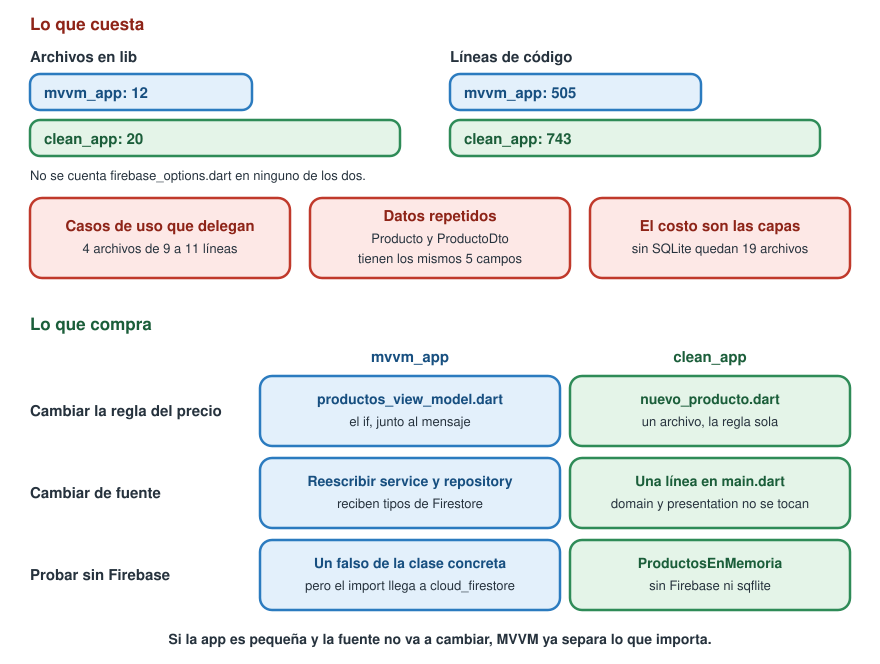{fig-alt="Barras que comparan mvvm_app con clean_app: 12 contra 20 archivos y 505 contra 743 líneas, seguidas de tres recuadros rojos con los costos de Clean. Debajo, una tabla muestra qué archivo se toca en cada app al cambiar la regla del precio, cambiar de fuente y probar sin Firebase."}

Clean cuesta más archivos y más líneas, y a cambio cada cambio se concentra en un solo lugar.
:::

- Archivos: 20 en `lib` de `clean_app` frente a 12 en `lib` de `mvvm_app`, sin contar `firebase_options.dart` en ninguno de los dos. Compruébalo en PowerShell, dentro de cada proyecto: `(Get-ChildItem lib -Recurse -Filter *.dart | Where-Object Name -ne firebase_options.dart).Count`. En líneas, son 743 frente a 505.
- Casos de uso que solo delegan: los cuatro archivos de `domain/usecases` miden de 9 a 11 líneas y cada uno llama a un solo método del repositorio. Por sí solos no agregan comportamiento por ahora. Por eso `CuentaViewModel` los omite.
- Datos repetidos: `Producto` y `ProductoDto` tienen los mismos cinco campos. La repetición compra algo concreto (el dominio no importa Firestore), pero es repetición.
- El costo no es SQLite: quitar `sqlite_productos_repository.dart` deja 19 archivos. La mayor parte viene de las capas, no de la segunda fuente.

Cuándo no vale la pena: una app pequeña, con una sola fuente de datos que no va a cambiar, reglas simples y pocas pantallas. Ahí MVVM con Repository ya separa lo que importa, y las carpetas de contratos, casos de uso y DTO son archivos que nadie va a cambiar.

Cuándo sí: cuando hay varias fuentes de datos (como aquí, nube y teléfono), cuando las reglas del negocio crecen y deben vivir en un solo lugar, o cuando hace falta probar la lógica sin infraestructura. Fíjate en lo que esta app logra y la versión MVVM no: una pantalla que sirve para las dos fuentes, una regla del precio que cambia en un archivo, y pruebas que corren sin Firebase.
