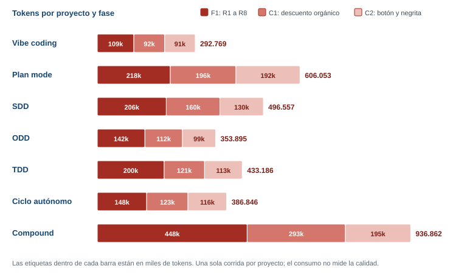

El Carrito de Plaza es el caso que atraviesa esta guía. Se construyó una vez con cada metodología de la sección 5, con el mismo punto de partida y el mismo modelo, para que puedas comparar lo que cada una produjo, lo que consumió y cómo respondió a dos cambios de requisito. Esta sección cuenta el encargo, cómo se hizo el experimento, qué límites tiene y termina con una práctica para que lo repitas sobre tu propia Plaza.

### El encargo

El punto de partida es Plaza en el commit `dc3dacf`: el catálogo está en PostgreSQL y los pedidos se guardan en memoria. El encargo es este, literal:

> Plaza es una aplicación ASP.NET Core MVC (.NET 10) con EF Core y PostgreSQL. Hoy permite ver el catálogo (`/catalogo`), ver un producto (`/catalogo/{id}`) y pedir un solo producto (`/catalogo/{id}/pedir`). Se necesita un carrito en `/carrito` para pedir varios productos en un solo pedido.

- R1. `Producto` gana los campos `Stock` (entero) y `EsOrganico` (booleano), con una migración de EF Core y estos datos iniciales: Tomate, stock 20, orgánico; Aguacate, stock 15, orgánico; Papa, stock 50, no orgánico; Panela, stock 30, no orgánico.
- R2. En `/carrito`, cada producto del catálogo se muestra con su precio, su stock, si es orgánico y un campo de cantidad. La cantidad es un entero entre 0 y el stock del producto. Si no lo es, se muestra "La cantidad de {producto} debe estar entre 0 y {stock}", por ejemplo "La cantidad de Tomate debe estar entre 0 y 20".
- R3. Subtotal = suma de precio por cantidad de cada producto.
- R4. Descuento del 10% del subtotal si el subtotal es de 50.000 COP o más.
- R5. Domicilio de 5.000 COP. Es gratis si el subtotal es de 80.000 COP o más. Total = subtotal menos descuento más domicilio.
- R6. No se confirma el pedido si todas las cantidades son 0 (se muestra "Agrega al menos un producto") ni si el nombre del cliente no cumple la regla del pedido actual (entre 3 y 60 letras, obligatorio).
- R7. Al confirmar, se muestra una página de gracias con el resumen: cada producto con su cantidad, el subtotal, el descuento, el domicilio, el total y el número de pedido.
- R8. El pedido de un solo producto que ya existe (`/catalogo/{id}/pedir`) sigue funcionando igual.

Después de terminar R1 a R8 llegan dos cambios, cada uno en una sesión nueva y con solo su texto.

**Cambio C1:** "El descuento del 10% ahora se calcula solo sobre los productos orgánicos. La condición para aplicarlo no cambia: el subtotal del pedido debe ser de 50.000 COP o más."

**Cambio C2:** "El botón del carrito dice 'Confirmar pedido' y el total se muestra en negrita."

C1 contradice la regla R4 que el agente acaba de implementar y exige decidir qué significa "el subtotal del pedido". C2 tiene una mitad que ya se cumplía en los seis proyectos que lo reportaron (el botón) y otra ambigua (qué total). Son cambios pequeños: miden cuánto cuesta cambiar de idea con cada metodología.

El enunciado no dice cómo verificar: no trae el comando de verificación ni pide pegar evidencia, que sí aparecen en el encargo de la sección 4. Lo que cada proyecto comprobó lo decidió su metodología.

### Cómo se hizo el experimento

1. **Una base por proyecto.** Se copió Plaza en el commit `dc3dacf` a siete carpetas, cada una con su propio repositorio de git y un commit inicial "base: Plaza en dc3dacf". La carpeta `00-base` queda sin tocar.
2. **El mismo modelo.** Todos los proyectos usaron Claude Sonnet.
3. **Tres fases por proyecto.** F1 construye R1 a R8. C1 y C2 llegan después, cada uno en una sesión nueva: el agente solo recibe el texto del cambio y lo demás lo lee del repositorio. En plan mode cada fase tiene dos turnos en la misma conversación (plan y código), y el docente aprobó los planes sin cambios.
4. **El consumo lo reporta el agente.** Cada fase corrió como un subagente que informó, al terminar, sus tokens, sus llamadas a herramientas y su duración en segundos.
5. **Verificación independiente.** Al final, un verificador distinto de quien construyó cada proyecto ejecuta 12 escenarios comunes contra la aplicación en marcha. Cubren cada regla, los umbrales de 50.000 y 80.000 COP en su límite, el nombre del cliente, la página de gracias, el pedido de un solo producto y los dos cambios. Los agentes constructores no vieron esos escenarios.

| Carpeta | Metodología | Detalle de la configuración |
|---|---|---|
| `00-base` | Plaza sin cambios | Punto de partida: commit `dc3dacf` |
| `01-vibe-coding` | Vibe coding | Sin proceso adicional |
| `02-plan-mode` | Plan mode | Dos turnos por fase: plan y código |
| `03-sdd` | SDD | Spec Kit 1.4.4.dev0 (commit `a4d5712`) |
| `04-odd` | ODD | Rama `feature/carrito` |
| `05-tdd` | TDD con augmented coding | xUnit; commits `estructura:` y `comportamiento:` |
| `06-ciclo-autonomo` | Ciclo autónomo con autoauditoría | Tope de 5 vueltas |
| `07-compound` | Compound engineering | Plugin de Every 3.38.2 (commit `58d1a83`) |

### Qué límites tiene

Los números de este caso son observaciones, no un ranking. Estas son las limitaciones declaradas:

- **Una sola corrida por metodología.** Un agente puede resolver la misma tarea de otra manera si se lo pides otra vez. Nada de lo que sigue permite decir que una metodología es mejor que otra.
- **Un entorno compartido.** Todos los agentes corrieron en el mismo entorno, con la misma configuración global (instrucciones generales y herramientas instaladas). Lo que ves mezcla la metodología con ese entorno. En la fase 1 de una de las metodologías, además, el agente usó por su cuenta una herramienta del entorno ajena a la metodología, de modo que su consumo puede incluir trabajo que la metodología no pide.
- **Cifras autoreportadas.** Los tokens, las llamadas y los segundos los informó cada agente, y plan mode suma los dos turnos de cada fase. Compound engineering lanzó subagentes propios y su cifra puede no incluir el consumo de ellos.
- **Los proyectos dejan cosas distintas.** Unos dejan pruebas, otros documentos y otros solo código. Un menor consumo no significa mejor resultado, ni un mayor consumo peor resultado.

### Cuánto consumió cada proyecto

Tokens que reportó el agente en cada fase. F1 es la construcción de R1 a R8. Los totales de las tres fases están en la figura: de 292.769 en vibe coding a 936.862 en compound.

| Proyecto | F1 | C1 | C2 |
|---|---|---|---|
| Vibe coding | 109.273 | 92.216 | 91.280 |
| Plan mode | 218.244 | 196.119 | 191.690 |
| SDD | 206.206 | 160.161 | 130.190 |
| ODD | 142.374 | 112.023 | 99.498 |
| TDD | 199.866 | 120.777 | 112.543 |
| Ciclo autónomo | 147.706 | 123.453 | 115.687 |
| Compound | 448.083 | 293.397 | 195.382 |

::: {.diagrama}
{fig-alt="Barras horizontales apiladas con los tokens que reportó el agente en cada proyecto, divididos en tres fases: F1 (reglas R1 a R8), C1 y C2. Vibe coding: 109.273, 92.216 y 91.280, total 292.769. Plan mode: 218.244, 196.119 y 191.690, total 606.053. SDD: 206.206, 160.161 y 130.190, total 496.557. ODD: 142.374, 112.023 y 99.498, total 353.895. TDD: 199.866, 120.777 y 112.543, total 433.186. Ciclo autónomo: 147.706, 123.453 y 115.687, total 386.846. Compound engineering: 448.083, 293.397 y 195.382, total 936.862."}

Tokens por proyecto y fase. El consumo describe lo que se gastó, no lo que se obtuvo.
:::

Llamadas a herramientas y duración en segundos, por fase, con el formato "llamadas y segundos" (plan mode suma plan y código):

| Proyecto | F1 | C1 | C2 |
|---|---|---|---|
| Vibe coding | 12 y 100,5 | 7 y 39,2 | 5 y 44,9 |
| Plan mode | 17 y 247,6 | 11 y 107,1 | 11 y 90,6 |
| SDD | 47 y 676,3 | 25 y 203,3 | 20 y 162,2 |
| ODD | 23 y 442,7 | 16 y 174,8 | 8 y 85,0 |
| TDD | 62 y 1.109,1 | 20 y 254,3 | 20 y 148,3 |
| Ciclo autónomo | 35 y 667,3 | 17 y 242,8 | 16 y 289,2 |
| Compound | 107 y 1.858,6 | 66 y 568,3 | 34 y 228,1 |

Cómo leer los tokens: cada sesión parte de un piso fijo de unos 85.000 a 90.000 tokens de contexto del entorno (instrucciones generales y definiciones de herramientas). Se ve en los cambios de una línea, que gastan unos 91.000. Lo que distingue a las metodologías es lo que se suma por encima de ese piso. Plan mode paga el piso dos veces por fase, porque cada fase tiene dos turnos, el del plan y el del código.

Tres observaciones, con la cautela de los límites anteriores:

- En C1 y en C2 solo compound gastó más que plan mode, que paga el piso dos veces aunque los cambios fueron de una a cinco líneas. Compound lanzó además subagentes propios en F1, y esa cifra puede estar subestimada.
- Por encima del piso, el cambio de una línea de C2 costó casi nada en vibe coding (91.280 tokens) y 7 documentos en SDD (130.190): la ceremonia que cada metodología mantiene se paga aun cuando el cambio es mínimo.
- El consumo no cuenta lo que quedó en el repositorio. La tabla siguiente completa la comparación.

Qué dejó cada proyecto para el próximo cambio:

| Proyecto | Verificación que queda en el repositorio | Documentos de proceso |
|---|---|---|
| Vibe coding | Ninguna | Ninguno |
| Plan mode | Ninguna: se verificó con `curl` en la sesión | Ninguno: el plan quedó en la conversación |
| SDD | `quickstart.md`, con los escenarios para ejecutar con `curl` | Constitución, especificación, plan, tareas y otros cinco documentos |
| ODD | 25 pruebas xUnit | Un documento de la funcionalidad con requisitos, tareas y bitácora |
| TDD | 70 pruebas xUnit | `tdd/evidencia.md`, con los bloques de rojo y verde |
| Ciclo autónomo | `tests/carrito.sh`, con 48 comprobaciones HTTP | `ciclo/registro.md`, con una auditoría por vuelta |
| Compound | 50 pruebas xUnit y `tests/carrito.sh`, con 58 comprobaciones HTTP | Dos planes, una nota de solución y el glosario `CONCEPTS.md` |

### Qué cumplió cada proyecto

La verificación independiente corrió los 12 escenarios contra los siete proyectos compilados y en marcha. Todos compilan sin advertencias ni errores en el proyecto web. Además de los 12 escenarios se corrieron sondas de robustez: entradas que el enunciado no menciona, como una cantidad que no es un número, un cliente de 61 caracteres o un formulario sin token.

| Proyecto | Escenarios | Sondas | Pruebas |
|---|---|---|---|
| Vibe coding | 12 de 12 | 4 | Ninguna |
| Plan mode | 12 de 12 | 0 | Ninguna |
| SDD | 12 de 12 | 0 | Ninguna |
| ODD | 12 de 12 | 0 | 25 xUnit |
| TDD | 12 de 12 | 0 | 70 xUnit |
| Ciclo autónomo | 12 de 12 | 0 | 48 HTTP |
| Compound | 12 de 12 | 0 | 50 xUnit y 58 HTTP |

En la tabla, Escenarios son los cumplidos de los 12, Sondas son las sondas de robustez con resultado anómalo y Pruebas son las pruebas propias que dejó el proyecto (xUnit o comprobaciones HTTP de extremo a extremo).

Los siete cumplen el encargo completo. Lo que cambia es la evidencia que dejan y el tamaño de lo que escribieron. Líneas añadidas respecto al commit base, sin contar la migración de EF, que es idéntica en los siete:

| Proyecto | Código | Pruebas | Documentos |
|---|---|---|---|
| Vibe coding | 242 | 0 | 0 |
| Plan mode | 286 | 0 | 0 |
| SDD | 243 | 0 | 678, más 5.405 de andamiaje de Spec Kit |
| ODD | 261 | 140 | 37 |
| TDD | 268 | 620 | 1.102 |
| Ciclo autónomo | 312 | 105 | 184 |
| Compound | 312 | 545 | 500 |

Las sondas también dejaron observaciones sin que ningún proyecto falle, porque el enunciado no las define. ODD y compound rechazan una cantidad con espacios (" 3 ") y los otros cinco la aceptan. Los siete aceptan el nombre "Ana123", porque todos implementaron solo la longitud de "entre 3 y 60 letras", igual que el pedido de un solo producto. Vibe coding muestra los importes sin separador de miles y con decimales ("$56000,00"), plan mode agregó un botón "Calcular" que nadie pidió y ODD lista "$3500,00" sin formato en `/carrito`, aunque su página de gracias sí está formateada: son defectos de presentación y de alcance, no de reglas.

#### El defecto que los 12 escenarios no vieron

Un solo proyecto tiene un defecto real: vibe coding. Si una cantidad no es un número, el carrito la descarta en silencio y puede confirmar un pedido incompleto. La evidencia: un POST a `/carrito` con Tomate "abc", Aguacate 3 y un cliente válido responde con una redirección a la página de gracias, y el pedido confirmado solo tiene el Aguacate, con total de 23.000 COP (18.000 de producto y 5.000 de domicilio). Nadie le avisó al cliente que el Tomate se perdió. Con "abc", "2.5" o "99999999999" en una sola línea, la respuesta es "Agrega al menos un producto" en lugar del mensaje de R2.

La causa está en `01-vibe-coding/Controllers/CarritoController.cs`: la cantidad es un entero, el enlazador falla con un texto, y el código borra ese error antes de validar el rango:

```csharp
            ModelState.Remove($"Lineas[{i}].Cantidad");
            if (linea.Cantidad < 0 || linea.Cantidad > producto.Stock)
            {
                ModelState.AddModelError($"Lineas[{i}].Cantidad", $"La cantidad de {producto.Nombre} debe estar entre 0 y {producto.Stock}");
```

Los escenarios E1 a E12 no lo detectan: E2 y E3 usan enteros fuera de rango, y ninguno manda texto. Lo detectaron cuatro sondas de robustez: Tomate "abc", Tomate "2.5", Tomate "99999999999" y Tomate "abc" junto a Aguacate 3. Los otros seis proyectos pasan esas sondas.

Es una lección sobre la verificación. Un escenario escrito a partir del encargo comprueba lo que el encargo dice. Un defecto que vive en lo que el encargo no dice solo aparece cuando alguien pregunta qué pasa con la entrada que nadie esperaba. El vibe coding no comprobó R2 a R8 y no escribió una sola prueba, y el defecto estaba en esa zona. Por eso, al verificar lo que entrega un agente, no basta con repetir los casos del encargo: pide también entradas hostiles, vacías y de otro tipo, y mira qué hace el sistema con ellas.

### Práctica: el Carrito en tu Plaza

Esta práctica es una actividad de aprendizaje, sin nota ni rúbrica. Aplicas el Carrito, o un cambio pequeño propio, sobre tu Plaza con una metodología de la sección 5 y una herramienta gratuita de la sección 3, y guardas la evidencia para poder explicar lo que hiciste.

**Qué guardas.** Una carpeta `practica-ia/` en el repositorio de tu Plaza, con Markdown y la salida de los comandos pegada como texto. Todo entra en tus commits.

1. **Prepara el punto de partida.** Parte de tu Plaza con el catálogo en PostgreSQL, sobre una rama limpia, y haz un commit de base. Anota su hash: es tu estado "antes".
2. **Elige el cambio.** Puede ser el Carrito completo (R1 a R8) o un cambio pequeño propio con al menos tres reglas que lleven números y mensajes literales, por ejemplo un cupón de descuento o un límite de cantidad por pedido.
3. **Elige la metodología y la herramienta.** Escoge una metodología de la sección 5 y una herramienta gratuita de la sección 3. Antes de empezar, confirma en su página oficial qué cubre el plan gratuito, como pide la advertencia del inicio de la guía. En `practica-ia/eleccion.md` escribe qué elegiste y una ventaja y un inconveniente que esperas.
4. **Escribe el encargo antes de abrir el agente.** Usa las cinco partes de la sección 4 y guárdalo en `practica-ia/encargo.md`. Incluye el comando que prueba cada regla.
5. **Trabaja con la metodología y guarda su artefacto.** Es el plan aprobado en plan mode, la especificación y las tareas en SDD, el documento de la funcionalidad en ODD, los bloques de rojo y verde en TDD, el registro de vueltas en el ciclo autónomo o la nota de lo aprendido en compound engineering. Si el agente no lo deja en el repositorio, cópialo a `practica-ia/`.
6. **Lleva la bitácora de prompts.** En `practica-ia/bitacora.md` agrega una fila por cada prompt que cambió algo. La columna Decisión dice si lo aceptaste, lo corregiste o lo descartaste, y por qué.
7. **Pide un cambio nuevo en una sesión nueva.** Usa el cambio C1 de este caso o escribe uno propio que modifique una de tus reglas, y dale al agente solo su texto. Anota qué leyó del repositorio, qué archivos tocó y qué tuvo que volver a descubrir.
8. **Verifica tú.** Ejecuta `dotnet build` y las pruebas o los comandos de tu encargo, lee el diff completo y pega la salida real en `practica-ia/evidencia.md`. Si tu herramienta informa el consumo (tokens o solicitudes), anótalo por fase.
9. **Declara el uso de IA.** Escribe `practica-ia/declaracion-ia.md` con el formato del ejemplo de la sección 9: la herramienta y el modelo, qué hizo el agente, qué hiciste tú y dónde está la evidencia.
10. **Cierra la elección.** Al final de `eleccion.md` escribe qué ventaja e inconveniente esperabas y cuáles viste.

Una plantilla para la bitácora:

```markdown
| Número | Prompt (copiado tal cual) | Qué hizo el agente | Decisión | Por qué |
|---|---|---|---|---|
| 1 | Agrega Stock y EsOrganico a Producto con una migración | Creó la migración y cambió el modelo | Aceptado | El diff solo toca Models/ y Migrations/ |
| 2 | Ahora el carrito en /carrito | Creó el controlador y dos vistas | Corregido | Faltaba el mensaje exacto de la cantidad; lo pedí de nuevo con el texto literal |
| 3 | Agrega también un enlace desde el catálogo | Cambió la vista del catálogo | Descartado | No estaba en el encargo y toca el pedido de un solo producto |
```

**Cuándo la das por terminada.**

- Cada regla de tu encargo tiene un comando y su salida pegada en `evidencia.md`.
- Puedes explicar cada archivo del diff, incluso los que escribió el agente.
- La bitácora incluye el cambio del paso 7, con lo que el agente tuvo que volver a descubrir.
- La declaración de uso de IA dice qué hizo el agente y qué hiciste tú.

### Comprueba

Puedes describir cómo se hizo el experimento y por qué sus cifras son observaciones y no un ranking, nombrar dos limitaciones declaradas, y tienes en tu repositorio la carpeta `practica-ia/` con el encargo, el artefacto de la metodología, la bitácora, la evidencia y la declaración de uso de IA.
