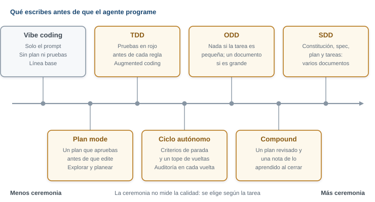
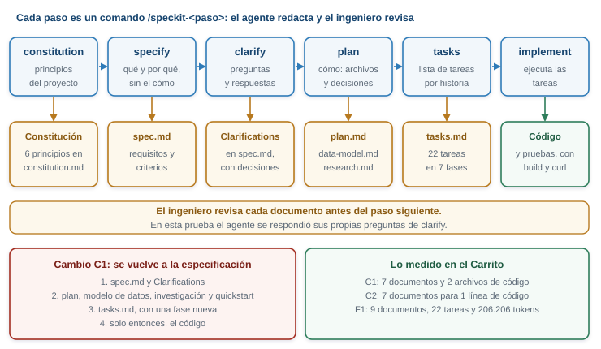
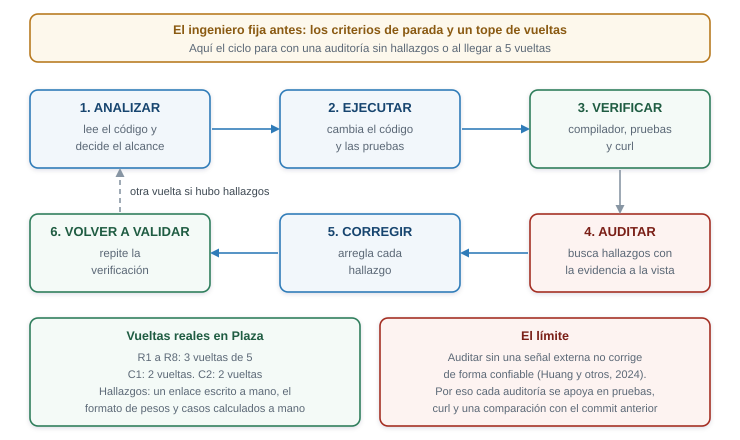
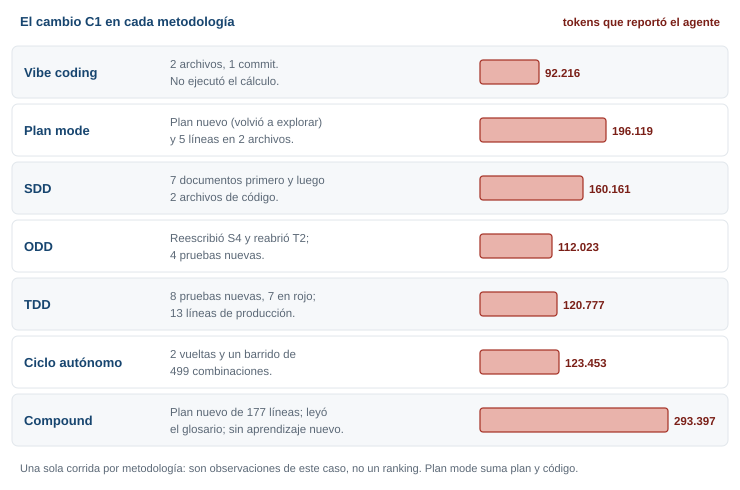

Las metodologías para trabajar con agentes se diferencian, sobre todo, en lo que escribes y apruebas antes de que el agente toque el código. En un extremo no escribes nada. En el otro, el agente produce varios documentos que tú revisas antes de ver una sola línea de código. No existe una metodología oficial: son prácticas que distintos autores y fabricantes han nombrado en los últimos dos años, y esta sección las ordena por esa pregunta.

::: {.diagrama}
{fig-alt="Un eje horizontal de menos a más ceremonia previa. De izquierda a derecha: vibe coding, que solo tiene el prompt y es la línea base; plan mode, con un plan que se aprueba antes de editar; TDD con augmented coding, con pruebas en rojo antes de cada regla; ciclo autónomo con autoauditoría, con criterios de parada y tope de vueltas; ODD, que no escribe nada si la tarea es pequeña y un documento si es grande; compound engineering, con un plan revisado y una nota de lo aprendido; y SDD, con constitución, especificación, plan y tareas. Una nota dice que la ceremonia no mide la calidad y que se elige según la tarea."}

Las metodologías ordenadas por lo que escribes antes de que el agente programe. La ceremonia no mide la calidad.
:::

Cada práctica se presenta igual: qué es y quién la propone, cómo se trabaja paso a paso, un ejemplo real del Carrito de Plaza con extractos copiados de los archivos que dejó el agente, cómo absorbió los dos cambios de requisito (C1 y C2), cuánto consumió y sus ventajas e inconvenientes. Ninguna se presenta como la mejor: la tarea decide.

Los ejemplos salen del experimento que cuenta la sección 6: el mismo encargo (R1 a R8) y dos cambios posteriores (C1 y C2), hechos una vez con cada metodología, sobre copias del mismo punto de partida y con el mismo modelo. Las rutas de los extractos empiezan por la carpeta del proyecto, por ejemplo `03-sdd/`. Las cifras de consumo las reportó cada agente al terminar y vienen de una sola corrida: describen lo que pasó en este caso, no predicen lo que te pasará. Para leer los tokens, ten presente que cada sesión parte de un piso fijo de unos 85.000 a 90.000 tokens de contexto del entorno (instrucciones generales y definiciones de herramientas), que se ve en los cambios de una línea, que gastan unos 91.000. Lo que distingue a las metodologías es lo que se suma por encima de ese piso, y plan mode paga el piso dos veces por fase porque cada fase tiene dos turnos, el del plan y el del código.

| Metodología | Qué escribes antes de programar | Para qué tarea suele servir |
|---|---|---|
| Vibe coding | Solo el prompt | Un prototipo que vas a descartar |
| Plan mode (explorar, planear, codificar) | Un plan que apruebas antes de que el agente edite | Una tarea que toca varios archivos y cuyo rumbo quieres ver antes de editar |
| SDD | Constitución, especificación, plan y tareas | Una funcionalidad grande en la que varias personas deben acordar qué se construye |
| ODD | Nada si la tarea es pequeña; un documento si es grande | Un proyecto con tareas de tamaños muy distintos |
| TDD con augmented coding | Pruebas que fallan antes de cada regla | Reglas con números y límites, como el dinero |
| Ciclo autónomo con autoauditoría | Criterios de parada y un tope de vueltas | Una tarea con un criterio de terminado que una máquina puede comprobar |
| Compound engineering | Un plan revisado y, al cerrar, una nota de lo aprendido | Un proyecto que vas a seguir tocando y cuyo aprendizaje conviene conservar |

La última columna es una orientación para empezar a pensar, no una regla. Cada subsección dice quién propone la práctica, qué costó y qué falló en el Carrito.

### Vibe coding: la línea base

**Qué es y quién la propone.** Andrej Karpathy lo nombró el 2 de febrero de 2025 (sección 1). Describes lo que quieres, el agente escribe, ejecutas y pides ajustes sin leer el código. El enunciado del Carrito no dice cómo verificar y el vibe coding no agrega ninguna verificación: por eso sirve de punto de comparación.

**Cómo se trabaja.**

1. Describes el resultado que quieres con una frase o un párrafo.
2. El agente edita el proyecto y te dice que terminó.
3. Ejecutas la aplicación y miras si parece funcionar.
4. Pides ajustes con otra frase y vuelves al paso 2.

::: {.callout-tip}
## En el Carrito de Plaza

Para R1 a R8 el agente hizo un solo commit, llamado `carrito`, con 12 archivos (416 líneas añadidas y 14 quitadas) y, según su informe, no comprobó R2 a R8. Ante C1 cambió dos archivos. Este es el cambio de cálculo, en `01-vibe-coding/Services/PedidosCarrito.cs` (commit `0a9289b`):

```diff
-    public static (decimal subtotal, decimal descuento, decimal domicilio, decimal total) Calcular(decimal subtotal)
+    public static (decimal subtotal, decimal descuento, decimal domicilio, decimal total) Calcular(decimal subtotal, decimal subtotalOrganicos)
     {
-        var descuento = subtotal >= 50000m ? subtotal * 0.10m : 0m;
+        var descuento = subtotal >= 50000m ? subtotalOrganicos * 0.10m : 0m;
```

El agente no ejecutó el cálculo para ver si daba lo esperado. En C2 descubrió que el botón ya decía "Confirmar pedido" y, como `/carrito` no muestra un total, puso en negrita el de la página de gracias: un supuesto que no confirmó. Este es el cambio, en `01-vibe-coding/Views/Carrito/Gracias.cshtml` (commit `af06a8d`):

```diff
-    <p>Total: $@Model.Total</p>
+    <p><strong>Total: $@Model.Total</strong></p>
```
:::

**Consumo (autoreportado).** F1: 109.273 tokens, 12 llamadas a herramientas y 100,5 segundos. C1: 92.216 tokens, 7 llamadas y 39,2 segundos. C2: 91.280 tokens, 5 llamadas y 44,9 segundos. Es el consumo más bajo de los siete proyectos: casi todo es el piso del entorno.

| Ventajas | Inconvenientes |
|---|---|
| Es la más rápida y la que menos tokens gasta: 292.769 en las tres fases | Nada obliga a comprobar el resultado: en F1 no se comprobaron R2 a R8, y la verificación independiente de la sección 6 encontró el único defecto real de los siete proyectos |
| No exige escribir nada antes y sirve para explorar una idea | C1 se aplicó sin ejecutar el cálculo que cambiaba |
| Sirve para un prototipo que vas a descartar | Los supuestos, como la negrita en la página de gracias, quedan sin confirmar |

### Plan mode y Explore-Plan-Code-Commit

**Qué es y quién la propone.** Anthropic recomienda separar la exploración y la planificación de la escritura de código: Explorar, Planear, Codificar y hacer Commit (Explore, Plan, Code, Commit). Publicó el patrón en abril de 2025 y hoy está en sus [buenas prácticas](https://code.claude.com/docs/en/best-practices). En Claude Code, el modo de planificación hace que el agente lea y proponga sin editar hasta que apruebes el plan.

**Cómo se trabaja.**

1. Activas el modo de planificación con `Shift+Tab`, con `/plan` o con `claude --permission-mode plan`.
2. Explorar: el agente lee el repositorio sin editar y te pregunta lo que no puede resolver leyendo.
3. Planear: propone los pasos, los archivos que tocará y cómo comprobará cada uno. Tú lo lees, lo corriges y lo apruebas.
4. Codificar: con el plan aprobado, el agente edita y ejecuta las comprobaciones que el plan prometió.
5. Commit: un commit por paso del plan, con un mensaje que lo describa.

::: {.callout-tip}
## En el Carrito de Plaza

En el experimento cada fase tuvo dos turnos en la misma conversación: el plan y, tras la aprobación del docente, el código. El docente aprobó los planes sin cambios; en F1, el agente resolvió seis dudas como proponía. El plan vive en la conversación y no quedó como archivo del repositorio. Lo que sí quedó son los commits, uno por paso. Esta es la salida de `git log --oneline` en `02-plan-mode`, sin el commit base:

```text
197e3cf feat: mostrar el total del carrito en negrita
b2634de feat: aplicar el descuento del 10% solo a productos orgánicos
7334f83 feat: página /carrito con validación de cantidades y resumen de pedido
4097689 feat: calcular subtotal, descuento y domicilio del carrito
d159343 feat: agregar Stock y EsOrganico a Producto con migración y datos iniciales
```

C1 llegó en una sesión nueva, donde el plan anterior no existe, así que el agente volvió a explorar desde cero antes de planear. El cambio final fue de cinco líneas en dos archivos. Esta es la parte del cálculo, en `02-plan-mode/Services/CalculadoraCarrito.cs` (commit `b2634de`):

```diff
-    public static ResumenCarrito Calcular(IEnumerable<(decimal Precio, int Cantidad)> lineas)
+    public static ResumenCarrito Calcular(IEnumerable<(decimal Precio, int Cantidad, bool EsOrganico)> lineas)
     {
         var subtotal = lineas.Sum(l => l.Precio * l.Cantidad);
-        var descuento = subtotal >= MinimoParaDescuento ? subtotal * PorcentajeDescuento : 0m;
+        var subtotalOrganico = lineas.Where(l => l.EsOrganico).Sum(l => l.Precio * l.Cantidad);
+        // La condición mira el subtotal del pedido completo; el porcentaje se aplica solo a los orgánicos.
+        var descuento = subtotal >= MinimoParaDescuento ? subtotalOrganico * PorcentajeDescuento : 0m;
```

En C2 la fase de exploración detectó que el botón ya decía "Confirmar pedido", y el cambio fue una línea en `Views/Carrito/_Resumen.cshtml`.
:::

**Consumo (autoreportado, plan y código sumados).** F1: 218.244 tokens (98.799 del plan y 119.445 del código), 17 llamadas y 247,6 segundos. C1: 196.119 tokens, 11 llamadas y 107,1 segundos. C2: 191.690 tokens, 11 llamadas y 90,6 segundos. Es el segundo consumo más alto de los siete proyectos, después de compound engineering. El piso se paga dos veces por fase: en C2, un cambio de una línea, el plan y el código sumaron 191.690 tokens.

| Ventajas | Inconvenientes |
|---|---|
| Corriges el rumbo en el plan, antes de que existan cambios que deshacer | El plan vive en la conversación: en una sesión nueva se vuelve a explorar y a planear, como pasó en C1 |
| El agente pregunta lo que no puede deducir leyendo: seis dudas en F1 | Para un cambio de una línea el plan duplica el piso del entorno: en C2 gastó 92.619 tokens en planear y 99.071 en codificar |
| Un commit por paso deja un historial fácil de leer | Un plan convincente puede estar equivocado, y aprobarlo sin leerlo traslada el problema a ti |

### SDD con Spec Kit (y Kiro, OpenSpec)

**Qué es y quién la propone.** En el desarrollo dirigido por especificaciones (spec-driven development, SDD), la especificación y no el código es el artefacto principal, y el agente produce el código a partir de ella. GitHub publicó Spec Kit, un kit de código abierto, el 2 de septiembre de 2025 ([blog](https://github.blog/ai-and-ml/github-copilot/spec-driven-development-with-ai-get-started-with-a-new-open-source-toolkit/) y [repositorio](https://github.com/github/spec-kit)). Kiro, de AWS, organiza el trabajo en `requirements.md`, `design.md` y `tasks.md` ([documentación](https://kiro.dev/docs/specs/)). [OpenSpec](https://github.com/Fission-AI/OpenSpec) es otra opción de código abierto.

Birgitta Boeckeler (Thoughtworks) analizó estas herramientas el 15 de octubre de 2025 ([artículo](https://www.martinfowler.com/articles/exploring-gen-ai/sdd-3-tools.html)). Distingue tres grados: spec-first (se escribe una especificación antes y guía la tarea), spec-anchored (la especificación se conserva y se usa para evolucionar el sistema) y spec-as-source (la especificación es lo único que editan las personas y el código se genera). Observa que la mayoría de las herramientas solo llega al primero, que el markdown resulta repetitivo y tedioso de revisar y que una función pequeña sale mejor sin SDD. Existe además un debate abierto sobre si SDD es la cascada de la era de la IA.

**Cómo se trabaja con Spec Kit.** Cada paso es un comando de la forma `/speckit-<paso>` y el agente redacta el documento que le corresponde.

1. `/speckit-constitution`: fija los principios del proyecto. En Plaza son seis, como "Validación en el servidor" y "Verificación con evidencia".
2. `/speckit-specify`: describe qué se construye y por qué, con historias de usuario y requisitos numerados (FR-001 en adelante).
3. `/speckit-clarify`: el agente pregunta lo ambiguo y registra las respuestas en la sección Clarifications.
4. `/speckit-plan`: decide cómo se construye y genera `plan.md`, `data-model.md`, `research.md`, los contratos y `quickstart.md`.
5. `/speckit-tasks`: produce `tasks.md`, la lista de tareas ordenada por historia de usuario.
6. `/speckit-implement`: ejecuta las tareas y las marca como hechas.

::: {.diagrama}
{fig-alt="Seis pasos de izquierda a derecha, cada uno un comando de Spec Kit: constitution, specify, clarify, plan, tasks e implement. Debajo de cada paso, el documento que produce: constitution.md con seis principios, spec.md con requisitos y criterios medibles, la sección Clarifications dentro de spec.md, plan.md con data-model.md y research.md, tasks.md con 22 tareas, y por último el código y las pruebas con evidencia. Una franja dice que el ingeniero revisa cada documento y que en esta prueba el agente respondió sus propias preguntas de clarify. Abajo, a la izquierda, el cambio C1 obligó a volver a la especificación y luego al plan, a las tareas y al código. A la derecha, lo medido: C1 tocó 7 documentos y 2 archivos de código, y C2 tocó 7 documentos para 1 línea de código."}

Los seis pasos de Spec Kit, el documento de cada uno y lo que pasó con C1 y C2 en el Carrito.
:::

::: {.callout-tip}
## En el Carrito de Plaza

F1 dejó nueve documentos de proceso (la constitución, de 41 líneas, y ocho en `specs/`, con 589 líneas), 22 tareas y cuatro commits. Además, el andamiaje de Spec Kit sumó 5.405 de las 6.409 líneas añadidas al repositorio (`git diff --numstat` entre el commit base y el último de F1). Así dice la constitución sobre la verificación (`03-sdd/.specify/memory/constitution.md`):

```markdown
### VI. Verificación con evidencia
Una funcionalidad MUST NOT darse por terminada sin evidencia ejecutada: la solución compila sin errores y las reglas de la especificación se comprueban contra la aplicación en marcha. Las reglas de cálculo con dinero MUST comprobarse con valores límite (justo debajo, justo en el umbral y justo encima). Razón: "compila" no significa "funciona".
```

Ante C1, el agente actualizó la especificación `001` en lugar de abrir una `002` y dejó escrita la razón. Fragmento de `03-sdd/specs/001-carrito-pedido-multiple/spec.md`:

> El cliente cambió R4: "El descuento del 10% ahora se calcula solo sobre los productos orgánicos. La condición para aplicarlo no cambia: el subtotal del pedido debe ser de 50.000 COP o más." Se actualizó esta misma especificación (no se abrió una `002`) porque describe la misma funcionalidad, aún sin entregar, y una `002` dejaría en `001` una regla falsa y dos documentos en conflicto sobre el descuento. Cambian FR-006, la Historia 2, SC-002, los casos límite, las entidades y los supuestos.

El requisito que quedó, en el mismo archivo:

> **FR-006**: El sistema MUST aplicar un descuento del 10% calculado solo sobre el subtotal de los productos orgánicos del pedido (suma de precio por cantidad de las líneas orgánicas), y solo si el subtotal del pedido completo es de 50.000 COP o más; si el subtotal del pedido es menor, o si el pedido no tiene productos orgánicos, el descuento es 0.

Los cinco commits de C1 muestran el orden: primero los documentos y al final el código (`git log --oneline`, del más reciente al más antiguo):

```text
6d5d583 Marca las tareas del cambio de requisito con su evidencia
487156e Calcula el descuento solo sobre las líneas orgánicas del pedido
a37c127 Agrega a tasks.md la fase del cambio de requisito del descuento
c588264 Actualiza plan, modelo de datos, investigación y quickstart para el descuento solo sobre orgánicos
1344314 Actualiza la especificación: el descuento del 10% se calcula solo sobre los productos orgánicos
```

C1 cambió 7 documentos (70 líneas añadidas y 22 quitadas) antes de tocar 2 archivos de código (6 y 2). En C2 el agente cambió 7 documentos (45 y 4) para una línea de código, y el requisito FR-015 fija el texto de un botón que ya existía:

> **FR-015**: El botón que confirma el pedido en `/carrito` MUST tener el texto exacto "Confirmar pedido".
:::

**Consumo (autoreportado).** F1: 206.206 tokens, 47 llamadas y 676,3 segundos, con Spec Kit 1.4.4.dev0 (commit `a4d5712`). C1: 160.161 tokens, 25 llamadas y 203,3 segundos. C2: 130.190 tokens, 20 llamadas y 162,2 segundos.

| Ventajas | Inconvenientes |
|---|---|
| Las decisiones y los supuestos quedan escritos y se revisan antes del código: cada Decisión está marcada en Clarifications | Es la metodología con más documentos y más andamiaje: 206.206 tokens en F1 y 7 documentos para una línea de código en C2 |
| La constitución fija reglas que el agente consulta en cada paso, como los valores límite para el dinero | Los documentos repiten información entre sí (requisitos, plan, tareas, quickstart) y son tediosos de revisar, como observa Boeckeler |
| Hay trazabilidad: cada tarea cita su historia y cada cambio cita el requisito que lo motiva | Las preguntas de clarify las respondió el propio agente: si no las lees, decidió por ti |

### ODD

**Qué es y quién la propone.** Organic Driven Development (ODD) ajusta la ceremonia a la tarea: lo pequeño se hace directo y lo grande lleva un único documento de la funcionalidad, con los requisitos literales, las tareas y una bitácora. No hay documentación pública independiente que la respalde, así que esta subsección la describe por lo que hizo el agente y por el documento que dejó, no por una fuente externa. El tamaño no lo decide el número de archivos sino tres preguntas: si se entiende qué cambiar y dónde, si el riesgo está contenido y si el trabajo se podría retomar solo con el pedido original y el `git diff`.

**Cómo se trabaja.**

1. Confirmas que el pedido autoriza un cambio y no solo una consulta.
2. El agente explora el código y los requisitos antes de proponer nada.
3. Clasifica la tarea como pequeña o grande con las tres preguntas.
4. Si es pequeña, la hace directo y con su prueba. Si es grande, crea un único documento antes de escribir código.
5. El documento tiene un encabezado corto, `## Specs` (requisitos numerados S1, S2 y siguientes, con tu texto literal), `## Tasks` (una línea por tarea, con sus requisitos y su commit) y `## Log` (la bitácora, que empieza con tu pedido literal).
6. Avanza tarea por tarea, con la prueba en rojo antes del código, y marca una tarea como hecha solo con evidencia observada.
7. Cierra declarando el riesgo del cambio.

::: {.callout-tip}
## En el Carrito de Plaza

En F1 el agente clasificó la tarea como grande porque la migración cambia datos persistidos, y creó `04-odd/odd/tasks/carrito.md`: ocho requisitos (S1 a S8, los textos literales de R1 a R8), cuatro tareas y una bitácora. Estas son las líneas del documento que importan para C1:

```markdown
- S4 (R4). "El descuento del 10% ahora se calcula solo sobre los productos orgánicos. La condición para aplicarlo no cambia: el subtotal del pedido debe ser de 50.000 COP o más." (cambio del cliente del 2026-11-20, ver L9; reemplaza el texto original de R4)
- [x] T2 | S2 (validación), S3, S4, S5 | Reglas puras de carrito con pruebas xUnit (rojo y verde) | commit: e653cc5; reabierta por el cambio de S4 (L9) y cerrada de nuevo en 58a7772 (L10)
```

C1 llegó en una sesión nueva y el agente retomó del documento, en lugar de explorar desde cero. Lo clasificó como pequeño y lo anotó en la bitácora (entrada L9, abreviada):

> Se reescribe solo S4 (el texto original de R4 queda en el historial de git, commit d4944e6). Se reabre solo T2, que es la tarea ligada a S4 (reglas puras de dinero); no se crea tarea nueva porque el cambio es una sola regla.

La entrada L10 registra el rojo y un error del propio agente que el ciclo rojo y verde sacó a la luz:

> Rojo observado: con `LineaPedido.EsOrganico` agregado pero `Calcular` sin cambiar, `dotnet test Plaza.Tests` dio 3 con error y 22 superadas (pedido sin orgánicos esperaba 0 y dio 6.000; mezcla esperaba 3.500 y dio 7.200; condición sobre todo el pedido esperaba 700 y dio 6.300). Verde: tras cambiar `Calcular` y el controlador, una prueba seguía en rojo por un error mío en la prueba (esperé domicilio 0 con subtotal 72.000, pero el domicilio gratis empieza en 80.000; lo correcto es 5.000 y total 73.500)

C2 se clasificó como pequeño y se hizo directo, sin tocar el documento: el botón ya cumplía y el agente puso en negrita el total de la página de gracias, con el supuesto declarado (commit `6ded32b`).
:::

**Consumo (autoreportado).** F1: 142.374 tokens, 23 llamadas y 442,7 segundos, con 21 pruebas xUnit y 40 comprobaciones HTTP en verde y 5 commits en la rama `feature/carrito`. C1: 112.023 tokens, 16 llamadas y 174,8 segundos, con 4 pruebas nuevas y 25 en verde. C2: 99.498 tokens, 8 llamadas y 85,0 segundos.

| Ventajas | Inconvenientes |
|---|---|
| La ceremonia se ajusta: C2 se resolvió directo, sin documento | Depende de clasificar bien: una tarea mal clasificada como pequeña se salta la ceremonia que necesitaba |
| El documento sobrevive a la sesión nueva: C1 empezó leyéndolo, no explorando desde cero | Es un documento más que mantener coherente: C1 obligó a reescribir S4 y a reabrir T2 |
| Los requisitos literales y la bitácora dejan rastro de cada decisión, y los supuestos van marcados como supuestos | No hay documentación pública independiente: hay poca evidencia externa sobre cuándo funciona mejor |

### TDD con augmented coding

**Qué es y quién la propone.** En el desarrollo dirigido por pruebas (test-driven development, TDD) escribes una prueba que falla (rojo), el código mínimo que la hace pasar (verde) y luego ordenas el código (refactor). Simon Willison recomienda este ciclo rojo y verde con agentes y pide no saltarse el rojo: una prueba que nunca falló no demuestra nada ([guía](https://simonwillison.net/guides/agentic-engineering-patterns/red-green-tdd/)). Kent Beck llama augmented coding a programar con IA sin soltar la disciplina de TDD, y suma Tidy First: separar los cambios estructurales (ordenar sin cambiar lo que el programa hace) de los de comportamiento, en commits distintos. Boeckeler midió, en una muestra pequeña, que TDD dentro del bucle del agente gastó entre 3 y 8,5 veces más tokens (8,50 veces en la tarea pequeña, 2,96 en la mediana y 4,89 en la grande) sin una diferencia clara de calidad, y que los agentes a veces fingieron el rojo. Su cálculo cuenta las lecturas de caché a peso completo, y ella misma cree que eso exagera el costo real.

**Cómo se trabaja.**

1. Eliges la siguiente regla del encargo y escribes (o pides) una prueba que la exprese con sus números y mensajes literales.
2. Ejecutas la prueba y confirmas que falla por la razón correcta: es el rojo.
3. El agente escribe el código mínimo y la prueba pasa: es el verde.
4. Ordenas el código con las pruebas en verde.
5. Haces commit: `comportamiento:` si cambió lo que el programa hace y `estructura:` si solo lo reordenaste.
6. Repites con la regla siguiente.

::: {.callout-tip}
## En el Carrito de Plaza

En F1 el agente avanzó una regla por commit, con el esqueleto primero y el comportamiento después. Estos son los primeros commits de `05-tdd` (`git log --oneline`):

```text
dcf27d1 estructura: esqueleto de CalculadoraCarrito, LineaPedido y ResumenCarrito (sin comportamiento)
63539a5 comportamiento: subtotal del carrito como suma de precio por cantidad (R3)
4b72966 comportamiento: descuento del 10% desde 50.000 COP (R4)
afff5cc comportamiento: domicilio de 5.000 COP gratis desde 80.000 y total del carrito (R5)
```

Ante C1 (que el agente numeró R9) primero agregó `EsOrganico` a la línea del pedido sin usarlo (un commit de estructura), cambió de forma explícita las dos pruebas viejas que la regla nueva contradecía y escribió las pruebas nuevas. El rojo quedó pegado en `05-tdd/tdd/evidencia.md`; se omiten las líneas intermedias:

```text
  Con error CalculadoraCarritoTests.La_condicion_de_50000_se_mide_sobre_todo_el_pedido(organico: 20000, noOrganico: 30000, descuentoEsperado: 3000) [1 ms]
  Mensaje de error:
   Assert.Equal() Failure: Values differ
Expected: 3000
Actual:   5000,00
Con error! - Con error:     7, Superado:    21, Omitido:     0, Total:    28, Duración: 2 s - Plaza.Tests.dll (net10.0)
```

Después de implementar lo mínimo, la suite completa quedó así:

```text
Correctas! - Con error:     0, Superado:    70, Omitido:     0, Total:    70, Duración: 2 s - Plaza.Tests.dll (net10.0)
```

Estos son los commits de C1 en orden de más reciente a más antiguo:

```text
ceeb26d estructura: evidencia de la verificacion en la app real del cambio R9
7868e6e estructura: el subtotal de un conjunto de lineas sale a un metodo de CalculadoraCarrito
48faf8e comportamiento: el descuento del 10% se calcula solo sobre los productos organicos (R9)
fdf4be7 comportamiento: las pruebas de descuento de R4 usan productos organicos porque la regla cambio (R9)
bdedc43 estructura: LineaPedido lleva EsOrganico, aun sin usarse en el calculo
```

En C2 una sola prueba nueva. El primer rojo se descartó porque la expresión regular de la prueba estaba mal escrita: fallaba por la razón equivocada. Se corrigió y se repitió el rojo.
:::

**Consumo (autoreportado).** F1: 199.866 tokens, 62 llamadas y 1.109,1 segundos, con 61 pruebas xUnit en verde, 44 bloques de rojo y verde en `tdd/evidencia.md` (832 líneas) y 21 commits. C1: 120.777 tokens, 20 llamadas y 254,3 segundos, con 8 pruebas nuevas (7 en rojo), 13 líneas de producción y 158 de evidencia. C2: 112.543 tokens, 20 llamadas y 148,3 segundos, con 70 de 70 pruebas en verde.

| Ventajas | Inconvenientes |
|---|---|
| Cada regla del encargo queda con una prueba que falló antes de pasar: C1 se detectó con 7 pruebas en rojo | Es la segunda F1 más larga de los siete proyectos, después de compound engineering: 62 llamadas y 1.109,1 segundos |
| Las pruebas siguen en el repositorio: 70 pruebas protegen R1 a R8 frente a cambios futuros | Hay que vigilar el rojo: un rojo por la razón equivocada, como la expresión regular de C2, no prueba nada |
| Los commits `estructura:` y `comportamiento:` hacen el historial fácil de revisar | Las pruebas pasaron con un formulario sin botón: solo probar la aplicación real lo reveló |

### Ciclo autónomo con autoauditoría

**Qué es y quién la propone.** Es un ciclo en que el agente se supervisa solo: ANALIZAR, EJECUTAR, VERIFICAR, AUDITAR, CORREGIR y VOLVER A VALIDAR, repetido hasta cumplir los criterios de parada que fijas tú o hasta un tope de vueltas. Aquí es una receta de prompt, no un producto: corresponde al patrón evaluador-optimizador que Anthropic describe en [Building effective agents](https://www.anthropic.com/research/building-effective-agents) y es el mismo tipo de bucle de la sección 8. Su límite está documentado: Huang y otros (arXiv 2310.01798, ICLR 2024) mostraron que la autocorrección sin una señal externa no mejora el razonamiento de forma confiable, mientras que con una señal externa, como las pruebas, sí ayuda.

**Cómo se trabaja.** Antes de empezar fijas los criterios de parada y un tope de vueltas. Aquí fueron: R1 a R8 comprobadas con evidencia, compilación sin advertencias nuevas y una auditoría sin hallazgos, o 5 vueltas. Cada vuelta tiene seis pasos:

1. ANALIZAR: el agente lee el código y decide el alcance.
2. EJECUTAR: cambia el código y las pruebas.
3. VERIFICAR: compila, ejecuta las pruebas y prueba la aplicación con `curl`.
4. AUDITAR: busca hallazgos con la evidencia a la vista y los anota.
5. CORREGIR: arregla cada hallazgo.
6. VOLVER A VALIDAR: repite la verificación. Si la auditoría de la vuelta siguiente no encuentra nada, el ciclo para.

::: {.diagrama}
{fig-alt="Arriba, una franja del ingeniero: antes de arrancar fija los criterios de parada y un tope de vueltas, que en estas pruebas fue de cinco. El ciclo tiene seis pasos. En la fila de arriba, de izquierda a derecha: analizar, ejecutar y verificar. En la fila de abajo, de derecha a izquierda: auditar, corregir y volver a validar. Una flecha sube de volver a validar a analizar para empezar otra vuelta. Verificar y volver a validar usan una señal externa: compilador, pruebas y curl. Abajo, a la izquierda, las vueltas reales en Plaza: tres para R1 a R8, dos para C1 y dos para C2. A la derecha, el límite: autocorregirse sin una señal externa no mejora de forma confiable."}

El ciclo con su condición de parada, las vueltas reales del Carrito y el límite de la autocorrección.
:::

::: {.callout-tip}
## En el Carrito de Plaza

El agente dejó un registro por vuelta en `06-ciclo-autonomo/ciclo/registro.md`. En la vuelta 1 de F1, la auditoría encontró dos hallazgos sobre un enlace que el propio agente había agregado al catálogo sin que se lo pidieran:

> 1. El enlace del catálogo al carrito era un `href="/carrito"` escrito a mano; el resto de las vistas usa tag helpers (`asp-controller`, `asp-action`), así que se rompería si cambia la ruta.
> 2. Ninguna prueba cubría ese enlace.

F1 cerró en la vuelta 3 de 5. Ante C1, la auditoría de la vuelta 1 detectó un riesgo del propio método, que el mismo agente construye y audita:

> Los casos esperados los calculé yo a mano y yo escogí las combinaciones: puede haber un sesgo compartido entre el código y la prueba. Falta una verificación independiente que barra combinaciones.

La vuelta 2 lo resolvió con una señal externa: un script fuera del proyecto calculó el resultado esperado por su cuenta y lo comparó con la página de gracias de la aplicación real para 499 combinaciones de cantidades (426 con descuento mayor que 0), sin diferencias. En C2 la auditoría pidió una comparación contra el commit anterior y ver la negrita renderizada en Chrome sin interfaz gráfica.
:::

**Consumo (autoreportado).** F1: 147.706 tokens, 35 llamadas y 667,3 segundos, en 3 vueltas, con 35 comprobaciones HTTP y 3 commits. C1: 123.453 tokens, 17 llamadas y 242,8 segundos, en 2 vueltas y con 41 comprobaciones. C2: 115.687 tokens, 16 llamadas y 289,2 segundos, en 2 vueltas y con 48 comprobaciones.

| Ventajas | Inconvenientes |
|---|---|
| Cada vuelta termina con una auditoría escrita: los hallazgos (enlace a mano, formato de pesos, sesgo de casos calculados a mano) quedaron registrados y corregidos | El mismo agente construye y audita: el sesgo compartido es un riesgo real y solo se mitigó al agregar un script independiente |
| El tope de vueltas y la condición de parada acotan el gasto | Una auditoría puede ampliar el alcance: el agente agregó un enlace que nadie pidió y luego lo auditó |
| Se apoya en señales externas, como el compilador, `curl` y la comparación con el commit base, y no solo en la opinión del agente | Sin una condición de parada verificable y un tope, un bucle gasta tokens sin control (sección 8) |

### Compound engineering

**Qué es y quién la propone.** Every (Dan Shipper y Kieran Klaassen) lo describió el 11 de diciembre de 2025 ([artículo](https://every.to/chain-of-thought/compound-engineering-how-every-codes-with-agents)): cuatro pasos, planear, trabajar, revisar y componer ("compound"), donde componer es registrar lo aprendido para que el siguiente trabajo sea más fácil. Proponen dedicar el 80% del esfuerzo a planear y revisar y el 20% a trabajar y componer: son cifras de sus autores y esta guía no las verificó por otra vía. Publican un [plugin](https://github.com/EveryInc/compound-engineering-plugin); el experimento usó la versión 3.38.2 (commit `58d1a83`).

**Cómo se trabaja.**

1. Planear: se escribe un plan y lo revisan varios agentes revisores antes de programar.
2. Trabajar: se implementa por unidades pequeñas, con las pruebas primero.
3. Revisar: varios revisores independientes miran el código en paralelo y se aplican los hallazgos.
4. Componer: lo aprendido se escribe en el repositorio, con una nota por problema resuelto y un glosario del dominio, para que las sesiones siguientes lo lean.

::: {.callout-tip}
## En el Carrito de Plaza

En F1 el agente escribió un plan de 241 líneas en `07-compound/docs/plans/2026-11-20-2326-feat-carrito-de-pedidos-plan.md`, que revisaron cinco revisores. Su cápsula de objetivo declara una condición de parada:

```markdown
- **Stop conditions:** Detenerse si la migración generada no deja las cuatro filas sembradas con el stock y el campo orgánico pedidos, o si cualquier cambio altera el pedido de un solo producto (R8).
```

Implementó cuatro unidades con las pruebas primero y, al terminar, cinco revisores de código trabajaron en paralelo: se aplicaron tres hallazgos. Uno de ellos lo habían dejado pasar el build, las pruebas y la revisión del plan. Quedó escrito como aprendizaje en `07-compound/docs/solutions/build-errors/proyecto-de-pruebas-anidado-en-proyecto-web-compile-remove-no-basta.md`, con este encabezado:

```yaml
title: "Un proyecto de pruebas anidado en un proyecto Web SDK: Compile Remove no basta"
date: 2026-11-20
category: build-errors
module: Plaza.csproj
tags: [dotnet, msbuild, sdk-web, proyecto-de-pruebas, publish, globbing]
```

La nota cuenta cómo apareció el problema y cómo evitarlo:

> La excepción solo apareció cuando un revisor de código consultó los elementos de MSBuild con `-getItem:Content`.

> Verificar el aislamiento mirando los elementos, no el build: `dotnet msbuild <proyecto>.csproj -getItem:Content` y `-getItem:None` no deben listar la subcarpeta, y `dotnet publish` no debe dejarla en la salida. Hacerlo después de compilar el proyecto anidado, porque los archivos de `bin` y `obj` solo existen entonces.

El último commit de F1, `01779eb`, es "docs: registra el aprendizaje del proyecto de pruebas anidado y el vocabulario del carrito". El glosario `07-compound/CONCEPTS.md` define cuatro términos del dominio: Pedido simple, Pedido de carrito, Stock y Domicilio.
:::

**Consumo de F1 (autoreportado).** 448.083 tokens, 107 llamadas a herramientas y 1.858,6 segundos, con 38 pruebas xUnit, 46 comprobaciones HTTP y 7 commits. El agente lanzó subagentes propios y su consumo puede no estar incluido en la cifra, así que el total real pudo ser mayor.

**Consumo de C1 y C2 (autoreportado).** C1: 293.397 tokens, 66 llamadas y 568,3 segundos, con 50 pruebas xUnit, 56 comprobaciones HTTP y 4 commits. C2: 195.382 tokens, 34 llamadas y 228,1 segundos, con 58 comprobaciones HTTP y 1 commit. En total, 936.862 tokens: es el consumo más alto de los siete proyectos.

::: {.callout-tip}
## En el Carrito de Plaza: C1 y C2

En C1, en una sesión nueva, el agente leyó sus aprendizajes previos y el glosario antes de planear. La nota de `docs/solutions/` no aplicaba, porque el cambio no agrega proyectos ni toca `Plaza.csproj`; el glosario sí aplicaba. Lo dejó escrito en el plan nuevo, de 177 líneas (`07-compound/docs/plans/2026-11-20-2353-feat-descuento-solo-organicos-plan.md`):

> - `CONCEPTS.md`: se usaron los términos "Pedido de carrito" y "Domicilio". "Descuento" no estaba definido y se agregó.

> - `docs/solutions/build-errors/proyecto-de-pruebas-anidado-en-proyecto-web-compile-remove-no-basta.md`: se leyó y no cambió este plan, porque el cambio no agrega proyectos ni toca `Plaza.csproj`. Solo importaría si se agregara un proyecto o una carpeta de pruebas nueva.

Implementó con rojo y verde. Este es el cambio de cálculo, en `07-compound/Services/CalculadoraCarrito.cs` (commit `7813c5c`):

```diff
-    public static Totales Calcular(decimal subtotal)
+    public static Totales Calcular(IEnumerable<LineaPedido> lineas)
     {
-        var descuento = subtotal >= MinimoParaDescuento ? subtotal * PorcentajeDescuento : 0m;
+        var subtotal = lineas.Sum(l => l.Subtotal);
+        // La condicion mira el pedido completo; el porcentaje, solo lo organico.
+        var subtotalOrganico = lineas.Where(l => l.EsOrganico).Sum(l => l.Subtotal);
+        var descuento = subtotal >= MinimoParaDescuento ? subtotalOrganico * PorcentajeDescuento : 0m;
```

Aquí apareció una tensión entre dos pasos del plugin. El planificador (`ce-plan`) agregó el término Descuento al glosario con las cifras. Al cerrar, el paso de componer (`ce-compound`) las quitó, porque un glosario no debe llevar números que pueden cambiar. Este es el cambio en `07-compound/CONCEPTS.md` (commit `7aa01f9`):

```diff
-La rebaja del 10% que se aplica a un pedido de carrito. Se calcula solo sobre el subtotal de los productos orgánicos, y solo se aplica cuando el subtotal del pedido completo (orgánico o no) es de 50.000 COP o más.
+La rebaja que se aplica a un pedido de carrito. Se calcula solo sobre los productos orgánicos del pedido, pero solo se aplica cuando el subtotal del pedido completo, orgánico o no, llega a un mínimo: el mínimo mira todo el pedido y la rebaja mira solo lo orgánico.
```

El mensaje de ese commit dice que no hubo aprendizaje nuevo, de modo que `docs/solutions/` no recibió una segunda nota:

> El glosario no lleva umbrales ni porcentajes que cambian; la entrada dice que el minimo mira el pedido completo y el descuento solo lo organico. Cierre del ciclo de compound: no hubo aprendizaje nuevo que merezca un documento en docs/solutions.

La revisión de C1 fue una versión reducida, sin hallazgos, y la hizo el mismo agente que escribió el código: en F1 habían sido cinco revisores independientes. Los cuatro commits de C1 (`git log --oneline`, del más reciente al más antiguo):

```text
7aa01f9 docs: el termino Descuento en el glosario describe el comportamiento sin cifras
445dde2 test: casos del descuento solo sobre organicos en el script de extremo a extremo
7813c5c feat: el descuento del 10% se calcula solo sobre los productos organicos
61635da docs: plan del descuento solo sobre productos organicos y termino Descuento en el glosario
```

En C2 el planificador eligió el nivel Direct: no escribió un archivo de plan para un cambio de una línea. La revisión fue también reducida y el cierre tampoco dejó aprendizaje nuevo. El único commit, `f85dd94`, dice:

```text
feat: el total de la pagina de gracias del carrito se muestra en negrita

Se envuelve la linea del total en strong y el script de extremo a extremo comprueba la negrita y que el boton del carrito dice Confirmar pedido, texto que ya era ese.
```
:::

| Ventajas | Inconvenientes |
|---|---|
| Lo aprendido queda en el repositorio y lo lee la sesión siguiente, en la nota de la solución y en el glosario | Es el proyecto más caro: 448.083 tokens en F1 (más de cuatro veces la de vibe coding, con la cifra posiblemente subestimada) y 936.862 en total |
| La revisión por varios revisores encontró un defecto que ni el build ni las pruebas detectaban: el proyecto de pruebas se copiaba al publicar | Es mucho andamiaje para una funcionalidad de este tamaño: un plan de 241 líneas con cinco revisores |
| El plan declara condiciones de parada explícitas, y en C2 el planificador escogió el nivel Direct y no escribió plan para un cambio de una línea | El plan aceptó una premisa equivocada ("y no más" bastaba) y la revisión del plan no la corrigió; y dos pasos del plugin chocaron sobre las cifras del glosario |

### El cambio C1 de lado a lado

C1 contradice una regla que el agente acaba de implementar, y por eso muestra bien cómo absorbe cada práctica un cambio de idea. La figura reúne qué hizo cada una de las siete metodologías y los tokens que reportó. Plan mode suma el plan y el código, y todas parten del piso del entorno; el consumo no mide la calidad del resultado.

::: {.diagrama}
{fig-alt="Siete filas, una por metodología, con lo que hizo ante el cambio C1 (el descuento del 10 por ciento solo sobre productos orgánicos) y una barra con los tokens que gastó. Vibe coding: 2 archivos y un commit, sin ejecutar el cálculo, 92.216 tokens. Plan mode: un plan nuevo y 5 líneas en 2 archivos, 196.119 tokens entre plan y código. SDD: 7 documentos y luego 2 archivos de código, 160.161 tokens. ODD: reescribió una especificación y reabrió una tarea, con 4 pruebas nuevas, 112.023 tokens. TDD: 8 pruebas nuevas, 7 en rojo, 120.777 tokens. Ciclo autónomo: 2 vueltas y un barrido de 499 combinaciones, 123.453 tokens. Compound engineering: un plan nuevo de 177 líneas, sin aprendizaje nuevo, 293.397 tokens."}

El cambio C1 en cada metodología: lo que cambió y los tokens que reportó el agente.
:::

Cinco de las siete dejaron algo que protege el cambio siguiente (pruebas, una especificación, una bitácora o un glosario), y dos no. En las siete, el cambio de código fue de pocas líneas; lo que varió fue cuánto se escribió y se verificó alrededor de él.

### Otras: Ralph y BMAD

Dos prácticas más circulan con frecuencia y no se probaron en el Carrito.

**Ralph** lo describió Geoffrey Huntley en julio de 2025 como un ciclo de una línea, `while :; do cat PROMPT.md | claude-code ; done`, que repite el mismo prompt hasta cumplir una condición ([artículo](https://ghuntley.com/ralph/)). Su autor dijo que no lo usaría sobre código existente. Anthropic publica un plugin oficial, [ralph-loop](https://claude.com/plugins/ralph-loop), con las opciones `--max-iterations` y `--completion-promise`. La sección 8 lo trata como un mecanismo de repetición y explica por qué necesita una condición de parada y un tope.

**BMAD Method** ([repositorio](https://github.com/bmad-code-org/BMAD-METHOD)) es otro método de código abierto, completo y pesado según las fuentes consultadas para esta guía. Si lo consideras, lee su documentación y decide si su ceremonia se justifica para tu tarea.

### Comprueba

Puedes elegir una de estas metodologías para una tarea tuya y justificar la elección con una ventaja y un inconveniente, decir qué artefacto de esa metodología sobrevive a una sesión nueva y explicar por qué una prueba en verde, por sí sola, no basta como evidencia.
