::: {.ficha}
|                 |                                                                                     |
|-----------------|-------------------------------------------------------------------------------------|
| Qué construyes  | Un criterio de ingeniería para dirigir agentes de IA: cómo escribir un encargo que se pueda verificar, qué metodología usar según la tarea, cómo darle contexto y extensiones al agente, cuánta autonomía concederle y cómo verificar y gobernar lo que entrega. El caso de trabajo es un carrito de compras para Plaza |
| Prerrequisitos  | Plaza terminada con la guía [Plaza: formularios, validación y base de datos](../plaza-formularios-y-datos/index.qmd), con el catálogo en PostgreSQL (el caso de esta guía parte de una versión de Plaza que guarda los pedidos en memoria), y Git para el control de versiones |
| Herramientas    | Un agente de código a elección (la sección 3 compara opciones), .NET SDK 10, PostgreSQL, Git y PowerShell |

: {tbl-colwidths="[25,75]"}
:::

::: {.acceso}
::: {.acceso-item}
Presentación interactiva: el recorrido de esta guía con diagramas animados, paso a paso

[Presentación interactiva](presentacion-interactiva.html){.btn-curso}
:::
:::

::: {.callout-note}
## Cómo usar esta guía

- La IA es la herramienta y tú eres el ingeniero: diriges el trabajo, entiendes lo que se hace y respondes por el resultado. El vibe coding aparece solo como contraste.
- Es una guía de criterio más que de comandos. Los archivos y comandos de ejemplo siguen la documentación oficial de cada herramienta y sirven de modelo: adáptalos a tu proyecto.
- Los comandos van en **PowerShell** y los de `dotnet` se ejecutan dentro de la carpeta `Plaza`.
- Todas las metodologías aparecen con sus ventajas e inconvenientes y ninguna se presenta como la mejor: la elección depende de la tarea.
- Cuando una cifra la reporta quien la obtuvo, la guía lo dice como autoreportada. Todas las fuentes están al final, con la fecha de consulta.
- Cada sección termina con una sección **Comprueba**. No sigas a la siguiente hasta que se cumpla.
:::

::: {.callout-warning}
## Verifica antes de usar

Este campo cambia con rapidez. Los datos de esta guía se consultaron el **2026-11-20**. Antes de apoyarte en uno de los siguientes, abre la página oficial y confirma la fecha: planes y precios (Cursor, GitHub Copilot, Codex, OpenCode Go a 10 USD al mes, Kimi Code), qué clientes van en los planes gratuitos, versiones de modelos y de herramientas, la versión vigente de la especificación de MCP (2026-07-28) y el estado de las funciones en vista previa (agent view de Claude Code, equipos de agentes, Symphony).
:::

## Lo que vas a lograr

| Sección | Qué te llevas |
|---|---|
| 1 | La diferencia entre dejar que la IA programe y dirigirla como ingeniero, y lo que dice la evidencia medida |
| 2 | Cómo funciona un agente por dentro: el bucle, el harness y sus controles |
| 3 | Un mapa de herramientas y modelos, cerrados y abiertos, con costo, licencia y privacidad |
| 4 | El paso del prompt al encargo verificable: objetivo, contexto, restricciones, criterio de terminado y verificación |
| 5 | Las metodologías para trabajar con agentes, cada una con ventajas e inconvenientes |
| 6 | El caso del Carrito de Plaza construido con esas metodologías |
| 7 | Contexto y extensión: AGENTS.md, skills, subagentes, hooks, plugins y MCP, con sus riesgos |
| 8 | Autonomía: bucles con condición de parada, trabajo en paralelo y del issue al pull request |
| 9 | Verificar y gobernar: evidencia, seguridad y responsabilidad |
| 10 | La frontera: el vocabulario que cambia y lo que permanece |

## 1. El cambio de rol: de autocompletar a agentes

Durante años, la IA en el editor completó una línea. Hoy un agente recibe una tarea, lee el repositorio, edita varios archivos, ejecuta comandos y mira el resultado para decidir su siguiente paso. La unidad de trabajo pasó de la línea a la tarea y, con ella, la responsabilidad del ingeniero: ya no revisas una sugerencia de una línea sino un cambio que atraviesa el proyecto.

::: {.diagrama}
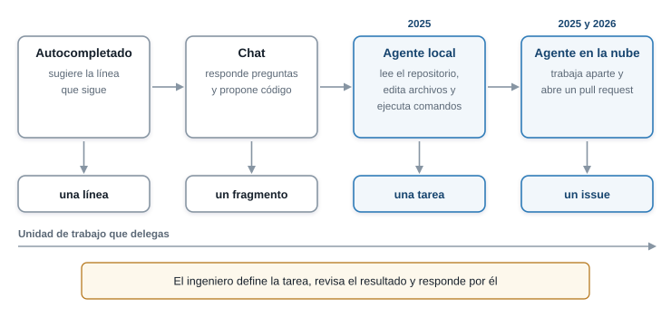{fig-alt="Cuatro etapas de izquierda a derecha. Autocompletado sugiere la línea que sigue. Chat responde preguntas y propone fragmentos. El agente local, de 2025, lee el repositorio, edita y ejecuta comandos. El agente en la nube, de 2025 y 2026, trabaja aparte y abre un pull request. Debajo, la unidad de trabajo crece de una línea a un fragmento, a una tarea y a un issue. Una caja del ingeniero dice que define la tarea, revisa y responde por el resultado."}

Cuatro etapas de la IA en el desarrollo: cada una delega una unidad de trabajo más grande.
:::

::: {.callout-tip}
## En el Carrito de Plaza

Con un agente local, la tarea "agrega el carrito" se convierte en una secuencia de acciones: leer `CatalogoController`, crear la migración de EF Core para los campos nuevos y ejecutar `dotnet build` para ver si compila. Cada paso lo decide el agente con lo que acaba de leer. Tu trabajo está antes (qué se pide y cómo se prueba) y después (qué se acepta).
:::

### Vibe coding frente a ingeniería con agentes

Andrej Karpathy llamó **vibe coding**, en una publicación en X del 2 de febrero de 2025, a entregarse por completo a las sensaciones y olvidar que el código existe ("fully give in to the vibes... forget that the code even exists"). El diccionario Collins lo eligió palabra del año 2025. Para un prototipo que vas a tirar, ese modo es una decisión legítima.

Para un sistema que otras personas usan, falta lo que define el trabajo de un ingeniero: entender, verificar y responder. Simon Willison trazó la misma línea el 6 de mayo de 2026: vibe coding es no mirar el código y **agentic engineering** es el trabajo profesional con agentes. Antes, el 7 de octubre de 2025, había propuesto **vibe engineering** para el uso profesional: pruebas automatizadas, planificar antes, documentación, control de versiones, integración continua y revisión, con el ingeniero responsable de lo que entrega. Según la prensa especializada, Karpathy propuso a comienzos de febrero de 2026 el nombre agentic engineering para ese trabajo. Anthropic usa **agentic coding** desde abril de 2025 en sus guías de buenas prácticas.

| Aspecto | Vibe coding | Ingeniería con agentes |
|---|---|---|
| Quién decide qué se construye | El agente, guiado por impresiones | El ingeniero, con un encargo, restricciones y un criterio de terminado |
| Quién entiende el código | Nadie está obligado a hacerlo | El ingeniero puede explicar cada cambio que entrega |
| Quién verifica | Se ejecuta y "parece funcionar" | Pruebas, comandos y revisión del diff, con evidencia |
| Para qué sirve | Prototipos desechables y exploración | Software que se mantiene, se despliega y tiene usuarios |
| Qué riesgo asume | Defectos ocultos y deuda que nadie ve | El costo de planear, revisar y escribir buenas pruebas |

El vibe coding sirve en esta guía como línea base: el punto de comparación contra el que mides lo que agrega cada práctica de ingeniería.

### Qué dice la evidencia

Dos estudios miden lo que pasa cuando se programa con IA.

METR publicó el 10 de julio de 2025 un estudio con desarrolladores de código abierto con experiencia, que trabajaron en sus propios repositorios: con IA tardaron **19% más**. Antes de empezar esperaban ir 24% más rápido y, después de terminar, seguían creyendo que habían ido 20% más rápido. La percepción y la medición se separaron. En el seguimiento del 24 de febrero de 2026, METR midió -4% con un intervalo de -15% a +9% y advirtió que hay sesgo de selección.

Anthropic publicó el 29 de enero de 2026 un ensayo con 52 ingenieros, mayormente junior, que aprendían una librería nueva. Quienes usaron un asistente de IA obtuvieron **50%** en el cuestionario posterior frente a **67%** de quienes no lo usaron, con la mayor brecha en depuración y sin una mejora significativa de velocidad. Importó más cómo se usó la IA que usarla o no.

::: {.diagrama}
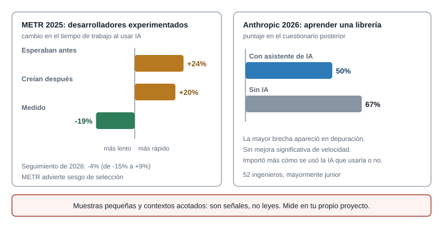{fig-alt="Dos paneles. A la izquierda, METR 2025: los desarrolladores esperaban ir 24 por ciento más rápido, creían después haber ido 20 por ciento más rápido y fueron 19 por ciento más lentos. El seguimiento de 2026 midió menos 4 por ciento, con intervalo de menos 15 a más 9. A la derecha, Anthropic 2026: con asistente de IA el puntaje fue 50 por ciento y sin IA 67 por ciento, con la mayor brecha en depuración."}

Lo que miden METR (2025) y Anthropic (2026). Cifras de cada estudio, no promesas.
:::

Las limitaciones son parte de la evidencia. METR mide a desarrolladores experimentados con las herramientas de comienzos de 2025. El estudio de Anthropic tiene una muestra pequeña, una sola librería, una medición inmediata y un asistente de chat, no un agente. Ninguno de los dos habla de tu proyecto.

Dos lecciones de ingeniería salen de ahí. La primera: tu sensación de ir más rápido no prueba nada, así que mide con tu propio criterio de terminado. La segunda: delegar lo que no entiendes impide aprenderlo y te quita la capacidad de verificar el resultado.

### Comprueba

Puedes explicar con tus palabras la diferencia entre vibe coding y agentic engineering, dar dos razones por las que una percepción de productividad no basta como evidencia y nombrar una limitación de cada estudio.

## 2. El agente por dentro

### El bucle

Anthropic definió en "Building effective agents" (19 de diciembre de 2024) un agente como un modelo de lenguaje que usa herramientas según la retroalimentación del entorno, en un bucle. En cada vuelta el agente **piensa** qué hacer, **actúa** con una herramienta (leer un archivo, editarlo, ejecutar un comando) y **observa** el resultado, que entra a su contexto para la vuelta siguiente. Termina cuando considera que cumplió la tarea.

::: {.diagrama}
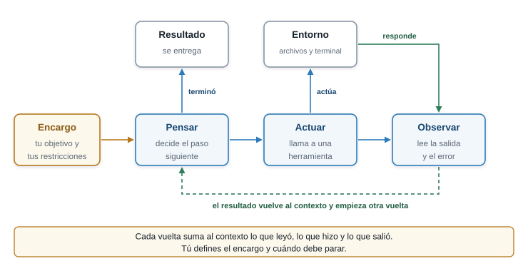{fig-alt="El encargo del ingeniero entra al agente. El agente piensa y decide el paso siguiente, actúa llamando a una herramienta sobre el entorno (archivos, terminal, pruebas), observa la salida o el error y el resultado vuelve al contexto para otra vuelta del ciclo. Cuando considera que terminó, entrega un resultado. Una franja recuerda que cada vuelta suma al contexto y que el ingeniero define cuándo debe parar."}

El bucle: pensar, actuar, observar. Cada vuelta suma al contexto y el ingeniero define cuándo parar.
:::

::: {.callout-tip}
## En el Carrito de Plaza

Un turno típico: el agente lee `Models/Producto.cs`, decide agregar `Stock` y `EsOrganico`, edita el archivo y ejecuta `dotnet build`. Si el compilador devuelve un error, ese error es la observación y el agente lo corrige en la vuelta siguiente. Sin ese resultado el agente no tendría de dónde aprender que se equivocó.
:::

### Flujo fijo frente a agente

El mismo texto de Anthropic distingue dos formas de usar un modelo. En un **flujo** (workflow), el código que escribes define la ruta y el modelo ocupa pasos concretos. En un **agente**, el modelo dirige su propio proceso y decide qué herramienta usar y cuándo parar. El flujo es más predecible y más barato de probar. El agente aguanta tareas cuyo camino no se puede fijar de antemano. Elegir bien entre los dos es una decisión de ingeniería.

::: {.diagrama}
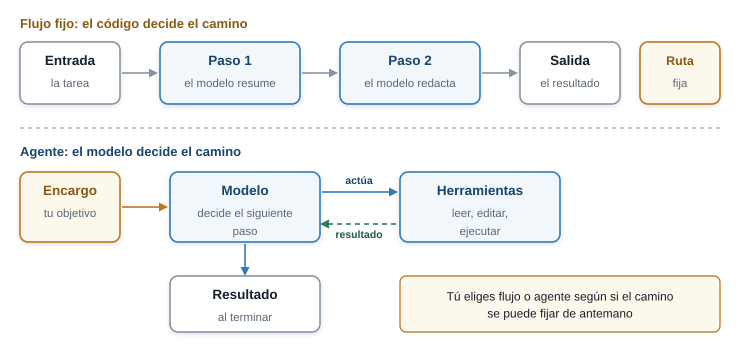{fig-alt="Dos filas. Arriba, un flujo fijo: una entrada pasa por el paso 1 del modelo, el paso 2 del modelo y una salida, con la ruta escrita por el ingeniero en código. Abajo, un agente: el encargo llega al modelo, que decide el siguiente paso, llama a una herramienta y recibe el resultado de la acción en un ciclo, hasta entregar un resultado cuando considera que terminó."}

En el flujo, el código decide el camino. En el agente, lo decide el modelo.
:::

Anthropic describe siete patrones, de lo más fijo a lo más autónomo:

| Patrón | Idea |
|---|---|
| Modelo aumentado | Un modelo con recuperación de información, herramientas y memoria |
| Encadenamiento | La salida de un paso es la entrada del siguiente |
| Enrutamiento | Se clasifica la entrada y se envía a un manejador especializado |
| Paralelización | Varias llamadas a la vez, por partes o por votación |
| Orquestador y trabajadores | Un modelo divide la tarea en el momento y delega en otros |
| Evaluador y optimizador | Un modelo genera y otro evalúa, en ciclo |
| Agentes autónomos | El modelo planifica y actúa en bucle con retroalimentación del entorno |

### El harness: todo lo que no es el modelo

Dos agentes con el mismo modelo se comportan distinto según lo que los rodea. Ese entorno se llama **harness**. Birgitta Boeckeler (Thoughtworks), en martinfowler.com el 2 de abril de 2026, lo define como todo lo que hay en el agente menos el modelo, y lo divide en dos:

- **Guías** (feedforward): actúan antes de que el agente actúe. Son instrucciones, reglas, skills y el modo de planificación.
- **Sensores** (feedback): actúan después y le devuelven evidencia. Pueden ser computacionales (el compilador, las pruebas, un linter, deterministas) o inferenciales (otro modelo que revisa).

::: {.diagrama}
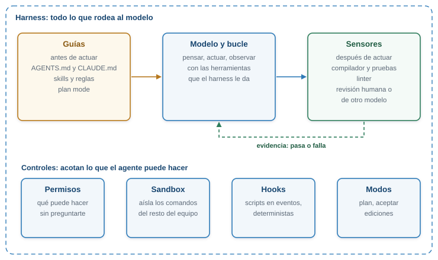{fig-alt="Un marco punteado llamado harness rodea al modelo. A la izquierda, las guías actúan antes: AGENTS.md y CLAUDE.md, skills, reglas y plan mode. Al centro, el modelo y el bucle. A la derecha, los sensores actúan después: compilador y pruebas, linter y revisión humana o de otro modelo; su evidencia vuelve al modelo. Abajo, cuatro controles que acotan lo que el agente puede hacer: permisos, sandbox, hooks y modos."}

El harness: guías antes, sensores después y controles que acotan lo que el agente puede hacer.
:::

OpenAI contó el 11 de febrero de 2026, en "Harness engineering", un caso autoreportado: un equipo de 3 a 7 ingenieros produjo unas 1.500 pull requests y cerca de un millón de líneas en cinco meses sin código escrito a mano. Su `AGENTS.md` gigante falló y lo redujeron a unas 100 líneas que funcionan como tabla de contenidos hacia la carpeta `docs/`. Es el relato de un solo equipo sobre su propio trabajo: sirve como ejemplo de práctica, no como medida de lo que lograrás.

Los controles del harness, en Claude Code (otras herramientas ofrecen equivalentes):

| Control | Qué hace | Quién decide |
|---|---|---|
| Permisos | Reglas que permiten, preguntan o niegan herramientas y rutas. La negación gana sobre las reglas que permiten | Tú, en la configuración |
| Sandbox | Aísla a nivel de sistema operativo los comandos de Bash | La herramienta, con tu configuración |
| Hooks | Scripts que se ejecutan en eventos del ciclo. Un hook `PreToolUse` puede bloquear una llamada | El script, no el modelo |
| Modos | Plan mode (`Shift+Tab`, `/plan` o `claude --permission-mode plan`) para que el agente proponga sin editar, y modos que aceptan ediciones | Tú, según la tarea |

### Comprueba

Puedes dibujar el bucle del agente, decir cuándo conviene un flujo fijo y cuándo un agente, y nombrar una guía, un sensor y un control del harness en tu propio proyecto.

## 3. Herramientas y modelos

### Por modalidad

Las herramientas se agrupan por dónde vive el agente. Varias ofrecen más de una modalidad: Claude Code corre en terminal, en VS Code y JetBrains, en escritorio y en la web (la versión web corre en la nube).

::: {.diagrama}
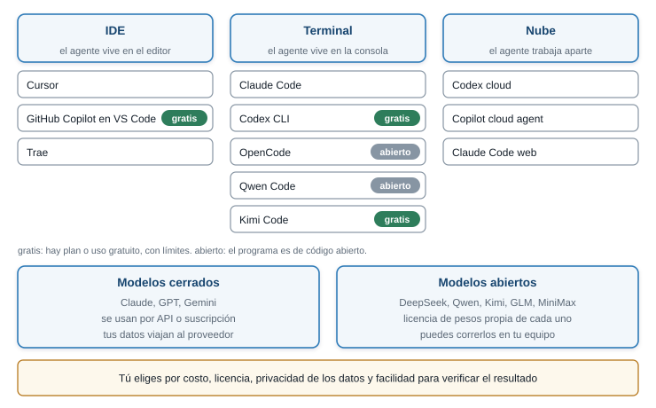{fig-alt="Tres columnas por modalidad. IDE: Cursor, GitHub Copilot en VS Code y Trae. Terminal: Claude Code, Codex CLI, OpenCode, Qwen Code y Kimi Code. Nube: Codex cloud, Copilot cloud agent y Claude Code web. Algunas llevan una etiqueta gratis con límites o abierto por ser de código abierto. Debajo, dos grupos de modelos: cerrados (Claude, GPT, Gemini) y abiertos (DeepSeek, Qwen, Kimi, GLM, MiniMax). Una franja dice que el ingeniero elige por costo, licencia, privacidad y facilidad de verificar."}

Herramientas por modalidad y los dos grandes grupos de modelos. Ninguna es la elección correcta para todo.
:::

| Modalidad | Herramientas | Dónde corre y cuándo conviene |
|---|---|---|
| IDE | Cursor, GitHub Copilot en VS Code, Trae | En tu editor. Conviene cuando quieres ver y aceptar cada cambio sobre el código abierto |
| Terminal | Claude Code, Codex CLI, OpenCode, Qwen Code, Kimi Code | En tu equipo, sobre tu carpeta. Conviene para tareas que tocan varios archivos y ejecutan comandos, y para trabajo que se puede guionar |
| Nube | Codex cloud, GitHub Copilot cloud agent, Claude Code web | En un entorno remoto, en segundo plano. Conviene para tareas definidas por un issue que terminan en un pull request para revisar |

### Qué se puede usar sin pagar

Gratis casi siempre significa con límites. Estas son las opciones documentadas al 2026-11-20:

- **GitHub Copilot:** tiene un plan Free limitado y un plan Student gratis para estudiantes verificados. Todos los planes incluyen Copilot CLI.
- **Codex de OpenAI:** los clientes locales (CLI, extensión de IDE y app) vienen en todos los planes de ChatGPT, incluidos Free y Go. Codex cloud no va en Free ni en Go.
- **OpenCode:** agente de código abierto con terminal, escritorio y web, que conecta muchos proveedores de modelos. El programa no se paga, pero el modelo que conectes puede costar. Existe OpenCode Go a 10 USD al mes.
- **Kimi Code:** de Moonshot, con CLI, extensión de IDE y web, y un plan gratuito llamado Adagio (dato de fuentes secundarias).
- **Qwen Code:** CLI de Alibaba con licencia Apache 2.0.
- **Cursor:** los agentes en la nube van en planes de pago y los precios cambiaron en 2026. No hay un plan para estudiantes confirmado.

### Modelos cerrados y abiertos

El modelo es una elección separada de la herramienta. Los **cerrados** (Claude, GPT, Gemini) se usan por API o suscripción del proveedor. Los **abiertos** de origen chino (DeepSeek, Qwen, Kimi, GLM, MiniMax) publican sus pesos y se pueden usar por una API compatible dentro de herramientas como OpenCode o Claude Code, o correr en tu equipo con Ollama o vLLM.

| Criterio | Cerrados | Abiertos |
|---|---|---|
| Costo | Por token o por suscripción | Por token en un proveedor, o el costo de tu hardware si corres el modelo local |
| Licencia | Términos de servicio del proveedor | Licencia de pesos propia de cada modelo: léela en su ficha |
| Privacidad | Tu código y tus datos viajan a los servidores del proveedor | Depende de dónde corra: en un proveedor, importa en qué país quedan los datos; en tu equipo, no salen |
| Correr local | No | Sí, si tu hardware lo permite |

Los modelos cambian cada pocas semanas, así que cualquier versión que se cite caduca rápido. Estos datos se verificaron el 2026-11-20 en la ficha de cada modelo: DeepSeek V4 usa licencia MIT, Qwen3-Coder usa Apache 2.0, GLM-5.3 y Kimi K3.1 usan licencias propias que debes leer, y `qwen3-coder:30b` pesa 19 GB en Ollama. Antes de decidir, consulta la ficha oficial de cada uno y confirma que sigan vigentes. Qué elegir depende del costo que puedas pagar, de la licencia que necesites, de qué datos puedes enviar fuera y de cuánta verificación exige la tarea.

### Comprueba

Puedes explicar por qué un proyecto con datos de personas reales no debe enviarse a cualquier proveedor y nombrar una herramienta por modalidad con una razón para elegirla.

## 4. Del prompt al encargo verificable

Las guías oficiales de Anthropic, OpenAI (Codex) y GitHub (Copilot) coinciden en lo esencial: un buen encargo tiene **objetivo**, **contexto**, **restricciones** y una **verificación comprobable**. Anthropic lo resume en dos consejos de sus buenas prácticas: "Give Claude a check to run" y "Tell Claude what it can't see". En GitHub, el issue que asignas a Copilot funciona como el prompt: describe el problema, los criterios de aceptación y los archivos a tocar.

::: {.diagrama}
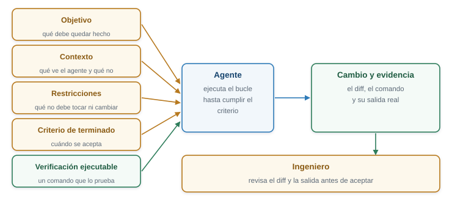{fig-alt="Cinco cajas a la izquierda: objetivo, contexto, restricciones, criterio de terminado y verificación ejecutable. Todas entran al agente, que ejecuta el bucle hasta cumplir el criterio. El agente produce un cambio y su evidencia: el diff, el comando y su salida real. Una caja del ingeniero indica que revisa el diff y la salida antes de aceptar."}

Las cinco partes de un encargo verificable y la evidencia que debe volver para revisarse.
:::

| Parte | Pregunta que contesta | Ejemplo en el Carrito |
|---|---|---|
| Objetivo | Qué debe quedar hecho | Un carrito en `/carrito` para pedir varios productos en un solo pedido |
| Contexto | Qué ve el agente y qué no | Plaza es ASP.NET Core MVC con EF Core y PostgreSQL; lee `CatalogoController` y `ICatalogo` |
| Restricciones | Qué no debe tocar ni cambiar | `/catalogo/{id}/pedir` sigue funcionando igual |
| Criterio de terminado | Cuándo se acepta | El 10% de descuento desde 50.000 COP, domicilio gratis desde 80.000 COP |
| Verificación ejecutable | Qué comando lo prueba | `dotnet build` sin errores y una prueba por cada regla de precio |

### Un encargo malo

```text
Hazme un carrito para Plaza.
```

El agente tiene que inventar qué es un carrito: si hay descuento, cuánto cuesta el domicilio, qué pasa con la cantidad. No hay manera de saber cuándo terminó, así que declarará que terminó cuando le parezca. Tampoco hay un comando que pruebe el resultado: aceptarlo sería confiar en que "parece funcionar".

### Un encargo verificable

```text
Objetivo
Agregar a Plaza un carrito en /carrito para pedir varios productos en un solo pedido.

Contexto
- Plaza es ASP.NET Core MVC (.NET 10) con EF Core y PostgreSQL.
- Hoy existen /catalogo, /catalogo/{id} y /catalogo/{id}/pedir.
- Lee CatalogoController y las interfaces ICatalogo e IPedidos antes de proponer cambios.

Restricciones
- /catalogo/{id}/pedir sigue funcionando igual.
- Los paquetes nuevos solo pueden ser los de pruebas.
- El nombre del cliente sigue la regla del pedido actual: obligatorio, entre 3 y 60 letras.

Criterio de terminado
- Producto gana Stock y EsOrganico, con una migración de EF Core y estos datos iniciales:
  Tomate 20 orgánico, Aguacate 15 orgánico, Papa 50 no orgánico, Panela 30 no orgánico.
- La cantidad de cada producto es un entero entre 0 y su stock. Si no lo es, el mensaje es
  "La cantidad de Tomate debe estar entre 0 y 20".
- Subtotal = suma de precio por cantidad. Descuento de 10% del subtotal desde 50.000 COP.
  Domicilio de 5.000 COP, gratis desde 80.000 COP.
- Con todas las cantidades en 0 se muestra "Agrega al menos un producto".
- Al confirmar, una página de gracias con cada producto y su cantidad, subtotal, descuento,
  domicilio, total y número de pedido.

Verificación
- dotnet build termina sin errores.
- Una prueba automática por cada regla de precio, en los límites 49.999, 50.000, 79.999 y
  80.000 COP.
- Con dotnet run, una petición a /carrito devuelve los cuatro productos con su stock.
Antes de dar la tarea por terminada, pega la salida real de estos comandos.
```

Fíjate en lo que cambió. El agente ya no decide las reglas: las recibe con sus números y sus mensajes literales. Cada regla tiene un caso de prueba en su límite, que es donde suelen estar los errores. Y la última línea pide evidencia en lugar de una afirmación.

### Comprueba

Escribes un encargo para una tarea tuya con las cinco partes y puedes decir, para cada criterio de terminado, qué comando lo comprueba.

## 5. Metodologías para trabajar con agentes



## 6. El caso: Carrito de Plaza



## 7. Contexto y extensión

### Context engineering

El contexto de un modelo es un recurso finito: lo que cabe, lo que ve y lo que ignora determina la calidad del trabajo. Tobi Lütke y Karpathy popularizaron el término **context engineering** en junio de 2025 (según fuentes secundarias) y Anthropic lo formalizó para agentes el 29 de septiembre de 2025. Sus técnicas: compactar el historial cuando crece, recuperar información justo a tiempo en lugar de cargarlo todo, llevar notas estructuradas fuera del contexto y usar subagentes para que la exploración no sature la conversación principal.

### AGENTS.md y CLAUDE.md

`AGENTS.md` nació en agosto de 2025 como un archivo común que leen varias herramientas (OpenAI Codex, Sourcegraph/Amp, Google, Cursor y Factory). Desde el 9 de diciembre de 2025 vive en la Agentic AI Foundation de la Linux Foundation, y sus responsables dicen que más de 60.000 proyectos lo usan (dato autoreportado). Claude Code lee `CLAUDE.md` y, si no existe, lee `AGENTS.md`. Cuanto más corto y concreto, mejor: el caso de OpenAI de la sección 2 redujo el suyo a unas 100 líneas que apuntan a la documentación.

Un `AGENTS.md` razonable para Plaza declara lo que el agente no puede deducir leyendo el código:

```markdown
# Plaza

Aplicación ASP.NET Core MVC (.NET 10) con EF Core y PostgreSQL.

## Comandos
- Compilar: `dotnet build`
- Ejecutar: `dotnet run` (el puerto está en Properties/launchSettings.json)
- Aplicar migraciones: `dotnet ef database update`
- Crear una migración: `dotnet ef migrations add NombreEnPascalCase`

## Estructura
- Controllers/: rutas por atributo, por ejemplo `[HttpGet("catalogo")]`
- Services/: ICatalogo e IPedidos; los controladores dependen de las interfaces
- Models/ y Data/PlazaDbContext.cs: entidades y contexto de EF Core
- Views/: vistas Razor

## Reglas
- Nombres de clases, métodos y variables en español, como el código existente.
- Todo cambio de modelo lleva su migración.
- No leas ni modifiques appsettings.Development.json: contiene la cadena de conexión.
- Antes de dar una tarea por terminada, pega la salida de `dotnet build`.
```

### Memoria y compactación

Una sesión larga llena el contexto. La **compactación** resume lo ocurrido para seguir; la **memoria** guarda en archivos lo que debe sobrevivir entre sesiones, como las instrucciones del proyecto. Lo que importa en ingeniería: lo que solo existe en la conversación se pierde al compactar o al abrir una sesión nueva. Si una decisión debe durar, escríbela en un archivo del repositorio.

### La pila de extensión

::: {.diagrama}
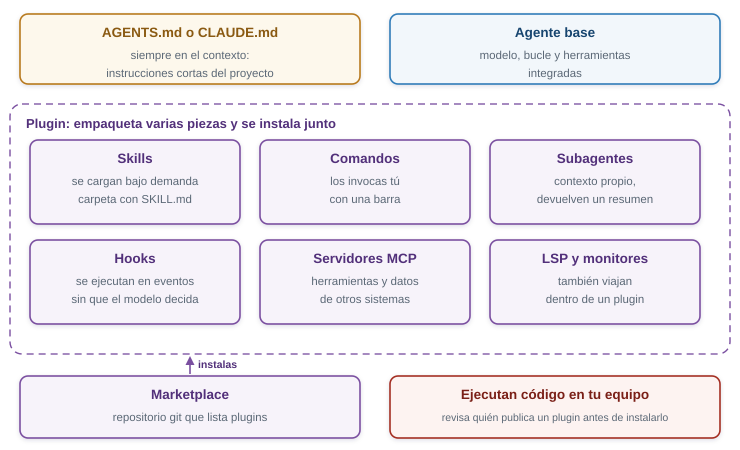{fig-alt="Arriba, dos cajas: AGENTS.md o CLAUDE.md, siempre en el contexto, y el agente base con modelo, bucle y herramientas. En un marco punteado llamado plugin hay seis piezas: skills que se cargan bajo demanda, comandos que invoca el ingeniero, subagentes con contexto propio, hooks deterministas, servidores MCP para herramientas y datos externos, y servidores LSP y monitores. Debajo, un marketplace como repositorio git que lista plugins y una advertencia de que los plugins ejecutan código en tu equipo."}

Qué se carga siempre, qué bajo demanda, qué es determinista y cómo se empaqueta todo en un plugin.
:::

| Pieza | Qué es y cuándo entra al contexto | Riesgo |
|---|---|---|
| `AGENTS.md` o `CLAUDE.md` | Instrucciones del proyecto. Entran siempre, al iniciar | Un archivo largo y vago pierde efecto |
| Skill | Carpeta con un `SKILL.md`, scripts y referencias. Entra bajo demanda: primero se ve su descripción y se carga el resto si hace falta | Una descripción ambigua hace que se use mal |
| Comando | Una acción que invocas tú con una barra. Entra cuando lo invocas | Ejecuta lo que defina el comando |
| Subagente | Un agente con su propio contexto y herramientas, definido en `.claude/agents/`. Corre aparte y devuelve un resumen | Más costo y un agente más que supervisar |
| Hook | Script que se ejecuta en un evento del ciclo. Es determinista: no depende de lo que el modelo decida | Ejecuta código con tus permisos |
| Servidor MCP | Herramientas y datos de otros sistemas. Sus herramientas se ofrecen al agente | Amplía lo que el agente puede leer o cambiar |
| Plugin | Paquete con skills, subagentes, hooks, servidores MCP, servidores LSP y monitores. Todo entra junto, al instalarlo | Ejecuta código en tu equipo |

Las **skills** las publicó Anthropic el 16 de octubre de 2025 y hoy son un estándar abierto en agentskills.io, que se donó a la Agentic AI Foundation el 22 de octubre de 2026 y reporta más de 70 plataformas (dato autoreportado). Una skill para Plaza que guía la creación de migraciones se ve así:

```markdown
---
name: migracion-ef-plaza
description: Crea una migración de EF Core en Plaza para que la revises. Úsala cuando cambie una entidad de Models/ o el PlazaDbContext.
---

1. Revisa el cambio en Models/ y en Data/PlazaDbContext.cs.
2. Crea la migración con un nombre en PascalCase que describa el cambio: `dotnet ef migrations add <Nombre>`.
3. Lee el archivo generado en Migrations/ y confirma que solo contiene el cambio esperado.
4. Compila con `dotnet build`. No corras `dotnet ef database update`: el agente crea y revisa la migración, y la persona la aplica después de revisarla.
5. Reporta el nombre de la migración y la salida de los comandos que corriste.
```

Va en `.claude/skills/migracion-ef-plaza/SKILL.md`. El campo `description` es lo que el agente lee para decidir si la usa, así que escribe en él cuándo aplica.

Un **subagente** es un archivo de Markdown con YAML en `.claude/agents/`. Este revisa un cambio sin escribir código:

```markdown
---
name: revisor-plaza
description: Revisa un cambio de Plaza contra su encargo. Úsalo después de implementar, antes de pedir revisión humana.
tools: Read, Glob, Grep, Bash
model: sonnet
---

Eres un revisor independiente y no escribes código. Lee el encargo y el diff (`git diff`), ejecuta `dotnet build` y reporta, para cada criterio de terminado, si se cumple con la evidencia que viste. Señala cualquier cambio fuera del alcance del encargo.
```

Los **plugins** agrupan estas piezas en una unidad que se instala junta, y los **marketplaces** son repositorios git que listan plugins: en Claude Code se instala uno con `/plugin install <nombre>@claude-plugins-official`. Un plugin ejecuta código en tu equipo: antes de instalarlo, lee qué contiene y quién lo publica.

### MCP

El **Model Context Protocol (MCP)** es un protocolo estándar para que un agente use herramientas y datos de otros sistemas: un servidor de GitHub, uno de PostgreSQL, uno de navegador, uno de documentación. Sin un estándar, cada herramienta necesitaría una integración distinta por cada servicio. MCP pasó a la Agentic AI Foundation de la Linux Foundation el 9 de diciembre de 2025 y su especificación vigente es la 2026-07-28.

::: {.diagrama}
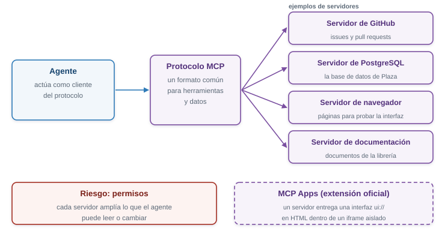{fig-alt="A la izquierda, el agente actúa como cliente. En el centro, el protocolo MCP, un formato común para herramientas y datos. A la derecha, cuatro servidores de ejemplo: GitHub con issues y pull requests, PostgreSQL con la base de Plaza, un navegador para probar la interfaz y documentación de una librería. Abajo, una advertencia de que cada servidor amplía lo que el agente puede leer o cambiar, y una caja sobre MCP Apps, una extensión oficial que entrega una interfaz con recurso ui:// en un iframe aislado."}

El agente como cliente MCP, servidores de ejemplo y los dos puntos que conviene recordar: permisos e interfaces.
:::

En Claude Code se agrega un servidor remoto con un comando como este, que reemplaza `<nombre>` y `<url>` por los del servidor:

```powershell
claude mcp add --transport http <nombre> <url>
```

**MCP Apps** es una extensión oficial: un servidor puede entregar una interfaz como recurso `ui://` con HTML, que la herramienta muestra dentro de un iframe aislado (especificación estable 2026-01-26).

Cada servidor MCP amplía lo que el agente puede leer o cambiar. Antes de conectar uno, decide qué permisos le das, quién lo mantiene y qué datos pasarán por él. Ese razonamiento se retoma en la sección 9.

### Comprueba

Tu repositorio tiene un `AGENTS.md` corto con comandos que sí funcionan, y puedes decir para cada pieza de la pila si entra siempre al contexto, bajo demanda o aparte, y qué riesgo trae.

## 8. Autonomía

### Bucles y condición de parada

Un agente solo avanza hasta donde le alcanza una vuelta. Para tareas que exigen muchas, se le deja repetir. **Loop engineering** es el nombre que IBM le dio el 17 de julio de 2026 al diseño de sistemas que guían a un agente de forma iterativa hacia una meta con mínima intervención humana. IBM pide condiciones de parada verificables, por ejemplo "todas las pruebas unitarias pasan". Gartner lo trata como un enfoque emergente en notas de pago de julio de 2026 (solo se pudieron leer resúmenes). Un artículo preliminar del 22 de agosto de 2026 (arXiv 2608.21884) encontró bucles autónomos en 217 de 36.710 repositorios y no halló evidencia sistemática de beneficios.

::: {.diagrama}
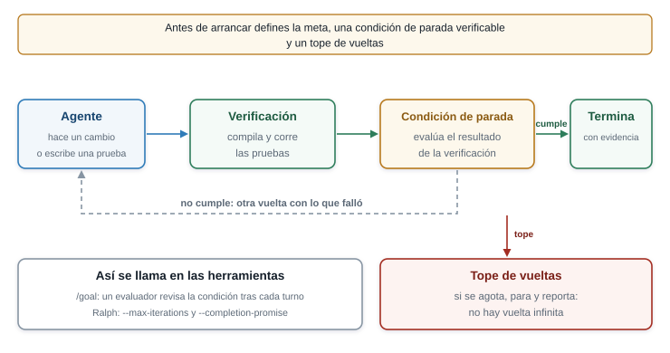{fig-alt="El ingeniero define antes de arrancar la meta, una condición de parada verificable y un tope de vueltas. El agente hace un cambio, una verificación externa compila y corre las pruebas, y la condición de parada evalúa el resultado. Si se cumple, termina con evidencia. Si no, vuelve a empezar con lo que falló. Si se agota el tope de vueltas, para y reporta. Abajo, ejemplos: /goal usa un evaluador tras cada turno y Ralph usa max-iterations y completion-promise."}

Un bucle autónomo necesita una verificación externa, una condición de parada y un tope de vueltas.
:::

Tres mecanismos repiten el trabajo, cada uno con su manera de decidir cuándo seguir y cuándo parar:

| Mecanismo | Qué inicia la vuelta siguiente | Cuándo para |
|---|---|---|
| `/goal` (Claude Code; Codex también tiene `/goal`) | El fin del turno anterior | Un evaluador confirma la condición, la juzga imposible, un turno falla por un error que debes corregir o ejecutas `/goal clear` |
| `/loop` (Claude Code) | Un intervalo de tiempo | Lo detienes o termina por su cuenta |
| Ralph | Un ciclo de shell que repite el mismo prompt | Un tope de vueltas o una promesa de terminado |

**Ralph** lo describió Geoffrey Huntley en julio de 2025 como un ciclo de una línea: `while :; do cat PROMPT.md | claude-code ; done`. Su propio autor dijo que no lo usaría sobre código existente. Anthropic publica un plugin oficial, `ralph-loop`, con las opciones `--max-iterations` y `--completion-promise`.

El ingeniero diseña el bucle y su parada. Con `/goal`, la condición debe ser algo que la propia salida del agente pueda demostrar, porque el evaluador solo juzga lo que aparece en la conversación:

```text
/goal dotnet test termina con código 0 y dotnet build no reporta errores, o detente después de 20 turnos
```

Esa condición tiene un estado final medible, un comando que lo prueba y un tope. Sin el tope, un bucle mal definido gasta tokens hasta que alguien lo note. Para un agente que se corrige solo, hace falta además una señal externa: Huang y otros mostraron en "Large Language Models Cannot Self-Correct Reasoning Yet" (arXiv 2310.01798, ICLR 2024) que la autocorrección sin una señal externa no mejora el razonamiento de forma confiable, mientras que con una señal externa, como las pruebas, sí ayuda.

### Paralelo y larga duración

Hay cuatro maneras de hacer más trabajo a la vez o por más tiempo:

- **Subagentes:** agentes con contexto propio, que corren en paralelo y devuelven un resumen.
- **Worktrees de Git:** cada agente trabaja en su propia copia del repositorio para no pisar a otro. En Claude Code, `claude --worktree <nombre>` y los subagentes con `isolation: worktree`.
- **Agentes en la nube:** Codex cloud lanza tareas en segundo plano, cada una en su propio sandbox, y el Copilot cloud agent trabaja sobre GitHub Actions. Claude Code tiene además una vista de agentes en vista previa de investigación.
- **Equipos de agentes:** en Claude Code son experimentales y vienen apagados por defecto.

Para tareas largas, Anthropic describió el 26 de noviembre de 2025 un patrón: un agente inicializador prepara el entorno (un `init.sh`, un archivo de progreso, un commit inicial y una lista de funcionalidades en JSON, todas marcadas como fallidas) y un agente de código avanza una funcionalidad a la vez: código, prueba y commit. Los fallos que observaron: intentar hacerlo todo de una vez y declarar terminado antes de tiempo. El patrón agrega estructura (archivo de progreso, lista de funcionalidades y commits) para que cada sesión retome el trabajo donde quedó la anterior.

**Multiagente** significa que un orquestador reparte el trabajo entre varios agentes. Anthropic lo usó para investigación (13 de junio de 2025) y reportó que consume unas 15 veces más tokens que un chat, y que el código se paraleliza peor que la investigación. Más agentes cuestan más y no siempre mejoran el resultado.

**A2A** (Agent2Agent) conecta agentes de distintos fabricantes: lo creó Google y hoy es un proyecto de la Linux Foundation. El **graph engineering** se menciona aquí solo como vocabulario emergente: un artículo de revisión del 21 de agosto de 2026 (arXiv 2608.21156) lo llama paradigma emergente, nació de un debate en X en julio de 2026 y lo sólido que hay detrás son los grafos con estado y puntos de control de herramientas como LangGraph.

### Del issue al pull request

La forma más madura de autonomía hoy es asignar un issue a un agente y recibir un pull request. GitHub Copilot lo ofrece con su agente de código (presentado en vista previa el 19 de mayo de 2025 y de disponibilidad general desde el 25 de septiembre de 2025, según el [aviso de GitHub](https://github.blog/changelog/2025-09-25-copilot-coding-agent-is-now-generally-available)) y con Copilot para Jira (6 de marzo de 2026). Claude Code corre en GitHub Actions: al mencionar `@claude` en un issue o un comentario, abre cambios en el repositorio. Codex trabaja también desde Linear.

::: {.diagrama}
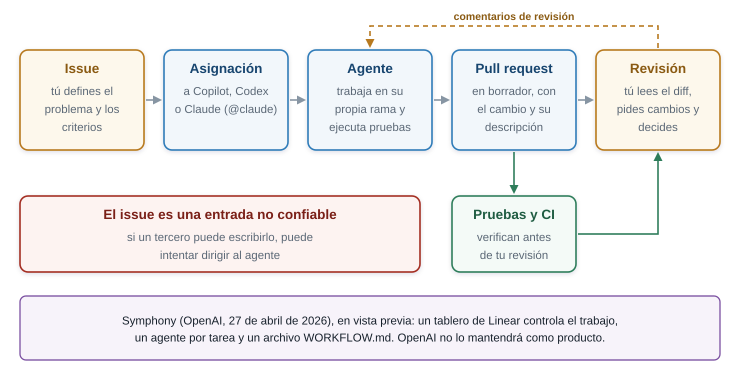{fig-alt="Cinco pasos. El ingeniero escribe un issue con el problema y los criterios. Lo asigna a Copilot, Codex o Claude mediante @claude. El agente en la nube trabaja en su propia rama y ejecuta pruebas. Abre un pull request en borrador. Las pruebas y la integración continua verifican antes de que el ingeniero revise el diff, pida cambios y decida. Los comentarios de revisión vuelven al agente. Una advertencia dice que el issue es una entrada no confiable. Abajo, Symphony de OpenAI, en vista previa."}

Del issue al pull request: el ingeniero escribe el issue y revisa; el agente y las pruebas hacen lo del medio.
:::

OpenAI publicó el 27 de abril de 2026 **Symphony**, una orquestación de código abierto en la que un tablero de Linear es el plano de control, cada tarea tiene un agente y el flujo se describe en un archivo `WORKFLOW.md`. OpenAI lo presenta como una vista previa que no mantendrá como producto, y su cifra de "500% más pull requests" la midieron equipos internos de OpenAI: es autoreportada.

Este es un flujo de trabajo reducido, adaptado del ejemplo oficial de `anthropics/claude-code-action`. Responde a un comentario con `@claude` en un issue:

```yaml
name: Claude Code
on:
  issue_comment:
    types: [created]
  issues:
    types: [opened, assigned]
jobs:
  claude:
    if: |
      (github.event_name == 'issue_comment' && contains(github.event.comment.body, '@claude')) ||
      (github.event_name == 'issues' && contains(github.event.issue.body, '@claude'))
    runs-on: ubuntu-latest
    permissions:
      contents: write
      pull-requests: write
      issues: write
      id-token: write
    steps:
      - uses: actions/checkout@v6
      - uses: actions/setup-dotnet@v6
        with:
          dotnet-version: 10.0.x
      - uses: anthropics/claude-code-action@v1
        with:
          anthropic_api_key: ${{ secrets.ANTHROPIC_API_KEY }}
          claude_args: |
            --max-turns 20
            --permission-mode acceptEdits
            --allowedTools "Bash(dotnet build *),Bash(dotnet test *)"
```

Guarda la clave como un secreto del repositorio, nunca en el archivo. El paso de `setup-dotnet` instala el SDK para que el agente pueda compilar Plaza. `--max-turns 20` es el tope de turnos. `--allowedTools` lista lo que el agente puede ejecutar sin pedir permiso, y `--permission-mode acceptEdits` hace que acepte editar archivos: sin ese modo, `--allowedTools` no es una lista estricta, porque la acción corre en modo auto por defecto. Y recuerda lo que muestra el diagrama: un issue o un comentario lo puede escribir quien no es de confianza. La sección 9 explica por qué eso importa.

En este modelo cambia tu trabajo, no desaparece. Escribes issues con el problema y sus criterios de aceptación, y revisas el diff y la evidencia antes de fusionar.

### Comprueba

Puedes escribir una condición de parada verificable con su tope para una tarea tuya, decir cuándo no paralelizarías y nombrar qué revisas tú en un pull request que abrió un agente.

## 9. Verificar y gobernar

### Evidencia, no afirmaciones

"Las pruebas pasan" es una afirmación. Lo que acepta un ingeniero es el **comando y su salida**: `dotnet test` con su resumen real, `dotnet build` con su resultado. Pide al agente que pegue la salida y, cuando importe, vuelve a ejecutar tú el comando. Las pruebas verdes de una prueba que el agente acaba de escribir solo dicen que el código cumple lo que el propio agente entendió.

La **verificación independiente** corrige ese sesgo: un revisor distinto del que escribió el código, con su propio contexto, que solo ve el encargo y el resultado. Es lo que hace el subagente `revisor-plaza` de la sección 7. Un artículo preliminar del 25 de octubre de 2026 (arXiv 2610.34577) reporta que la verificación independiente por un crítico da la mejor relación entre precisión y costo. Y sigue habiendo una revisión humana del diff completo: nadie entrega lo que no puede explicar.

Con las pruebas hay una trampa. Willison recomienda el ciclo rojo y verde: la prueba debe fallar antes de implementar. Boeckeler observó, en una muestra pequeña, que los agentes a veces fingieron el rojo y que usar TDD gastó entre 3 y 8,5 veces más tokens (8,50 veces en la tarea pequeña, 2,96 en la mediana y 4,89 en la grande) sin una diferencia clara de calidad. Su cálculo cuenta las lecturas de caché a peso completo, y ella cree que eso exagera el costo real. Ejecuta tú la prueba en rojo.

### Benchmarks frágiles

Los benchmarks públicos de programación sirven para comparar modelos, pero se rompen. OpenAI dejó de reportar SWE-bench Verified el 23 de febrero de 2026: encontró defectos en las pruebas del 59,4% de 138 problemas auditados y contaminación de los datos. El 8 de julio de 2026 retiró su recomendación de SWE-bench Pro, con cerca de 30% de tareas rotas. La lección: no elijas herramienta ni modelo por un número. Mide en tu propio proyecto, con tus propios criterios de terminado. Claude Code exporta métricas por OpenTelemetry, incluidos costos y tokens, que ayudan a medir.

### Seguridad

La **inyección de prompt** (prompt injection) es la clase de riesgo central: un texto escrito por un atacante, dentro de un issue, una página o un archivo, que el modelo lee y obedece como si fuera una instrucción tuya. Meta la describe como una debilidad fundamental y sin resolver de los modelos de lenguaje. No hay una solución definitiva: se gestiona limitando lo que un agente puede hacer. En 2026 la prensa reportó casos: "Comment and Control" (abril, con títulos de pull requests y comentarios) y "GitLost" (julio, repositorios privados filtrados mediante un issue público; The Register, 7 de julio de 2026).

Simon Willison nombró el 16 de junio de 2025 la **lethal trifecta**: el riesgo grave aparece cuando un agente reúne a la vez acceso a tus datos privados, exposición a contenido no confiable y la capacidad de comunicarse hacia fuera. Con las tres, un atacante puede dirigir al agente para que envíe tus datos.

::: {.diagrama}
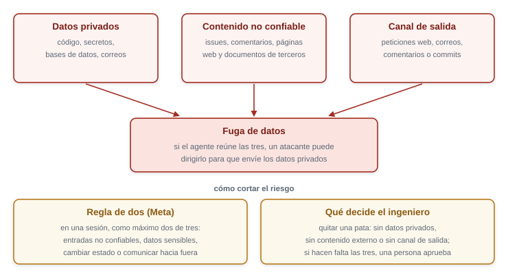{fig-alt="Tres cajas de riesgo: datos privados, contenido no confiable y canal de salida. Las tres apuntan a una caja central: si el agente reúne las tres, un atacante puede dirigirlo para que envíe los datos privados. Abajo, dos cajas del ingeniero: la regla de dos de Meta, que permite como máximo dos de tres propiedades por sesión, y las decisiones de quitar una de las tres patas o pedir aprobación humana."}

Tres capacidades que juntas permiten robar datos, y las dos decisiones del ingeniero para cortar el riesgo.
:::

Meta propuso el 31 de octubre de 2025 la **regla de dos**: en una sesión, un agente debe cumplir como máximo dos de tres propiedades: procesar entradas no confiables, acceder a sistemas sensibles o datos privados, y cambiar estado o comunicarse hacia fuera. Si hacen falta las tres, el agente no debe operar solo y requiere supervisión, como la aprobación humana. OWASP publicó el 9 de diciembre de 2025 su Top 10 para aplicaciones agénticas de 2026, que sirve como lista de referencia (esta guía no repite sus ítems).

Prácticas concretas:

- **Secretos fuera del contexto:** lo que el agente lee puede acabar en un servicio externo. No pegues claves en el prompt ni dejes que lea los archivos que las contienen.
- **Permisos mínimos:** que el agente pida permiso para lo que no es rutinario y que tenga negado lo peligroso.
- **Sandbox:** que los comandos corran aislados del resto del equipo.
- **Revisar lo que instalas:** un plugin ejecuta código en tu equipo y un servidor MCP amplía los permisos del agente.
- **Una pata menos:** si el agente lee issues de desconocidos, que no tenga además tus datos privados ni un canal de salida.

En Claude Code, un archivo `.claude/settings.json` como este impide leer los archivos de secretos de Plaza y subir cambios sin tu mano. Las reglas de negación se evalúan primero y ninguna regla que permita las anula:

```json
{
  "permissions": {
    "deny": [
      "Read(./.env)",
      "Read(./.env.*)",
      "Read(./appsettings.Development.json)",
      "Bash(git push *)"
    ]
  }
}
```

### Responsabilidad del ingeniero

- **Autoría:** el commit lo firmas tú, no el agente. Tú respondes por lo que se publica a tu nombre.
- **Declaración de uso de IA:** di en el commit o en el pull request qué hizo el agente y qué hiciste tú.
- **Licencias:** el código que entregas lo debes poder defender legalmente, sin importar quién lo escribió. Revisa las licencias de las dependencias que el agente agregue.
- **Privacidad:** el código, las rutas y los datos que lee el agente viajan a servidores externos, salvo que el modelo corra en tu equipo. No uses datos personales reales en un proyecto con un proveedor que no controlas.
- **Costo:** los tokens se pagan, y los bucles y el multiagente los multiplican. Ponles un tope.
- **Entender:** si no puedes explicar el código, no lo entregas.

Un ejemplo de declaración para un pull request del Carrito:

```text
Uso de IA: el carrito se implementó con un agente de código (la herramienta y el modelo están indicados en el pull request).
Qué hizo el agente: la migración, el servicio de totales y la vista.
Qué hice yo: definí el encargo, revisé el diff completo, ejecuté dotnet build y las pruebas, y puedo explicar cada cambio.
Evidencia: la salida de dotnet build y de las pruebas está pegada en el pull request.
```

### Comprueba

Puedes decir cuál de las tres patas de la lethal trifecta quitarías en un agente que lee issues públicos, escribir una regla de negación para un archivo de secretos de tu proyecto y redactar una declaración de uso de IA para tu último cambio.

## 10. La frontera

El campo cambia de nombre rápido. Cada término señala un problema real, pero no todos tienen la misma solidez. La clasificación de la tabla es el criterio de esta guía: **Consolidado** es lo que tiene documentación de varios fabricantes y práctica extendida, **Emergente** lo que tiene fuentes iniciales pero poca evidencia, y **Experimental** lo que solo tiene artículos preliminares.

::: {.diagrama}
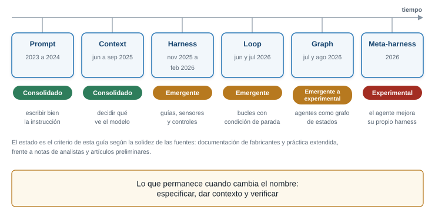{fig-alt="Una línea de tiempo con seis estaciones y su estado. Prompt, de 2023 a 2024, consolidado. Context, de junio a septiembre de 2025, consolidado. Harness, de noviembre de 2025 a febrero de 2026, emergente. Loop, junio y julio de 2026, emergente. Graph, julio y agosto de 2026, emergente a experimental. Meta-harness y autoevolución, en 2026, experimental. Una franja dice que lo que permanece es especificar, dar contexto y verificar."}

La línea de tiempo del vocabulario, con el estado de cada término.
:::

| Término y época | Estado | Qué señala |
|---|---|---|
| Prompt engineering, 2023 a 2024 | Consolidado | Escribir bien la instrucción |
| Context engineering, junio a septiembre de 2025 | Consolidado | Decidir qué ve el modelo en cada momento |
| Harness engineering, noviembre de 2025 a febrero de 2026 | Emergente | Diseñar las guías, los sensores y los controles del agente |
| Loop engineering, junio y julio de 2026 | Emergente | Diseñar bucles con condiciones de parada verificables |
| Graph engineering, julio y agosto de 2026 | Emergente a experimental | Orquestar agentes como un grafo con estado |
| Meta-harness y agentes que se mejoran solos, marzo a noviembre de 2026 | Experimental | Que el agente modifique su propio harness |

Los agentes que mejoran su propio harness (Meta-Harness, Agentic Harness Engineering, Self-Harness y una revisión sobre agentes de código que evolucionan, todos de 2026, más "Harnesses That Improve Themselves" del 17 de noviembre de 2026) son preprints. Dejan riesgos abiertos: que la retroalimentación sea confiable, que se sobreajuste a los benchmarks, que los cambios sean reversibles, la seguridad, el costo y la posibilidad de que el agente manipule su propio evaluador.

Detrás de cada nombre nuevo, lo que permanece es lo mismo: **especificar** lo que se quiere, **dar contexto** suficiente y **verificar** con evidencia. Si entiendes esas tres, el siguiente término será una variación de lo que ya sabes.

## Errores frecuentes

| Qué ves | Por qué pasa | Cómo se arregla |
|---|---|---|
| El agente declara que terminó y la tarea no funciona | No había criterio de terminado ni comando que lo probara | Escribe la verificación en el encargo y pide la salida real |
| Los cambios tocan archivos que no pediste | Faltaron las restricciones o el contexto | Agrega "qué no tocar" al encargo y revisa el diff completo |
| El agente repite el mismo error en cada vuelta | El bucle no recibe una señal externa que le diga qué falló | Dale un comando que falle con un mensaje claro: compilador o pruebas |
| El agente ignora las reglas de `AGENTS.md` | El archivo es largo o vago, o las reglas se contradicen | Acórtalo, usa comandos concretos y pasa a un hook lo que debe ser obligatorio |
| La sesión se vuelve lenta y confusa | El contexto se llenó con exploración | Compacta, abre una sesión nueva o delega la exploración en un subagente |
| El gasto de tokens se dispara | Un bucle sin tope o varios agentes en paralelo | Pon un tope de turnos y mide el consumo |
| Las pruebas pasan pero el comportamiento está mal | El agente escribió las pruebas a la medida de su código | Escribe tú los casos en los límites y exige ver la prueba en rojo |
| Un plugin o servidor MCP hizo algo inesperado | Se instaló sin revisar qué ejecuta ni qué permisos pide | Lee su contenido, limita sus permisos y desinstala lo que no uses |
| El agente leyó un archivo de secretos | No había una regla que lo negara | Agrega reglas `deny` y no dejes secretos en el repositorio |
| No puedes explicar el código que entregaste | Delegaste la comprensión junto con la escritura | No lo entregues: pídele al agente que te lo explique y verifica por tu cuenta |

## Referencia rápida

| Qué quieres hacer | Comando o archivo |
|---|---|
| Que el agente planifique sin editar | `Shift+Tab`, `/plan` o `claude --permission-mode plan` |
| Dar instrucciones al proyecto | `AGENTS.md` o `CLAUDE.md` en la raíz |
| Crear una skill | `.claude/skills/<nombre>/SKILL.md` |
| Crear un subagente | `.claude/agents/<nombre>.md` |
| Conectar un servidor MCP remoto | `claude mcp add --transport http <nombre> <url>` |
| Instalar un plugin | `/plugin install <nombre>@claude-plugins-official` |
| Seguir hasta cumplir una condición | `/goal <condición>`; consulta con `/goal` y quita con `/goal clear` |
| Repetir por intervalo | `/loop` |
| Aislar un agente en su propia copia | `claude --worktree <nombre>` |
| Negar lectura de secretos | `permissions.deny` en `.claude/settings.json` |
| Pedir evidencia | "Pega la salida real de `dotnet build` y de las pruebas" |

## Para seguir aprendiendo

Esta guía deja un criterio para dirigir agentes. Estos temas lo complementan y no se tratan aquí con profundidad:

- **Evals propios:** un conjunto pequeño de tareas de tu proyecto, con criterio de terminado, que ejecutas cada vez que cambias de herramienta, de modelo o de instrucciones.
- **Integración continua:** los mismos comandos de verificación del agente, ejecutados en cada pull request por una máquina que no se cansa.
- **Observabilidad:** medir costos, tokens y duración de las sesiones con las métricas por OpenTelemetry de Claude Code.
- **Ingeniería de contexto avanzada:** la guía de Anthropic sobre contexto para agentes, enlazada en las fuentes.
- **Seguridad de agentes:** el Top 10 de OWASP para aplicaciones agénticas y los artículos de Willison y Meta sobre la lethal trifecta y la regla de dos.

## Fuentes

Todas se consultaron el 2026-11-20. Las marcadas como secundarias son prensa, blogs o resúmenes, no la página original: úsalas como pista y contrasta con la fuente oficial.

**Evolución y evidencia**

- Karpathy, publicación en X del 2 de febrero de 2025 (secundaria, sin enlace) y [palabra del año 2025 de Collins](https://blog.collinsdictionary.com/language-lovers/collins-word-of-the-year-2025-ai-meets-authenticity-as-society-shifts/).
- Anthropic, [Claude Code: buenas prácticas](https://code.claude.com/docs/en/best-practices).
- Simon Willison, [Vibe coding and agentic engineering](https://simonwillison.net/2026/May/6/vibe-coding-and-agentic-engineering) (6 de mayo de 2026) y [Vibe engineering](https://simonwillison.net/2025/Oct/7/vibe-engineering/) (7 de octubre de 2025).
- Agentic engineering de Karpathy: The New Stack y SD Times, febrero de 2026 (secundaria, sin enlace).
- [Agentic Software Engineering](https://arxiv.org/abs/2509.06216), arXiv 2509.06216 (preprint).
- METR, [estudio de productividad de desarrolladores experimentados](https://metr.org/blog/2025-07-10-early-2025-ai-experienced-os-dev-study/) (10 de julio de 2025) y [seguimiento](https://metr.org/blog/2026-02-24-uplift-update/) (24 de febrero de 2026; leído mediante un buscador).
- Anthropic, [AI assistance and coding skills](https://www.anthropic.com/research/AI-assistance-coding-skills) (29 de enero de 2026; arXiv 2601.20245).

**El agente y el harness**

- Anthropic, [Building effective agents](https://www.anthropic.com/research/building-effective-agents) (19 de diciembre de 2024).
- OpenAI, [Harness engineering](https://openai.com/index/harness-engineering) (11 de febrero de 2026).
- Birgitta Boeckeler, Harness Engineering for coding agent users, martinfowler.com (2 de abril de 2026, [artículo](https://martinfowler.com/articles/harness-engineering.html)).
- Anthropic, [Effective harnesses for long-running agents](https://www.anthropic.com/engineering/effective-harnesses-for-long-running-agents) (26 de noviembre de 2025).
- Claude Code: [hooks](https://code.claude.com/docs/en/hooks), [permisos](https://code.claude.com/docs/en/permissions), [sandbox](https://code.claude.com/docs/en/sandboxing) y [modos de permiso](https://code.claude.com/docs/en/permission-modes).

**Herramientas y modelos**

- [Claude Code](https://code.claude.com/docs/en/overview); [Codex disponible para todos](https://openai.com/index/codex-now-generally-available) y [ayuda de Codex en los planes de ChatGPT](https://help.openai.com/en/articles/11369540); [precios de Cursor](https://cursor.com/pricing); [planes de GitHub Copilot](https://docs.github.com/en/copilot/get-started/plans); [OpenCode](https://opencode.ai/docs/); [Qwen Code](https://qwenlm.github.io/qwen-code-docs).
- Kimi Code, Trae, GLM Coding Plan y la lista de modelos abiertos: fuentes secundarias, sin enlace.

**Encargo y metodologías**

- Claude Code, [buenas prácticas](https://code.claude.com/docs/en/best-practices); GitHub, [cómo obtener los mejores resultados del agente en la nube](https://docs.github.com/en/copilot/tutorials/cloud-agent/get-the-best-results); guías de OpenAI para Codex.
- Willison, [red/green TDD](https://simonwillison.net/guides/agentic-engineering-patterns/red-green-tdd/); Boeckeler, [crítica de las herramientas de SDD](https://www.martinfowler.com/articles/exploring-gen-ai/sdd-3-tools.html) (15 de octubre de 2025).
- SDD: GitHub, [Spec Kit](https://github.com/github/spec-kit) y su [anuncio](https://github.blog/ai-and-ml/github-copilot/spec-driven-development-with-ai-get-started-with-a-new-open-source-toolkit/) (2 de septiembre de 2025); AWS, [Kiro](https://kiro.dev/docs/specs/); [OpenSpec](https://github.com/Fission-AI/OpenSpec).
- Compound engineering: Every, [artículo](https://every.to/chain-of-thought/compound-engineering-how-every-codes-with-agents) (11 de diciembre de 2025) y [plugin](https://github.com/EveryInc/compound-engineering-plugin). [BMAD Method](https://github.com/bmad-code-org/BMAD-METHOD).
- Boeckeler, [TDD dentro del bucle del agente](https://martinfowler.com/articles/exploring-gen-ai/tdd-in-the-agent-loop.html), martinfowler.com.

**Contexto y extensión**

- Anthropic, [Effective context engineering for AI agents](https://www.anthropic.com/engineering/effective-context-engineering-for-ai-agents) (29 de septiembre de 2025).
- [AGENTS.md](https://agents.md) y [la memoria de Claude Code](https://code.claude.com/docs/en/memory).
- Anthropic, [Equipping agents for the real world with Agent Skills](https://www.anthropic.com/engineering/equipping-agents-for-the-real-world-with-agent-skills) (16 de octubre de 2025).
- Claude Code: [plugins](https://code.claude.com/docs/en/plugins-reference), [subagentes](https://code.claude.com/docs/en/sub-agents) y [equipos de agentes](https://code.claude.com/docs/en/agent-teams). [MCP Apps](https://github.com/modelcontextprotocol/ext-apps).

**Autonomía**

- IBM, [Loop engineering](https://www.ibm.com/think/topics/loop-engineering) (17 de julio de 2026). Gartner: solo resúmenes, sin enlace. arXiv 2608.21884 (22 de agosto de 2026, preprint).
- Claude Code: [/goal](https://code.claude.com/docs/en/goal) y [tareas programadas y /loop](https://code.claude.com/docs/en/scheduled-tasks); Codex: [seguir objetivos](https://learn.chatgpt.com/use-cases/follow-goals).
- Geoffrey Huntley, [Ralph](https://ghuntley.com/ralph/); plugin [ralph-loop](https://claude.com/plugins/ralph-loop).
- Huang y otros, Large Language Models Cannot Self-Correct Reasoning Yet, arXiv 2310.01798 (ICLR 2024). arXiv 2610.34577 (25 de octubre de 2026, preprint).
- Anthropic, [How we built our multi-agent research system](https://www.anthropic.com/engineering/multi-agent-research-system) (13 de junio de 2025); [A2A](https://github.com/a2aproject/A2A); arXiv 2608.21156 (21 de agosto de 2026, preprint).
- Claude Code, [GitHub Actions](https://code.claude.com/docs/en/github-actions) y el [ejemplo oficial de workflow](https://github.com/anthropics/claude-code-action/blob/main/examples/claude.yml); OpenAI, [Symphony](https://openai.com/index/open-source-codex-orchestration-symphony) (27 de abril de 2026).

**Verificar y gobernar**

- OpenAI, [Why we no longer evaluate SWE-bench Verified](https://openai.com/index/why-we-no-longer-evaluate-swe-bench-verified/) (23 de febrero de 2026) y [Separating signal from noise in coding evaluations](https://openai.com/index/separating-signal-from-noise-coding-evaluations) (8 de julio de 2026).
- Claude Code, [monitoreo del uso](https://code.claude.com/docs/en/monitoring-usage).
- [OWASP Top 10 for Agentic Applications 2026](https://genai.owasp.org/resource/owasp-top-10-for-agentic-applications-for-2026/) (9 de diciembre de 2025).
- Simon Willison, [The lethal trifecta](https://simonwillison.net/2025/jun/16/the-lethal-trifecta/) (16 de junio de 2025); Meta, [Agents Rule of Two](https://ai.meta.com/blog/practical-ai-agent-security/) (31 de octubre de 2025).
- "Comment and Control" y "GitLost": prensa (The Register, 7 de julio de 2026), sin enlace.

**Frontera**

- arXiv 2603.28052 (Meta-Harness, 30 de marzo de 2026), 2604.25850 (28 de abril de 2026), 2606.09498 (8 de junio de 2026), 2608.03392 (4 de agosto de 2026) y 2611.22299 (17 de noviembre de 2026). Todos son preprints.

::: {.pie-doc}
Programación Web (IF2003). Institución Universitaria de Envigado. Facultad de Ingenierías. Semestre 2026-02.

**Transparencia.** La redacción de esta guía contó con el apoyo de inteligencia artificial, usando el modelo Claude Sonnet 5.5 de Anthropic. Todo el contenido fue revisado y validado.
:::
