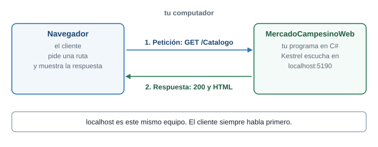
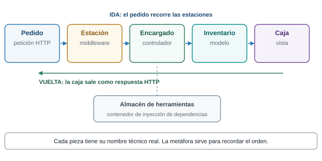
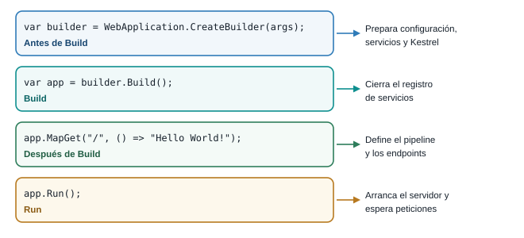
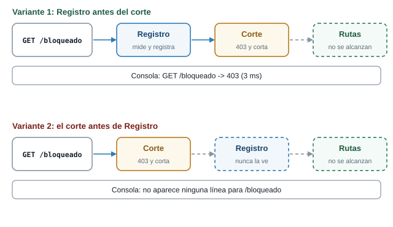
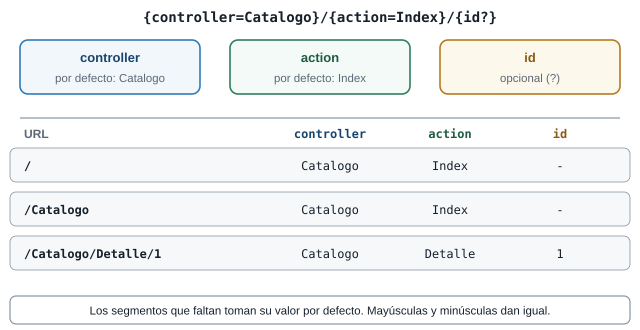
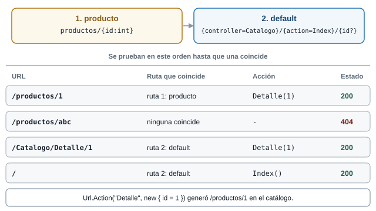
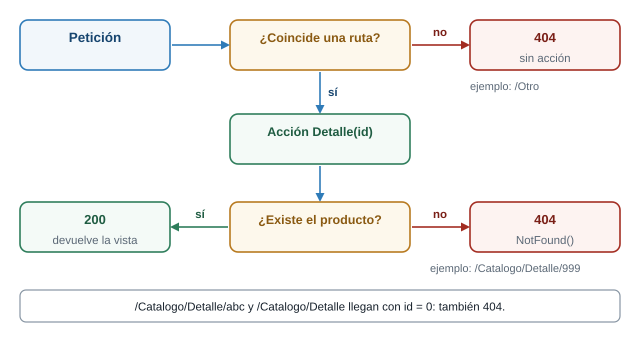

::: {.ficha}
|                 |                                                                           |
|-----------------|---------------------------------------------------------------------------|
| Qué construyes  | El servidor de Mercado Campesino Digital, en seis etapas, desde un proyecto vacío |
| Prerrequisitos  | Semana 8: peticiones HTTP, JSON y DevTools                                |
| Herramientas    | .NET SDK 10, VS Code (o cualquier editor) y una terminal                  |
:::

::: {.acceso}
::: {.acceso-item}
Presentación interactiva de las etapas 0 a 2: proyecto vacío, pipeline y middleware

[Abrir la presentación del pipeline](presentacion-interactiva-pipeline.html){.btn-doc target="_blank"}
:::

::: {.acceso-item}
Presentación interactiva de las etapas 3 a 5: MVC, rutas e inyección de dependencias

[Abrir la presentación de MVC](presentacion-interactiva-mvc.html){.btn-doc target="_blank"}
:::
:::

## Lo que vas a lograr

Hasta la Semana 8 tu panel del productor pedía los datos a un servidor ajeno. Esta semana el servidor
lo escribes tú. Partes de una carpeta vacía y, en seis etapas, llegas a un servidor ASP.NET Core que
atiende rutas como `/Catalogo` y `/Catalogo/Detalle/4` con el catálogo del proyecto Mercado
Campesino Digital. Todo se hace con un editor y la terminal. No hay asistentes ni plantillas que
generen código por ti: cada archivo lo escribes, lo ejecutas y ves qué cambió.

### Cliente y servidor, en tu computador

La conversación es la de la Semana 8: una petición y una respuesta. Cambia quién escribe el
servidor. Tu servidor es un programa en C#. **Kestrel**, el servidor web que trae ASP.NET Core, abre
un puerto y entrega cada petición al código de tu proyecto. Con `localhost`, el navegador y el
servidor corren en el mismo computador.

::: {.diagrama}
{fig-alt="Un navegador envía la petición GET /Catalogo al programa MercadoCampesinoWeb, que corre en el mismo computador y escucha en localhost puerto 5190, y recibe una respuesta 200 con HTML."}

El cliente siempre empieza la conversación.
:::

### La línea de empaque

Para recordar el orden de las piezas usarás una sola imagen: una **línea de empaque**. Cada petición
es un **pedido** que llega con una etiqueta (la URL). Recorre una fila de **estaciones** (el
pipeline). Un **encargado** lo arma (el controlador) con lo que hay en el **inventario** (el
modelo) y lo entrega en una **caja** (la vista) que sale por la misma línea. Las herramientas que
necesita el encargado las guarda un **almacén** (el contenedor de inyección de dependencias). Los
nombres técnicos aparecen siempre con su nombre real. La línea de empaque ayuda a recordar el orden.

::: {.diagrama}
{fig-alt="Cinco cajas en fila: pedido, estación, encargado, inventario y caja, con su nombre técnico debajo: petición HTTP, middleware, controlador, modelo y vista. Una flecha de vuelta indica la respuesta y un almacén de herramientas se conecta al encargado."}

Cada pieza de la línea tiene un nombre técnico. 
:::

### Las seis etapas

Cada etapa agrega una sola idea al proyecto y termina con algo que ejecutas y ves.

- **Etapa 0. Proyecto vacío.** El proyecto de `dotnet new web` y su `Program.cs`. Archivos: los 5 que
  genera la plantilla.
- **Etapa 1. Pipeline.** Un middleware en línea que registra cada petición y la ruta `/salud`.
  Archivos nuevos: ninguno, cambia `Program.cs`.
- **Etapa 2. Middleware como clase.** El mismo middleware, en su propia clase. Archivo nuevo:
  `Middleware/RegistroPeticionesMiddleware.cs`.
- **Etapa 3. MVC a mano.** Modelo, controlador y vista del catálogo. Archivos nuevos:
  `Models/Producto.cs`, `Controllers/CatalogoController.cs` y `Views/Catalogo/Index.cshtml`.
- **Etapa 4. Rutas y 404.** Detalle de un producto, ruta propia y respuesta 404. Archivo nuevo:
  `Views/Catalogo/Detalle.cshtml`.
- **Etapa 5. Inyección de dependencias.** Un servicio detrás de una interfaz y su registro. Archivos
  nuevos: `Services/ICatalogoService.cs`, `Services/CatalogoEnMemoria.cs` y los de la demostración.

El árbol de carpetas crece así. Vuelve a este diagrama al terminar cada etapa y comprueba que tu
carpeta tiene lo mismo.

::: {.diagrama}
{fig-alt="Matriz de archivos del proyecto contra las etapas 0 a 5. Un punto verde marca la etapa en que aparece cada archivo, uno ámbar las etapas en que cambia y uno gris pequeño que sigue igual."}

Un punto verde marca el archivo que aparece, uno ámbar el que cambia y uno gris el que sigue igual.
:::

Al terminar la guía sabes:

1. Crear un proyecto web vacío con `dotnet new web` y leer cada uno de sus archivos.
2. Explicar el pipeline y escribir un middleware en línea y como clase.
3. Predecir cómo cambia el resultado cuando cambia el orden de los middleware.
4. Armar un catálogo con modelo, controlador y vista, y entender qué busca MVC y dónde.
5. Predecir qué controlador y qué acción atiende una URL, y por qué una ruta termina en 404.
6. Usar una interfaz y el contenedor de inyección de dependencias.
7. Dejar el servidor de tu proyecto respondiendo a sus rutas base.

## Preparación del entorno

::: {.callout-note}
## Antes de empezar

Necesitas el panel del productor de la Semana 8 (HTML, CSS y JavaScript con `fetch`), una terminal
y el **.NET SDK 10**. Comprueba que está instalado:

```text
dotnet --version
```

La guía se escribió y se probó con la versión `10.0.302`. Los mensajes de `dotnet` salen en el
idioma de tu sistema: aquí aparecen en español porque así salieron en la prueba.
:::

El editor es **VS Code**, aunque cualquier editor de texto sirve: el proyecto se compila y se ejecuta
desde la terminal con el SDK, y el editor solo te ayuda a escribir.

1. Crea una carpeta para el proyecto y ábrela en VS Code. Desde una terminal dentro de la carpeta:
   `code .`
2. Instala la extensión de C# de Microsoft. En la máquina donde se preparó esta guía estaban
   instaladas `ms-dotnettools.csharp` y `ms-dotnettools.csdevkit` (C# Dev Kit). Dan resaltado de
   sintaxis y ayudas al escribir. El código no las necesita para compilar ni ejecutar.
3. Abre la terminal integrada de VS Code (menú Terminal). Trabajarás en ella: es la misma terminal
   que usarías fuera del editor y queda ya ubicada en la carpeta del proyecto.

::: {.callout-warning}
## Qué se probó y qué no

Todos los comandos y las salidas de esta guía se ejecutaron en una máquina con Windows 11. Los pasos
de la interfaz de VS Code (instalar la extensión, abrir la terminal integrada) no se probaron uno por
uno: si tu pantalla se ve distinta, busca la opción equivalente. Cada vez que algo no se probó, la
guía lo dice.
:::

## Etapa 0. Un proyecto vacío

### El problema

Antes de escribir middleware o controladores necesitas saber qué trae un proyecto web y cuántas
piezas son realmente imprescindibles. La plantilla `web` crea el proyecto más pequeño posible: no
trae controladores, ni vistas, ni estilos. Es el punto de partida de todo lo demás.

::: {.callout-tip}
## Predice antes de seguir

Un servidor que responde "Hello World" es un programa. ¿Cuántas líneas de C# crees que hacen falta
para que escuche peticiones y conteste una? Escribe un número y compáralo al final de la etapa.
:::

::: {.callout-note collapse="true"}
## Respuesta

Cuatro instrucciones. Están en `Program.cs`, que es todo el código que trae la plantilla.
:::

### Crear el proyecto

En la terminal, dentro de la carpeta donde guardas tus proyectos:

```text
dotnet new web -n MercadoCampesinoWeb
```

La salida literal fue:

```text
La plantilla "ASP.NET Core vacío" se creó correctamente.

Procesando acciones posteriores a la creación...
Restaurando ...\MercadoCampesinoWeb\MercadoCampesinoWeb.csproj:
  Determinando los proyectos que se van a restaurar...
  Se ha restaurado ...\MercadoCampesinoWeb\MercadoCampesinoWeb.csproj (en 109 ms).
Restauración realizada correctamente.
```

Entra a la carpeta que se creó y ábrela en el editor:

```text
cd MercadoCampesinoWeb
code .
```

La plantilla generó estos archivos (la carpeta `obj/` aparece después, cuando el SDK restaura el
proyecto):

```text
MercadoCampesinoWeb/
  MercadoCampesinoWeb.csproj
  Program.cs
  appsettings.json
  appsettings.Development.json
  Properties/launchSettings.json
  obj/            (lo crea el restore; no se versiona)
```

No hay `wwwroot`, ni `Controllers`, ni `Views`, ni layout. La plantilla tampoco crea un
`.gitignore`: si usas Git, `bin/` y `obj/` quedan sin ignorar hasta que agregues uno.

### Qué hace cada archivo

El archivo de proyecto, `MercadoCampesinoWeb.csproj`, dice qué es esto y cómo se compila:

```xml
<Project Sdk="Microsoft.NET.Sdk.Web">

  <PropertyGroup>
    <TargetFramework>net10.0</TargetFramework>
    <Nullable>enable</Nullable>
    <ImplicitUsings>enable</ImplicitUsings>
  </PropertyGroup>

</Project>
```

| Línea | Qué significa |
|---|---|
| `Sdk="Microsoft.NET.Sdk.Web"` | Usa el SDK web: trae ASP.NET Core sin referenciar paquetes a mano |
| `TargetFramework` `net10.0` | Compila contra .NET 10 |
| `Nullable` `enable` | El compilador avisa de posibles referencias nulas |
| `ImplicitUsings` `enable` | Agrega por defecto los `using` más comunes. Por eso `Program.cs` no tiene ninguno |

Los dos `appsettings` son configuración. `appsettings.json` fija el nivel de registro del
framework: `Microsoft.AspNetCore` en `Warning`. Consecuencia: el framework no
imprime una línea por cada petición, solo los mensajes de arranque.

`Properties/launchSettings.json` define dos perfiles, `http` y `https`, con sus puertos y con
`ASPNETCORE_ENVIRONMENT` en `Development`. La plantilla sortea los puertos al crear el proyecto, así
que en tu máquina serán otros.

### Program.cs, línea por línea

Todo el código del servidor es este archivo:

```csharp
var builder = WebApplication.CreateBuilder(args);
var app = builder.Build();

app.MapGet("/", () => "Hello World!");

app.Run();
```

- **Línea 1,** `var builder = WebApplication.CreateBuilder(args);` Crea el constructor de la
  aplicación. Lee configuración (`appsettings.json`, variables de entorno, `args`), prepara el
  registro de servicios y el servidor Kestrel.
- **Línea 2,** `var app = builder.Build();` Cierra el registro de servicios y construye la
  aplicación. A partir de aquí configuras el pipeline, ya no los servicios.
- **Línea 4,** `app.MapGet("/", () => "Hello World!");` Registra un endpoint: para `GET /` ejecuta la
  función y escribe el texto como respuesta.
- **Línea 6,** `app.Run();` Arranca el servidor y espera. El programa sigue vivo hasta que lo
  detienes.

::: {.diagrama}
{fig-alt="Las cuatro instrucciones de Program.cs en cuatro bloques: CreateBuilder prepara configuración, servicios y Kestrel; Build cierra el registro de servicios; MapGet define el endpoint; Run arranca el servidor."}

Lo que va antes de `Build` es el registro de servicios. Lo que va después define cómo responde el servidor.
:::

El archivo no tiene `using` ni método `Main`. Son **instrucciones de nivel superior**: el compilador
genera por ti la clase `Program` y el método `Main`.

::: {.callout-note}
## C# justo a tiempo: lo que usa esta etapa

- `var` declara una variable y deja que el compilador deduzca su tipo.
- `() => "Hello World!"` es una **expresión lambda**: una función sin nombre. Los paréntesis vacíos
  dicen que no recibe parámetros, y lo que está después de `=>` es lo que devuelve.
- `args` son los argumentos con que se ejecutó el programa en la terminal.
:::

### Ejecutar el servidor

Compila y ejecuta. Los dos comandos hacen un trabajo distinto: `dotnet build` solo comprueba que el
código compila, y `dotnet run` compila y además arranca el programa.

```text
dotnet build
```

```text
  Determinando los proyectos que se van a restaurar...
  Se ha restaurado ...\etapa-0-vacio\MercadoCampesinoWeb\MercadoCampesinoWeb.csproj (en 103 ms).
  MercadoCampesinoWeb -> ...\etapa-0-vacio\MercadoCampesinoWeb\bin\Debug\net10.0\MercadoCampesinoWeb.dll
Compilación correcta.
    0 Advertencia(s)
    0 Errores
Tiempo transcurrido 00:00:02.21
```

Para que todos los equipos usen la misma dirección, en esta guía se ejecuta siempre con el puerto
fijado:

```text
dotnet run --no-launch-profile --urls http://localhost:5190
```

`--urls` fija la dirección y el puerto. `--no-launch-profile` hace que ignore
`launchSettings.json`. La consola muestra:

```text
info: Microsoft.Hosting.Lifetime[14]
      Now listening on: http://localhost:5190
info: Microsoft.Hosting.Lifetime[0]
      Application started. Press Ctrl+C to shut down.
info: Microsoft.Hosting.Lifetime[0]
      Hosting environment: Production
info: Microsoft.Hosting.Lifetime[0]
      Content root path: ...\etapa-0-vacio\MercadoCampesinoWeb
```

Dos cosas para leer. `Now listening on: http://localhost:5190` es el programa avisando en qué
puerta atiende. Y `Hosting environment: Production` aparece porque `--no-launch-profile` ignoró el
archivo que fijaba `Development`. Esa línea te dice en qué entorno corre.

Abre `http://localhost:5190/` en el navegador. Esto es lo que respondió el servidor:

| Petición | Estado | Tipo de contenido | Cuerpo |
|---|---|---|---|
| `GET /` | `200 OK` | `text/plain; charset=utf-8` | `Hello World!` |
| `GET /otra` | `404 Not Found` | (ninguno) | vacío |

La consola no imprime nada por petición. Para detener el servidor, la propia consola lo dice:
`Press Ctrl+C to shut down`.

### dotnet watch: recarga al guardar

Cada cambio en el código te obliga a detener el servidor y volver a ejecutarlo. `dotnet watch`
vigila los archivos y recarga cuando guardas:

```text
dotnet watch run --no-launch-profile --urls http://localhost:5190
```

Lo que se midió en esta máquina:

| Prueba | Resultado observado |
|---|---|
| Arranque (incluye restore y build) | App respondiendo a los 9,7 s de lanzar el comando |
| Cambiar el texto de `MapGet("/")` y guardar | `File updated: .\Program.cs` y `C# and Razor changes applied in 2729ms.` La respuesta cambió de `Hello World!` a `Hola, Mercado Campesino` 2,9 s después de guardar, sin reiniciar el proceso |
| Quitar un `;` (error de compilación) | `Unable to apply changes due to compilation errors.` y `Program.cs(6,10): error CS1002: Se esperaba ;`. La app siguió respondiendo con la última versión buena |
| Corregir el error | La app volvió a funcionar sin reiniciar `dotnet watch` |
| Agregar una ruta nueva con `app.MapGet("/nueva", ...)` | `warning ENC0118: Es posible que el cambio de "código de nivel superior" no tenga efecto hasta que se reinicie la aplicación. Press "Ctrl + R" to restart.` y `GET /nueva` siguió respondiendo `404` |

Entonces: un cambio en el cuerpo de una lambda se aplica en caliente, y una ruta nueva en `Program.cs`
pide reiniciar. El propio mensaje te dice cómo: `Ctrl + R` en la terminal de `dotnet watch`, o
detenerlo y volver a ejecutarlo. Esas dos teclas no se pudieron probar en una terminal interactiva
al preparar la guía, así que usa lo que el mensaje te indique en tu pantalla. Sin `dotnet watch`,
`dotnet run` no recarga nada.

### Cierre de la etapa 0

- **Qué cambió:** el proyecto nace. No hay etapa anterior.
- **Cómo verificarlo:** `dotnet run --no-launch-profile --urls http://localhost:5190` y abre
  `http://localhost:5190/`.
- **Qué debes ver:** `Hello World!` en el navegador, `404` en `/otra` y, en la consola,
  `Now listening on: http://localhost:5190`. La respuesta a la pregunta del inicio: cuatro
  instrucciones.

## Etapa 1. El pipeline y el middleware en línea

### El problema

Quieres saber qué peticiones llegan al servidor y cuánto tardan, y ahora la consola no dice nada.
Podrías escribir `Console.WriteLine` dentro de cada ruta, pero entonces tendrías que repetirlo en
cada una y no verías las rutas que no existen. Lo que necesitas es un lugar que **vea todas las
peticiones antes de que lleguen a cualquier ruta**.

::: {.callout-tip}
## Predice antes de seguir

Si pides `/no-existe`, que ninguna ruta atiende, ¿crees que el registro lo verá? Piensa dónde
tendría que estar el código para verlo.
:::

::: {.callout-note collapse="true"}
## Respuesta

Sí, lo verá, siempre que esté antes de la selección de la ruta. Lo comprobarás en esta etapa:
`/no-existe` queda registrado con `404`.
:::

### Modelo mental: el pipeline

Una petición no llega directo a tu ruta. Antes pasa por una **cadena de middleware**, el
**pipeline**. Cada middleware es una estación de la línea de empaque: recibe el pedido, hace su
trabajo y decide si lo pasa a la estación siguiente. Cuando la última estación responde, la
respuesta **vuelve por la misma cadena**.

::: {.diagrama}
{fig-alt="Un navegador, el middleware de registro y el endpoint salud en fila. La petición va hacia la derecha por el pipeline y la respuesta regresa hacia la izquierda. Dentro del registro, antes de siguiente arranca el reloj y después imprime la línea."}

El middleware tiene dos momentos: lo que hace a la ida y lo que hace a la vuelta.
:::

### El código

Cambia `Program.cs` por esto:

```csharp
using System.Diagnostics;

var builder = WebApplication.CreateBuilder(args);
var app = builder.Build();

// Registro de peticiones. Va primero para ver todo lo que entra y medir todo lo que sigue.
app.Use(async (contexto, siguiente) =>
{
    var reloj = Stopwatch.StartNew();

    // Todo lo que sigue en la cadena corre aqui adentro; al volver ya hay respuesta.
    await siguiente();

    reloj.Stop();
    Console.WriteLine(
        $"{contexto.Request.Method} {contexto.Request.Path} -> {contexto.Response.StatusCode} ({reloj.ElapsedMilliseconds} ms)");
});

app.MapGet("/", () => "Mercado Campesino Digital");
app.MapGet("/salud", () => "ok");

app.Run();
```

Qué cambió respecto de la etapa 0:

```diff
--- anterior
+++ nuevo
@@ -1,6 +1,22 @@
+using System.Diagnostics;
+
 var builder = WebApplication.CreateBuilder(args);
 var app = builder.Build();
 
-app.MapGet("/", () => "Hello World!");
+// Registro de peticiones. Va primero para ver todo lo que entra y medir todo lo que sigue.
+app.Use(async (contexto, siguiente) =>
+{
+    var reloj = Stopwatch.StartNew();
+
+    // Todo lo que sigue en la cadena corre aqui adentro; al volver ya hay respuesta.
+    await siguiente();
+
+    reloj.Stop();
+    Console.WriteLine(
+        $"{contexto.Request.Method} {contexto.Request.Path} -> {contexto.Response.StatusCode} ({reloj.ElapsedMilliseconds} ms)");
+});
+
+app.MapGet("/", () => "Mercado Campesino Digital");
+app.MapGet("/salud", () => "ok");
 
 app.Run();
```

Por qué cada pieza:

- `app.Use(async (contexto, siguiente) => ...)` registra un middleware en línea. `contexto` es la
  petición y la respuesta en curso. `siguiente` es **el resto de la cadena**.
- `await siguiente();` ejecuta el resto de la cadena y vuelve **cuando ya hay respuesta**. Por eso
  el estado y el tiempo se leen después de esa línea.
- Lo que va antes de `siguiente()` corre a la ida. Lo que va después, a la vuelta.
- `app.MapGet("/salud", () => "ok");` es una segunda ruta, para tener algo más que pedir.

::: {.callout-note}
## C# justo a tiempo: lo que usa esta etapa

- `using System.Diagnostics;` trae el espacio de nombres donde vive `Stopwatch`, un cronómetro.
- Una lambda puede recibir parámetros: `(contexto, siguiente) => { ... }`.
- `async` y `await` permiten esperar un trabajo sin bloquear el programa. `siguiente()` devuelve
  algo que se espera con `await`.
- `$"...{expresión}..."` es una **cadena interpolada**: dentro de las llaves va código C# cuyo
  valor entra en el texto.
:::

### Verificar

Ejecuta con `dotnet run --no-launch-profile --urls http://localhost:5190` y pide en el navegador `/`,
`/salud`, `/no-existe` y `/favicon.ico`. Respuestas observadas:

| Petición | Estado | Cuerpo |
|---|---|---|
| `GET /` | `200 OK` | `Mercado Campesino Digital` |
| `GET /salud` | `200 OK` | `ok` |
| `GET /no-existe` | `404 Not Found` | vacío |
| `GET /favicon.ico` | `404 Not Found` | vacío |

Y la consola, después de los mensajes de arranque:

```text
GET / -> 200 (3 ms)
GET /salud -> 200 (0 ms)
GET /no-existe -> 404 (0 ms)
GET /favicon.ico -> 404 (0 ms)
```

Aun las rutas que no existen quedan registradas con `404`: el middleware está antes de la selección
de la ruta. Los milisegundos varían en cada ejecución.

### Experimento: el orden importa

Un middleware que **no llama a `siguiente`** corta la cadena. Para verlo, agrega justo después del
bloque de registro (y antes de los `MapGet`) este segundo middleware:

```csharp
app.Use(async (contexto, siguiente) =>
{
    if (contexto.Request.Path == "/bloqueado")
    {
        contexto.Response.StatusCode = 403;
        await contexto.Response.WriteAsync("bloqueado por middleware");
        return;
    }

    await siguiente();
});
```

Pide `/bloqueado` y `/salud`. Observado con el registro **antes** del corte:

```text
GET /salud -> 200 (3 ms)
GET /bloqueado -> 403 (0 ms)
```

`/bloqueado` responde `403` con el texto `bloqueado por middleware`, y el registro lo ve. Ahora mueve
el bloque del corte **arriba** del registro. Lo medido fue que `/bloqueado` sigue respondiendo `403`
y `/salud` `200`, pero la consola solo imprime la línea de `/salud`: la petición bloqueada no se
registra.

::: {.diagrama}
{fig-alt="Dos variantes de la misma cadena. En la primera, Registro va antes del corte y la consola imprime la línea con 403. En la segunda, el corte va antes de Registro, que nunca ve la petición, y la consola no imprime nada para /bloqueado."}

El mismo código, con otro orden, produce otro resultado.
:::

Resultados de las cuatro variantes que se probaron. `corta` es el middleware de arriba, `termina` es
un `app.Run` que responde `fin de la cadena` y `registro` es el de la etapa:

| Variante | Orden de registro | Respuestas | Consola |
|---|---|---|---|
| 1 | registro, corta, rutas | `/bloqueado` 403 `bloqueado por middleware`; `/salud` 200 `ok` | `GET /bloqueado -> 403 (3 ms)` y `GET /salud -> 200 (1 ms)` |
| 2 | corta, registro, rutas | igual que la 1 | solo `GET /salud -> 200 (2 ms)` |
| 3 | registro, `app.Run`, rutas | `/`, `/salud` y `/cualquiera`: 200 `fin de la cadena` | las tres, con 200 |
| 4 | `app.Run`, registro, rutas | las tres: 200 `fin de la cadena` | ninguna línea |

Dos reglas que salen de ahí:

- Un middleware que no llama a `siguiente` corta la cadena: lo registrado después no se ejecuta para
  esa petición.
- `app.Run` es terminal. Las rutas de `MapGet` escritas después de él nunca se alcanzan. En la
  variante 4 la petición se atiende y el registro no se entera: es el mismo código con otro orden.

Quita el middleware del corte antes de pasar a la etapa 2.

::: {.callout-tip}
## Reto 1. Predice la consola

Tienes tres middleware registrados en este orden: el de registro, un `app.Run` que responde
`fin de la cadena` y después las rutas `MapGet("/")` y `MapGet("/salud")`. Pides `/salud`.
¿Qué texto recibes y qué imprime la consola?
:::

::: {.callout-note collapse="true"}
## Solución del Reto 1

Recibes `fin de la cadena` con estado `200`, no `ok`. El `app.Run` es terminal y atiende toda
petición que le llega, así que la ruta `/salud` nunca se alcanza. La consola imprime
`GET /salud -> 200 (...)`: el registro está antes del `app.Run`, ve la petición y la mide. Es la
variante 3 de la tabla.
:::

### Cierre de la etapa 1

- **Qué cambió:** `Program.cs` tiene un middleware en línea y una ruta `/salud`.
- **Cómo verificarlo:** ejecuta y pide `/`, `/salud` y `/no-existe`.
- **Qué debes ver:** `Mercado Campesino Digital`, `ok` y un `404`, y en la consola tres líneas
  `GET ... -> ... (N ms)`, una por petición.

## Etapa 2. El middleware como clase

### El problema

El bloque de registro vive dentro de `Program.cs` y ya ocupa una parte importante del archivo. Si
agregas autenticación, errores y más, `Program.cs` se vuelve ilegible. Un middleware con nombre propio
se puede leer, mover y reutilizar por separado.

::: {.callout-tip}
## Predice antes de seguir

Si sacas el mismo código a una clase, ¿qué dos cosas tiene que recibir esa clase del framework para
hacer lo mismo que el bloque en línea?
:::

::: {.callout-note collapse="true"}
## Respuesta

Necesita la **siguiente estación** (lo que en la lambda era el parámetro `siguiente`) y el
**contexto** de cada petición. El framework entrega la primera al construir la clase, y el segundo
cada vez que llega una petición.
:::

### El código

Crea la carpeta `Middleware` y dentro el archivo `RegistroPeticionesMiddleware.cs`:

```csharp
using System.Diagnostics;

namespace MercadoCampesinoWeb.Middleware;

public class RegistroPeticionesMiddleware
{
    private readonly RequestDelegate _siguiente;

    // El framework entrega aqui el siguiente eslabon de la cadena.
    public RegistroPeticionesMiddleware(RequestDelegate siguiente)
    {
        _siguiente = siguiente;
    }

    public async Task InvokeAsync(HttpContext contexto)
    {
        var reloj = Stopwatch.StartNew();

        await _siguiente(contexto);

        reloj.Stop();
        Console.WriteLine(
            $"{contexto.Request.Method} {contexto.Request.Path} -> {contexto.Response.StatusCode} ({reloj.ElapsedMilliseconds} ms)");
    }
}
```

Y deja `Program.cs` así:

```csharp
using MercadoCampesinoWeb.Middleware;

var builder = WebApplication.CreateBuilder(args);
var app = builder.Build();

// Primero en la cadena: ve todas las peticiones y mide todo lo que sigue.
app.UseMiddleware<RegistroPeticionesMiddleware>();

app.MapGet("/", () => "Mercado Campesino Digital");
app.MapGet("/salud", () => "ok");

app.Run();
```

Qué cambió respecto de la etapa 1:

```diff
--- anterior
+++ nuevo
@@ -1,19 +1,9 @@
-using System.Diagnostics;
+using MercadoCampesinoWeb.Middleware;
 
 var builder = WebApplication.CreateBuilder(args);
 var app = builder.Build();
 
-// Registro de peticiones. Va primero para ver todo lo que entra y medir todo lo que sigue.
-app.Use(async (contexto, siguiente) =>
-{
-    var reloj = Stopwatch.StartNew();
-
-    // Todo lo que sigue en la cadena corre aqui adentro; al volver ya hay respuesta.
-    await siguiente();
-
-    reloj.Stop();
-    Console.WriteLine(
-        $"{contexto.Request.Method} {contexto.Request.Path} -> {contexto.Response.StatusCode} ({reloj.ElapsedMilliseconds} ms)");
-});
+// Primero en la cadena: ve todas las peticiones y mide todo lo que sigue.
+app.UseMiddleware<RegistroPeticionesMiddleware>();
 
 app.MapGet("/", () => "Mercado Campesino Digital");
```

::: {.diagrama}
{fig-alt="Cuatro pares que relacionan el middleware en línea con la clase: la lambda con InvokeAsync, el parámetro siguiente con el constructor, await siguiente con await _siguiente y app.Use con app.UseMiddleware."}

El cuerpo no cambia. Cambia dónde vive y cómo recibe `siguiente`.
:::

::: {.callout-note}
## C# justo a tiempo: lo que usa esta etapa

- Una **clase** agrupa datos y comportamiento: `public class RegistroPeticionesMiddleware`.
- `namespace MercadoCampesinoWeb.Middleware;` dice a qué grupo de nombres pertenece. El `using` de
  `Program.cs` lo trae.
- Un **campo privado** `private readonly RequestDelegate _siguiente;` guarda un valor dentro del
  objeto. `readonly` impide cambiarlo después de la construcción.
- El **constructor** tiene el nombre de la clase y recibe lo que el objeto necesita para existir.
- Un método `async Task` es el equivalente de la lambda `async`.
:::

El framework **construye la clase una sola vez** y le entrega `RequestDelegate` en el constructor.
`InvokeAsync` corre en cada petición. El método debe llamarse `Invoke` o `InvokeAsync`.

### Verificar

Ejecuta de nuevo. La salida es idéntica a la de la etapa 1: las mismas respuestas y las mismas
líneas de consola. Es lo esperado, porque el comportamiento no cambió.

```text
GET / -> 200 (5 ms)
GET /salud -> 200 (0 ms)
GET /no-existe -> 404 (0 ms)
GET /favicon.ico -> 404 (0 ms)
```

::: {.callout-tip}
## Reto 2. Un nombre mal puesto

Cambia el nombre del método `InvokeAsync` por `Registrar` y ejecuta `dotnet build` y después
`dotnet run`. ¿Compila? ¿Cuándo aparece el error y qué dice?
:::

::: {.callout-note collapse="true"}
## Solución del Reto 2

El proyecto **compila**: para el compilador `Registrar` es un método válido. El error aparece al
arrancar, en `UseMiddleware`, porque el framework busca por nombre un método `Invoke` o
`InvokeAsync`. El mensaje literal fue:

```text
System.InvalidOperationException: No public 'Invoke' or 'InvokeAsync' method found for middleware of type 'MercadoCampesinoWeb.Middleware.RegistroPeticionesMiddleware'.
```

Devuelve el nombre `InvokeAsync` antes de seguir.
:::

### Cierre de la etapa 2

- **Qué cambió:** el registro vive en `Middleware/RegistroPeticionesMiddleware.cs` y `Program.cs`
  solo lo registra con `app.UseMiddleware<...>()`.
- **Cómo verificarlo:** ejecuta y pide `/`, `/salud` y `/no-existe`.
- **Qué debes ver:** exactamente lo mismo que en la etapa 1.

## Etapa 3. MVC armado a mano

### El problema

Hasta ahora cada respuesta es un texto escrito dentro de `Program.cs`. El catálogo del proyecto es
una lista de productos con nombre, precio, cantidad y productor, y debe verse como una página HTML.
Escribir todo eso dentro de una lambda mezclaría los datos, la decisión de qué mostrar y el HTML.
**MVC** separa esas tres responsabilidades en tres piezas.

::: {.callout-tip}
## Predice antes de seguir

En la línea de empaque, ¿qué piezas hacen falta para devolver un catálogo en HTML? Nómbralas con su
nombre de la línea (pedido, estación, encargado, inventario, caja) y con su nombre técnico.
:::

::: {.callout-note collapse="true"}
## Respuesta

El **encargado** (controlador) recibe el pedido, consulta el **inventario** (modelo, la lista de
`Producto`) y entrega los datos a la **caja** (vista), que los empaca como HTML. La petición llega
hasta el encargado por la estación de rutas.
:::

::: {.diagrama}
{fig-alt="La petición GET /Catalogo pasa por la ruta default, llega a CatalogoController.Index, que arma la lista del modelo Producto y la pasa con View a la vista Views/Catalogo/Index.cshtml, que produce el HTML."}

El recorrido completo de una petición al catálogo.
:::

### El código

Esta etapa agrega tres archivos y cambia `Program.cs`. Crea las carpetas `Models`, `Controllers`,
`Views` y `Views/Catalogo`.

**El modelo**, `Models/Producto.cs`:

```csharp
namespace MercadoCampesinoWeb.Models;

public class Producto
{
    public int Id { get; set; }
    public string Nombre { get; set; } = "";
    public decimal Precio { get; set; }
    public int Cantidad { get; set; }
    public string Productor { get; set; } = "";

    // RN-03: sin cantidad disponible se muestra como agotado, sin ocultarse del catalogo.
    public bool Agotado => Cantidad <= 0;
}
```

::: {.callout-note}
## C# justo a tiempo: modelo y propiedades

- Una **propiedad** `public int Id { get; set; }` es un dato de la clase que se puede leer y
  escribir. Cada producto tiene `Id`, `Nombre`, `Precio`, `Cantidad` y `Productor`.
- `= "";` da un valor inicial a un texto, para que nunca sea nulo.
- `public bool Agotado => Cantidad <= 0;` es una **propiedad calculada**: no guarda nada, responde
  según `Cantidad`. Así expresas la regla RN-03: sin cantidad disponible, el producto se muestra
  como agotado y no se oculta.
:::

**El controlador**, `Controllers/CatalogoController.cs`:

```csharp
using MercadoCampesinoWeb.Models;
using Microsoft.AspNetCore.Mvc;

namespace MercadoCampesinoWeb.Controllers;

public class CatalogoController : Controller
{
    // La lista vive aqui por ahora; en la etapa 5 sale de un servicio.
    public IActionResult Index()
    {
        var productos = new List<Producto>
        {
            new() { Id = 1, Nombre = "Papa criolla", Precio = 3200m, Cantidad = 40, Productor = "Finca La Esperanza" },
            new() { Id = 2, Nombre = "Mora de Castilla", Precio = 6500m, Cantidad = 0, Productor = "Finca El Roble" },
            new() { Id = 3, Nombre = "Panela redonda", Precio = 4800m, Cantidad = 25, Productor = "Trapiche San José" },
        };

        return View(productos);
    }
}
```

::: {.callout-note}
## C# justo a tiempo: listas y objetos

- `List<Producto>` es una lista que solo guarda `Producto`. El tipo entre `<` y `>` es el de sus
  elementos.
- `new() { Id = 1, Nombre = "...", ... }` crea un objeto y asigna sus propiedades en un solo paso.
- Un controlador es una clase que **hereda** de `Controller` (`: Controller`). Cada método público
  que devuelve `IActionResult` es una **acción**.
- `View(productos)` le dice a MVC: usa la vista de esta acción y pásale esta lista.
:::

**La vista**, `Views/Catalogo/Index.cshtml`:

```cshtml
@using System.Globalization
@using MercadoCampesinoWeb.Models
@model List<Producto>
<!DOCTYPE html>
<html lang="es">
<head>
    <meta charset="utf-8" />
    <title>Catálogo | Mercado Campesino Digital</title>
</head>
<body>
    <h1>Catálogo de productos</h1>
    <ul>
        @foreach (var producto in Model)
        {
            <li>
                @producto.Nombre, @producto.Precio.ToString("C0", new CultureInfo("es-CO")), @producto.Productor:
                @(producto.Agotado ? "Agotado" : $"{producto.Cantidad} disponibles")
            </li>
        }
    </ul>
</body>
</html>
```

Un archivo `.cshtml` es HTML con fragmentos de C# marcados con `@`. `@model List<Producto>` declara
qué recibe la vista. `@foreach` repite el bloque por cada producto. `@producto.Nombre` escribe el
valor, y `@(producto.Agotado ? "Agotado" : $"{producto.Cantidad} disponibles")` escoge un texto según
la propiedad calculada del modelo. El precio sale formateado con la cultura `es-CO`:
`Precio.ToString("C0", new CultureInfo("es-CO"))` produjo `$ 3.200`.

La vista incluye su propio `<!DOCTYPE html>`, `<head>` y `<body>` porque todavía no hay layout:
sin él, la vista es el documento completo.

**Program.cs**, con el registro de MVC y la ruta:

```csharp
using MercadoCampesinoWeb.Middleware;

var builder = WebApplication.CreateBuilder(args);

// Registra lo que MVC necesita: controladores y vistas Razor.
builder.Services.AddControllersWithViews();

var app = builder.Build();

app.UseMiddleware<RegistroPeticionesMiddleware>();

app.MapGet("/salud", () => "ok");

// Ruta convencional: /Catalogo llama a CatalogoController.Index. En "/" cae en Catalogo/Index.
app.MapControllerRoute(
    name: "default",
    pattern: "{controller=Catalogo}/{action=Index}/{id?}");

app.Run();
```

Qué cambió respecto de la etapa 2:

```diff
--- anterior
+++ nuevo
@@ -2,11 +2,18 @@
 
 var builder = WebApplication.CreateBuilder(args);
+
+// Registra lo que MVC necesita: controladores y vistas Razor.
+builder.Services.AddControllersWithViews();
+
 var app = builder.Build();
 
-// Primero en la cadena: ve todas las peticiones y mide todo lo que sigue.
 app.UseMiddleware<RegistroPeticionesMiddleware>();
 
-app.MapGet("/", () => "Mercado Campesino Digital");
 app.MapGet("/salud", () => "ok");
 
+// Ruta convencional: /Catalogo llama a CatalogoController.Index. En "/" cae en Catalogo/Index.
+app.MapControllerRoute(
+    name: "default",
+    pattern: "{controller=Catalogo}/{action=Index}/{id?}");
+
 app.Run();
```

- `builder.Services.AddControllersWithViews();` registra lo que MVC necesita: controladores y vistas.
  Va **antes** de `Build()`.
- `app.MapControllerRoute(...)` es la ruta convencional. Su patrón dice cómo leer una URL para elegir controlador y acción.
- Se quitó `app.MapGet("/", ...)`: era la que respondía en `/`, y ahora lo hace el catálogo.

### Qué hace falta para que compile y renderice

Probado partiendo de la etapa 2:

| Intento | Resultado observado |
|---|---|
| Solo `AddControllersWithViews` y `MapControllerRoute`, sin controlador | Compila. `GET /Catalogo` da `404`; `/` y `/salud` siguen respondiendo desde los `MapGet` |
| Controlador con `return View(productos)` y sin vista | `500 Internal Server Error` |
| Vista con `@model List<Producto>` sin `using` de `Models` | Error de compilación en `dotnet build` |
| Vista con `@using MercadoCampesinoWeb.Models` al inicio | Compila y renderiza |
| Sin `_ViewStart.cshtml` y sin layout | Renderiza sin problema |

Por eso en esta etapa no existe `_ViewImports.cshtml` ni `_ViewStart.cshtml`: un `@using` en la
propia vista basta.

### Dónde busca MVC la vista

Una acción que llama `View(...)` no dice el nombre del archivo. MVC lo deduce:
`Views/<Controlador>/<Acción>.cshtml`, y si no lo encuentra, `Views/Shared/<Acción>.cshtml`.

::: {.diagrama}
{fig-alt="Cuando CatalogoController.Index llama View, MVC busca primero Views/Catalogo/Index.cshtml, después Views/Shared/Index.cshtml, y si no encuentra ninguna responde 500 con el mensaje The view Index was not found."}

La carpeta se llama como el controlador, sin el sufijo `Controller`.
:::

### Verificar

Ejecuta y abre `/`, `/Catalogo`, `/Catalogo/Index` y `/salud`. Respuestas:

| Petición | Estado |
|---|---|
| `GET /` | `200`, el catálogo |
| `GET /Catalogo` | `200`, el catálogo |
| `GET /Catalogo/Index` | `200`, el catálogo |
| `GET /salud` | `200`, `ok` |
| `GET /Catalogo/Detalle` | `404` |
| `GET /Otro` | `404` |

El HTML de `/Catalogo` que salió, línea por línea:

```text
<!DOCTYPE html>
<html lang="es">
<head>
    <meta charset="utf-8" />
    <title>Catálogo | Mercado Campesino Digital</title>
</head>
<body>
    <h1>Catálogo de productos</h1>
    <ul>
            <li>
                Papa criolla, $ 3.200, Finca La Esperanza:
                40 disponibles
            </li>
            <li>
                Mora de Castilla, $ 6.500, Finca El Roble:
                Agotado
            </li>
            <li>
                Panela redonda, $ 4.800, Trapiche San Jos&#xE9;:
                25 disponibles
            </li>
    </ul>
</body>
</html>
```

Dos detalles. La mora de Castilla sale `Agotado` y no desaparece: es RN-03. Y `José` sale como
`Jos&#xE9;` en el HTML crudo: Razor codifica los caracteres no ASCII de los valores dinámicos. El
navegador lo muestra bien; solo lo notas si lees el HTML con `curl`.

La primera petición MVC de cada ejecución es la más lenta (`GET / -> 200 (42 ms)`) y las siguientes
bajan a 1 a 3 ms: es el calentamiento de MVC y Razor.

::: {.callout-tip}
## Reto 3. Una carpeta mal escrita

Renombra `Views/Catalogo` a `Views/Catalog` y ejecuta. Pide `/Catalogo`. ¿Qué estado recibes? ¿Qué
dice el mensaje y qué rutas lista?
:::

::: {.callout-note collapse="true"}
## Solución del Reto 3

Recibes `500`. En la consola aparece:

```text
System.InvalidOperationException: The view 'Index' was not found. The following locations were searched:
/Views/Catalogo/Index.cshtml
/Views/Shared/Index.cshtml
```

El mensaje es el mismo que cuando el controlador no tiene vista. Lee las rutas que lista: son
exactamente las dos del diagrama, y ninguna existe porque tu carpeta se llama `Catalog`. Devuélvele
su nombre a la carpeta.
:::

### Cierre de la etapa 3

- **Qué cambió:** `Program.cs` registra MVC y una ruta. Hay un modelo, un controlador y una vista.
  `MapGet("/")` ya no existe.
- **Cómo verificarlo:** ejecuta y abre `/` y `/Catalogo`.
- **Qué debes ver:** tres productos, el segundo marcado `Agotado`, y en la consola
  `GET / -> 200 (N ms)` y `GET /Catalogo -> 200 (N ms)`.

## Etapa 4. Rutas y respuestas 404

### El problema

El catálogo muestra una lista, pero el comprador necesita abrir **un** producto. Para eso la URL
tiene que llevar cuál. Tienes que decidir qué forma tienen las URL de tu servidor y qué debe pasar
cuando piden algo que no existe.

::: {.callout-tip}
## Predice antes de seguir

Con la ruta `{controller=Catalogo}/{action=Index}/{id?}`, ¿qué controlador y qué acción atiende
`/`? ¿Y `/Catalogo/Detalle/1`?
:::

::: {.callout-note collapse="true"}
## Respuesta

`/` no trae segmentos, así que cada uno toma su valor por defecto: `Catalogo` e `Index`.
`/Catalogo/Detalle/1` llena los tres: controlador `Catalogo`, acción `Detalle` e `id` igual a 1.
:::

### La ruta convencional

El patrón tiene tres segmentos separados por `/`. Lo que va después de `=` es el valor por
defecto cuando el segmento falta, y `?` marca el `id` como opcional.

::: {.diagrama}
{fig-alt="El patrón con tres segmentos, controller con valor por defecto Catalogo, action con Index e id opcional, y tres URL de ejemplo: la barra, /Catalogo y /Catalogo/Detalle/1, con el controlador, la acción y el id que le corresponden."}

Los segmentos que faltan toman su valor por defecto.
:::

Las rutas no distinguen mayúsculas: `/catalogo/detalle/3` respondió `200`.

La ruta convencional usa `Catalogo` como controlador por defecto para que `/` muestre el catálogo: la vitrina pública es lo primero que debe ver el comprador.

### El código

**El controlador** gana una acción `Detalle` y una lista compartida:

```csharp
using MercadoCampesinoWeb.Models;
using Microsoft.AspNetCore.Mvc;

namespace MercadoCampesinoWeb.Controllers;

public class CatalogoController : Controller
{
    // La lista vive aqui por ahora; en la etapa 5 sale de un servicio.
    private static readonly List<Producto> Productos = new()
    {
        new() { Id = 1, Nombre = "Papa criolla", Precio = 3200m, Cantidad = 40, Productor = "Finca La Esperanza" },
        new() { Id = 2, Nombre = "Mora de Castilla", Precio = 6500m, Cantidad = 0, Productor = "Finca El Roble" },
        new() { Id = 3, Nombre = "Panela redonda", Precio = 4800m, Cantidad = 25, Productor = "Trapiche San José" },
    };

    public IActionResult Index()
    {
        return View(Productos);
    }

    // El parametro "id" se llena con el ultimo segmento de la ruta: /Catalogo/Detalle/1.
    public IActionResult Detalle(int id)
    {
        var producto = Productos.FirstOrDefault(p => p.Id == id);
        if (producto is null)
        {
            return NotFound();
        }

        return View(producto);
    }
}
```

::: {.callout-note}
## C# justo a tiempo: lo que usa esta etapa

- `Detalle(int id)` recibe un parámetro. MVC lo llena con el segmento `id` de la ruta.
- `Productos.FirstOrDefault(p => p.Id == id)` busca el primer producto cuyo `Id` coincide, o
  devuelve `null` si no hay ninguno. `p => p.Id == id` es otra lambda.
- `producto is null` pregunta si no se encontró nada.
- `NotFound()` responde `404`.
- `private static readonly` hace que la lista sea una sola para toda la clase y no se pueda
  reemplazar.
:::

**La vista nueva**, `Views/Catalogo/Detalle.cshtml`:

```cshtml
@using System.Globalization
@using MercadoCampesinoWeb.Models
@model Producto
<!DOCTYPE html>
<html lang="es">
<head>
    <meta charset="utf-8" />
    <title>@Model.Nombre | Mercado Campesino Digital</title>
</head>
<body>
    <h1>@Model.Nombre</h1>
    <p>Precio: @Model.Precio.ToString("C0", new CultureInfo("es-CO"))</p>
    <p>Productor: @Model.Productor</p>
    <p>@(Model.Agotado ? "Agotado" : $"{Model.Cantidad} disponibles")</p>
    <p><a href="@Url.Action("Index")">Volver al catálogo</a></p>
</body>
</html>
```

**El catálogo** enlaza cada producto con su detalle; cambia una línea de `Index.cshtml`:

```diff
--- anterior
+++ nuevo
@@ -14,5 +14,5 @@
         {
             <li>
-                @producto.Nombre, @producto.Precio.ToString("C0", new CultureInfo("es-CO")), @producto.Productor:
+                <a href="@Url.Action("Detalle", new { id = producto.Id })">@producto.Nombre</a>, @producto.Precio.ToString("C0", new CultureInfo("es-CO")), @producto.Productor:
                 @(producto.Agotado ? "Agotado" : $"{producto.Cantidad} disponibles")
             </li>
```

`Url.Action("Detalle", new { id = producto.Id })` **genera** la URL de esa acción. Así los enlaces no
se escriben a mano.

**Program.cs**, con una ruta propia antes de la convencional:

```csharp
using MercadoCampesinoWeb.Middleware;

var builder = WebApplication.CreateBuilder(args);

builder.Services.AddControllersWithViews();

var app = builder.Build();

app.UseMiddleware<RegistroPeticionesMiddleware>();

app.MapGet("/salud", () => "ok");

// Ruta propia con nombre. Va antes de la convencional: se evalua en el orden en que se registra.
app.MapControllerRoute(
    name: "producto",
    pattern: "productos/{id:int}",
    defaults: new { controller = "Catalogo", action = "Detalle" });

// Ruta convencional: /Catalogo/Detalle/1 llama a CatalogoController.Detalle(1).
// "Catalogo" e "Index" son los valores por defecto cuando el segmento no viene.
app.MapControllerRoute(
    name: "default",
    pattern: "{controller=Catalogo}/{action=Index}/{id?}");

app.Run();
```

Qué cambió respecto de la etapa 3:

```diff
--- anterior
+++ nuevo
@@ -3,5 +3,4 @@
 var builder = WebApplication.CreateBuilder(args);
 
-// Registra lo que MVC necesita: controladores y vistas Razor.
 builder.Services.AddControllersWithViews();
 
@@ -12,5 +11,12 @@
 app.MapGet("/salud", () => "ok");
 
-// Ruta convencional: /Catalogo llama a CatalogoController.Index. En "/" cae en Catalogo/Index.
+// Ruta propia con nombre. Va antes de la convencional: se evalua en el orden en que se registra.
+app.MapControllerRoute(
+    name: "producto",
+    pattern: "productos/{id:int}",
+    defaults: new { controller = "Catalogo", action = "Detalle" });
+
+// Ruta convencional: /Catalogo/Detalle/1 llama a CatalogoController.Detalle(1).
+// "Catalogo" e "Index" son los valores por defecto cuando el segmento no viene.
 app.MapControllerRoute(
     name: "default",
```

### La ruta propia y el orden

La ruta `producto` tiene el patrón `productos/{id:int}`: la URL empieza por `productos` y el último
segmento debe ser un entero (`:int`). Su `defaults` fija el controlador y la acción, porque el
patrón no los trae. Las rutas se evalúan **en el orden en que se registran**.

::: {.diagrama}
{fig-alt="Dos rutas en orden, producto con patrón productos id entero y default. Cuatro URL: /productos/1 coincide con la ruta producto y da 200, /productos/abc no coincide y da 404, /Catalogo/Detalle/1 coincide con default y da 200, y la barra coincide con default y da 200."}

La ruta propia va primero. Si coincide, la convencional ni se prueba.
:::

### Verificar

Pide estas URL y compara:

| Petición | Estado | Qué muestra |
|---|---|---|
| `/` | `200` | el catálogo |
| `/Catalogo/Detalle/1` | `200` | Papa criolla |
| `/Catalogo/Detalle/2` | `200` | Mora de Castilla, `Agotado` |
| `/Catalogo/Detalle/999` | `404` | vacío |
| `/Catalogo/Detalle/abc` | `404` | vacío |
| `/Catalogo/Detalle` | `404` | vacío |
| `/productos/1` | `200` | Papa criolla |
| `/productos/abc` | `404` | vacío |
| `/productos/999` | `404` | vacío |
| `/Catalogo/Detalle/1/extra` | `404` | vacío |
| `/catalogo/detalle/3` | `200` | Panela redonda |

El HTML de `/Catalogo/Detalle/1`:

```text
<!DOCTYPE html>
<html lang="es">
<head>
    <meta charset="utf-8" />
    <title>Papa criolla | Mercado Campesino Digital</title>
</head>
<body>
    <h1>Papa criolla</h1>
    <p>Precio: $ 3.200</p>
    <p>Productor: Finca La Esperanza</p>
    <p>40 disponibles</p>
    <p><a href="/">Volver al catálogo</a></p>
</body>
</html>
```

Dos observaciones medidas:

- Los enlaces del catálogo salieron como `/productos/1`, no `/Catalogo/Detalle/1`, aunque la vista
  llama a `Url.Action("Detalle", new { id = producto.Id })`. Lo más probable es que `Url.Action`
  use la primera ruta registrada capaz de generar esa acción. No se comprobó invirtiendo el orden.
- Las dos URL de detalle (`/Catalogo/Detalle/1` y `/productos/1`) devuelven el mismo producto.

### Los dos caminos al 404

`/Catalogo/Detalle/999`, `/Catalogo/Detalle/abc` y `/Catalogo/Detalle` devuelven el mismo `404`
vacío, pero llegan por caminos distintos:

::: {.diagrama}
{fig-alt="Diagrama de decisión. Si ninguna ruta coincide, la respuesta es 404 sin acción. Si coincide, se ejecuta la acción Detalle, y si el producto no existe responde NotFound con 404; si existe, devuelve la vista con 200."}

El navegador ve el mismo `404` en los dos caminos.
:::

Con un `Console.WriteLine` temporal en la acción se comprobó: `/Catalogo/Detalle/abc` llega a la acción
con `id` igual a 0 y `ModelState.IsValid` en `False`, y `/Catalogo/Detalle` llega con `id` igual a 0
y `ModelState.IsValid` en `True`. Los dos caen en `NotFound()` porque ningún producto tiene `Id` 0.
El `404` no distingue entre "la ruta no existe" y "el producto no existe". En `/productos/abc` y
`/productos/999` no se instrumentó la acción, así que no se afirma por cuál camino llegó cada uno.

::: {.callout-tip}
## Reto 4. Predice los estados

Sin ejecutar, escribe el estado de cada petición: `/productos/1`, `/productos/abc`,
`/catalogo/detalle/3` y `/Catalogo/Detalle/1/extra`. Después ejecuta y compara.
:::

::: {.callout-note collapse="true"}
## Solución del Reto 4

`/productos/1` da `200`: lo atiende la ruta propia. `/productos/abc` da `404`: `abc` no cumple
`{id:int}` y no hay otra ruta que lo atienda. `/catalogo/detalle/3` da `200`: las rutas no
distinguen mayúsculas, y se muestra Panela redonda. `/Catalogo/Detalle/1/extra` da `404`: sobra un
segmento que ningún patrón admite.
:::

### Cierre de la etapa 4

- **Qué cambió:** hay una acción `Detalle`, una vista nueva, enlaces en el catálogo y una ruta propia
  con nombre.
- **Cómo verificarlo:** ejecuta y recorre las URL de la tabla.
- **Qué debes ver:** los estados de la tabla, y en la consola `GET /Catalogo/Detalle/999 -> 404 (N ms)`.

## Etapa 5. Inyección de dependencias

### El problema

El catálogo vive dentro del controlador. Si mañana los productos salen de otro lugar, tendrías que
reescribir el controlador. Al controlador le basta con saber **qué puede pedir**; **de dónde** salen los productos le da igual. Eso se logra separando el contrato de la clase que lo cumple.

::: {.callout-tip}
## Predice antes de seguir

El controlador necesita una lista de productos. ¿Quién debería crear el objeto que se la entrega: el
propio controlador o alguien externo? ¿Qué ganas con cada opción?
:::

::: {.callout-note collapse="true"}
## Respuesta

Si el controlador hace `new CatalogoEnMemoria()`, queda atado a esa clase: para cambiarla hay que
editar el controlador. Si alguien externo se lo entrega, el controlador solo declara qué necesita y
puedes cambiar la clase sin tocarlo. Ese "alguien externo" es el **contenedor de inyección de
dependencias**.
:::

### La interfaz y su clase

Una **interfaz** es un contrato: lista qué métodos existe, sin escribirlos. Una clase **implementa**
la interfaz cuando cumple ese contrato.

::: {.diagrama}
{fig-alt="CatalogoController usa solo la interfaz ICatalogoService, que declara Listar y Obtener. La clase CatalogoEnMemoria la implementa con una lista de ocho productos. Una segunda implementación con el mismo contrato aparece punteada."}

El controlador conoce el contrato. Qué clase lo cumple lo decide el registro.
:::

Crea la carpeta `Services` y la interfaz, `Services/ICatalogoService.cs`:

```csharp
using MercadoCampesinoWeb.Models;

namespace MercadoCampesinoWeb.Services;

public interface ICatalogoService
{
    IReadOnlyList<Producto> Listar();

    // Devuelve null cuando no existe un producto con ese id.
    Producto? Obtener(int id);
}
```

Y la clase que la implementa, `Services/CatalogoEnMemoria.cs`:

```csharp
using MercadoCampesinoWeb.Models;

namespace MercadoCampesinoWeb.Services;

public class CatalogoEnMemoria : ICatalogoService
{
    private readonly List<Producto> _productos = new()
    {
        new() { Id = 1, Nombre = "Papa criolla (libra)", Precio = 3200m, Cantidad = 40, Productor = "Finca La Esperanza" },
        new() { Id = 2, Nombre = "Mora de Castilla (libra)", Precio = 6500m, Cantidad = 0, Productor = "Finca El Roble" },
        new() { Id = 3, Nombre = "Panela redonda (unidad)", Precio = 4800m, Cantidad = 25, Productor = "Trapiche San José" },
        new() { Id = 4, Nombre = "Café pergamino (libra)", Precio = 9500m, Cantidad = 12, Productor = "Finca Los Naranjos" },
        new() { Id = 5, Nombre = "Plátano hartón (unidad)", Precio = 1800m, Cantidad = 60, Productor = "Finca La Esperanza" },
        new() { Id = 6, Nombre = "Aguacate Hass (unidad)", Precio = 4500m, Cantidad = 18, Productor = "Finca El Roble" },
        new() { Id = 7, Nombre = "Queso campesino (libra)", Precio = 14000m, Cantidad = 8, Productor = "Lácteos El Páramo" },
        new() { Id = 8, Nombre = "Cebolla larga (atado)", Precio = 2500m, Cantidad = 30, Productor = "Hortalizas Santa Elena" },
    };

    public IReadOnlyList<Producto> Listar() => _productos;

    public Producto? Obtener(int id) => _productos.FirstOrDefault(p => p.Id == id);
}
```

::: {.callout-note}
## C# justo a tiempo: lo que usa esta etapa

- `interface ICatalogoService` declara métodos sin cuerpo. Por convención empieza por `I`.
- `public class CatalogoEnMemoria : ICatalogoService` dice que la clase cumple esa interfaz, y el
  compilador exige que tenga `Listar` y `Obtener`.
- `Producto?` con signo de interrogación significa "un `Producto` o `null`".
- `IReadOnlyList<Producto>` es una lista que quien la recibe puede recorrer pero no modificar.
- `=> _productos;` en un método es la forma corta de `{ return _productos; }`.
:::

### El registro y el constructor

**Program.cs** le dice al contenedor qué clase entregar cuando alguien pida la interfaz:

```csharp
using MercadoCampesinoWeb.Middleware;
using MercadoCampesinoWeb.Services;

var builder = WebApplication.CreateBuilder(args);

builder.Services.AddControllersWithViews();

// Un unico catalogo en memoria para toda la aplicacion.
builder.Services.AddSingleton<ICatalogoService, CatalogoEnMemoria>();

// Demostracion de ciclos de vida: ver DiagnosticoController.
builder.Services.AddSingleton<ServicioSingleton>();
builder.Services.AddScoped<ServicioScoped>();
builder.Services.AddTransient<ServicioTransient>();

var app = builder.Build();

app.UseMiddleware<RegistroPeticionesMiddleware>();

app.MapGet("/salud", () => "ok");

app.MapControllerRoute(
    name: "producto",
    pattern: "productos/{id:int}",
    defaults: new { controller = "Catalogo", action = "Detalle" });

app.MapControllerRoute(
    name: "default",
    pattern: "{controller=Catalogo}/{action=Index}/{id?}");

app.Run();
```

Qué cambió respecto de la etapa 4:

```diff
--- anterior
+++ nuevo
@@ -1,7 +1,16 @@
 using MercadoCampesinoWeb.Middleware;
+using MercadoCampesinoWeb.Services;
 
 var builder = WebApplication.CreateBuilder(args);
 
 builder.Services.AddControllersWithViews();
+
+// Un unico catalogo en memoria para toda la aplicacion.
+builder.Services.AddSingleton<ICatalogoService, CatalogoEnMemoria>();
+
+// Demostracion de ciclos de vida: ver DiagnosticoController.
+builder.Services.AddSingleton<ServicioSingleton>();
+builder.Services.AddScoped<ServicioScoped>();
+builder.Services.AddTransient<ServicioTransient>();
 
 var app = builder.Build();
@@ -11,5 +20,4 @@
 app.MapGet("/salud", () => "ok");
 
-// Ruta propia con nombre. Va antes de la convencional: se evalua en el orden en que se registra.
 app.MapControllerRoute(
     name: "producto",
@@ -17,6 +25,4 @@
     defaults: new { controller = "Catalogo", action = "Detalle" });
 
-// Ruta convencional: /Catalogo/Detalle/1 llama a CatalogoController.Detalle(1).
-// "Catalogo" e "Index" son los valores por defecto cuando el segmento no viene.
 app.MapControllerRoute(
     name: "default",
```

**El controlador** deja de crear los datos y los pide en su constructor:

```csharp
using MercadoCampesinoWeb.Services;
using Microsoft.AspNetCore.Mvc;

namespace MercadoCampesinoWeb.Controllers;

public class CatalogoController : Controller
{
    private readonly ICatalogoService _catalogo;

    // El controlador pide la interfaz; el contenedor entrega la implementacion registrada.
    public CatalogoController(ICatalogoService catalogo)
    {
        _catalogo = catalogo;
    }

    public IActionResult Index()
    {
        return View(_catalogo.Listar());
    }

    public IActionResult Detalle(int id)
    {
        var producto = _catalogo.Obtener(id);
        if (producto is null)
        {
            return NotFound();
        }

        return View(producto);
    }
}
```

La vista cambia una línea para declarar el tipo que ahora devuelve `Listar()`, que es `IReadOnlyList<Producto>`. No se midió si `@model List<Producto>` habría seguido funcionando.

```diff
--- anterior
+++ nuevo
@@ -1,5 +1,5 @@
 @using System.Globalization
 @using MercadoCampesinoWeb.Models
-@model List<Producto>
+@model IReadOnlyList<Producto>
 <!DOCTYPE html>
 <html lang="es">
```

::: {.diagrama}
{fig-alt="Program.cs registra que ICatalogoService se resuelve con CatalogoEnMemoria en el contenedor. El controlador pide ICatalogoService en su constructor y el contenedor le entrega una instancia de CatalogoEnMemoria. Sin registro, la petición falla con Unable to resolve service."}

Tres pasos: registrar al arrancar, pedir en el constructor, recibir la instancia.
:::

Lo que pasa en una petición a `/Catalogo`: MVC necesita crear `CatalogoController`; ve que su
constructor pide un `ICatalogoService`; busca en el registro y encuentra `CatalogoEnMemoria`; la crea
(la primera vez) y se la entrega. El controlador no escribe `new` en ningún momento.

`AddSingleton<ICatalogoService, CatalogoEnMemoria>()` significa: "cuando pidan `ICatalogoService`,
entrega una `CatalogoEnMemoria`, y que sea **la misma** durante toda la vida de la aplicación".

### Verificar

Ejecuta y compara con la etapa 4. Ahora el catálogo tiene ocho productos (los de
`CatalogoEnMemoria`), con nombres como `Papa criolla (libra)`. Respuestas:

| Petición | Estado |
|---|---|
| `/Catalogo` | `200`, ocho productos |
| `/Catalogo/Detalle/7` | `200`, Queso campesino (libra), 8 disponibles |
| `/Catalogo/Detalle/2` | `200`, Mora de Castilla (libra), `Agotado` |
| `/Catalogo/Detalle/999` | `404` |
| `/Catalogo/Detalle/abc` | `404` |
| `/productos/4` | `200`, Café pergamino (libra) |
| `/salud` | `200`, `ok` |

Y en la consola:

```text
GET /Catalogo -> 200 (58 ms)
GET /Catalogo/Detalle/7 -> 200 (21 ms)
GET /Catalogo/Detalle/2 -> 200 (1 ms)
GET /Catalogo/Detalle/999 -> 404 (0 ms)
GET /Catalogo/Detalle/abc -> 404 (1 ms)
GET /Catalogo/Detalle -> 404 (0 ms)
GET /productos/4 -> 200 (1 ms)
GET /Diagnostico -> 200 (3 ms)
GET /Diagnostico -> 200 (0 ms)
GET /salud -> 200 (0 ms)
```

Las líneas `/Diagnostico` corresponden a la demostración de ciclos de vida de esta misma etapa.

::: {.callout-tip}
## Reto 5. Un servicio sin registrar

Comenta la línea `builder.Services.AddSingleton<ICatalogoService, CatalogoEnMemoria>();` y ejecuta.
¿La aplicación arranca? ¿Qué pasa al pedir `/Catalogo`? ¿Y al pedir `/salud`?
:::

::: {.callout-note collapse="true"}
## Solución del Reto 5

La aplicación **arranca** y `/salud` responde `200` con `ok`. Falla solo la petición que necesita el servicio: `/Catalogo` da `500` con el cuerpo vacío. La consola muestra el error, pero no imprime la línea `GET /Catalogo -> 500` del registro:

```text
System.InvalidOperationException: Unable to resolve service for type 'MercadoCampesinoWeb.Services.ICatalogoService' while attempting to activate 'MercadoCampesinoWeb.Controllers.CatalogoController'.
```

La causa es la línea de registro que falta. Tampoco se afecta `/Diagnostico`, que no usa ese servicio: responde `200`. Descomenta la línea.
:::

### Demostración del docente: ciclos de vida

El registro lleva un método que decide cuánto vive la instancia. Esta parte la muestra el docente en
pantalla; el código queda aquí completo para que lo leas y, si quieres, lo reproduzcas.

| Registro | Cuánto vive la instancia |
|---|---|
| `AddSingleton` | Una para toda la aplicación |
| `AddScoped` | Una por petición |
| `AddTransient` | Una nueva cada vez que se pide |

Tres clases idénticas a propósito, en `Services/ServiciosDeCicloDeVida.cs`. Cada una guarda un
`Guid`, un identificador único que se asigna al crear la instancia; si dos inyecciones muestran el
mismo `Guid`, son la misma instancia.

```csharp
namespace MercadoCampesinoWeb.Services;

// Tres clases identicas a proposito: lo unico que cambia es como se registran en Program.cs.
// El Guid se asigna al crear la instancia, asi que sirve para saber si dos inyecciones son la misma.
public class ServicioSingleton
{
    public Guid Id { get; } = Guid.NewGuid();
}

public class ServicioScoped
{
    public Guid Id { get; } = Guid.NewGuid();
}

public class ServicioTransient
{
    public Guid Id { get; } = Guid.NewGuid();
}
```

Un controlador que las pide **dos veces cada una** y las muestra, `Controllers/DiagnosticoController.cs`:

```csharp
using MercadoCampesinoWeb.Services;
using Microsoft.AspNetCore.Mvc;

namespace MercadoCampesinoWeb.Controllers;

public class DiagnosticoController : Controller
{
    private readonly ServicioSingleton _singleton1;
    private readonly ServicioSingleton _singleton2;
    private readonly ServicioScoped _scoped1;
    private readonly ServicioScoped _scoped2;
    private readonly ServicioTransient _transient1;
    private readonly ServicioTransient _transient2;

    // Cada servicio se pide dos veces para comparar los Guid dentro de una misma peticion.
    public DiagnosticoController(
        ServicioSingleton singleton1, ServicioSingleton singleton2,
        ServicioScoped scoped1, ServicioScoped scoped2,
        ServicioTransient transient1, ServicioTransient transient2)
    {
        _singleton1 = singleton1;
        _singleton2 = singleton2;
        _scoped1 = scoped1;
        _scoped2 = scoped2;
        _transient1 = transient1;
        _transient2 = transient2;
    }

    public IActionResult Index()
    {
        var texto =
            $"Singleton 1: {_singleton1.Id}\n" +
            $"Singleton 2: {_singleton2.Id}\n" +
            $"Scoped 1:    {_scoped1.Id}\n" +
            $"Scoped 2:    {_scoped2.Id}\n" +
            $"Transient 1: {_transient1.Id}\n" +
            $"Transient 2: {_transient2.Id}\n";

        return Content(texto, "text/plain; charset=utf-8");
    }
}
```

Los registros ya estaban en `Program.cs` (las tres últimas líneas de `builder.Services`). Pedir
`/Diagnostico` dos veces seguidas dio:

```text
Singleton 1: 269bb6df-87fc-471e-b808-384393c3df24
Singleton 2: 269bb6df-87fc-471e-b808-384393c3df24
Scoped 1:    7f5ef6a4-3950-4865-a113-1a86c95a39c8
Scoped 2:    7f5ef6a4-3950-4865-a113-1a86c95a39c8
Transient 1: 39e9c901-59a2-454e-b887-31803b4668ba
Transient 2: f5a20cce-989e-4ff3-9e51-054eaf45eb8a
```

```text
Singleton 1: 269bb6df-87fc-471e-b808-384393c3df24
Singleton 2: 269bb6df-87fc-471e-b808-384393c3df24
Scoped 1:    28a2fe1d-4621-4666-8b36-9ebd2fbc04f5
Scoped 2:    28a2fe1d-4621-4666-8b36-9ebd2fbc04f5
Transient 1: 8c08d721-ff12-4afe-b3f7-8350a11f98bc
Transient 2: 2c5f7879-fe64-4a08-b0d2-d54b1ee7c9cd
```

::: {.diagrama}
{fig-alt="Dos peticiones y tres servicios. Singleton muestra la misma letra A en las cuatro inyecciones. Scoped muestra B y B en la primera petición y C y C en la segunda. Transient muestra cuatro letras distintas."}

Cada ficha es una inyección y la letra identifica su `Guid`.
:::

| Servicio | Dentro de una petición (1 contra 2) | Entre las dos peticiones |
|---|---|---|
| Singleton | mismo `Guid` | mismo `Guid` |
| Scoped | mismo `Guid` | cambia |
| Transient | `Guid` distintos | cambia, y cada inyección recibe uno nuevo |

**Singleton vive todo el proceso, Scoped una petición y Transient una inyección.** Los `Guid` de tu
ejecución serán otros: lo que debe coincidir es el patrón de iguales y distintos.

Un caso que conviene conocer: un servicio Singleton que pide un Scoped en su constructor. En una
copia se probó:

- **Development:** la aplicación **no arranca**. El mensaje dice que no puede consumir el servicio
  scoped `ServicioScoped` desde el singleton `SingletonQueUsaScoped`:

  ```text
  Cannot consume scoped service 'MercadoCampesinoWeb.Services.ServicioScoped' from singleton 'MercadoCampesinoWeb.Services.SingletonQueUsaScoped'.
  ```

- **Production** (`--no-launch-profile`): arranca y `GET /Diagnostico` responde `200` sin error. El
  contenedor no valida en Production y el problema queda oculto.

Por eso el entorno que muestra la consola (`Hosting environment`) importa: con
`--no-launch-profile` estás en `Production` y algunos errores no se anuncian.

### Cierre de la etapa 5

- **Qué cambió:** hay una interfaz, una clase que la implementa y un registro en `Program.cs`. El
  controlador recibe el servicio por constructor.
- **Cómo verificarlo:** ejecuta y pide `/Catalogo` y `/Catalogo/Detalle/7`. Para la demostración,
  `/Diagnostico` dos veces.
- **Qué debes ver:** ocho productos, un `200` en el detalle 7 y, en la demostración, los `Guid`
  iguales y distintos de la tabla.

## Errores frecuentes

Cada uno de estos errores apareció de verdad al preparar el material, con el mensaje que ves aquí.

### La consola dice Production y el error no tiene detalle

Un error en una acción devuelve `500` con el cuerpo vacío y la consola muestra
`Hosting environment: Production`. `--no-launch-profile` ignora `launchSettings.json`, donde está
`ASPNETCORE_ENVIRONMENT=Development`. El detalle del error sale en la consola. Para ver la página de
error detallada hay que fijar esa variable de entorno.

### El registro no imprime nada cuando la petición falla

La consola tiene los `fail:` de MVC, pero no una línea `GET /Catalogo -> 500`. El `Console.WriteLine`
está después de `await siguiente()` y una excepción salta ese código.

### El middleware tiene el método mal nombrado

```text
System.InvalidOperationException: No public 'Invoke' or 'InvokeAsync' method found for middleware of type 'MercadoCampesinoWeb.Middleware.RegistroPeticionesMiddleware'.
```

El proyecto compila y falla al arrancar, en `UseMiddleware`. El método debe llamarse `Invoke` o
`InvokeAsync`.

### La vista no se encuentra

```text
System.InvalidOperationException: The view 'Index' was not found. The following locations were searched:
```

Le siguen `/Views/Catalogo/Index.cshtml` y `/Views/Shared/Index.cshtml`, con estado `500`. MVC busca
`Views/<Controlador>/<Acción>.cshtml` y luego `Views/Shared/`. La carpeta debe llamarse como el
controlador, sin el sufijo `Controller`. Una carpeta mal escrita da el mismo mensaje.

### MapGet("/") tapa al catálogo

En `/` responde `Mercado Campesino Digital` en texto plano, sin error. Gana el `MapGet`. Quita
`app.MapGet("/", ...)`.

### La vista usa Producto sin using

```text
Views\Catalogo\Index.cshtml(1,13): error CS0246: El nombre del tipo o del espacio de nombres 'Producto' no se encontró (¿falta una directiva using o una referencia de ensamblado?)
```

Falla en `dotnet build`, no al ejecutar. Agrega `@using MercadoCampesinoWeb.Models` a la vista.

### dotnet watch no aplica una ruta nueva

```text
warning ENC0118: Es posible que el cambio de "código de nivel superior" no tenga efecto hasta que se reinicie la aplicación. Press "Ctrl + R" to restart.
```

Reinicia como indica el mensaje, o detén y vuelve a ejecutar.

### Un servicio inyectado sin registrar

```text
System.InvalidOperationException: Unable to resolve service for type 'MercadoCampesinoWeb.Services.ICatalogoService' while attempting to activate 'MercadoCampesinoWeb.Controllers.CatalogoController'.
```

Falta `builder.Services.AddSingleton<ICatalogoService, CatalogoEnMemoria>()`. Solo falla la petición
que usa ese controlador.

### Un servicio Scoped dentro de un Singleton

`Cannot consume scoped service '...' from singleton '...'`. En Development el contenedor lo rechaza
al arrancar. En Production pasa sin aviso.

### Las tildes de los datos salen como entidades

`Productor: L&#xE1;cteos El P&#xE1;ramo` en el HTML crudo. Razor codifica lo que no es ASCII básico
en los valores dinámicos. El navegador lo muestra bien.

## Lo que debes poder explicar

1. Qué hace cada una de las cuatro líneas de `Program.cs` y qué cambia antes y después de `Build()`.
2. Qué es el pipeline y por qué un middleware tiene un momento de ida y otro de vuelta.
3. Qué pasa si un middleware no llama a `siguiente`, y qué pasa con un `app.Run` antes de las rutas.
4. Qué recibe el framework en el constructor de un middleware y qué en `InvokeAsync`.
5. Qué responsabilidad tiene el modelo, cuál la vista y cuál el controlador.
6. Dónde busca MVC la vista de una acción.
7. Cómo se lee la ruta `{controller=Catalogo}/{action=Index}/{id?}` y qué pasa si falta un segmento.
8. Por qué la ruta propia va antes que la convencional.
9. Por qué `/Catalogo/Detalle/999` y `/Otro` dan el mismo `404` por caminos distintos.
10. Qué ganas al pedir una interfaz en el constructor en lugar de crear la clase con `new`.
11. Qué diferencia hay entre Singleton, Scoped y Transient.

## Trabajo independiente

La semana pide dejar **el servidor de tu proyecto respondiendo a sus rutas base**. Esta semana no tiene
porcentaje: es la base sobre la que se construye el resto del proyecto.

Aplica a tu proyecto lo que hiciste con Mercado Campesino Digital:

1. En el repositorio de tu proyecto, crea el servidor con `dotnet new web`, con el nombre de tu
   proyecto.
2. Llega a las mismas etapas: middleware de registro como clase, y una ruta `/salud`.
3. Define el modelo de la entidad principal de tu proyecto, un controlador con acción de listado y de
   detalle, y las vistas. El detalle de un identificador que no existe debe responder `404`.
4. Saca los datos del controlador a un servicio con su interfaz y regístralo en `Program.cs`.
5. Verifica con `dotnet run` que cada ruta responde con el estado esperado, y anota en el README del
   repositorio la tabla de rutas del servidor y los comandos para ejecutarlo.
6. Trabaja con commits pequeños: uno por etapa, para que el historial cuente cómo creció el servidor.
   Agrega un `.gitignore` antes del primer commit para que `bin/` y `obj/` no se versionen.

Una nota: la plantilla `dotnet new gitignore` existe, pero no se ejecutó al preparar esta guía.
Revisa el archivo que genera antes de confiar en él.

## Recursos

- Microsoft Learn, middleware de ASP.NET Core: [learn.microsoft.com, Middleware](https://learn.microsoft.com/en-us/aspnet/core/fundamentals/middleware/)
- Microsoft Learn, controladores y vistas con MVC: [learn.microsoft.com, MVC](https://learn.microsoft.com/en-us/aspnet/core/mvc/overview)
- Microsoft Learn, enrutamiento: [learn.microsoft.com, Routing](https://learn.microsoft.com/en-us/aspnet/core/fundamentals/routing)
- Microsoft Learn, inyección de dependencias: [learn.microsoft.com, Dependency injection](https://learn.microsoft.com/en-us/aspnet/core/fundamentals/dependency-injection)
- Microsoft Learn, `dotnet watch`: [learn.microsoft.com, dotnet watch](https://learn.microsoft.com/en-us/dotnet/core/tools/dotnet-watch)
- Presentación interactiva de las etapas 0 a 2: [Abrir la presentación del pipeline](presentacion-interactiva-pipeline.html){.btn-doc target="_blank"}
- Presentación interactiva de las etapas 3 a 5: [Abrir la presentación de MVC](presentacion-interactiva-mvc.html){.btn-doc target="_blank"}

::: {.pie-doc}
Programación Web (IF2003). Institución Universitaria de Envigado. Facultad de Ingenierías.
Semestre 2026-02.

**Transparencia.** La redacción de esta guía contó con el apoyo de inteligencia artificial, usando
el modelo Claude Sonnet 5.5 de Anthropic. Todo el contenido fue revisado y validado. Las salidas de
terminal son registros reales tomados durante la preparación del material.
:::
