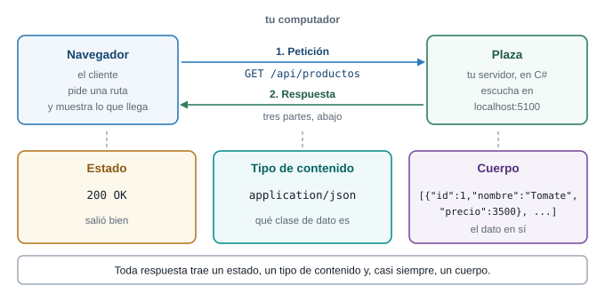
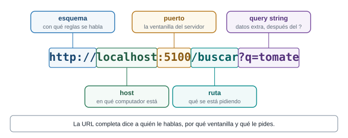
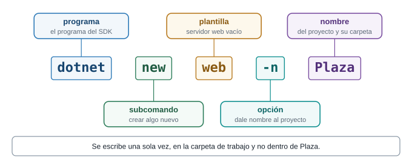
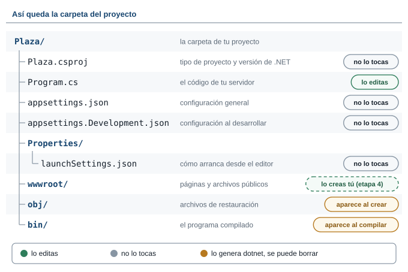
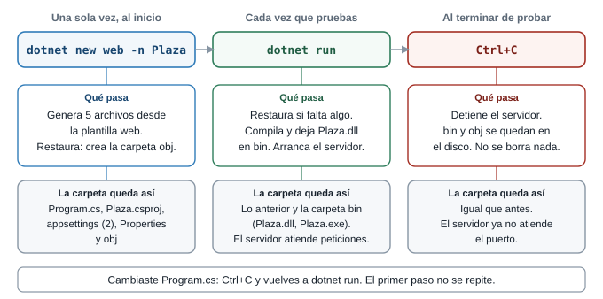
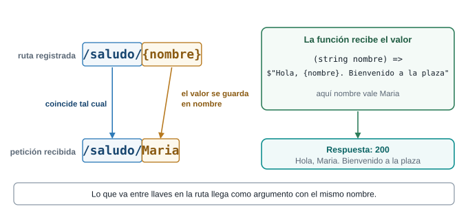
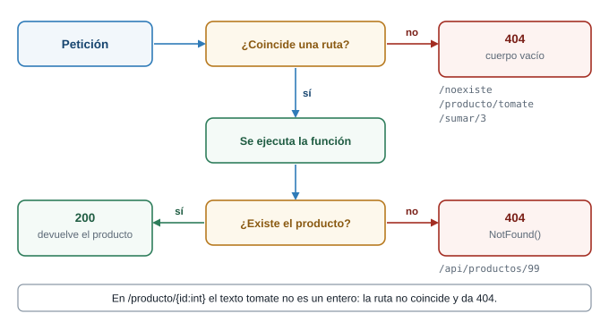
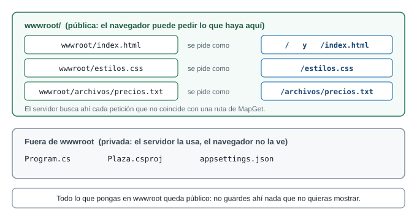
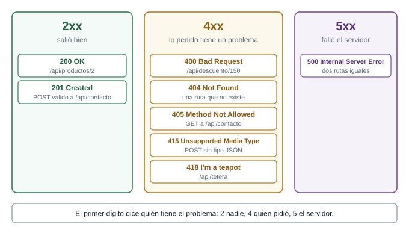

::: {.ficha}
|                 |                                                                                     |
|-----------------|-------------------------------------------------------------------------------------|
| Qué construyes  | Un servidor propio, llamado Plaza, que responde texto, JSON, páginas HTML y archivos en las rutas que tú inventas |
| Prerrequisitos  | Semana 8: peticiones HTTP, JSON y DevTools                                          |
| Herramientas    | .NET SDK 10, VS Code y una terminal                                                 |
| Tiempo          | 1 h con el docente (etapas 0 a 3) y el resto en casa                                |
:::

::: {.acceso}
::: {.acceso-item}
Presentación interactiva: el recorrido de una petición, con predicciones y retos

[Abrir la presentación](presentacion-interactiva-rutas.html){.btn-doc target="_blank"}
:::
:::

::: {.callout-note}
## Qué es esencial y qué es opcional

Si el tiempo de la clase no alcanza, este es el orden de prioridad:

- **Esencial en la hora de clase:** etapas 0, 1, 2 y 3, cada una con su predicción y su primer reto
  (en la etapa 0, el Reto 0).
- **Para terminar en casa:** etapas 4 y 5, y el segundo reto de cada etapa.
- **Opcional siempre:** los recuadros "Profundiza" y las pruebas con `curl`. Puedes saltarlos y la
  guía sigue funcionando.
:::

## Lo que vas a lograr

Hasta la Semana 8 tu página pedía datos a un servidor que escribió otra persona. Hoy escribes tú el
servidor. Partes de un proyecto vacío y, en seis etapas, lo haces responder cosas cada vez más
interesantes: un texto, un dato en JSON, una página HTML y un archivo para descargar. La clase es un
juego de crear rutas y mirar qué responde el servidor cuando le pides cosas distintas.

El proyecto se llama **Plaza** y vende productos campesinos. Todo se hace con un editor y la
terminal: cada archivo lo escribes tú, lo ejecutas y ves qué cambió.

::: {.diagrama}
{fig-alt="El navegador envía la petición GET /api/productos al servidor Plaza, que escucha en localhost puerto 5100. El servidor responde con tres partes: el estado 200 OK, el tipo de contenido application/json y el cuerpo con la lista de productos."}

El cliente pide y el servidor responde. Esa conversación es todo lo que ocurre hoy.
:::

### Las seis etapas

Cada etapa agrega una sola idea y termina con algo que ejecutas y ves en el navegador.

| Etapa | Mi servidor responde... | Qué aprendes |
|---|---|---|
| 0 | `Hello World!` | Cómo se crea un proyecto, qué es cada uno de sus archivos y cómo ejecutarlo |
| 1 | Varias rutas de texto | Qué es una ruta y cómo se registra con `MapGet` |
| 2 | Lo que le pides en la URL | Parámetros en la ruta y en el query string |
| 3 | Datos en JSON | Un `record`, una lista y `Results.Json` |
| 4 | Páginas HTML | Tipo de contenido, `wwwroot` y `fetch` |
| 5 | Estados y archivos | 200, 201, 400, 404, 418, descargas y `POST` |

Al terminar sabes:

1. Crear un servidor con `dotnet new web`, saber para qué sirve cada archivo que genera y leer cada
   línea de su `Program.cs`.
2. Registrar rutas que devuelven texto, JSON, HTML y archivos.
3. Leer datos de la ruta y del query string.
4. Elegir el estado HTTP correcto para cada respuesta.
5. Servir una página con su CSS y su JavaScript desde la carpeta `wwwroot`.
6. Predecir qué responde tu servidor antes de pedirle algo.

## Las palabras de la plaza

Para entender un servidor piensa en una plaza de mercado. Tú llegas, vas a un puesto, dices qué
quieres, y el vendedor te entrega algo o te dice que no lo tiene. Un servidor web hace exactamente
eso, con otros nombres:

| Palabra | Qué es, en palabras simples | En la plaza |
|---|---|---|
| **Cliente** | Quien pide. Tu navegador es un cliente. | El comprador que llega |
| **Servidor** | Un programa que espera peticiones y las contesta. Se queda encendido hasta que lo detienes. | El puesto que atiende |
| **Petición** | El mensaje que envía el cliente: qué quiere y dónde. | "Una libra de papa, por favor" |
| **Respuesta** | Lo que devuelve el servidor: un estado, un tipo de contenido y, casi siempre, un cuerpo. | El vendedor te entrega la bolsa |
| **URL** | La dirección completa de lo que pides. | El letrero con el puesto y el pasillo |
| **Puerto** | Un número que dice por cuál ventanilla atiende un programa dentro de un computador. Un computador tiene miles. | El número de la ventanilla |
| **localhost** | El nombre del computador en que estás. Pedir `localhost` es hablar con tu propia máquina. | Tu casa |
| **Ruta** | La parte de la URL que viene después del puerto, como `/saludo`. Dice qué se pide. | El pasillo |
| **Estado HTTP** | Un número de tres cifras con el que el servidor resume cómo le fue: `200` salió bien, `404` no hay eso. | La cara del vendedor: "aquí tiene" o "eso no tengo" |
| **Tipo de contenido** | Una etiqueta que dice qué clase de dato viene en la respuesta: texto, HTML, JSON o una imagen. Con ella el navegador sabe qué hacer. | La etiqueta pegada a la bolsa |

Una URL tiene partes, y cada parte tiene su nombre. Vuelve a este dibujo cuando una palabra no te
suene:

::: {.diagrama}
{fig-alt="La URL http://localhost:5100/buscar?q=tomate dividida en cinco partes: el esquema http://, el host localhost, el puerto 5100, la ruta /buscar y el query string ?q=tomate."}

Cada parte de una URL responde una pregunta distinta.
:::

## Preparación del entorno

Antes de escribir una línea de código necesitas tres cosas: el **.NET SDK 10** instalado, un editor
(VS Code) y una carpeta donde guardar tus proyectos. Esta sección cubre los pasos 1 a 3. Los pasos 4 a
6, que crean y abren el proyecto, están en la etapa 0.

### Paso 1. Comprueba que .NET está instalado

Abre una terminal y escribe:

```text
dotnet --version
```

**Qué verás:** un número de versión, por ejemplo `10.0.302`. Si empieza por `10`, estás listo. La guía
se escribió y se probó con la versión `10.0.302`. Los mensajes de `dotnet` salen en el idioma de tu
sistema: aquí aparecen en español porque así salieron en la prueba.

**Si la terminal dice que `dotnet` no se reconoce,** el SDK no está instalado. Descarga el SDK 10 de
`dotnet.microsoft.com/download`, instálalo, **cierra la terminal y ábrela de nuevo**, y repite el
comando. Una terminal que estaba abierta durante la instalación no se entera de que `dotnet` ya existe.

### Paso 2. Crea la carpeta de trabajo

La **carpeta de trabajo** es la carpeta donde viven todos tus proyectos de la clase. `Plaza` será una
subcarpeta de ella. La creas una sola vez para todo el curso. Llámala `Clases-Web`: sin espacios y sin
tildes, porque los comandos son más cómodos así.

Tienes dos caminos con el mismo resultado:

- **Con el Explorador de archivos.** Entra a Documentos, haz clic derecho, elige Nuevo y Carpeta, y
  escribe `Clases-Web`.
- **Con la terminal.** Escribe estos tres comandos, uno por línea:

  ```text
  cd ~/Documents
  mkdir Clases-Web
  cd Clases-Web
  ```

  - `cd ~/Documents` entra a la carpeta Documentos de tu usuario. En el Explorador se ve
    **Documentos**, pero en el disco se llama `Documents`.
  - `mkdir Clases-Web` crea la carpeta (`mkdir` viene de *make directory*, "hacer directorio").
  - `cd Clases-Web` entra a ella.

  Después de `mkdir`, PowerShell muestra una tabla con la carpeta recién creada:

  ```text
      Directorio: C:\Users\tu-usuario\Documents

  Mode                 LastWriteTime         Length Name
  ----                 -------------         ------ ----
  d-----      13/10/2026   8:58 p. m.                Clases-Web
  ```

  Tu ruta y tu fecha serán otras. Lo que importa es la letra `d` de `Mode` y el nombre `Clases-Web`.

Los comandos de arriba funcionan en PowerShell, la terminal que VS Code abre por defecto en Windows, y
en Git Bash. En `cmd`, el primero cambia a `cd %USERPROFILE%\Documents`. Si tu carpeta Documentos está
sincronizada con OneDrive, la ruta real es otra: usa el Explorador.

### Paso 3. Abre la terminal en esa carpeta y comprueba dónde estás

1. Abre la carpeta `Clases-Web` en VS Code. Si la creaste con el Explorador, usa el menú **Archivo** y
   **Abrir carpeta**. Si la creaste con la terminal, escribe `code .` estando dentro de ella: `code`
   abre VS Code y el punto significa "esta carpeta".
2. En VS Code, abre el menú **Terminal** y elige **Nueva terminal**. Aparece un panel inferior con una
   terminal que ya está ubicada en la carpeta abierta.
3. Comprueba la ubicación con `pwd` (*print working directory*, "mostrar el directorio de trabajo"):

   ```text
   pwd
   ```

   **Qué verás:** una ruta que termina en `Clases-Web`.

   ```text
   Path
   ----
   C:\Users\tu-usuario\Documents\Clases-Web
   ```

   En `cmd` el mismo dato lo da el comando `cd` sin nada más.

**Por qué importa dónde estás.** Todos los comandos de `dotnet` trabajan sobre la carpeta en que estés
parado:

- `dotnet new` crea los archivos **en esa carpeta**.
- `dotnet run` busca un archivo `.csproj` **en esa carpeta**.

Si estás en otra, el proyecto aparece en un lugar que no esperabas, o `dotnet run` no lo encuentra.
Antes de un comando de `dotnet`, mira la ruta que muestra tu terminal (en PowerShell, el texto que
termina en `>`, como `PS C:\...\Clases-Web>`) o escribe `pwd`.

### Cómo se ejecuta cada etapa

Una vez creado el proyecto, en todas las etapas usarás el mismo comando, desde la carpeta del proyecto:

```text
dotnet run --no-launch-profile --urls http://localhost:5100
```

- `dotnet run` compila el proyecto y lo ejecuta.
- `--urls http://localhost:5100` fija en qué dirección y en qué puerto atiende el servidor. Así todos
  los equipos usan la misma.
- `--no-launch-profile` evita que `dotnet` lea el archivo `Properties/launchSettings.json`. Ese archivo
  trae un puerto distinto para cada proyecto y un nombre de entorno propio, y aquí queremos que todos
  usen lo mismo.

Para detener el servidor, presiona `Ctrl+C` en la terminal. **Cada vez que cambies el código, detén
el servidor y vuelve a ejecutar el comando.**

### Mirar la respuesta completa

El navegador solo muestra el cuerpo. Para ver también el estado y el tipo de contenido tienes dos
caminos:

- La pestaña **Red** (Network) de DevTools, como en la Semana 8.
- `curl`, una herramienta de terminal que pide una URL y escribe la respuesta. La opción `-i` agrega
  el estado y los encabezados:

```text
curl -i http://localhost:5100/
```

En Windows PowerShell `curl` es un alias de otro comando. Si te da un error raro, escribe
`curl.exe`.

::: {.callout-warning}
## Qué se probó y qué no

Los comandos y las salidas de esta guía se ejecutaron en una máquina con Windows 11 y el SDK
`10.0.302`, con `curl 8.14.1` desde Git Bash. Las páginas HTML se abrieron en un navegador sin
errores propios en la consola. Se comprobó que `dotnet new web -n Plaza` crea los archivos y las
carpetas de la etapa 0, que `bin` y `obj` se regeneran al borrarlos, y que `dotnet run` sin opciones
usa el perfil `http` de `launchSettings.json`. No se probaron otros sistemas operativos, la vista en
un teléfono, el perfil `https`, el botón de ejecutar de Visual Studio, ni los mensajes de VS Code del
paso 6: su texto exacto depende de la versión del editor y de la extensión. Cuando algo no se probó,
la guía lo dice.
:::

## Etapa 0. Hola mundo

### Qué vas a lograr

Crear un proyecto desde cero, entender para qué sirve cada archivo que aparece en su carpeta,
encenderlo y ver que responde. Al terminar tienes un programa de cuatro instrucciones escuchando en
tu computador.

::: {.callout-tip}
## Predice antes de seguir

Cuando tengas el servidor encendido en `http://localhost:5100/`, ¿qué crees que responde si alguien
pide `http://localhost:5100/otra`, una dirección que no programaste? Apuesta: un error, un texto de
bienvenida o nada.
:::

::: {.callout-note collapse="true"}
## Respuesta

Un **404**, con el cuerpo vacío. El servidor solo sabe responder las rutas que le registraste. Para
cualquier otra dice "no tengo eso".
:::

### Paso 4. Crea el proyecto

::: {.callout-tip}
## Predice antes de crearlo

El comando de abajo genera un servidor web completo. ¿Cuántos archivos crees que crea: uno, cinco o
cincuenta?
:::

::: {.callout-note collapse="true"}
## Respuesta

**Cinco archivos tuyos**, repartidos en una carpeta nueva (`Plaza`) y una subcarpeta (`Properties`), y
**otros cinco** dentro de una carpeta `obj`. Son diez en total. Un servidor web completo cabe en cinco
archivos pequeños. La carpeta `bin` todavía no existe: aparece cuando compilas.
:::

Con la terminal ubicada en `Clases-Web` (lo comprobaste con `pwd` en el paso 3), escribe:

```text
dotnet new web -n Plaza
```

::: {.diagrama}
{fig-alt="El comando dotnet new web -n Plaza dividido en cinco partes. dotnet es el programa del SDK, new es el subcomando que crea algo nuevo, web es la plantilla de servidor web vacío, -n es la opción para dar nombre al proyecto y Plaza es el nombre del proyecto y de su carpeta. Se escribe una sola vez, en la carpeta de trabajo y no dentro de Plaza."}

Cada palabra del comando cumple un oficio distinto.
:::

| Parte | Qué significa |
|---|---|
| `dotnet` | El programa que instalaste con el SDK. Todo comando de .NET empieza por él. |
| `new` | "Crea algo nuevo a partir de una plantilla". |
| `web` | El nombre de la **plantilla**. Una plantilla es un molde: una lista de archivos ya escritos. `web` es el molde más pequeño de un servidor web, casi vacío. Existen moldes más grandes con más archivos de ejemplo. |
| `-n` | Una **opción** del comando. Significa *name*, "nombre", y va seguida del nombre elegido. |
| `Plaza` | El nombre del proyecto. Con él se nombra la carpeta nueva y el archivo `Plaza.csproj`. |

**Qué hace, en palabras simples.** `dotnet new` toma la plantilla `web` y la convierte en archivos
reales dentro de una carpeta nueva llamada `Plaza`. Al final hace una **restauración** (*restore*):
revisa qué bibliotecas necesita el proyecto, las deja listas y guarda esa información en una carpeta
llamada `obj`. Por eso, después del comando, tienes cinco archivos tuyos y la carpeta `obj`.

La salida fue:

```text
La plantilla "ASP.NET Core vacío" se creó correctamente.

Procesando acciones posteriores a la creación...
Restaurando ...\Plaza\Plaza.csproj:
  Determinando los proyectos que se van a restaurar...
  Se ha restaurado ...\Plaza\Plaza.csproj (en 109 ms).
Restauración realizada correctamente.
```

- `La plantilla ... se creó correctamente` significa que los cinco archivos ya existen.
- `Restaurando` y `Se ha restaurado` son la restauración: aquí se crea `obj`.

::: {.callout-note}
## Dónde y cuándo se ejecuta

- **Dónde:** en la carpeta de trabajo (`Clases-Web`), **fuera** de cualquier proyecto. El comando crea
  la carpeta `Plaza` por ti: no la crees antes.
- **Cuándo:** **una sola vez por proyecto**, al inicio. Las etapas 1 a 5 no lo repiten. Trabajan sobre
  este mismo proyecto y solo reemplazan el contenido de `Program.cs`.
- **Sin `-n`:** si lo omites, `dotnet new web` crea los archivos directamente en la carpeta donde estás
  y usa el nombre de esa carpeta como nombre del proyecto. En esta guía siempre se usa `-n`.
:::

### Paso 5. Entra a la carpeta y ábrela en VS Code

```text
cd Plaza
code .
```

- **`cd Plaza`** (*change directory*, "cambiar de directorio") entra a la carpeta `Plaza`. Ahora `pwd`
  termina en `...\Clases-Web\Plaza`. Para volver a la carpeta anterior se escribe `cd ..`.
- **`code .`** abre VS Code en la carpeta donde estás. Abre `Plaza`, no `Clases-Web`: así el archivo
  `Program.cs` queda a la vista y la terminal integrada nace ubicada en el proyecto.

Si la terminal dice que `code` no se reconoce, usa el menú de VS Code: **Archivo**, **Abrir carpeta** y
elige `Plaza`.

**Qué verás:** una ventana de VS Code con el panel **Explorador** a la izquierda, que lista los
archivos del proyecto. Abre una terminal con el menú **Terminal** y **Nueva terminal**, y escribe
`pwd`: la ruta termina en `Plaza`. Desde aquí, todos los comandos de la clase se escriben en esa
terminal.

### Paso 6. Los mensajes que puede mostrar VS Code

Al abrir un proyecto por primera vez, VS Code muestra ventanas emergentes. Estas son las tres más
comunes. El texto exacto cambia según la versión y el idioma del editor.

| Mensaje | Qué significa | Qué responder |
|---|---|---|
| Pregunta si confías en los autores de los archivos de la carpeta | VS Code abre las carpetas desconocidas en un modo restringido, que desactiva extensiones y tareas | **Sí, confío en los autores.** La carpeta la creaste tú |
| Recomienda instalar la extensión de C# | La extensión de Microsoft da colores y ayudas al escribir | **Instalar.** El código se compila y se ejecuta también sin ella |
| Dice que faltan los "assets" requeridos para compilar y depurar `Plaza` y pregunta si quieres agregarlos | Ofrece crear una carpeta `.vscode` con la configuración del depurador | **Sí** o **Ahora no**: esta guía no usa el depurador. Si aceptas, aparece `.vscode` y tampoco la tocas |

### Qué creó el comando

Cuando termina `dotnet new web -n Plaza`, la carpeta tiene estos diez archivos. Los cinco primeros son
tuyos. Los de `obj` los crea la restauración:

```text
Plaza/
  Plaza.csproj
  Program.cs
  appsettings.json
  appsettings.Development.json
  Properties/
    launchSettings.json
  obj/
    Plaza.csproj.nuget.dgspec.json
    Plaza.csproj.nuget.g.props
    Plaza.csproj.nuget.g.targets
    project.assets.json
    project.nuget.cache
```

::: {.diagrama}
{fig-alt="Árbol de la carpeta Plaza. Program.cs es el archivo que editas, y desde la etapa 4 la carpeta wwwroot que creas tú. Plaza.csproj, appsettings.json, appsettings.Development.json y Properties/launchSettings.json no se tocan. La carpeta obj aparece al crear el proyecto y la carpeta bin aparece al compilar; ninguna de las dos se edita."}

Un solo archivo para editar. La carpeta `bin` no existe hasta que compilas por primera vez.
:::

| Archivo o carpeta | Para qué sirve | ¿Lo editas? |
|---|---|---|
| `Plaza.csproj` | Dice qué tipo de proyecto es y con qué versión de .NET se compila | No |
| `Program.cs` | El código de tu servidor | **Sí**, en todas las etapas |
| `appsettings.json` | Configuración general que el programa lee al arrancar | No |
| `appsettings.Development.json` | Configuración extra que solo se lee cuando desarrollas | No |
| `Properties/launchSettings.json` | Cómo arranca el proyecto desde el editor: puerto y entorno | No |
| `wwwroot/` | Páginas y archivos públicos. No existe todavía: la creas en la etapa 4 | **Sí**, desde la etapa 4 |
| `obj/` | Archivos de restauración. Aparece al crear el proyecto | **Nunca** |
| `bin/` | El programa compilado. Aparece al compilar o ejecutar | **Nunca** |

#### Plaza.csproj

`.csproj` abrevia *C# project*, "proyecto de C#". Es un archivo de texto en formato **XML**: etiquetas
que se abren y se cierran, como en HTML. Este es su contenido completo:

```xml
<Project Sdk="Microsoft.NET.Sdk.Web">

  <PropertyGroup>
    <TargetFramework>net10.0</TargetFramework>
    <Nullable>enable</Nullable>
    <ImplicitUsings>enable</ImplicitUsings>
  </PropertyGroup>

</Project>
```

| Línea | Qué dice, en palabras simples |
|---|---|
| `<Project Sdk="Microsoft.NET.Sdk.Web">` | "Este proyecto usa las herramientas del SDK para aplicaciones web". Con esa palabra `Web`, `dotnet run` sabe que debe arrancar un servidor |
| `<PropertyGroup>` | Abre un grupo de ajustes del proyecto |
| `<TargetFramework>net10.0</TargetFramework>` | La versión de .NET con la que se compila y se ejecuta: **.NET 10** |
| `<Nullable>enable</Nullable>` | C# te avisa cuando un valor puede venir vacío (`null`). Por eso más adelante escribirás `string? q` |
| `<ImplicitUsings>enable</ImplicitUsings>` | C# agrega por ti las referencias a las bibliotecas más comunes. Por eso `Program.cs` no empieza con una lista de `using` |

`dotnet run` busca este archivo en la carpeta donde estés. Si no hay ningún `.csproj`, no sabe qué
ejecutar.

#### Program.cs

Es el código del servidor y el único archivo que editas. El comando lo crea con las mismas cuatro
instrucciones que ves en la sección "El código", más abajo: `CreateBuilder`, `Build`, un `MapGet` y
`Run`. La única diferencia es la primera línea, un comentario con `//` que agregó esta guía.

#### appsettings.json

Una **configuración** es un valor que el programa lee al arrancar y que puedes cambiar sin tocar el
código C#. Está escrita en JSON, el mismo formato que usaste en la Semana 8:

```json
{
  "Logging": {
    "LogLevel": {
      "Default": "Information",
      "Microsoft.AspNetCore": "Warning"
    }
  },
  "AllowedHosts": "*"
}
```

- **`Logging`** controla los mensajes que el servidor escribe en la consola, los que empiezan por
  `info:` cuando lo enciendes.
- **`LogLevel`** fija cuánto detalle mostrar. Los niveles van de menos serio a más serio:
  `Trace`, `Debug`, `Information`, `Warning`, `Error` y `Critical`.
- **`"Default": "Information"`** significa "muestra los mensajes informativos y los más serios".
- **`"Microsoft.AspNetCore": "Warning"`** dice que los mensajes internos del framework solo se muestran
  si son advertencias o errores. Por eso no ves una línea en la consola por cada petición.
- **`AllowedHosts`** es la lista de nombres de sitio que el servidor acepta en una petición. `"*"`
  significa "cualquiera".

#### appsettings.Development.json

```json
{
  "Logging": {
    "LogLevel": {
      "Default": "Information",
      "Microsoft.AspNetCore": "Warning"
    }
  }
}
```

**Por qué hay dos.** `appsettings.json` se lee **siempre**. `appsettings.Development.json` se lee
**además** cuando el entorno se llama `Development` (desarrollo) y sus valores ganan sobre los del
primero. Es el lugar para ajustes que solo valen mientras programas.

**Cuál se usa cuándo.** El nombre del entorno sale de `launchSettings.json`, que dice `Development`.
Con `dotnet run` a secas, el entorno es `Development` y se leen los dos archivos. Con el comando de la
clase, que lleva `--no-launch-profile`, `dotnet` no lee `launchSettings.json`, el nombre del entorno
queda en su valor por defecto, `Production`, y solo se lee `appsettings.json`. En la prueba, la línea
`Hosting environment` de la consola dijo `Production`. En este proyecto los dos archivos dicen lo mismo
en `Logging`, así que no notas ninguna diferencia.

#### Properties/launchSettings.json

El contenido de tu archivo se ve así. **Los números de puerto serán otros:** `dotnet new` elige un
puerto al azar para cada proyecto, y por eso el tuyo no dirá `5120` ni `7097`.

```json
{
  "$schema": "https://json.schemastore.org/launchsettings.json",
  "profiles": {
    "http": {
      "commandName": "Project",
      "dotnetRunMessages": true,
      "launchBrowser": true,
      "applicationUrl": "http://localhost:5120",
      "environmentVariables": {
        "ASPNETCORE_ENVIRONMENT": "Development"
      }
    },
    "https": {
      "commandName": "Project",
      "dotnetRunMessages": true,
      "launchBrowser": true,
      "applicationUrl": "https://localhost:7097;http://localhost:5120",
      "environmentVariables": {
        "ASPNETCORE_ENVIRONMENT": "Development"
      }
    }
  }
}
```

| Campo | Qué significa |
|---|---|
| `$schema` | Un enlace que el editor usa para ayudarte a escribir el archivo. No cambia el programa |
| `profiles` | La lista de formas de arrancar el proyecto. Cada una es un **perfil** con su nombre: aquí `http` y `https` |
| `commandName: "Project"` | Arranca el proyecto como un programa propio |
| `dotnetRunMessages` | Muestra mensajes de progreso de `dotnet run`, como `Compilando...` |
| `launchBrowser` | Pide al editor que abra el navegador al arrancar. Visual Studio lo usa. `dotnet run` no lo hace: en la prueba no abrió el navegador |
| `applicationUrl` | La dirección y el puerto en que atiende el servidor. El perfil `https` lista dos, separadas por `;` |
| `ASPNETCORE_ENVIRONMENT` | El nombre del entorno. `Development` activa `appsettings.Development.json` |

**Quién lo usa.** Lo usa `dotnet run` cuando **no** lleva `--no-launch-profile`, que toma el primer
perfil (`http`), y lo usa el botón de ejecutar de Visual Studio. El comando de la clase lo ignora a
propósito. La guía no usa el perfil `https`.

::: {.callout-note collapse="true"}
## Profundiza (opcional): dotnet run sin opciones

Si ejecutas `dotnet run` sin ninguna opción, `dotnet` avisa que usa el archivo y atiende en el puerto
de tu `applicationUrl`. En la prueba, con un proyecto cuyo puerto era `5239`, salió:

```text
Usando la configuración de inicio de ...\Plaza\Properties\launchSettings.json...
Compilando...
info: Microsoft.Hosting.Lifetime[14]
      Now listening on: http://localhost:5239
info: Microsoft.Hosting.Lifetime[0]
      Application started. Press Ctrl+C to shut down.
info: Microsoft.Hosting.Lifetime[0]
      Hosting environment: Development
```

Si además agregas `--urls`, el puerto de `--urls` gana sobre el del archivo. El entorno sigue siendo
`Development`, porque eso sale del perfil.
:::

#### La carpeta obj

`obj` guarda el resultado de la **restauración**: la lista de lo que el proyecto necesita para
compilarse. Los archivos `Plaza.csproj.nuget.*`, `project.assets.json` y `project.nuget.cache` son
anotaciones de **NuGet**, el sistema que .NET usa para traer paquetes. El proyecto vacío no necesita
paquetes extra, así que la lista de `project.assets.json` queda sin bibliotecas. Cuando compilas,
`obj` se llena además de archivos intermedios, hasta unos 27 archivos en la prueba. No los abres.

#### La carpeta bin

`bin` (de *binarios*) aparece cuando **compilas**, por ejemplo con tu primer `dotnet run`. Compilar es
convertir tu `Program.cs` en un programa que el computador sabe ejecutar. Dentro, en
`bin/Debug/net10.0/`, quedan estos archivos:

| Archivo | Qué es |
|---|---|
| `Plaza.dll` | Tu código ya compilado. Es el programa |
| `Plaza.exe` | El ejecutable de Windows que arranca ese programa |
| `Plaza.pdb` | Información extra para depurar |
| `Plaza.deps.json` y `Plaza.runtimeconfig.json` | Qué bibliotecas y qué versión de .NET necesita el programa |
| `appsettings.json` y `appsettings.Development.json` | Copias de tus archivos de configuración |

`Debug` es el modo de compilación por defecto, pensado para programar. `net10.0` es la versión de .NET
del `Plaza.csproj`.

#### Qué editas y qué no tocas nunca

- **Editas** `Program.cs` en todas las etapas y, desde la etapa 4, los archivos de `wwwroot`.
- **No tocas nunca** `bin` ni `obj`. Los genera `dotnet`.
- **No tocas hoy** `Plaza.csproj`, `appsettings` ni `launchSettings.json`. Existen y el proyecto los
  necesita, pero ninguna etapa de esta guía los cambia.

`bin` y `obj` se pueden **borrar** sin riesgo. Cada `dotnet run` los regenera. En la prueba, se borraron
las dos carpetas, se ejecutó `dotnet build` (compila sin arrancar) y volvieron a aparecer. Lo que no
puedes borrar son los cinco archivos de la primera columna.

### El código

Abre `Program.cs`. Este es todo el servidor:

```csharp
// Etapa 0: el proyecto tal como lo crea "dotnet new web".
var builder = WebApplication.CreateBuilder(args);
var app = builder.Build();

// Una sola ruta: cuando alguien pide "/" respondemos con este texto.
app.MapGet("/", () => "Hello World!");

app.Run();
```

Línea por línea, con lo que significa cada palabra:

- **`var builder = WebApplication.CreateBuilder(args);`** Pide al framework un **constructor**: el
  ayudante que monta el puesto antes de abrir. `var` le dice a C# "deduce tú el tipo de esta
  variable". `args` son los argumentos con que ejecutaste el programa, por ejemplo `--urls`.
- **`var app = builder.Build();`** Monta el puesto. `app` es la aplicación lista para recibir
  peticiones.
- **`app.MapGet("/", () => "Hello World!");`** Pone un letrero: cuando alguien pida la ruta `/` con el
  método GET, ejecuta esta función y responde con su resultado.
- **`app.Run();`** Abre el puesto y atiende hasta que lo detengas con `Ctrl+C`.

::: {.callout-note}
## C# justo a tiempo: lo que usa esta etapa

- **`MapGet`** une una ruta con una función. **GET** es el método que usa el navegador cuando
  escribes una URL: significa "dame esto".
- **`() => "Hello World!"`** es una **función sin nombre**, también llamada lambda. Lo que está a la
  izquierda de `=>` son los datos que recibe (aquí ninguno, por eso los paréntesis vacíos) y lo que
  está a la derecha es lo que devuelve.
- Un texto entre comillas dobles, `"..."`, se llama **cadena**.
- Cada instrucción termina en `;`.
:::

### Ejecutarlo

En la terminal de VS Code, ubicada en `Plaza`, escribe el comando de la sección "Cómo se ejecuta cada
etapa":

```text
dotnet run --no-launch-profile --urls http://localhost:5100
```

La consola muestra:

```text
info: Microsoft.Hosting.Lifetime[14]
      Now listening on: http://localhost:5100
info: Microsoft.Hosting.Lifetime[0]
      Application started. Press Ctrl+C to shut down.
info: Microsoft.Hosting.Lifetime[0]
      Hosting environment: Production
info: Microsoft.Hosting.Lifetime[0]
      Content root path: ...\Plaza
```

`Now listening on: http://localhost:5100` es el servidor avisando por qué ventanilla atiende. La línea
`Hosting environment` dice `Production` porque este comando no lee `launchSettings.json`, donde está el
nombre `Development`. No cambia nada de lo que haces hoy.

::: {.callout-note}
## Qué hace dotnet run por dentro

Cuando escribes `dotnet run`, `dotnet` hace cuatro cosas, siempre en este orden:

1. **Busca el proyecto.** Mira la carpeta actual en busca de un archivo `.csproj`. Si no hay ninguno,
   se detiene con un mensaje.
2. **Restaura si hace falta.** Si falta la carpeta `obj` o cambió lo que el proyecto necesita, repite
   la restauración. La primera vez no hace falta, porque `dotnet new` ya la hizo.
3. **Compila.** Convierte `Program.cs` en `Plaza.dll` dentro de `bin/Debug/net10.0/`. Si nada cambió
   desde la última vez, reutiliza lo compilado.
4. **Arranca.** Ejecuta el programa compilado, lee los `appsettings`, abre el puerto y se queda
   esperando peticiones hasta que presionas `Ctrl+C`.

**Si cambias `Program.cs` y no reinicias**, el servidor sigue ejecutando el `Plaza.dll` de la vez
anterior. Guardar el archivo no vuelve a compilar nada, así que el servidor responde lo de antes. Para
ver el cambio: `Ctrl+C` y `dotnet run` otra vez.
:::

::: {.diagrama}
{fig-alt="Tres momentos de un proyecto. Primero dotnet new web -n Plaza, una sola vez al inicio: genera cinco archivos y la carpeta obj. Después dotnet run, cada vez que pruebas: restaura si hace falta, compila a la carpeta bin y arranca el servidor. Al final Ctrl+C detiene el servidor y bin y obj se quedan en el disco."}

El primer comando se ejecuta una vez. Los otros dos se repiten en cada prueba.
:::

Abre `http://localhost:5100/` en el navegador. Esto responde el servidor:

| Petición | Estado | Tipo de contenido | Cuerpo |
|---|---|---|---|
| `GET /` | `200 OK` | `text/plain; charset=utf-8` | `Hello World!` |
| `GET /otra` | `404 Not Found` | (ninguno) | vacío |

Con `curl` la primera respuesta se ve así:

```text
$ curl -i http://localhost:5100/
HTTP/1.1 200 OK
Content-Type: text/plain; charset=utf-8

Hello World!
```

Presiona `Ctrl+C` para detener el servidor.

### Qué pasó por dentro

1. Ejecutaste `dotnet run`: el SDK compiló `Program.cs` y arrancó el programa.
2. El programa abrió el puerto `5100` y se quedó esperando.
3. Escribiste `http://localhost:5100/` y el navegador envió `GET /` a ese puerto.
4. El servidor buscó entre sus rutas una que coincidiera con `GET /`. Encontró la única que hay.
5. Ejecutó la función, que devolvió `"Hello World!"`.
6. Respondió con estado `200`, tipo `text/plain` y ese texto como cuerpo.
7. El navegador vio `text/plain` y mostró el texto tal cual.

### Retos de la etapa 0

::: {.callout-tip}
## Reto 0. Explora tu proyecto

Abre cada archivo del proyecto en VS Code, sin ejecutar nada, y responde: **¿qué archivo cambiarías
para...**

a. cambiar el puerto en que atiende el servidor,
b. cambiar la versión de .NET con que se compila,
c. cambiar el texto que responde la ruta `/`?

Escribe el nombre del archivo y la línea que tocarías.
:::

::: {.callout-note collapse="true"}
## Solución del Reto 0

a. **`Properties/launchSettings.json`**, la línea `"applicationUrl": "http://localhost:5120"` de un
   perfil (el número será el de tu proyecto). Con el comando de la clase, que lleva `--no-launch-profile`
   y `--urls`, ese archivo no se lee: ahí el puerto se cambia en `--urls http://localhost:5100`.
   `appsettings.json` no tiene nada que ver con el puerto.
b. **`Plaza.csproj`**, la línea `<TargetFramework>net10.0</TargetFramework>`. En la clase déjala como
   está: otra versión te obligaría a tener esa versión de .NET instalada y tu proyecto dejaría de
   parecerse al de tus compañeros.
c. **`Program.cs`**, la línea `app.MapGet("/", () => "Hello World!");`. El texto está entre comillas, a
   la derecha de `=>`. Es el único archivo que editas en esta etapa.
:::

::: {.callout-tip}
## Reto 1. Dile tu nombre

Cambia el texto de la ruta `/` para que el servidor responda `Soy` y tu nombre. Reinicia el
servidor y recarga la página.
:::

::: {.callout-note collapse="true"}
## Solución del Reto 1

```csharp
app.MapGet("/", () => "Soy Rosa");
```

Detén el servidor con `Ctrl+C`, ejecútalo de nuevo y recarga. Si no reinicias, el servidor sigue
ejecutando el programa anterior, porque el código nuevo todavía no se compiló.
:::

::: {.callout-tip}
## Reto 2. Mueve la ruta

Cambia `"/"` por `"/hola"`. Reinicia y pide `/` y `/hola`. Antes de hacerlo, predice qué estado
recibes en cada una.
:::

::: {.callout-note collapse="true"}
## Solución del Reto 2

```csharp
app.MapGet("/hola", () => "Hello World!");
```

`/hola` responde `200` con `Hello World!`. `/` responde `404` con el cuerpo vacío, porque ya no hay
ninguna ruta registrada para `/`. La ruta es parte de la respuesta: cambiar la ruta cambia qué
direcciones existen.
:::

### Cierre de la etapa 0

- **Qué cambió:** el proyecto nace. Hay una carpeta `Plaza` con cinco archivos, una carpeta `obj` y un
  servidor con una sola ruta.
- **Cómo verificarlo:** ejecuta el comando y abre `http://localhost:5100/`.
- **Qué debes ver:** `Hello World!`, un `404` en `/otra` y, en la consola, `Now listening on`. Después
  de ejecutar, la carpeta `bin` aparece junto a `obj`.

## Etapa 1. Varias rutas

### Qué vas a lograr

Un servidor con cuatro rutas, cada una con su respuesta. Empiezas a "jugar": crear una ruta, pedirla
y ver qué pasa.

### La idea: una ruta es un pasillo

Piensa en los pasillos de la plaza: en el de las frutas hay frutas, en el de los granos hay granos.
Una **ruta** es el nombre de ese pasillo, y con `MapGet` le dices al servidor qué entregar cuando
alguien lo visite. Cuantas más rutas registres, más pasillos tiene tu plaza.

::: {.callout-tip}
## Predice antes de seguir

Abres `/hora`, esperas unos segundos y la abres otra vez. ¿Qué crees que verás: la misma hora las
dos veces o una distinta? ¿Qué te dice eso sobre cuándo se ejecuta la función?
:::

::: {.callout-note collapse="true"}
## Respuesta

Una hora distinta. La función de la ruta **se ejecuta en cada petición**, no una vez al arrancar el
servidor. Por eso la respuesta se calcula en el momento.
:::

### El código

Reemplaza el contenido de `Program.cs` por:

```csharp
// Etapa 1: varias rutas que responden texto.
var builder = WebApplication.CreateBuilder(args);
var app = builder.Build();

// Cada MapGet une una dirección (la ruta) con lo que se responde.
app.MapGet("/", () => "Bienvenido a la Plaza Campesina");

app.MapGet("/saludo", () => "Hola, buenos días desde la plaza");

app.MapGet("/acerca", () => "Plaza: una tienda de productos campesinos hecha con ASP.NET Core");

// La respuesta puede calcularse en el momento de la petición.
app.MapGet("/hora", () => $"Son las {DateTime.Now:HH:mm:ss}");

app.Run();
```

::: {.callout-note}
## C# justo a tiempo: lo que usa esta etapa

- **`//`** inicia un comentario: texto para humanos que el compilador ignora.
- **`$"Son las {DateTime.Now:HH:mm:ss}"`** es una **cadena interpolada**. El `$` antes de las comillas
  habilita huecos: lo que va entre llaves es código C# y su valor se pega en el texto.
- **`DateTime.Now`** es la fecha y la hora de este computador. **`:HH:mm:ss`** es el formato: hora de
  0 a 23, minutos y segundos.
:::

### Ejecutarlo

Ejecuta y pide cada ruta en el navegador:

| Petición | Estado | Tipo de contenido | Cuerpo |
|---|---|---|---|
| `GET /` | `200 OK` | `text/plain; charset=utf-8` | `Bienvenido a la Plaza Campesina` |
| `GET /saludo` | `200 OK` | `text/plain; charset=utf-8` | `Hola, buenos días desde la plaza` |
| `GET /acerca` | `200 OK` | `text/plain; charset=utf-8` | `Plaza: una tienda de productos campesinos hecha con ASP.NET Core` |
| `GET /hora` | `200 OK` | `text/plain; charset=utf-8` | `Son las 19:39:07` (la hora cambia) |
| `GET /noexiste` | `404 Not Found` | (ninguno) | vacío |

Con `curl`, la última se ve así:

```text
$ curl -i http://localhost:5100/noexiste
HTTP/1.1 404 Not Found
Content-Length: 0

```

### Qué pasó por dentro

Para `GET /saludo`:

1. El navegador envía `GET /saludo`.
2. El servidor recorre las rutas registradas y compara la ruta pedida con cada una.
3. `"/saludo"` coincide con la segunda. Las otras no.
4. Ejecuta esa función. Devuelve el texto `Hola, buenos días desde la plaza`.
5. Responde `200` con tipo `text/plain`.

Para `GET /noexiste` el paso 3 no encuentra ninguna coincidencia. El servidor no ejecuta ninguna
función y responde `404` sin cuerpo.

### Una comodidad: dotnet watch

Detener y volver a ejecutar cansa. `dotnet watch` vigila tus archivos y recarga cuando guardas:

```text
dotnet watch run --no-launch-profile --urls http://localhost:5100
```

Lo que se observó al probarlo:

- Cambiar el texto de una ruta que ya existe se aplica **sin reiniciar**. La consola mostró
  `File updated: .\Program.cs` y `C# and Razor changes applied in 4530ms.` Tarda unos 5 segundos.
- **Agregar una ruta nueva sí exige reiniciar.** Mostró `Restart is needed to apply the changes.` y
  volvió a compilar todo.

Si `dotnet watch` no reinicia solo, detenlo con `Ctrl+C` y ejecútalo de nuevo. Con `dotnet run` a
secas, nada se recarga: reinicias tú. En una terminal normal `dotnet watch` te pregunta si reinicia;
esa pregunta no se pudo probar al preparar la guía.

### Retos de la etapa 1

::: {.callout-tip}
## Reto 3. Una ruta con tu nombre

Crea la ruta `/nombre` que devuelva `Me llamo` y tu nombre. Pídela en el navegador.
:::

::: {.callout-note collapse="true"}
## Solución del Reto 3

Agrega esta línea antes de `app.Run();`:

```csharp
app.MapGet("/nombre", () => "Me llamo Rosa");
```

Reinicia el servidor y abre `http://localhost:5100/nombre`. Responde `200`, `text/plain` y el texto.
Es una ruta nueva, así que necesitas reiniciar.
:::

::: {.callout-tip}
## Reto 4. La fecha de hoy

Crea la ruta `/fecha` que responda `Hoy es` seguido de la fecha en formato día/mes/año. Usa la
cadena interpolada y `DateTime.Now`, como en `/hora`.
:::

::: {.callout-note collapse="true"}
## Solución del Reto 4

```csharp
app.MapGet("/fecha", () => $"Hoy es {DateTime.Now:dd/MM/yyyy}");
```

Al pedirla responde `Hoy es 13/10/2026` (con la fecha de tu computador). Dentro de las llaves, lo que
va después de los dos puntos es el formato: `dd` día, `MM` mes (en mayúscula, porque `mm` son
minutos) y `yyyy` el año.
:::

### Cierre de la etapa 1

- **Qué cambió:** `Program.cs` tiene cuatro rutas de texto.
- **Cómo verificarlo:** pide `/`, `/saludo`, `/acerca`, `/hora` y `/noexiste`.
- **Qué debes ver:** cuatro textos con `200` y un `404` vacío.

## Etapa 2. Datos en la URL

### Qué vas a lograr

Que el servidor use lo que le pides en la URL. Con una sola ruta puedes saludar a cualquier persona o
buscar cualquier producto.

### La idea: el pedido dentro de la dirección

En la plaza no tienes un puesto por cada comprador. Llegas al puesto y dices "una libra de **papa**".
El puesto es la ruta y la papa es el **parámetro**. En una URL hay dos lugares para ese dato:

- **En la ruta:** `/saludo/Maria`. La parte variable es un segmento más del camino.
- **En el query string:** `/buscar?q=tomate`. Va después del signo `?`, como una nota pegada al
  final de la dirección, con la forma `nombre=valor`.

Un **parámetro** es un dato que el servidor recibe para decidir qué responder.

::: {.diagrama}
{fig-alt="La ruta /saludo/{nombre} comparada con la petición /saludo/Maria. El segmento saludo coincide tal cual y el segmento Maria se guarda en el parámetro nombre. La función recibe nombre igual a Maria y responde Hola, Maria. Bienvenido a la plaza."}

Lo que va entre llaves en la ruta llega a la función con el mismo nombre.
:::

::: {.callout-tip}
## Predice antes de seguir

La ruta `/producto/{id:int}` dice que `id` debe ser un número entero. Si pides
`/producto/tomate`, ¿qué crees que responde: un mensaje de error, un `400` o un `404`?
:::

::: {.callout-note collapse="true"}
## Respuesta

Un `404` con el cuerpo vacío. Para el servidor, `/producto/tomate` simplemente **no coincide** con la
ruta `/producto/{id:int}`: es como pedir un pasillo que no existe.
:::

### El código

Reemplaza `Program.cs` por:

```csharp
// Etapa 2: rutas que reciben datos (parámetros en la ruta y query string).
var builder = WebApplication.CreateBuilder(args);
var app = builder.Build();

app.MapGet("/", () => "Bienvenido a la Plaza Campesina");

// Parámetro en la ruta: lo que va entre llaves llega como argumento del mismo nombre.
// Ejemplo: /saludo/Maria
app.MapGet("/saludo/{nombre}", (string nombre) => $"Hola, {nombre}. Bienvenido a la plaza");

// Restricción {id:int}: la ruta solo coincide si el valor es un número entero.
// Ejemplo: /producto/7 responde; /producto/tomate no coincide con ninguna ruta (404).
app.MapGet("/producto/{id:int}", (int id) => $"Producto número {id}");

// Sin restricción: acepta cualquier texto.
// Ejemplo: /vendedor/rosa
app.MapGet("/vendedor/{nombre}", (string nombre) => $"Vendedor: {nombre}");

// Query string: lo que va después del signo ? en la dirección.
// Ejemplo: /buscar?q=tomate. Si "q" no viene, usamos "todo" como valor por defecto.
app.MapGet("/buscar", (string? q) => $"Buscando: {q ?? "todo"}");

// Dos parámetros en la ruta. Ejemplo: /sumar/3/4
app.MapGet("/sumar/{a:int}/{b:int}", (int a, int b) => $"{a} + {b} = {a + b}");

app.Run();
```

::: {.callout-note}
## C# justo a tiempo: lo que usa esta etapa

- **`(string nombre) => ...`** es una lambda que **recibe** un dato. El nombre del parámetro debe
  coincidir con el de las llaves de la ruta: `{nombre}` y `nombre`.
- **`string`** es texto y **`int`** es un número entero.
- **`{id:int}`** es una **restricción**: la ruta solo coincide si el segmento es un entero.
- **`string? q`** con signo de interrogación significa "puede no venir". Cuando falta, vale `null`,
  que es "nada".
- **`q ?? "todo"`** significa "usa `q`, y si no vino, usa `todo`".
- Dentro de una cadena interpolada puede ir una operación: `{a + b}`.
:::

### Ejecutarlo

Prueba estas peticiones. Las que llevan `?` o `&` ponlas entre comillas si usas la terminal.

| Petición | Estado | Cuerpo |
|---|---|---|
| `/saludo/Maria` | `200` | `Hola, Maria. Bienvenido a la plaza` |
| `/saludo/María` | `200` | `Hola, María. Bienvenido a la plaza` |
| `/producto/7` | `200` | `Producto número 7` |
| `/producto/tomate` | `404` | vacío |
| `/producto/3.5` | `404` | vacío |
| `/vendedor/rosa` | `200` | `Vendedor: rosa` |
| `/buscar?q=tomate` | `200` | `Buscando: tomate` |
| `/buscar` | `200` | `Buscando: todo` |
| `/buscar?q=` | `200` | `Buscando: ` (vacío, no `todo`) |
| `/buscar?q=tomate&q=papa` | `200` | `Buscando: tomate,papa` |
| `/sumar/3/4` | `200` | `3 + 4 = 7` |
| `/sumar/3/x` | `404` | vacío |
| `/sumar/3` | `404` | vacío |

Tres cosas para notar:

- **Dos ceros distintos.** `/buscar` y `/buscar?q=` no responden igual. Sin `q`, el valor es `null` y
  se usa `todo`. Con `q=` vacío, el valor es un texto vacío, que no es `null`.
- **`:int` falla con `404`.** `/sumar/3/x` no tiene la forma `{a:int}/{b:int}`, así que la ruta no
  coincide y el servidor no ejecuta nada.
- **Si repites `q`**, el servidor junta los valores con coma.

### Qué pasó por dentro

Para `GET /sumar/3/4`:

1. El servidor parte la ruta en segmentos: `sumar`, `3` y `4`.
2. Compara con `/sumar/{a:int}/{b:int}`: el primero es literal y coincide; `3` y `4` son enteros y
   cumplen la restricción.
3. Guarda `a = 3` y `b = 4`.
4. Ejecuta la función con esos valores. Calcula `a + b` y arma el texto `3 + 4 = 7`.
5. Responde `200` con ese texto.

Con `/sumar/3/x` el paso 2 falla en `x`: no es un entero. No hay otra ruta que coincida, así que el
resultado es `404`.

::: {.callout-note collapse="true"}
## Profundiza (opcional): cuando dos rutas se parecen

Si registras `/producto/{id:int}` y también `/producto/{nombre}`, el servidor elige la más
específica. En la prueba, `/producto/5` respondió con la ruta del entero y `/producto/tomate` con la
del texto. Solo se probó en ese orden de declaración.

Algo parecido pasa con una ruta literal y una con parámetro: con `/dato/{n}` y `/dato/especial`
declaradas, `/dato/especial` la atendió la literal.
:::

### Retos de la etapa 2

::: {.callout-tip}
## Reto 5. Restar dos números

Crea una ruta que reste dos números: `/restar/10/4` debe responder `10 - 4 = 6`. Pruébala también
con `/restar/4/10`.
:::

::: {.callout-note collapse="true"}
## Solución del Reto 5

```csharp
app.MapGet("/restar/{a:int}/{b:int}", (int a, int b) => $"{a} - {b} = {a - b}");
```

`/restar/10/4` responde `10 - 4 = 6` y `/restar/4/10` responde `4 - 10 = -6`. También acepta
negativos: `/restar/-3/2` responde `-3 - 2 = -5`.
:::

::: {.callout-tip}
## Reto 6. Saludo con query string

Crea `/hola` que lea el parámetro `nombre` del query string. `/hola?nombre=Rosa` responde
`Hola, Rosa` y `/hola` sin nada responde `Hola, visitante`.
:::

::: {.callout-note collapse="true"}
## Solución del Reto 6

```csharp
app.MapGet("/hola", (string? nombre) => $"Hola, {nombre ?? "visitante"}");
```

Como `nombre` no aparece entre llaves en la ruta, C# lo busca en el query string. El `?` del tipo
`string?` permite que falte, y `??` pone el valor por defecto.
:::

### Cierre de la etapa 2

- **Qué cambió:** las rutas reciben datos de la ruta y del query string.
- **Cómo verificarlo:** pide `/saludo/Maria`, `/producto/7`, `/producto/tomate` y `/buscar?q=tomate`.
- **Qué debes ver:** tres respuestas `200` con texto y un `404` vacío para `tomate`.

## Etapa 3. Responder JSON

### Qué vas a lograr

Que el servidor devuelva **datos** y no solo frases: la lista de productos de la plaza, en el formato
que cualquier programa puede leer.

### La idea: una ficha de producto

**JSON** es un formato de texto para datos. Un objeto se escribe entre llaves, con pares
`"clave": valor`. Una lista va entre corchetes. Es el formato que usaste con `fetch` en la Semana 8:

```json
{"id": 1, "nombre": "Tomate", "precio": 3500}
```

Para que el servidor arme ese texto, primero necesita saber qué forma tiene un producto. En C# eso
se define con un **record**: una ficha con campos fijos, de solo datos.

```csharp
record Producto(int Id, string Nombre, decimal Precio);
```

Esa línea dice "un `Producto` tiene un `Id` entero, un `Nombre` de texto y un `Precio` decimal".

::: {.callout-tip}
## Predice antes de seguir

El record tiene campos con mayúscula inicial: `Id`, `Nombre`, `Precio`. Cuando el servidor lo
convierta a JSON, ¿cómo crees que se escribirán las claves: `Nombre` o `nombre`? ¿Y qué tipo de
contenido tendrá la respuesta?
:::

::: {.callout-note collapse="true"}
## Respuesta

Las claves salen en minúscula: `"id"`, `"nombre"`, `"precio"`. El framework convierte los nombres al
estilo habitual de JSON sin que lo pidas. El tipo de contenido es `application/json`, y por eso el
navegador sabe que es JSON y no una frase.
:::

### El código

Reemplaza `Program.cs` por:

```csharp
// Etapa 3: responder datos en formato JSON.
var builder = WebApplication.CreateBuilder(args);
var app = builder.Build();

// Una lista en memoria con los productos de la plaza.
var productos = new List<Producto>
{
    new(1, "Tomate", 3500m),
    new(2, "Aguacate", 6000m),
    new(3, "Papa", 2800m),
    new(4, "Panela", 4500m),
};

app.MapGet("/", () => "Plaza Campesina: pruebe /api/productos");

// Si devolvemos un objeto o una lista, se convierte a JSON automáticamente.
app.MapGet("/api/productos", () => productos);

// Un objeto anónimo también sirve: se crea al vuelo con "new { ... }".
app.MapGet("/api/estado", () => new { ok = true, tienda = "Plaza", total = productos.Count });

// Results.Json y Results.NotFound nos dejan elegir qué se responde en cada caso.
app.MapGet("/api/productos/{id:int}", (int id) =>
{
    var producto = productos.FirstOrDefault(p => p.Id == id);

    if (producto is null)
    {
        return Results.NotFound();   // 404 si no existe
    }

    return Results.Json(producto);   // 200 con el producto en JSON
});

app.Run();

// Un record es una forma corta de declarar una clase de solo datos.
record Producto(int Id, string Nombre, decimal Precio);
```

::: {.callout-note}
## C# justo a tiempo: lo que usa esta etapa

- **`record Producto(...)`** declara una clase de solo datos en una línea. Va **al final** del
  archivo, después de las instrucciones.
- **`List<Producto>`** es una lista que guarda productos. El tipo entre `<` y `>` es el de sus
  elementos.
- **`new(1, "Tomate", 3500m)`** crea un `Producto`. La `m` de `3500m` marca un número `decimal`, el
  tipo adecuado para dinero.
- **`new { ok = true, tienda = "Plaza" }`** crea un objeto anónimo: una ficha armada al vuelo, sin
  declarar su tipo.
- **`productos.FirstOrDefault(p => p.Id == id)`** busca el primer producto cuyo `Id` coincide, o
  devuelve `null` si no hay ninguno. `p => p.Id == id` es otra lambda: "dado un `p`, ¿su `Id` es
  `id`?".
- **`producto is null`** pregunta si no se encontró nada.
- **`Results.Json(...)`** y **`Results.NotFound()`** te dejan elegir qué respuesta dar en cada caso.
- Una lambda con llaves `{ ... }` puede tener varias instrucciones y usa `return` para devolver.
:::

### Ejecutarlo

| Petición | Estado | Tipo de contenido | Cuerpo |
|---|---|---|---|
| `/` | `200` | `text/plain; charset=utf-8` | `Plaza Campesina: pruebe /api/productos` |
| `/api/productos` | `200` | `application/json; charset=utf-8` | la lista de cuatro productos |
| `/api/productos/1` | `200` | `application/json; charset=utf-8` | `{"id":1,"nombre":"Tomate","precio":3500}` |
| `/api/productos/99` | `404` | (ninguno) | vacío |
| `/api/productos/abc` | `404` | (ninguno) | vacío |
| `/api/estado` | `200` | `application/json; charset=utf-8` | `{"ok":true,"tienda":"Plaza","total":4}` |

Con `curl`:

```text
$ curl -i http://localhost:5100/api/productos
HTTP/1.1 200 OK
Content-Type: application/json; charset=utf-8

[{"id":1,"nombre":"Tomate","precio":3500},{"id":2,"nombre":"Aguacate","precio":6000},{"id":3,"nombre":"Papa","precio":2800},{"id":4,"nombre":"Panela","precio":4500}]

$ curl -i http://localhost:5100/api/productos/99
HTTP/1.1 404 Not Found
Content-Length: 0

```

Las rutas que devuelven datos para otros programas llevan por costumbre el prefijo `/api`. Es un
acuerdo entre quienes escriben servidores para no mezclarlas con las páginas.

### Qué pasó por dentro

Para `GET /api/productos/3`:

1. El servidor encuentra la ruta `/api/productos/{id:int}` y guarda `id = 3`.
2. La función busca en la lista el producto con `Id` igual a 3 y encuentra Papa.
3. Como no es `null`, devuelve `Results.Json(producto)`.
4. El framework convierte el `Producto` a texto JSON: `{"id":3,"nombre":"Papa","precio":2800}`.
5. Responde `200`, con tipo `application/json` y ese texto de cuerpo.

Con `/api/productos/99` el paso 2 no encuentra nada, `producto` es `null` y la función devuelve
`Results.NotFound()`: un `404`.

::: {.diagrama}
{fig-alt="Una petición primero busca una ruta que coincida. Si ninguna coincide, el servidor responde 404 con cuerpo vacío; por ejemplo /noexiste o /producto/tomate. Si una ruta coincide y la función no encuentra el producto, devuelve NotFound y también responde 404."}

Un 404 puede venir de dos lugares: de una ruta que no coincide o de una función que no encontró el dato.
:::

La lista vive en la **memoria** del programa. Si detienes el servidor y lo vuelves a encender,
vuelve a empezar con los mismos cuatro productos.

### Retos de la etapa 3

::: {.callout-tip}
## Reto 7. Un producto por nombre

Crea `/api/productos/nombre/{nombre}` que devuelva el producto cuyo nombre coincide. Debe dar `200`
con el JSON del producto, o `404` si no existe. Prueba con `papa`, `Aguacate` y `kiwi`.
:::

::: {.callout-note collapse="true"}
## Solución del Reto 7

```csharp
app.MapGet("/api/productos/nombre/{nombre}", (string nombre) =>
{
    var producto = productos.FirstOrDefault(p => p.Nombre.ToLower() == nombre.ToLower());
    return producto is null ? Results.NotFound() : Results.Json(producto);
});
```

`papa` responde `{"id":3,"nombre":"Papa","precio":2800}`, `Aguacate` responde el aguacate y `kiwi`
responde `404`. `ToLower()` pasa ambos textos a minúscula para que `papa` y `Papa` coincidan. El
signo `? :` elige entre dos valores: `condición ? si es verdadera : si es falsa`.
:::

::: {.callout-tip}
## Reto 8. Los productos baratos

Crea `/api/productos/baratos` que devuelva solo los productos con precio menor a 4000.
:::

::: {.callout-note collapse="true"}
## Solución del Reto 8

```csharp
app.MapGet("/api/productos/baratos", () => productos.Where(p => p.Precio < 4000));
```

Responde `[{"id":1,"nombre":"Tomate","precio":3500},{"id":3,"nombre":"Papa","precio":2800}]`.
`Where` filtra la lista y deja solo los elementos para los que la lambda es verdadera. La ruta no
choca con `/api/productos/{id:int}` porque `baratos` no es un entero.
:::

### Cierre de la etapa 3

- **Qué cambió:** `Program.cs` tiene una lista de productos, un `record` y rutas que devuelven JSON.
- **Cómo verificarlo:** pide `/api/productos`, `/api/productos/1`, `/api/productos/99` y `/api/estado`.
- **Qué debes ver:** JSON con `200` en las tres primeras y un `404` vacío para el producto 99.

## Etapa 4. Responder HTML

### Qué vas a lograr

Que el servidor entregue **páginas** que el navegador dibuja: primero una escrita dentro de
`Program.cs` y después una página completa con su CSS y su JavaScript, guardada en archivos.

### La idea: la etiqueta de la bolsa

El navegador no adivina qué recibió. Mira el **tipo de contenido** de la respuesta: es la etiqueta
pegada a la bolsa. Si dice `text/plain`, muestra el texto tal cual. Si dice `text/html`, lo interpreta
como una página y dibuja los títulos, los párrafos y los enlaces.

| Tipo de contenido | Qué hace el navegador |
|---|---|
| `text/plain` | Muestra el texto sin cambios |
| `text/html` | Dibuja una página |
| `application/json` | Muestra los datos como texto (y `fetch` los puede leer) |
| `text/css` | Aplica los estilos si una página lo pide; si lo abres directo, lo muestra como texto |
| `image/svg+xml` | Dibuja una imagen |

::: {.callout-tip}
## Predice antes de seguir

Una ruta devuelve el texto `<h1>Hola</h1>` con un `MapGet` como los de las etapas anteriores, sin
tocar el tipo de contenido. ¿Qué ves en el navegador: un título grande o las etiquetas escritas?
:::

::: {.callout-note collapse="true"}
## Respuesta

Ves las etiquetas escritas: `<h1>Hola</h1>`. Una función que devuelve un texto responde con tipo
`text/plain`, y el navegador respeta esa etiqueta. Para que dibuje el título, tienes que responder
con tipo `text/html`.
:::

### Parte A. Una página desde una cadena

La ruta `/pagina` escribe el HTML dentro de `Program.cs` y lo entrega con `Results.Content`, que deja
elegir el tipo de contenido.

### Parte B. Una página desde archivos

Escribir páginas largas dentro de una cadena es incómodo. Lo habitual es guardarlas como archivos en
una carpeta especial, **`wwwroot`**: la carpeta **pública** del proyecto. El servidor entrega
directamente lo que haya ahí, con el tipo de contenido que corresponde a cada extensión.

::: {.diagrama}
{fig-alt="Los archivos de la carpeta wwwroot se pueden pedir desde el navegador: index.html en / y en /index.html, estilos.css en /estilos.css y archivos/precios.txt en /archivos/precios.txt. Program.cs, Plaza.csproj y appsettings.json quedan fuera y no se sirven."}

Lo que está dentro de `wwwroot` es público. Lo que está fuera solo lo usa el servidor.
:::

### El código

Crea la carpeta `wwwroot` dentro de `Plaza`, al lado de `Program.cs`. Dentro, crea estos dos archivos.

**`wwwroot/index.html`**:

```html
<!DOCTYPE html>
<html lang="es">
<head>
    <meta charset="utf-8">
    <meta name="viewport" content="width=device-width, initial-scale=1">
    <title>Plaza Campesina</title>
    <link rel="stylesheet" href="/estilos.css">
</head>
<body>
    <main>
        <h1>Plaza Campesina</h1>
        <p>Productos frescos, directo del campo.</p>

        <ul id="lista">
            <li>Cargando...</li>
        </ul>
    </main>

    <script>
        // Pedimos la lista a la ruta /api/productos y la dibujamos en la página.
        const lista = document.getElementById("lista");

        fetch("/api/productos")
            .then(respuesta => respuesta.json())
            .then(productos => {
                lista.innerHTML = "";

                productos.forEach(producto => {
                    const item = document.createElement("li");
                    const precio = producto.precio.toLocaleString("es-CO");
                    item.textContent = producto.nombre + ": $" + precio;
                    lista.appendChild(item);
                });
            })
            .catch(() => {
                lista.innerHTML = "<li>No se pudo cargar la lista</li>";
            });
    </script>
</body>
</html>
```

**`wwwroot/estilos.css`**:

```css
body {
    font-family: system-ui, sans-serif;
    background: #f6f3e8;
    color: #2b2b2b;
    margin: 0;
}

main {
    max-width: 32rem;
    margin: 2rem auto;
    padding: 0 1rem;
}

h1 {
    color: #2e6b2f;
}

ul {
    list-style: none;
    padding: 0;
}

li {
    background: #ffffff;
    border-left: 6px solid #2e6b2f;
    margin-bottom: 0.5rem;
    padding: 0.75rem 1rem;
    border-radius: 4px;
}
```

Y reemplaza `Program.cs` por:

```csharp
// Etapa 4: responder páginas HTML.
var builder = WebApplication.CreateBuilder(args);
var app = builder.Build();

// Estas dos líneas sirven los archivos de la carpeta wwwroot.
// UseDefaultFiles hace que "/" entregue wwwroot/index.html.
// UseStaticFiles entrega el resto (estilos.css, imágenes, etc.).
app.UseDefaultFiles();
app.UseStaticFiles();

var productos = new List<Producto>
{
    new(1, "Tomate", 3500m),
    new(2, "Aguacate", 6000m),
    new(3, "Papa", 2800m),
    new(4, "Panela", 4500m),
};

// HTML escrito en una cadena. El tipo "text/html" le dice al navegador
// que lo dibuje como página y no como texto plano.
app.MapGet("/pagina", () =>
{
    var html = """
        <!DOCTYPE html>
        <html lang="es">
        <head>
            <meta charset="utf-8">
            <title>Plaza</title>
        </head>
        <body>
            <h1>Plaza Campesina</h1>
            <p>Esta página sale de una cadena dentro de Program.cs.</p>
        </body>
        </html>
        """;

    return Results.Content(html, "text/html; charset=utf-8");
});

// La página de wwwroot/index.html pide estos datos con fetch.
app.MapGet("/api/productos", () => productos);

app.Run();

record Producto(int Id, string Nombre, decimal Precio);
```

::: {.callout-warning}
## Ya no hay MapGet("/")

Fíjate que en este `Program.cs` **no existe** la ruta `/`. Si la dejas, gana sobre el
`index.html`: pedirías `/` y verías el texto de la ruta, no tu página. Más abajo, en los errores,
está el caso completo.
:::

::: {.callout-note}
## C# justo a tiempo: lo que usa esta etapa

- **`app.UseDefaultFiles();`** y **`app.UseStaticFiles();`** activan el servicio de archivos. La
  primera hace que `/` entregue `index.html`. La segunda entrega el resto de lo que haya en
  `wwwroot`. Van en ese orden.
- **`Results.Content(html, "text/html; charset=utf-8")`** responde con el texto y con el tipo de
  contenido que tú eliges.
- **`"""..."""`** es una **cadena de varias líneas**. Todo lo que está entre las comillas triples se
  guarda tal cual, con sus saltos de línea.
:::

La página `index.html` pide los datos a tu propia ruta con `fetch`, igual que en la Semana 8: pide
`/api/productos`, recibe el JSON y dibuja una lista. Para el navegador, tu servidor es una API más.

### Ejecutarlo

Abre estas direcciones:

| Petición | Estado | Tipo de contenido | Qué ves |
|---|---|---|---|
| `/` | `200` | `text/html` | La página "Plaza Campesina" con la lista de productos |
| `/index.html` | `200` | `text/html` | La misma página |
| `/estilos.css` | `200` | `text/css` | El archivo de estilos como texto |
| `/pagina` | `200` | `text/html; charset=utf-8` | Una página con el título "Plaza Campesina" |
| `/api/productos` | `200` | `application/json; charset=utf-8` | El JSON de la lista |
| `/noexiste` | `404` | (ninguno) | vacío |

La lista de la página aparece como `Tomate: $3.500`, `Aguacate: $6.000`, `Papa: $2.800` y
`Panela: $4.500`. El formato con punto sale de `toLocaleString("es-CO")`, en el JavaScript.

Los encabezados de `/pagina`, con `curl`:

```text
$ curl -i http://localhost:5100/pagina
HTTP/1.1 200 OK
Content-Length: 216
Content-Type: text/html; charset=utf-8

<!DOCTYPE html>
<html lang="es">
<head>
    <meta charset="utf-8">
    <title>Plaza</title>
</head>
<body>
    <h1>Plaza Campesina</h1>
    <p>Esta página sale de una cadena dentro de Program.cs.</p>
</body>
</html>
```

Y los de `/`, donde el tipo lo decidió la extensión del archivo (el tamaño depende de tu archivo):

```text
$ curl -i http://localhost:5100/
HTTP/1.1 200 OK
Content-Length: 1212
Content-Type: text/html
```

### Qué pasó por dentro

Abrir una página dispara varias peticiones. Para abrir `/`:

1. El navegador envía `GET /`.
2. `UseDefaultFiles` ve que piden `/` y busca `index.html` en `wwwroot`. Lo encuentra.
3. `UseStaticFiles` entrega el archivo con tipo `text/html`, porque termina en `.html`.
4. El navegador lee la página y descubre que necesita `estilos.css`. Envía `GET /estilos.css`.
5. El servidor entrega el archivo con tipo `text/css`.
6. El JavaScript de la página ejecuta `fetch("/api/productos")`: una tercera petición.
7. Esta no coincide con un archivo, así que la atiende la ruta `MapGet`. Devuelve JSON.
8. El JavaScript dibuja la lista dentro de la página.

Abre la pestaña **Red** de DevTools y recarga: verás estas peticiones, y una más a `/favicon.ico`, el
ícono de la pestaña, que el navegador pide siempre y aquí responde `404`. Es el único error que
aparece en la consola.

::: {.callout-note collapse="true"}
## Profundiza (opcional): charset

Los archivos de `wwwroot` salen con `Content-Type: text/html` y `text/css`, sin `charset`. Funciona
porque el HTML declara `<meta charset="utf-8">`. En cambio `/pagina` sí declara el `charset` en el
encabezado, porque lo escribiste en `Results.Content`. Si guardas un archivo con tildes y se ven
raras, revisa esa línea del HTML.
:::

### Retos de la etapa 4

::: {.callout-tip}
## Reto 9. Tu producto favorito

Crea la ruta `/favorito` que devuelva una página HTML con el nombre y el precio de tu producto
favorito de la lista. Usa un título `<h1>` y un párrafo.
:::

::: {.callout-note collapse="true"}
## Solución del Reto 9

```csharp
app.MapGet("/favorito", () =>
{
    var producto = productos.First(p => p.Nombre == "Papa");
    var html = $"""
        <!DOCTYPE html>
        <html lang="es">
        <head>
            <meta charset="utf-8">
            <title>Mi favorito</title>
        </head>
        <body>
            <h1>{producto.Nombre}</h1>
            <p>Precio: ${producto.Precio}</p>
        </body>
        </html>
        """;

    return Results.Content(html, "text/html; charset=utf-8");
});
```

Al abrir `/favorito` ves el título `Papa` y el párrafo `Precio: $2800`. La cadena lleva `$` antes de
las comillas triples para que `{producto.Nombre}` se reemplace por su valor. El `$` que está antes de
`{producto.Precio}` es un símbolo de peso escrito tal cual.
:::

::: {.callout-tip}
## Reto 10. Una segunda página

Agrega una página `acerca.html` en `wwwroot` con un título `<h1>` que diga "Acerca de la plaza" y
ábrela en `/acerca.html`. ¿Necesitas reiniciar el servidor?
:::

::: {.callout-note collapse="true"}
## Solución del Reto 10

Crea `wwwroot/acerca.html`:

```html
<!DOCTYPE html>
<html lang="es">
<head>
    <meta charset="utf-8">
    <title>Acerca</title>
</head>
<body>
    <h1>Acerca de la plaza</h1>
</body>
</html>
```

Abre `http://localhost:5100/acerca.html`: responde `200` con tipo `text/html`. **No hace falta
reiniciar**: el servidor lee los archivos de `wwwroot` en cada petición. Reiniciar solo hace falta
cuando cambia el código de `Program.cs`.
:::

### Cierre de la etapa 4

- **Qué cambió:** hay una carpeta `wwwroot` con una página y su CSS, y `Program.cs` activa el servicio
  de archivos. Se quitó `MapGet("/")`.
- **Cómo verificarlo:** abre `/`, `/pagina` y `/estilos.css`.
- **Qué debes ver:** la página con los cuatro productos, otra página corta en `/pagina` y el CSS como
  texto.

## Etapa 5. Estados y archivos

### Qué vas a lograr

Que el servidor use el **estado correcto** en cada caso, entregue archivos para **descargar** y reciba
datos de un formulario con **POST**.

### La idea: la cara del vendedor

Hasta ahora casi todo fue `200` o `404`. El estado es la forma en que el servidor resume cómo le
fue, y se agrupa por la primera cifra:

- **2xx:** salió bien.
- **4xx:** el problema está en lo que pidió el cliente.
- **5xx:** el servidor falló.

::: {.diagrama}
{fig-alt="Estados agrupados por la primera cifra. 2xx salió bien: 200 OK y 201 Created. 4xx el problema está en lo que pidió el cliente: 400 Bad Request, 404 Not Found, 405 Method Not Allowed, 415 Unsupported Media Type y 418 I'm a teapot. 5xx falló el servidor: 500 Internal Server Error."}

Los estados que usa Plaza, con un ejemplo de cada uno.
:::

::: {.callout-tip}
## Predice antes de seguir

Vas a crear `/api/descuento/{porcentaje:int}`, que rechaza porcentajes fuera de 0 a 100. ¿Qué estado
crees que da `/api/descuento/150`: `404` porque "no existe", u otro? ¿Y `/api/descuento/abc`?
:::

::: {.callout-note collapse="true"}
## Respuesta

`/api/descuento/150` da **`400 Bad Request`**: la ruta sí coincide (150 es un entero) y es la función
la que rechaza el valor, con un mensaje. `/api/descuento/abc` da **`404`**: `abc` no es un entero, la
ruta no coincide y la función nunca se ejecuta.
:::

### El código

Primero, los archivos de `wwwroot`. Reemplaza `index.html` y `estilos.css`, y agrega dos archivos en
carpetas nuevas.

**`wwwroot/index.html`**, un formulario de contacto y dos enlaces de descarga:

```html
<!DOCTYPE html>
<html lang="es">
<head>
    <meta charset="utf-8">
    <meta name="viewport" content="width=device-width, initial-scale=1">
    <title>Contacto - Plaza Campesina</title>
    <link rel="stylesheet" href="/estilos.css">
</head>
<body>
    <main>
        <h1>Escríbale a la plaza</h1>

        <form id="formulario">
            <label>
                Nombre
                <input type="text" id="nombre" required>
            </label>
            <label>
                Mensaje
                <textarea id="mensaje" rows="3" required></textarea>
            </label>
            <button type="submit">Enviar</button>
        </form>

        <p id="resultado"></p>

        <h2>Descargas</h2>
        <ul>
            <li><a href="/descargas/precios">Lista de precios (texto)</a></li>
            <li><a href="/descargas/logo">Logo de la plaza (imagen)</a></li>
        </ul>
    </main>

    <script>
        const formulario = document.getElementById("formulario");
        const resultado = document.getElementById("resultado");

        formulario.addEventListener("submit", async evento => {
            evento.preventDefault();

            const datos = {
                nombre: document.getElementById("nombre").value,
                mensaje: document.getElementById("mensaje").value
            };

            // POST con JSON a la ruta /api/contacto.
            const respuesta = await fetch("/api/contacto", {
                method: "POST",
                headers: { "Content-Type": "application/json" },
                body: JSON.stringify(datos)
            });

            if (respuesta.status === 201) {
                const guardado = await respuesta.json();
                resultado.textContent = "Recibido (201). Gracias, " + guardado.nombre + ".";
                formulario.reset();
            } else {
                resultado.textContent = "No se pudo enviar. Estado: " + respuesta.status;
            }
        });
    </script>
</body>
</html>
```

**`wwwroot/estilos.css`**:

```css
body {
    font-family: system-ui, sans-serif;
    background: #f6f3e8;
    color: #2b2b2b;
    margin: 0;
}

main {
    max-width: 32rem;
    margin: 2rem auto;
    padding: 0 1rem;
}

h1, h2 {
    color: #2e6b2f;
}

label {
    display: block;
    margin-bottom: 1rem;
}

input, textarea {
    display: block;
    width: 100%;
    box-sizing: border-box;
    padding: 0.5rem;
    margin-top: 0.25rem;
    font: inherit;
}

button {
    background: #2e6b2f;
    color: #ffffff;
    border: 0;
    border-radius: 4px;
    padding: 0.6rem 1.2rem;
    font: inherit;
    cursor: pointer;
}

ul {
    padding-left: 1.2rem;
}
```

**`wwwroot/archivos/precios.txt`**:

```text
Lista de precios de la Plaza Campesina

Tomate     3500
Aguacate   6000
Papa       2800
Panela     4500
```

**`wwwroot/imagenes/logo.svg`**:

```xml
<svg xmlns="http://www.w3.org/2000/svg" viewBox="0 0 120 120" width="120" height="120">
    <circle cx="60" cy="60" r="56" fill="#2e6b2f"/>
    <circle cx="60" cy="68" r="26" fill="#d9372b"/>
    <path d="M60 42 C52 30 40 32 36 38 C46 38 54 42 60 42 Z" fill="#8cc152"/>
    <path d="M60 42 C68 30 80 32 84 38 C74 38 66 42 60 42 Z" fill="#8cc152"/>
</svg>
```

Y `Program.cs`:

```csharp
// Etapa 5: códigos de estado, archivos y recibir datos con POST.
var builder = WebApplication.CreateBuilder(args);
var app = builder.Build();

// Sirve los archivos de la carpeta wwwroot ("/" entrega wwwroot/index.html).
app.UseDefaultFiles();
app.UseStaticFiles();

var productos = new List<Producto>
{
    new(1, "Tomate", 3500m),
    new(2, "Aguacate", 6000m),
    new(3, "Papa", 2800m),
    new(4, "Panela", 4500m),
};

// 200 OK con la lista.
app.MapGet("/api/productos", () => Results.Ok(productos));

// 200 OK si existe, 404 Not Found si no.
app.MapGet("/api/productos/{id:int}", (int id) =>
{
    var producto = productos.FirstOrDefault(p => p.Id == id);

    return producto is null
        ? Results.NotFound(new { error = $"No existe el producto {id}" })
        : Results.Ok(producto);
});

// 400 Bad Request cuando el dato recibido no es válido.
// Ejemplo: /api/descuento/20 responde; /api/descuento/150 es un error del cliente.
app.MapGet("/api/descuento/{porcentaje:int}", (int porcentaje) =>
{
    if (porcentaje < 0 || porcentaje > 100)
    {
        return Results.BadRequest(new { error = "El porcentaje debe estar entre 0 y 100" });
    }

    return Results.Ok(new { porcentaje, mensaje = $"Descuento del {porcentaje}% aplicado" });
});

// Cualquier código se puede elegir con Results.StatusCode. 418 es una broma clásica de HTTP.
app.MapGet("/api/tetera", () => Results.StatusCode(418));

// Results.File entrega un archivo. El tercer argumento es el nombre con que se descarga.
app.MapGet("/descargas/precios", () =>
{
    var ruta = Path.Combine(app.Environment.WebRootPath, "archivos", "precios.txt");
    return Results.File(ruta, "text/plain", "precios-plaza.txt");
});

app.MapGet("/descargas/logo", () =>
{
    var ruta = Path.Combine(app.Environment.WebRootPath, "imagenes", "logo.svg");
    return Results.File(ruta, "image/svg+xml", "logo-plaza.svg");
});

// MapPost recibe datos que envía el cliente en el cuerpo de la petición.
// El JSON llega convertido en un objeto Contacto.
app.MapPost("/api/contacto", (Contacto contacto) =>
{
    if (string.IsNullOrWhiteSpace(contacto.Nombre) || string.IsNullOrWhiteSpace(contacto.Mensaje))
    {
        return Results.BadRequest(new { error = "Nombre y mensaje son obligatorios" });
    }

    // 201 Created: algo nuevo quedó registrado. Devolvemos lo recibido.
    return Results.Created("/api/contacto", contacto);
});

app.Run();

record Producto(int Id, string Nombre, decimal Precio);

record Contacto(string Nombre, string Mensaje);
```

::: {.callout-note}
## C# justo a tiempo: lo que usa esta etapa

- **`Results.Ok`**, **`Results.NotFound`**, **`Results.BadRequest`** y **`Results.Created`** eligen el
  estado `200`, `404`, `400` y `201`. Cada una acepta un objeto que se envía como JSON.
- **`Results.StatusCode(418)`** elige cualquier número.
- **`condición ? valorSi : valorNo`** es el operador ternario: elige entre dos valores.
- **`||`** significa "o": la condición se cumple si alguna de las dos partes es verdadera.
- **`Path.Combine`** une partes de una ruta de archivo. **`app.Environment.WebRootPath`** es dónde
  está la carpeta `wwwroot` en tu disco.
- **`app.MapPost`** atiende el método POST: el cliente **envía** datos en el cuerpo de la petición.
  El parámetro `Contacto contacto` recibe ese JSON ya convertido en un objeto.
- **`string.IsNullOrWhiteSpace(x)`** es verdadero si `x` es nulo, vacío o solo espacios.
:::

### Ejecutarlo

| Petición | Estado | Tipo de contenido | Cuerpo |
|---|---|---|---|
| `/api/productos` | `200` | `application/json; charset=utf-8` | la lista |
| `/api/productos/2` | `200` | `application/json; charset=utf-8` | `{"id":2,"nombre":"Aguacate","precio":6000}` |
| `/api/productos/99` | `404` | `application/json; charset=utf-8` | `{"error":"No existe el producto 99"}` |
| `/api/descuento/20` | `200` | `application/json; charset=utf-8` | `{"porcentaje":20,"mensaje":"Descuento del 20% aplicado"}` |
| `/api/descuento/150` | `400` | `application/json; charset=utf-8` | `{"error":"El porcentaje debe estar entre 0 y 100"}` |
| `/api/descuento/abc` | `404` | (ninguno) | vacío |
| `/api/tetera` | `418` | (ninguno) | vacío |
| `/descargas/precios` | `200` | `text/plain`, descarga | `precios-plaza.txt` |
| `/descargas/logo` | `200` | `image/svg+xml`, descarga | `logo-plaza.svg` |

Compara con la etapa 3: `/api/productos/99` seguía siendo un `404`, pero ahora trae un cuerpo JSON
con el motivo. Un `404` puede ser vacío o explicar qué pasó.

La respuesta de una descarga trae un encabezado extra, `Content-Disposition`, que le pide al
navegador **guardar** el archivo en lugar de mostrarlo:

```text
$ curl -i http://localhost:5100/descargas/precios
HTTP/1.1 200 OK
Content-Length: 104
Content-Type: text/plain
Content-Disposition: attachment; filename=precios-plaza.txt; filename*=UTF-8''precios-plaza.txt

Lista de precios de la Plaza Campesina

Tomate     3500
Aguacate   6000
Papa       2800
Panela     4500
```

Abre `/` en el navegador. La página tiene un formulario y dos enlaces de descarga. Escribe un nombre
y un mensaje y presiona **Enviar**: aparece `Recibido (201). Gracias,` y tu nombre. Eso fue un POST
con estado `201`.

### Qué pasó por dentro

Para el formulario:

1. Presionas **Enviar**. El JavaScript de la página arma un objeto con `nombre` y `mensaje`.
2. Con `fetch` envía un `POST /api/contacto` con ese objeto como JSON en el cuerpo y el tipo de
   contenido `application/json`.
3. El servidor busca una ruta `MapPost` para `/api/contacto`. La encuentra.
4. Convierte el JSON a un objeto `Contacto` y ejecuta la función.
5. Si falta el nombre o el mensaje, responde `400` con `{"error":"..."}`.
6. Si todo está bien, responde `201 Created` y devuelve lo recibido.
7. La página lee el estado: si es `201`, muestra el agradecimiento.

Para una descarga, `Results.File(ruta, tipo, nombre)` lee el archivo del disco y lo envía con el tipo
indicado y con `Content-Disposition: attachment`, que es lo que provoca que el navegador lo guarde con
el nombre de tu tercer argumento.

::: {.callout-note collapse="true"}
## Profundiza (opcional): probar el POST con curl

Desde Git Bash, con un archivo o con una cadena JSON:

```text
$ curl -i -X POST -H "Content-Type: application/json" -d '{"nombre":"Rosa","mensaje":"Quiero un kilo de tomate"}' http://localhost:5100/api/contacto
HTTP/1.1 201 Created
Content-Type: application/json; charset=utf-8
Location: /api/contacto

{"nombre":"Rosa","mensaje":"Quiero un kilo de tomate"}
```

Y los casos que fallan, con su estado:

| Qué envías | Estado |
|---|---|
| `{"nombre":"","mensaje":"hola"}` | `400`, `{"error":"Nombre y mensaje son obligatorios"}` |
| `{}` | `400`, el mismo mensaje |
| `-d` sin `Content-Type: application/json` | `415 Unsupported Media Type`, vacío |
| Un `GET` a `/api/contacto` | `405 Method Not Allowed`, con `Allow: POST` |
| JSON roto como `{nombre` | `400`, con un texto largo de error en Development |

El `415` aparece porque `curl -d` envía por defecto `application/x-www-form-urlencoded`, y la ruta
solo entiende JSON. El `405` aparece porque `/api/contacto` solo tiene `MapPost`.
:::

### Retos de la etapa 5

::: {.callout-tip}
## Reto 11. Una oferta con tres posibles respuestas

Crea `/api/oferta/{id:int}/{porcentaje:int}`. Si el producto no existe, responde `404` con un
mensaje. Si el porcentaje está fuera de 0 a 100, `400`. Si todo está bien, `200` con el nombre y el
precio final con descuento.
:::

::: {.callout-note collapse="true"}
## Solución del Reto 11

```csharp
app.MapGet("/api/oferta/{id:int}/{porcentaje:int}", (int id, int porcentaje) =>
{
    var producto = productos.FirstOrDefault(p => p.Id == id);

    if (producto is null)
    {
        return Results.NotFound(new { error = $"No existe el producto {id}" });
    }

    if (porcentaje < 0 || porcentaje > 100)
    {
        return Results.BadRequest(new { error = "El porcentaje debe estar entre 0 y 100" });
    }

    var precioFinal = producto.Precio - producto.Precio * porcentaje / 100;
    return Results.Ok(new { producto.Nombre, precioFinal });
});
```

`/api/oferta/1/20` responde `200` con `{"nombre":"Tomate","precioFinal":2800}`. `/api/oferta/9/20`
responde `404` con `{"error":"No existe el producto 9"}`. `/api/oferta/1/150` responde `400` con el
mensaje del porcentaje.
:::

::: {.callout-tip}
## Reto 12. Otra descarga

Crea el archivo `wwwroot/archivos/contacto.txt` con tu nombre y tu número de puesto, y una ruta
`/descargas/contacto` que lo entregue para descargar con el nombre `contacto-plaza.txt`.
:::

::: {.callout-note collapse="true"}
## Solución del Reto 12

```csharp
app.MapGet("/descargas/contacto", () =>
{
    var ruta = Path.Combine(app.Environment.WebRootPath, "archivos", "contacto.txt");
    return Results.File(ruta, "text/plain", "contacto-plaza.txt");
});
```

La respuesta es `200` con `Content-Disposition: attachment; filename=contacto-plaza.txt`.
Como `contacto.txt` está dentro de `wwwroot`, también se puede pedir directo en
`/archivos/contacto.txt`, sin descarga forzada. Si un archivo solo debe salir por su ruta, guárdalo
fuera de `wwwroot`.
:::

### Cierre de la etapa 5

- **Qué cambió:** las rutas eligen su estado, hay descargas con `Results.File` y una ruta `MapPost`
  que recibe un formulario.
- **Cómo verificarlo:** pide `/api/descuento/20`, `/api/descuento/150`, `/api/tetera` y
  `/descargas/precios`, y envía el formulario de `/`.
- **Qué debes ver:** `200`, `400` con mensaje, `418`, una descarga y el mensaje `Recibido (201)`.

## Errores que te van a pasar

Cada uno de estos tropiezos apareció de verdad al preparar el material.

### Agregué una ruta y da 404

**Qué ves:** escribiste una ruta nueva, guardaste, recargaste y sigue el `404`.

**Por qué:** el servidor ejecuta el programa que compiló al arrancar. Con `dotnet run`, el código
nuevo no existe hasta que reinicies. Con `dotnet watch`, cambiar el texto de una ruta se aplica en
caliente, pero **una ruta nueva exige reiniciar**: avisa con `Restart is needed to apply the changes`
o con una advertencia `ENC0118`.

**Cómo se arregla:** detén con `Ctrl+C` y ejecuta de nuevo. Los archivos de `wwwroot` son la excepción:
se leen en cada petición y no piden reinicio.

### /producto/tomate da 404 y no un error

**Qué ves:** pediste `/producto/tomate`, `/producto/3.5` o `/sumar/3/x` y llegó un `404` vacío.

**Por qué:** `{id:int}` es parte de la forma de la ruta. Un valor que no es entero hace que la ruta
**no coincida**, y sin ruta que coincida el resultado es `404`. No hay mensaje que mostrar porque tu
función nunca se ejecutó.

**Cómo se arregla:** no hay nada que arreglar. Si quieres un mensaje, quita la restricción y valida
dentro de la función.

### Mi index.html no aparece en /

**Qué ves:** creaste `wwwroot/index.html`, pero al abrir `/` ves un texto plano, sin página.

**Por qué:** quedó un `app.MapGet("/", ...)` de una etapa anterior. Una ruta de `MapGet` gana sobre el
archivo. En la prueba, con ese `MapGet` presente, `/` respondió `text/plain` y `/index.html` sí
entregó el archivo.

**Cómo se arregla:** borra el `MapGet("/")`, o abre `/index.html`.

### /hora no muestra la hora de Colombia

**Qué ves:** la hora de `/hora` no coincide con la de tu reloj.

**Por qué:** `DateTime.Now` es la hora **del computador donde corre el servidor**. En tu máquina
coincide con la tuya. Un servidor en la nube normalmente corre en UTC y mostraría otra hora, aunque
el código sea idéntico.

**Cómo se arregla:** `DateTime.UtcNow` da siempre la hora UTC. Para mostrar la hora del usuario, el
cálculo suele hacerse en el navegador.

### Las tildes llegan rotas con curl

**Qué ves:** enviaste `"mensaje":"¿Tienen aguacate?"` con `curl -d` y el servidor respondió `400`
con `Cannot transcode invalid UTF-8 JSON text`.

**Por qué:** la terminal de Windows envió la `¿` en otra codificación, no en UTF-8. El servidor
estaba bien: lo que llegó no era JSON válido.

**Cómo se arregla:** prueba las tildes con el formulario de la página, o guarda el JSON en un archivo
UTF-8 y envíalo con `--data-binary @archivo.json`. De los dos modos, el servidor respondió `201`.

### Buscando: sale vacío, no "todo"

**Qué ves:** `/buscar?q=` responde `Buscando: ` y esperabas `Buscando: todo`.

**Por qué:** `q ?? "todo"` solo reemplaza cuando `q` **no viene**. En `?q=` sí viene, pero vacío.

**Cómo se arregla:** usa `string.IsNullOrWhiteSpace(q) ? "todo" : q`, que cubre las dos situaciones.

### El puerto está ocupado

**Qué ves:** al ejecutar, la consola dice `Failed to bind to address http://127.0.0.1:5100: address
already in use` y el programa termina.

**Por qué:** hay otro servidor encendido en ese puerto. Casi siempre es una terminal anterior con
`dotnet run` que no detuviste.

**Cómo se arregla:** ve a esa terminal y presiona `Ctrl+C`, o cierra la terminal.

### dotnet run dice que no encuentra un proyecto

**Qué ves:** al ejecutar, la consola responde `No se ha podido encontrar un proyecto para ejecutar.
Asegúrese de que exista uno en ...` y el programa termina.

**Por qué:** `dotnet run` busca un archivo `.csproj` en la carpeta donde estás. Estás una carpeta
arriba, en `Clases-Web`, o en otro lugar. En la prueba, ejecutarlo desde la carpeta de trabajo dio
exactamente este error.

**Cómo se arregla:** escribe `pwd`, comprueba que la ruta termina en `Plaza` y entra con `cd Plaza` si
hace falta. Después repite el comando.

### dotnet new dice que va a sobrescribir archivos, o quedó Plaza dentro de Plaza

**Qué ves:** al repetir `dotnet new web -n Plaza`, la consola lista `Sobrescribir ./Program.cs` y los
demás archivos, no crea nada y sugiere la opción `--force`. Si lo ejecutaste dentro de la carpeta
`Plaza`, en cambio, se creó una segunda carpeta `Plaza/Plaza`.

**Por qué:** el comando se escribe **una sola vez** y **fuera** del proyecto. Repetirlo en la misma
carpeta choca con los archivos que ya existen. Ejecutarlo dentro de `Plaza` crea un proyecto nuevo
anidado, porque `-n Plaza` siempre crea su propia carpeta.

**Cómo se arregla:** no uses `--force`: borraría tus cambios en `Program.cs`. Si creaste una carpeta
anidada por error, bórrala (`Plaza/Plaza`) y sigue con el proyecto original.

### Dos rutas iguales: el error llega tarde

**Qué ves:** el servidor arranca bien, pero al pedir una ruta responde `500` con
`AmbiguousMatchException: The request matched multiple endpoints`.

**Por qué:** registraste la misma ruta dos veces. El servidor no se queja al arrancar. Se da cuenta
cuando alguien la pide.

**Cómo se arregla:** busca la ruta repetida en `Program.cs` y deja una sola.

### Un 400 con una página llena de texto

**Qué ves:** una petición mal armada responde `400` y un texto largo que empieza con
`BadHttpRequestException`, con muchas líneas de traza.

**Por qué:** el entorno es **Development** y el servidor muestra el detalle del error para ayudarte.
En **Production** el mismo error llega con el cuerpo vacío. La línea `Hosting environment` de la
consola te dice en cuál estás.

**Cómo se arregla:** lee la primera línea, que dice qué falló. Casi siempre es un dato mal enviado.

## Lo que debes poder explicar

1. Qué pasa, paso a paso, desde que escribes una URL hasta que ves la respuesta: cliente, petición,
   servidor, ruta, estado y cuerpo.
2. Qué hace `MapGet` y qué le entrega a la función.
3. En qué se diferencia un parámetro de la ruta de un query string, y cuándo usarías cada uno.
4. Por qué `/producto/tomate` da `404` cuando la ruta pide `{id:int}`.
5. Qué es el tipo de contenido y qué cambia en el navegador entre `text/plain` y `text/html`.
6. Para qué sirve `wwwroot` y por qué todo lo que hay ahí es público.
7. Qué familia de estado usarías (2xx, 4xx o 5xx) y por qué: cuándo `200`, `201`, `400` y `404`.
8. Qué hace `dotnet new web -n Plaza`, en qué carpeta y cuántas veces se ejecuta, qué archivos crea y
   cuáles de ellos editas.
9. Qué hace `dotnet run` por dentro, y por qué `bin` y `obj` se pueden borrar.

## Trabajo independiente

La semana pide un **servidor del proyecto respondiendo a sus rutas base**. Aplica a tu proyecto lo que
hiciste con Plaza. Esta semana no tiene porcentaje.

1. **Crea el servidor** de tu proyecto con `dotnet new web -n` y el nombre de tu proyecto, desde tu
   carpeta de trabajo y no dentro de otro proyecto.
2. **Seis rutas propias** del tema de tu proyecto: dos de texto, dos con parámetro (una en la ruta y
   una en el query string) y dos que respondan con estados distintos de `200`.
3. **Un JSON de cinco elementos:** un `record` con tres campos como mínimo, una lista de cinco
   elementos de tu tema y una ruta para la lista y otra por `id`.
4. **Una página HTML en `wwwroot`** con su CSS, que muestre esa lista con `fetch`.
5. **Una descarga:** un archivo de tu tema entregado con `Results.File`.
6. **Un archivo `README.md`** con una tabla de tus rutas (ruta, qué responde, estado) y el comando
   para ejecutar el servidor.

Reparto sugerido de las unas 6 horas:

| Parte | Tiempo aproximado |
|---|---|
| Servidor y seis rutas | 1 h 30 min |
| JSON y rutas de datos | 1 h |
| Página HTML con CSS y `fetch` | 1 h 30 min |
| Descarga y estados | 1 h |
| README y verificación de cada ruta | 1 h |

**Entregable:** la carpeta del proyecto con el `README.md`. **Criterio:** cada ruta de la tabla
responde con el estado que dice la tabla.

## Recursos

- Microsoft Learn, aplicaciones web con ASP.NET Core Minimal APIs: [Minimal APIs](https://learn.microsoft.com/en-us/aspnet/core/fundamentals/apis)
- Microsoft Learn, respuestas en Minimal APIs: [Create responses](https://learn.microsoft.com/en-us/aspnet/core/fundamentals/minimal-apis/responses)
- Microsoft Learn, enrutamiento: [Routing](https://learn.microsoft.com/en-us/aspnet/core/fundamentals/routing)
- Microsoft Learn, archivos estáticos y `wwwroot`: [Static files](https://learn.microsoft.com/en-us/aspnet/core/fundamentals/static-files)
- Microsoft Learn, `dotnet watch`: [dotnet watch](https://learn.microsoft.com/en-us/dotnet/core/tools/dotnet-watch)
- Microsoft Learn, el tipo `record`: [Records](https://learn.microsoft.com/en-us/dotnet/csharp/language-reference/builtin-types/record)
- Microsoft Learn, cadenas interpoladas: [String interpolation](https://learn.microsoft.com/en-us/dotnet/csharp/fundamentals/tutorials/string-interpolation)
- MDN, qué es una URL: [Qué es una URL](https://developer.mozilla.org/es/docs/Learn_web_development/Howto/Web_mechanics/What_is_a_URL)
- MDN, códigos de estado HTTP: [Códigos de estado](https://developer.mozilla.org/es/docs/Web/HTTP/Reference/Status)
- MDN, tipos MIME: [Tipos MIME](https://developer.mozilla.org/es/docs/Web/HTTP/Guides/MIME_types)
- MDN, `fetch`: [Fetch API](https://developer.mozilla.org/es/docs/Web/API/Fetch_API)
- Presentación interactiva: [Abrir la presentación](presentacion-interactiva-rutas.html){.btn-doc target="_blank"}

::: {.pie-doc}
Programación Web (IF2003). Institución Universitaria de Envigado. Facultad de Ingenierías.
Semestre 2026-02.

**Transparencia.** La redacción de esta guía contó con el apoyo de inteligencia artificial, usando
el modelo Claude Sonnet 5.5 de Anthropic. Todo el contenido fue revisado y validado. Las salidas de
terminal son registros reales tomados durante la preparación del material.
:::
