::: {.ficha}
|                 |                                                                                     |
|-----------------|-------------------------------------------------------------------------------------|
| Qué construyes  | El mismo servidor Plaza de la guía de rutas, ahora con formularios que envían pedidos, controladores y vistas, servicios inyectados y middleware propio |
| Prerrequisitos  | La guía de rutas y respuestas (etapas 0 a 5) o, si no la terminaste, la sección "Punto de partida" de esta guía |
| Herramientas    | .NET SDK 10, VS Code y una terminal                                                 |
:::

::: {.acceso}
::: {.acceso-item}
Presentación interactiva: del formulario al pipeline completo, con predicciones y retos

[Abrir la presentación](presentacion-interactiva-mvc.html){.btn-doc target="_blank"}
:::

::: {.acceso-item}
Guía de rutas y respuestas: las etapas 0 a 5, de las que parte esta guía

[Abrir la guía de rutas](index.qmd){.btn-doc}
:::
:::

::: {.callout-note}
## Qué es esencial y qué es opcional

Este es el orden de prioridad del contenido:

- **Esencial:** las etapas 6, 7, 8, 9 y 10, cada una con su predicción y su primer reto. La demostración de ciclos de vida de la etapa 9 la hace el docente: tú la miras.
- **Para profundizar:** el segundo reto de cada etapa y las fallas provocadas.
- **Opcional siempre:** los recuadros "Profundiza" y las pruebas con `curl`. Puedes saltarlos y la guía sigue funcionando.
:::

## Lo que vas a lograr

En la guía de rutas escribiste tu primer servidor y lo hiciste responder texto, JSON, páginas y archivos. Aquí el servidor aprende a **recibir** lo que el cliente le entrega y, a la vez, se ordena para que el código no se vuelva un nudo. Partes del proyecto Plaza y, en cinco etapas, lo conviertes en una aplicación con formularios, controladores, vistas, servicios y middleware.

La guía sigue un hilo: una petición entra, la ve el middleware, una ruta la atiende, un controlador recibe lo que piden (con el servicio que le inyectan), usa el modelo y responde JSON o una vista. Cada etapa nace de un problema de la anterior, y al final de la guía tienes el mapa completo de ese recorrido.

### Las cinco etapas

La numeración sigue la de la guía de rutas, que llegó a la etapa 5.

| Etapa | Mi servidor... | Qué aprendes |
|---|---|---|
| 6 | Recibe pedidos de un formulario y de `fetch` | GET frente a POST, el atributo `name`, `[FromForm]`, JSON, los estados `201`, `400`, `415` y `302` |
| 7 | Reparte su código en modelos y controladores | `AddControllers`, `MapControllers`, rutas por atributo |
| 8 | Responde páginas armadas con vistas Razor | `View(modelo)`, `@model`, `@foreach`, el token antifalsificación |
| 9 | Recibe sus servicios por el constructor | Interfaz, inyección, `AddSingleton`, ciclos de vida |
| 10 | Pasa cada petición por piezas propias | `app.Use`, `next`, el orden, el cortocircuito, `UseMiddleware` |

Cada etapa nace de un problema de la anterior:

- **Etapa 6:** GET no sirve para enviar datos.
- **Etapa 7:** `Program.cs` crece sin orden.
- **Etapa 8:** el controlador devuelve datos, pero la gente necesita páginas.
- **Etapa 9:** los controladores se pasan listas entre sí.
- **Etapa 10:** falta saber qué le pasa a toda petición antes de llegar a la ruta.

Al terminar sabes:

1. Explicar en qué se diferencian GET y POST, y enviar datos con un formulario HTML y con `fetch`.
2. Elegir el estado correcto para un pedido recibido: `201`, `302`, `400` o `415`.
3. Repartir un servidor en modelos y controladores con rutas por atributo.
4. Armar una página con una vista Razor que recibe un modelo.
5. Escribir una interfaz, inyectarla por el constructor y cambiar de implementación en una línea.
6. Nombrar los tres ciclos de vida de un servicio y predecir qué instancia recibe cada consumidor.
7. Escribir un middleware, en línea y como clase, y explicar por qué importa su orden.
8. Dibujar el recorrido completo de una petición por tu servidor.

## Las palabras de la plaza, otra vez

La plaza de la guía de rutas sigue en pie. Ahora llegan estos personajes y estas ideas:

| Palabra | Qué es, en palabras simples | En la plaza |
|---|---|---|
| **GET** | El método para pedir algo. El dato, si lo hay, viaja en la dirección. | Decir el pedido en voz alta: todos oyen y queda a la vista |
| **POST** | El método para enviar algo. El dato viaja en el cuerpo de la petición. | Entregar un sobre cerrado en el mostrador |
| **Formulario** | Una página con campos que el navegador convierte en una petición cuando presionas enviar. | La hoja de pedido que llena el comprador |
| **Modelo** | La clase que describe un dato de tu aplicación. | La ficha del producto |
| **Controlador** | La clase que recibe una petición, reúne lo que hace falta y decide qué responder. | El vendedor que atiende |
| **Vista** | Una plantilla que arma el HTML con los datos del modelo. | El letrero o escaparate que ve el cliente |
| **Inyección de dependencias** | Una clase pide en su constructor lo que necesita y el framework se lo entrega. | Al puesto le entregan la balanza: el vendedor no la fabrica |
| **Middleware** | Una pieza por la que pasa toda petición antes de llegar a la ruta. | Los controles por los que pasa todo comprador antes de llegar al puesto: el registro y la portería |
| **Pipeline** | La cadena completa de middleware, de la entrada a la ruta y de vuelta. | El recorrido entero, desde la puerta de la plaza hasta el puesto y de regreso |

::: {.callout-warning}
## Lo que esta guía no enseña

Cuatro temas quedan fuera a propósito. Cada uno tiene su propio tema en el curso:

- **Layout y vistas parciales:** el tema de Razor con layouts y vistas parciales. Por eso las cuatro vistas de la etapa 8 repiten su HTML completo.
- **Validaciones con atributos y mensajes en el navegador:** el tema de validaciones. Aquí la validación es una función que escribes tú.
- **Base de datos con EF Core:** el tema de bases de datos con Entity Framework Core. Aquí los datos viven en la memoria del programa y se pierden al reiniciar el servidor. Lo verás con tus propios ojos en las etapas 6, 7 y 9.
- **Autenticación real:** el curso no incluye un tema de autenticación. La clave de `/admin` en la etapa 10 solo sirve para ver el cortocircuito de un middleware.
:::

## Punto de partida

Esta guía continúa el proyecto **Plaza** de la guía de rutas y funciona de dos maneras.

**Si terminaste las etapas 0 a 5 de la guía de rutas,** trabajas en tu carpeta `Plaza`. La etapa 6 reemplaza algunos de tus archivos y las etapas siguientes reemplazan otros. Antes de empezar, copia tu `Program.cs` de la guía de rutas a un lugar fuera del proyecto si quieres conservar sus rutas de estados, descargas y contacto: el `Program.cs` de esta guía no las incluye.

**Si no las terminaste,** crea el proyecto desde cero. La etapa 6 trae todo el `Program.cs` y todos los archivos de `wwwroot` que necesita, así que no te falta nada de la guía de rutas:

```text
dotnet new web -n Plaza
cd Plaza
```

El comando se escribe una sola vez, en tu carpeta de trabajo y fuera de cualquier otro proyecto, como en la guía de rutas. Lo que genera, y por qué no tocas `Plaza.csproj`, `appsettings.json` ni `Properties/launchSettings.json`, está explicado en la etapa 0 de esa guía.

Qué pasa con tus archivos de la guía de rutas:

| Archivo de la guía de rutas | Qué pasa en esta guía |
|---|---|
| `Program.cs` | Se reemplaza en la etapa 6 y en cada etapa siguiente |
| `wwwroot/index.html` | Se reemplaza en la etapa 6: la página de contacto deja su lugar al menú de esta guía |
| `wwwroot/estilos.css` | Se reemplaza en la etapa 6: agrega estilos para tablas, listas desplegables y mensajes de error |
| `wwwroot/archivos/precios.txt` y `wwwroot/imagenes/logo.svg` | Sobran: las descargas no están en el `Program.cs` de esta guía. Puedes borrarlos o dejarlos, no estorban |
| `Plaza.csproj`, `appsettings.json`, `appsettings.Development.json`, `Properties/launchSettings.json` | No se tocan |

Cada etapa parte del código de la anterior. Cuando una etapa dice "reemplaza", pega el archivo completo que se muestra. Cuando dice "crea", el archivo no existía.

Los comandos para ejecutar el servidor y mirar la respuesta son los de la guía de rutas. Desde la carpeta `Plaza`:

```text
dotnet run --no-launch-profile --urls http://localhost:5100
```

Para detenerlo, `Ctrl+C`. **Cada vez que cambies el código, detén el servidor y vuelve a ejecutar el comando.** En Windows PowerShell, `curl` es un alias de otro comando: escribe `curl.exe` si te da un error raro.

Este dibujo muestra qué archivos aparecen o cambian en cada etapa. Vuelve a él cuando no recuerdes si un archivo ya existe:

::: {.diagrama}
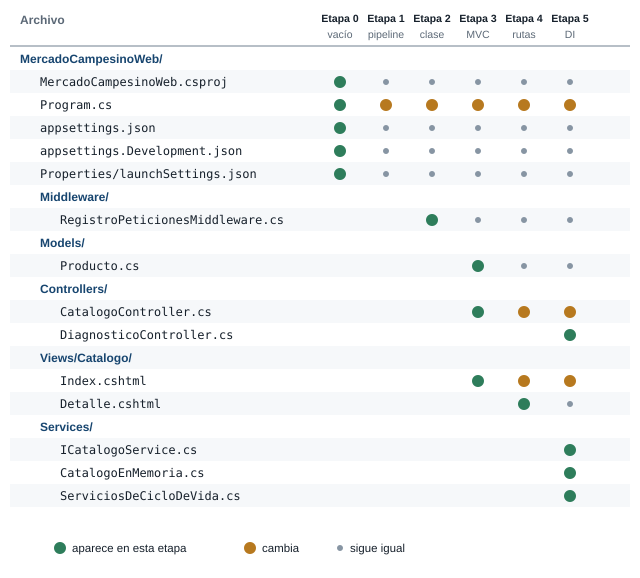{fig-alt="Tabla de las etapas 6 a 10 con los archivos del proyecto Plaza. Program.cs cambia en todas. Los modelos, ProductosController y PedidosController aparecen en la etapa 7. CatalogoController y las vistas Razor aparecen en la etapa 8. Los servicios con interfaz, CiclosDeVida y DiagnosticoController aparecen en la etapa 9. AdminController y las clases de Middleware aparecen en la etapa 10. Las páginas de wwwroot aparecen en la etapa 6."}

Verde: el archivo aparece en esa etapa. Ámbar: cambia. Gris: se queda igual.
:::

## Apertura: lo que ya sabes de la guía de rutas

Estas cuatro ideas de la guía de rutas sostienen todo lo de esta guía:

| Idea de la guía de rutas | Dónde la usas aquí |
|---|---|
| Una **ruta** une un método HTTP con una dirección (`MapGet`, `MapPost`) | En la etapa 7 la declaras con un atributo sobre un método de una clase |
| Un **parámetro** llega de la ruta (`/saludo/Maria`) o del query string (`/buscar?q=tomate`) | En la etapa 6 aparece un tercer lugar para un dato: el cuerpo de la petición |
| Un **estado** resume cómo le fue al servidor: `200`, `201`, `400`, `404` | Aquí estrenas `302` y `401`, y te encuentras de cerca con `415` y `500` |
| `UseDefaultFiles` y `UseStaticFiles` sirven la carpeta `wwwroot` | En la etapa 10 descubres que ya eran middleware |

::: {.callout-tip}
## Predice antes de seguir

En la guía de rutas pediste datos con `/buscar?q=tomate`: el dato viaja dentro de la dirección. Imagina que registras un pedido con una dirección como `/pedido?cliente=Ana&producto=Tomate&cantidad=2`. ¿Qué problemas le ves a enviar un pedido de ese modo? Escribe dos.
:::

::: {.callout-note collapse="true"}
## Respuesta

Dos problemas que aparecen enseguida: el pedido queda a la vista en la barra de direcciones y en cualquier enlace que copies, y una dirección se puede abrir una y otra vez sin querer, porque el método GET se diseñó para **pedir** y no para **cambiar** algo en el servidor. La etapa 6 resuelve las dos cosas con otro método, POST.
:::

## Etapa 6. Recibir datos: formularios y POST

### Qué vas a lograr

Que el servidor reciba un pedido de tres maneras: un formulario de búsqueda que usa GET, un formulario de pedido que usa POST y una petición `fetch` que envía JSON. Al terminar registras pedidos, los ves en una tabla y sabes qué estado responde el servidor en cada caso.

### La idea: decir el pedido o entregar un sobre

En la guía de rutas recibiste datos por la ruta y por el query string, y en la etapa 5 enviaste un JSON con `fetch`. Ahora el problema es registrar un **pedido**: un cliente, un producto y una cantidad. Meterlos en la dirección tiene dos defectos, los que acabas de predecir: el dato queda a la vista y GET se diseñó para pedir, no para cambiar algo en el servidor.

En la plaza, la diferencia es esta. **GET** es decir el pedido en voz alta: todos oyen y queda en la dirección. **POST** es entregar un sobre cerrado en el mostrador: el vendedor lo recibe y la dirección del puesto no cambia. Un formulario HTML escoge uno de los dos con el atributo `method`.

::: {.diagrama}
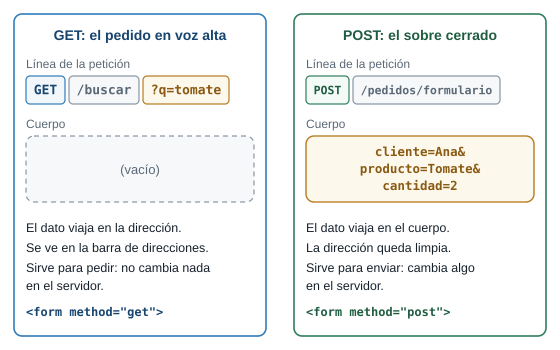{fig-alt="Dos columnas. GET: la línea de la petición es GET /buscar?q=tomate, el dato va dentro de la dirección y el cuerpo está vacío; sirve para pedir. POST: la línea de la petición es POST /pedidos/formulario, la dirección queda limpia y el dato viaja en el cuerpo como cliente=Ana&producto=Tomate&cantidad=2; sirve para enviar."}

La misma información viaja en lugares distintos. Con GET va en la dirección y con POST va en el cuerpo.
:::

::: {.callout-tip}
## Predice antes de seguir

El formulario de búsqueda tiene `method="get"` y un campo con `name="q"`. Escribes `to` y presionas **Buscar**. ¿Qué cambia en la barra de direcciones?
:::

::: {.callout-note collapse="true"}
## Respuesta

La dirección pasa a `http://localhost:5100/buscar?q=to`. El navegador toma el nombre del campo (`q`), lo une con lo que escribiste (`to`) y lo pega al final de la dirección, igual que el query string de la guía de rutas. La página muestra el JSON que responde `/buscar`.
:::

### El formulario HTML

Un formulario es una etiqueta `<form>` con campos adentro. Cuatro piezas deciden qué viaja y adónde:

| Pieza | Qué hace |
|---|---|
| `method` | `get` pone los campos en la dirección. `post` los pone en el cuerpo de la petición |
| `action` | La ruta del servidor que recibe el envío |
| `name` | El nombre con que viaja cada dato. **Sin `name`, el campo no viaja.** El `id` no sirve para esto |
| `<button type="submit">` | Al presionarlo, el navegador arma la petición con lo que hay en los campos |

El navegador junta los campos en pares `nombre=valor` separados por `&`. Ese texto es lo que llega al servidor, y cada `name` tiene que coincidir con una propiedad del modelo que lo recibe:

::: {.diagrama}
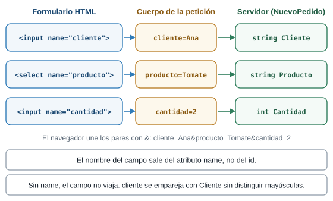{fig-alt="Tres filas. El campo HTML input name cliente viaja como cliente=Ana en el cuerpo y llega al parámetro string Cliente. El campo select name producto viaja como producto=Tomate y llega a string Producto. El campo input name cantidad viaja como cantidad=2 y llega a int Cantidad. Sin el atributo name el campo no viaja, y cliente se empareja con Cliente sin distinguir mayúsculas."}

Del campo HTML al parámetro del servidor: el atributo `name` es el puente.
:::

### El código

Primero las páginas. Crea o reemplaza estos archivos dentro de `wwwroot` (`index.html` y `estilos.css` reemplazan a los de la guía de rutas; las otras cuatro páginas son nuevas).

**`wwwroot/index.html`**, el menú de esta guía:

```html
<!DOCTYPE html>
<html lang="es">
<head>
    <meta charset="utf-8">
    <meta name="viewport" content="width=device-width, initial-scale=1">
    <title>Plaza Campesina</title>
    <link rel="stylesheet" href="/estilos.css">
</head>
<body>
    <main>
        <h1>Plaza Campesina</h1>
        <ul>
            <li><a href="/buscar.html">Buscar un producto (formulario con GET)</a></li>
            <li><a href="/formulario.html">Hacer un pedido (formulario con POST)</a></li>
            <li><a href="/fetch.html">Hacer un pedido (fetch con JSON)</a></li>
            <li><a href="/pedidos.html">Ver los pedidos</a></li>
        </ul>
    </main>
</body>
</html>
```

**`wwwroot/buscar.html`**, un formulario con GET:

```html
<!DOCTYPE html>
<html lang="es">
<head>
    <meta charset="utf-8">
    <meta name="viewport" content="width=device-width, initial-scale=1">
    <title>Buscar - Plaza Campesina</title>
    <link rel="stylesheet" href="/estilos.css">
</head>
<body>
    <main>
        <h1>Buscar un producto</h1>

        <!-- method="get": al enviar, los campos pasan a la dirección: /buscar?q=tomate -->
        <form method="get" action="/buscar">
            <label>
                Nombre
                <input type="text" name="q">
            </label>
            <button type="submit">Buscar</button>
        </form>

        <p><a href="/">Volver</a></p>
    </main>
</body>
</html>
```

**`wwwroot/formulario.html`**, un formulario con POST:

```html
<!DOCTYPE html>
<html lang="es">
<head>
    <meta charset="utf-8">
    <meta name="viewport" content="width=device-width, initial-scale=1">
    <title>Pedido - Plaza Campesina</title>
    <link rel="stylesheet" href="/estilos.css">
</head>
<body>
    <main>
        <h1>Hacer un pedido</h1>

        <!-- method="post": los campos viajan en el cuerpo y no se ven en la dirección.
             El atributo name de cada campo es el nombre con que llega al servidor. -->
        <form method="post" action="/pedidos/formulario">
            <label>
                Cliente
                <input type="text" name="cliente">
            </label>
            <label>
                Producto
                <select name="producto">
                    <option>Tomate</option>
                    <option>Aguacate</option>
                    <option>Papa</option>
                    <option>Panela</option>
                </select>
            </label>
            <label>
                Cantidad
                <input type="number" name="cantidad" value="1">
            </label>
            <button type="submit">Enviar pedido</button>
        </form>

        <p><a href="/">Volver</a></p>
    </main>
</body>
</html>
```

**`wwwroot/fetch.html`**, la misma idea con JavaScript, sin recargar la página:

```html
<!DOCTYPE html>
<html lang="es">
<head>
    <meta charset="utf-8">
    <meta name="viewport" content="width=device-width, initial-scale=1">
    <title>Pedido con fetch - Plaza Campesina</title>
    <link rel="stylesheet" href="/estilos.css">
</head>
<body>
    <main>
        <h1>Hacer un pedido con fetch</h1>

        <!-- Sin method ni action: JavaScript envía los datos y la página no se recarga. -->
        <form id="formulario">
            <label>
                Cliente
                <input type="text" id="cliente">
            </label>
            <label>
                Producto
                <select id="producto">
                    <option>Tomate</option>
                    <option>Aguacate</option>
                    <option>Papa</option>
                    <option>Panela</option>
                </select>
            </label>
            <label>
                Cantidad
                <input type="number" id="cantidad" value="1">
            </label>
            <button type="submit">Enviar pedido</button>
        </form>

        <p id="resultado"></p>
        <p><a href="/">Volver</a></p>
    </main>

    <script>
        const formulario = document.getElementById("formulario");
        const resultado = document.getElementById("resultado");

        formulario.addEventListener("submit", async evento => {
            evento.preventDefault();

            const datos = {
                cliente: document.getElementById("cliente").value,
                producto: document.getElementById("producto").value,
                cantidad: Number(document.getElementById("cantidad").value)
            };

            // POST con JSON: el encabezado Content-Type le dice al servidor cómo leer el cuerpo.
            const respuesta = await fetch("/api/pedidos", {
                method: "POST",
                headers: { "Content-Type": "application/json" },
                body: JSON.stringify(datos)
            });

            const cuerpo = await respuesta.json();

            if (respuesta.status === 201) {
                resultado.className = "";
                resultado.textContent = "Pedido " + cuerpo.id + " guardado (201).";
                formulario.reset();
            } else {
                resultado.className = "error";
                resultado.textContent = "Error " + respuesta.status + ": " + cuerpo.error;
            }
        });
    </script>
</body>
</html>
```

**`wwwroot/pedidos.html`**, la tabla de pedidos:

```html
<!DOCTYPE html>
<html lang="es">
<head>
    <meta charset="utf-8">
    <meta name="viewport" content="width=device-width, initial-scale=1">
    <title>Pedidos - Plaza Campesina</title>
    <link rel="stylesheet" href="/estilos.css">
</head>
<body>
    <main>
        <h1>Pedidos</h1>

        <table>
            <thead>
                <tr><th>Número</th><th>Cliente</th><th>Producto</th><th>Cantidad</th></tr>
            </thead>
            <tbody id="filas"></tbody>
        </table>

        <p id="vacio" class="aviso" hidden>Todavía no hay pedidos.</p>
        <p><a href="/">Volver</a></p>
    </main>

    <script>
        async function cargar() {
            // GET: pide la lista actual. Recargar la página nunca crea un pedido nuevo.
            const respuesta = await fetch("/api/pedidos");
            const pedidos = await respuesta.json();

            document.getElementById("vacio").hidden = pedidos.length > 0;

            const filas = document.getElementById("filas");
            for (const pedido of pedidos) {
                const fila = filas.insertRow();
                // textContent trata el texto como texto: un nombre con etiquetas no se ejecuta.
                fila.insertCell().textContent = pedido.id;
                fila.insertCell().textContent = pedido.cliente;
                fila.insertCell().textContent = pedido.producto;
                fila.insertCell().textContent = pedido.cantidad;
            }
        }

        cargar();
    </script>
</body>
</html>
```

**`wwwroot/estilos.css`**:

```css
body {
    font-family: system-ui, sans-serif;
    background: #f6f3e8;
    color: #2b2b2b;
    margin: 0;
}

main {
    max-width: 32rem;
    margin: 2rem auto;
    padding: 0 1rem;
}

h1, h2 {
    color: #2e6b2f;
}

label {
    display: block;
    margin-bottom: 1rem;
}

input, textarea, select {
    display: block;
    width: 100%;
    box-sizing: border-box;
    padding: 0.5rem;
    margin-top: 0.25rem;
    font: inherit;
}

button {
    background: #2e6b2f;
    color: #ffffff;
    border: 0;
    border-radius: 4px;
    padding: 0.6rem 1.2rem;
    font: inherit;
    cursor: pointer;
}

ul {
    padding-left: 1.2rem;
}

table {
    border-collapse: collapse;
    width: 100%;
}

th, td {
    border-bottom: 1px solid #d8d2bd;
    padding: 0.4rem 0.5rem;
    text-align: left;
}

.aviso {
    background: #fff7d6;
    border-left: 4px solid #d9a400;
    padding: 0.5rem 0.8rem;
}

.error {
    color: #b3261e;
}
```

Y ahora `Program.cs`. Reemplaza todo su contenido por:

```csharp
// Etapa 6: recibir datos. Un formulario HTML y una petición con fetch llegan al mismo servidor.
using Microsoft.AspNetCore.Mvc;

var builder = WebApplication.CreateBuilder(args);
var app = builder.Build();

// Sirve la carpeta wwwroot: "/" entrega wwwroot/index.html.
app.UseDefaultFiles();
app.UseStaticFiles();

var productos = new List<Producto>
{
    new(1, "Tomate", 3500m),
    new(2, "Aguacate", 6000m),
    new(3, "Papa", 2800m),
    new(4, "Panela", 4500m),
};

// La lista de pedidos vive en la memoria del programa: se borra al detener el servidor.
var pedidos = new List<Pedido>();

app.MapGet("/api/productos", () => productos);

// GET con formulario: los datos viajan en la dirección (?q=...).
app.MapGet("/buscar", (string? q) =>
{
    var texto = q ?? "";
    return productos.Where(p => p.Nombre.Contains(texto, StringComparison.OrdinalIgnoreCase));
});

// GET: leer los pedidos sin cambiar nada.
app.MapGet("/api/pedidos", () => pedidos);

// POST con formulario HTML: los datos viajan en el cuerpo, como clave=valor separados por &.
// Un formulario estático no puede traer el token antifalsificación, así que lo desactivamos aquí.
// La etapa 8 lo recupera: Razor lo agrega solo.
app.MapPost("/pedidos/formulario", ([FromForm] NuevoPedido nuevo) =>
{
    var error = Validar(nuevo, productos);
    if (error is not null)
    {
        return Results.BadRequest(new { error });
    }

    pedidos.Add(Crear(nuevo, pedidos));

    // Post/Redirect/Get: después de guardar, el navegador pasa a una página que pide con GET.
    // Así, recargar la página no repite el pedido.
    return Results.Redirect("/pedidos.html");
}).DisableAntiforgery();

// POST con JSON: lo envía JavaScript con fetch. Responde 201 Created con lo que quedó guardado.
app.MapPost("/api/pedidos", (NuevoPedido nuevo) =>
{
    var error = Validar(nuevo, productos);
    if (error is not null)
    {
        return Results.BadRequest(new { error });
    }

    var pedido = Crear(nuevo, pedidos);
    pedidos.Add(pedido);
    return Results.Created($"/api/pedidos/{pedido.Id}", pedido);
});

app.Run();

// Devuelve el mensaje de error, o null si el pedido es válido.
static string? Validar(NuevoPedido nuevo, List<Producto> productos)
{
    if (string.IsNullOrWhiteSpace(nuevo.Cliente))
    {
        return "El nombre del cliente es obligatorio";
    }

    if (!productos.Any(p => p.Nombre == nuevo.Producto))
    {
        return $"No vendemos {nuevo.Producto}";
    }

    if (nuevo.Cantidad < 1 || nuevo.Cantidad > 100)
    {
        return "La cantidad debe estar entre 1 y 100";
    }

    return null;
}

static Pedido Crear(NuevoPedido nuevo, List<Pedido> pedidos)
{
    return new Pedido(pedidos.Count + 1, nuevo.Cliente, nuevo.Producto, nuevo.Cantidad);
}

record Producto(int Id, string Nombre, decimal Precio);

// Lo que llega del cliente.
record NuevoPedido(string Cliente, string Producto, int Cantidad);

// Lo que el servidor guarda: lo recibido más un número de pedido.
record Pedido(int Id, string Cliente, string Producto, int Cantidad);
```

Lo que hace cada parte de `Program.cs`:

- **`using Microsoft.AspNetCore.Mvc;`** trae el atributo `[FromForm]`. Las otras líneas que ya conoces (`CreateBuilder`, `UseDefaultFiles`, `UseStaticFiles`, `MapGet`, `Run`) hacen lo mismo que en la guía de rutas.
- **`var pedidos = new List<Pedido>();`** es la lista donde se guardan los pedidos. Vive en la memoria del programa: **se borra cuando detienes el servidor.** Por ahora basta. En el tema de bases de datos con Entity Framework Core los pedidos pasarán a una base de datos y sobrevivirán a un reinicio.
- **`/buscar`** es la ruta del formulario con GET. Recibe `q` del query string y devuelve los productos cuyo nombre lo contiene.
- **`/pedidos/formulario`** es la ruta del formulario con POST. `[FromForm] NuevoPedido nuevo` le pide al servidor que lea el cuerpo como formulario y arme un `NuevoPedido` emparejando cada `name` con una propiedad.
- **`/api/pedidos`** con `MapPost` recibe el JSON que envía `fetch`. Sin `[FromForm]`, el parámetro `NuevoPedido nuevo` se lee como JSON, igual que `Contacto` en la guía de rutas.
- **`Validar`** devuelve el texto del error, o `null` si el pedido está bien. Las dos rutas POST la usan.
- **`Results.Redirect("/pedidos.html")`** responde `302` y le dice al navegador que pida esa dirección con GET. Se llama **Post/Redirect/Get**, y la explicación está más abajo.
- **`Results.Created(...)`** responde `201` y agrega el encabezado `Location` con la dirección del pedido nuevo.
- **`.DisableAntiforgery()`** apaga una exigencia que un formulario de `wwwroot` no puede cumplir. También se explica más abajo.

::: {.callout-note}
## C# justo a tiempo: lo que usa esta etapa

- **`record NuevoPedido(string Cliente, string Producto, int Cantidad);`** describe lo que llega del cliente. **`record Pedido(int Id, ...)`** describe lo que el servidor guarda: lo recibido más un número.
- **`new { error }`** crea un objeto anónimo con una propiedad llamada `error`. Es la forma corta de `new { error = error }`. Se convierte en JSON: `{"error":"..."}`.
- **`static string? Validar(...)`** es una función declarada al final del archivo. `string?` dice que puede devolver un texto o `null`. El `static` y su significado completo llegan en la etapa 7.
- **`error is not null`** pregunta si hay un error. `!productos.Any(p => ...)` pregunta si **no** hay ningún producto que cumpla la condición: `Any` responde si al menos uno la cumple y `!` invierte la respuesta.
- **`productos.Where(p => p.Nombre.Contains(texto, StringComparison.OrdinalIgnoreCase))`** filtra los productos cuyo nombre contiene el texto, sin distinguir mayúsculas. Un texto vacío está contenido en todos los nombres, así que `/buscar` sin `q` devuelve los cuatro.
- **`||`** significa "o". `nuevo.Cantidad < 1 || nuevo.Cantidad > 100` rechaza cantidades fuera del rango de 1 a 100.
:::

### Por qué `.DisableAntiforgery()`

Otro sitio podría esconder un formulario que haga que tu navegador envíe un POST a tu servidor sin que lo notes. Para evitarlo, ASP.NET Core usa un **token antifalsificación**: un valor que el servidor pone en sus propios formularios y exige de vuelta en cada POST, de modo que solo acepta envíos que salieron de su página.

Con `[FromForm]`, el servidor agrega esa exigencia a la ruta. Una página estática de `wwwroot`, como `formulario.html`, no puede traer el token, porque el servidor no la arma: la entrega tal cual. Por eso la ruta lleva `.DisableAntiforgery()`. **Esta decisión vale solo para esta etapa.** La etapa 8 recupera la protección: Razor agrega el token solo.

### Ejecutarlo

Ejecuta el servidor y prueba cada página en el navegador:

1. **`/buscar.html`.** Escribe `to` y presiona **Buscar**. La dirección pasa a `/buscar?q=to` y ves `[{"id":1,"nombre":"Tomate","precio":3500}]`.
2. **`/formulario.html`.** Escribe un nombre y presiona **Enviar pedido**. La dirección termina en `/pedidos.html` y la tabla muestra tu pedido.
3. **`/fetch.html`.** Escribe un nombre y presiona **Enviar pedido**. La página no se recarga y aparece `Pedido 2 guardado (201).` (el número depende de cuántos pedidos lleves). Déjalo vacío y envía: aparece `Error 400: El nombre del cliente es obligatorio`.
4. **Recarga `/pedidos.html`.** El número de filas no cambia.

Y estas peticiones, con su estado:

| Petición | Estado | Cuerpo |
|---|---|---|
| `GET /buscar?q=to` | `200` | `[{"id":1,"nombre":"Tomate","precio":3500}]` |
| `GET /buscar` (sin `q`) | `200` | los cuatro productos |
| `POST /pedidos/formulario` con `cliente=Ana&producto=Tomate&cantidad=2` | `302` | vacío, con el encabezado `Location: /pedidos.html` |
| `POST /pedidos/formulario` con `cliente=` vacío | `400` | `{"error":"El nombre del cliente es obligatorio"}` |
| `POST /pedidos/formulario` sin el campo `cantidad` | `400` | vacío: el servidor no pudo leer el formulario |
| `POST /pedidos/formulario` con `cantidad=abc` | `400` | vacío |
| `POST /api/pedidos` con un JSON válido | `201` | `{"id":2,"cliente":"Luis","producto":"Papa","cantidad":3}` y `Location: /api/pedidos/2` |
| `POST /api/pedidos` con el producto `Mango` | `400` | `{"error":"No vendemos Mango"}` |
| `POST /api/pedidos` con cantidad 500 | `400` | `{"error":"La cantidad debe estar entre 1 y 100"}` |
| `POST /api/pedidos` sin `Content-Type: application/json` | `415` | vacío |
| `GET /api/pedidos` | `200` | la lista de pedidos guardados |

Con `curl`, `-d` envía un cuerpo con el formato de un formulario (`clave=valor&clave=valor`), igual que el navegador:

```text
$ curl -i -d "cliente=Ana&producto=Tomate&cantidad=2" http://localhost:5100/pedidos/formulario
HTTP/1.1 302 Found
Content-Length: 0
Location: /pedidos.html

$ curl -i -d "cliente=&producto=Tomate&cantidad=2" http://localhost:5100/pedidos/formulario
HTTP/1.1 400 Bad Request
Content-Type: application/json; charset=utf-8

{"error":"El nombre del cliente es obligatorio"}
```

Para enviar JSON, `curl` necesita el encabezado `Content-Type`, o el servidor responde `415`:

```text
$ curl -i -X POST -H "Content-Type: application/json" -d '{"cliente":"Luis","producto":"Papa","cantidad":3}' http://localhost:5100/api/pedidos
HTTP/1.1 201 Created
Content-Type: application/json; charset=utf-8
Location: /api/pedidos/2

{"id":2,"cliente":"Luis","producto":"Papa","cantidad":3}

$ curl -i -X POST -d '{"cliente":"Luis","producto":"Papa","cantidad":3}' http://localhost:5100/api/pedidos
HTTP/1.1 415 Unsupported Media Type
Content-Length: 0

$ curl -i http://localhost:5100/api/pedidos
HTTP/1.1 200 OK
Content-Type: application/json; charset=utf-8

[{"id":1,"cliente":"Ana","producto":"Tomate","cantidad":2},{"id":2,"cliente":"Luis","producto":"Papa","cantidad":3}]
```

### Qué pasó por dentro

Para el formulario con POST, cuando presionas **Enviar pedido**:

1. El navegador toma cada campo que tiene `name` y arma el cuerpo: `cliente=Ana&producto=Tomate&cantidad=2`.
2. Envía `POST /pedidos/formulario` con ese cuerpo.
3. El servidor encuentra la ruta `MapPost("/pedidos/formulario", ...)` y lee el cuerpo como formulario. Con `[FromForm]` arma un `NuevoPedido` emparejando `cliente` con `Cliente`, `producto` con `Producto` y `cantidad` con `Cantidad`.
4. `Validar` revisa el pedido. Si hay error, responde `400` con el mensaje.
5. Si está bien, crea un `Pedido` con el número siguiente, lo agrega a la lista y responde `302` con `Location: /pedidos.html`.
6. El navegador sigue la dirección nueva con un **GET** y pide `pedidos.html`.
7. La página `pedidos.html` pide `GET /api/pedidos` con JavaScript y dibuja la tabla.

El paso 5 y el 6 son **Post/Redirect/Get**. Después de guardar, el servidor no responde con la página: manda al navegador a una dirección que se pide con GET. Así, la pantalla final es el resultado de un GET y recargarla repite el GET, no el POST. En la prueba, recargar `pedidos.html` dejó el mismo número de filas.

::: {.diagrama}
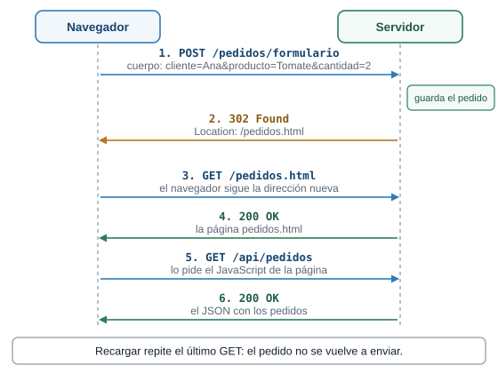{fig-alt="Secuencia entre el navegador y el servidor. 1: el navegador envía POST /pedidos/formulario con el cuerpo del pedido y el servidor guarda el pedido. 2: el servidor responde 302 con Location /pedidos.html. 3: el navegador pide GET /pedidos.html. 4: el servidor responde 200 con la página. 5: la página pide GET /api/pedidos. 6: el servidor responde 200 con el JSON. Recargar repite el último GET y no vuelve a enviar el pedido."}

Un POST termina en un `302`, y la pantalla que ves es el resultado de un GET.
:::

Para el `fetch` el recorrido es parecido, con dos diferencias: el cuerpo es JSON (`Content-Type: application/json`) y la página lee el estado de la respuesta en vez de seguir una redirección. Si es `201`, muestra el número del pedido. Si no, muestra el mensaje de `error` que trae el JSON.

### Falla provocada: quitar `.DisableAntiforgery()`

Para ver por qué está esa llamada, bórrala. Cambia `}).DisableAntiforgery();` por `});` al final de la ruta `/pedidos/formulario`, detén el servidor y vuelve a ejecutarlo. Compila y arranca sin quejas. Envía el formulario de `/formulario.html`: no ves la tabla de pedidos, porque el servidor responde `500` con el cuerpo vacío. El motivo aparece en la consola:

```text
fail: Microsoft.AspNetCore.Server.Kestrel[13]
      Connection id "0HNPF1LE2L76G", Request id "0HNPF1LE2L76G:00000001": An unhandled exception was thrown by the application.
      System.InvalidOperationException: Endpoint HTTP: POST /pedidos/formulario contains anti-forgery metadata, but a middleware was not found that supports anti-forgery.
```

El identificador de la conexión cambia en cada ejecución. Lo que importa es la frase `contains anti-forgery metadata`: la ruta exige el token y un formulario de `wwwroot` no lo trae. Con el comando de clase el entorno es `Production`: la respuesta no trae detalle y el motivo solo aparece en la consola. Devuelve la llamada antes de seguir.

### Retos de la etapa 6

::: {.callout-tip}
## Reto 13. Un campo sin name

En `formulario.html` borra `name="cliente"` del campo del cliente, guarda y envía el formulario con un nombre escrito. Antes de hacerlo, predice qué estado responde el servidor y qué ves en pantalla.
:::

::: {.callout-note collapse="true"}
## Solución del Reto 13

Responde `400` con el cuerpo vacío, y no ves la tabla de pedidos. Sin `name`, el navegador no envía el campo `cliente`. El servidor no puede armar el `NuevoPedido` sin él y responde `400` antes de llegar a `Validar`. El mismo cuerpo, sin ese campo, se ve con `curl`:

```text
$ curl -i -d "producto=Tomate&cantidad=2" http://localhost:5100/pedidos/formulario
HTTP/1.1 400 Bad Request
Content-Length: 0
```

Devuelve el atributo `name="cliente"`. Un campo sin `name` es un campo que el servidor nunca ve.
:::

::: {.callout-tip}
## Reto 14. Un GET a una ruta de POST

Abre `http://localhost:5100/pedidos/formulario` en la barra de direcciones. La ruta existe, pero la registraste con `MapPost`. Predice el estado.
:::

::: {.callout-note collapse="true"}
## Solución del Reto 14

`405 Method Not Allowed`, con el encabezado `Allow: POST` y el cuerpo vacío. La ruta existe, pero no para el método GET:

```text
$ curl -i http://localhost:5100/pedidos/formulario
HTTP/1.1 405 Method Not Allowed
Content-Length: 0
Allow: POST
```

Una ruta es una pareja: **método y dirección**. Con la misma dirección puedes tener una ruta GET y otra POST, y para cada pareja responde su propia función. Compara con un `404`, que significa que ninguna dirección coincide.
:::

### Cierre de la etapa 6

- **Qué cambió:** el servidor recibe datos de un formulario con GET, de un formulario con POST y de un `fetch` con JSON. Guarda pedidos en una lista en memoria y responde `302`, `201`, `400` o `415`.
- **Cómo verificarlo:** envía los tres formularios de las páginas y repite las peticiones de la tabla con `curl`.
- **Qué debes ver:** el pedido en la tabla de `/pedidos.html`, `201` para el JSON, `400` con mensaje para los datos malos y `415` sin `Content-Type`.
- **Lo que falta, y de dónde sale la etapa 7:** `Program.cs` ya tiene unas cien líneas y mezcla todo: archivos, rutas, validación, la lista de productos y los cuatro tipos. Agregar una ruta más lo hace crecer, y encontrar una función exige recorrerlo entero. La etapa 7 reparte ese código.

## Etapa 7. Modelos y controladores

### Qué vas a lograr

Que el mismo servidor de la etapa 6, con las mismas direcciones y las mismas páginas, quede repartido en archivos con un oficio cada uno: los modelos en `Models/` y los controladores en `Controllers/`. `Program.cs` baja de unas cien líneas a quince.

### La idea: el vendedor y la ficha

Hay un patrón para ordenar un servidor que atiende páginas y datos: **MVC**, por *Model*, *View* y *Controller*. Reparte el trabajo en tres oficios:

| Pieza | Qué hace | En la plaza | Dónde vive |
|---|---|---|---|
| **Modelo** | Describe un dato de la aplicación | La ficha del producto | `Models/` |
| **Controlador** | Recibe la petición, reúne lo que hace falta y decide qué responder | El vendedor que atiende | `Controllers/` |
| **Vista** | Arma lo que ve el cliente | El letrero o escaparate | `Views/` (etapa 8) |

En esta etapa llegan el modelo y el controlador. La vista llega en la etapa 8.

::: {.callout-tip}
## Predice antes de seguir

Vas a mover todo el código de `Program.cs` a controladores y a mantener las mismas direcciones: `/api/productos`, `/buscar`, `/api/pedidos` y `/pedidos/formulario`. ¿Tienes que cambiar algo en las páginas de `wwwroot`?
:::

::: {.callout-note collapse="true"}
## Respuesta

No. Las páginas piden direcciones, y las direcciones no cambian: las declara un atributo sobre cada método del controlador. El navegador no tiene forma de saber en qué archivo vive el código. Por eso no tocas nada en `wwwroot`.
:::

### El código

Reemplaza `Program.cs` y crea las carpetas `Models` y `Controllers` dentro de `Plaza`. En `wwwroot` no cambia nada.

**`Program.cs`**, ahora de quince líneas:

```csharp
// Etapa 7: el mismo servidor de la etapa 6, repartido en modelos y controladores.
var builder = WebApplication.CreateBuilder(args);

// Le dice a ASP.NET Core que busque clases controlador en el proyecto.
builder.Services.AddControllers();

var app = builder.Build();

app.UseDefaultFiles();
app.UseStaticFiles();

// Conecta cada método de cada controlador con su dirección (la que declara el atributo).
app.MapControllers();

app.Run();
```

Los modelos, uno por archivo, en `Models/`. Son los mismos `record` de la etapa 6, ahora `public` y con un `namespace`:

**`Models/Producto.cs`**:

```csharp
namespace Plaza.Models;

public record Producto(int Id, string Nombre, decimal Precio);
```

**`Models/NuevoPedido.cs`**:

```csharp
namespace Plaza.Models;

// Lo que llega del cliente.
public record NuevoPedido(string Cliente, string Producto, int Cantidad);
```

**`Models/Pedido.cs`**:

```csharp
namespace Plaza.Models;

// Lo que el servidor guarda: lo recibido más un número de pedido.
public record Pedido(int Id, string Cliente, string Producto, int Cantidad);
```

Los controladores, en `Controllers/`:

**`Controllers/ProductosController.cs`**:

```csharp
using Microsoft.AspNetCore.Mvc;
using Plaza.Models;

namespace Plaza.Controllers;

// ControllerBase: un controlador que responde datos (JSON), sin vistas.
// [ApiController] activa ayudas para APIs, por ejemplo responder 400 solo cuando los datos no se pueden leer.
[ApiController]
[Route("api/productos")]
public class ProductosController : ControllerBase
{
    // public static: cualquiera puede leer esta lista sin crear un ProductosController.
    // Funciona, pero PedidosController ya depende de este controlador. La etapa 9 lo corrige.
    public static readonly List<Producto> Lista = new()
    {
        new(1, "Tomate", 3500m),
        new(2, "Aguacate", 6000m),
        new(3, "Papa", 2800m),
        new(4, "Panela", 4500m),
    };

    // GET /api/productos
    [HttpGet]
    public List<Producto> Listar()
    {
        return Lista;
    }

    // GET /api/productos/2
    [HttpGet("{id:int}")]
    public IActionResult Obtener(int id)
    {
        var producto = Lista.FirstOrDefault(p => p.Id == id);

        if (producto is null)
        {
            return NotFound(new { error = $"No existe el producto {id}" });
        }

        return Ok(producto);
    }

    // La barra inicial hace la ruta absoluta: ignora el [Route] del controlador.
    // GET /buscar?q=to
    [HttpGet("/buscar")]
    public IEnumerable<Producto> Buscar(string? q)
    {
        var texto = q ?? "";
        return Lista.Where(p => p.Nombre.Contains(texto, StringComparison.OrdinalIgnoreCase));
    }
}
```

**`Controllers/PedidosController.cs`**:

```csharp
using Microsoft.AspNetCore.Mvc;
using Plaza.Models;

namespace Plaza.Controllers;

// Sin [Route] en la clase: cada método declara su dirección completa.
// Son las mismas direcciones de la etapa 6, así que las páginas de wwwroot siguen funcionando.
[ApiController]
public class PedidosController : ControllerBase
{
    private static readonly List<Pedido> pedidos = new();

    // GET /api/pedidos
    [HttpGet("api/pedidos")]
    public List<Pedido> Listar()
    {
        return pedidos;
    }

    // POST /api/pedidos con un JSON en el cuerpo.
    [HttpPost("api/pedidos")]
    public IActionResult CrearConJson(NuevoPedido nuevo)
    {
        var error = Validar(nuevo);
        if (error is not null)
        {
            return BadRequest(new { error });
        }

        var pedido = Guardar(nuevo);
        return Created($"/api/pedidos/{pedido.Id}", pedido);
    }

    // POST /pedidos/formulario con los campos del formulario HTML.
    [HttpPost("pedidos/formulario")]
    public IActionResult CrearConFormulario([FromForm] NuevoPedido nuevo)
    {
        var error = Validar(nuevo);
        if (error is not null)
        {
            return BadRequest(new { error });
        }

        Guardar(nuevo);
        return Redirect("/pedidos.html");
    }

    private static string? Validar(NuevoPedido nuevo)
    {
        if (string.IsNullOrWhiteSpace(nuevo.Cliente))
        {
            return "El nombre del cliente es obligatorio";
        }

        // Para saber si el producto existe, este controlador lee la lista de otro controlador.
        if (!ProductosController.Lista.Any(p => p.Nombre == nuevo.Producto))
        {
            return $"No vendemos {nuevo.Producto}";
        }

        if (nuevo.Cantidad < 1 || nuevo.Cantidad > 100)
        {
            return "La cantidad debe estar entre 1 y 100";
        }

        return null;
    }

    private static Pedido Guardar(NuevoPedido nuevo)
    {
        var pedido = new Pedido(pedidos.Count + 1, nuevo.Cliente, nuevo.Producto, nuevo.Cantidad);
        pedidos.Add(pedido);
        return pedido;
    }
}
```

::: {.callout-warning}
## El nombre del espacio de nombres

Los archivos escriben `namespace Plaza.Models;` y `namespace Plaza.Controllers;`. La palabra `Plaza` es el nombre del proyecto (`Plaza.csproj`). Si creaste tu proyecto con otro nombre, usa el tuyo en cada `namespace` y en cada `using Plaza.Models;`.
:::

Lo que hace cada pieza:

| Pieza | Qué hace |
|---|---|
| `builder.Services.AddControllers();` | Le dice a ASP.NET Core que busque clases controlador en el proyecto |
| `app.MapControllers();` | Conecta cada método de cada controlador con su dirección, la que declara su atributo |
| `ControllerBase` | La clase de la que heredan los controladores que responden datos (JSON), sin vistas |
| `[ApiController]` | Activa ayudas para APIs. Una de ellas cambia un comportamiento: se explica más abajo |
| `[Route("api/productos")]` sobre la clase | El prefijo común de todos sus métodos |
| `[HttpGet]`, `[HttpGet("{id:int}")]`, `[HttpPost("api/pedidos")]` | El método HTTP y el resto de la dirección. `{id:int}` es la misma restricción de la guía de rutas |
| `[HttpGet("/buscar")]` | Con una barra inicial, la dirección es absoluta: ignora el `[Route]` de la clase |
| `IActionResult`, `Ok(...)`, `NotFound(...)`, `BadRequest(...)`, `Created(...)`, `Redirect(...)` | Los mismos estados de `Results.*` de la guía de rutas, ahora como métodos del controlador |

::: {.callout-note}
## C# justo a tiempo: lo que usa esta etapa

- **Una clase** agrupa datos y funciones. **`public class ProductosController : ControllerBase`** declara una clase pública que hereda de `ControllerBase`: recibe todo lo que esa clase ya sabe hacer, como `Ok(...)` y `NotFound(...)`.
- **Un método** es una función dentro de una clase. `public List<Producto> Listar()` dice: "se llama `Listar`, no recibe nada y devuelve una lista de productos".
- **`public`** deja usar algo desde cualquier clase. **`private`** lo deja usar solo dentro de su clase.
- **`static`** dice que algo pertenece a la clase y no a cada objeto que se cree: hay una sola copia. **`readonly`** dice que la variable no se puede reasignar después de crearla (la lista sí se puede llenar).
- **`namespace Plaza.Models;`** pone un nombre de carpeta lógica al archivo, y **`using Plaza.Models;`** permite usar sus tipos sin escribir el prefijo.
- **`[Algo]`** sobre una clase o un método es un **atributo**: una etiqueta que ASP.NET Core lee para saber qué hacer.
- **`new()`** sin tipo crea el objeto del tipo que ya declaró la variable: `List<Pedido> pedidos = new();`.
:::

### Lo que cambió sin que lo pidieras

Con `[ApiController]`, el framework revisa los datos **antes** de ejecutar tu método, y eso cambia respuestas que en la etapa 6 eran otras. Compara estos casos, que salieron de la prueba:

| Petición | Etapa 6 | Etapa 7 |
|---|---|---|
| `POST /pedidos/formulario` con `cliente=` vacío | `400` con `{"error":"El nombre del cliente es obligatorio"}` | `400` con un objeto de errores del framework, que dice `The Cliente field is required.` |
| `POST /pedidos/formulario` sin el campo `cantidad` | `400` con el cuerpo vacío | `400` con `{"error":"La cantidad debe estar entre 1 y 100"}`: llega `0` y lo rechaza tu `Validar` |
| `POST /api/pedidos` con el JSON roto `{"cliente":` | `400` con el cuerpo vacío | `400` con un objeto de errores que menciona `The nuevo field is required.` y el detalle del JSON |

Así se ve el primer caso en la etapa 7:

```text
$ curl -i -d "cliente=&producto=Tomate&cantidad=2" http://localhost:5100/pedidos/formulario
HTTP/1.1 400 Bad Request
Content-Type: application/problem+json; charset=utf-8

{"type":"https://tools.ietf.org/html/rfc9110#section-15.5.1","title":"One or more validation errors occurred.","status":400,"errors":{"Cliente":["The Cliente field is required."]},"traceId":"00-3ed34e545b9d022bab72bebae4819866-a9ba6e8d91ccf62c-00"}
```

La causa está en `Plaza.csproj`, que tiene `<Nullable>enable</Nullable>`: una propiedad `string Cliente` sin `?` cuenta como **obligatoria**. Con `[ApiController]`, el framework rechaza por su cuenta un valor ausente antes de ejecutar el método. En las rutas mínimas de la etapa 6 nadie hacía esa revisión, y el texto vacío llegaba hasta tu `Validar`. Con un JSON, en cambio, `"cliente":""` sí llega a `Validar`: en la prueba respondió `{"error":"El nombre del cliente es obligatorio"}`.

No hay nada que arreglar aquí: conviven dos validaciones, la del framework y la tuya. Las **validaciones con atributos** son tema de la guía de validaciones. Basta con saber que existen y que `[ApiController]` las activa.

### Un olor a propósito

Abre `PedidosController` y mira `Validar`. Para saber si un producto existe, lee `ProductosController.Lista`, una lista `public static` de **otro** controlador. Funciona, pero ahora un controlador depende de otro. Tenlo presente: la etapa 9 lo corrige.

### Ejecutarlo

Ejecuta el servidor y repite las peticiones de la etapa 6. Todas responden igual, salvo las tres de la tabla de arriba. Las páginas de `wwwroot` siguen funcionando sin cambios. Hay además una ruta nueva por atributo:

| Petición | Estado | Cuerpo |
|---|---|---|
| `GET /api/productos/2` | `200` | `{"id":2,"nombre":"Aguacate","precio":6000}` |
| `GET /api/productos/99` | `404` | `{"error":"No existe el producto 99"}` |
| `GET /api/productos/abc` | `404` | vacío: ninguna ruta coincide con `{id:int}` |
| `GET /buscar?q=to` | `200` | `[{"id":1,"nombre":"Tomate","precio":3500}]` |

### Qué pasó por dentro

Para `GET /api/productos/2`:

1. Al arrancar, `MapControllers` leyó los atributos de cada controlador y registró una ruta por método. `ProductosController.Obtener` quedó con la dirección `api/productos/{id:int}`: el `[Route]` de la clase más el `[HttpGet("{id:int}")]` del método.
2. Llega la petición y el servidor encuentra esa ruta. Guarda `id = 2`.
3. El servidor **crea un `ProductosController` nuevo** y llama a `Obtener(2)`.
4. El método busca en la lista y devuelve `Ok(producto)`: un `200` con el producto en JSON.
5. Cuando la respuesta sale, el controlador se descarta.

El paso 3 importa más de lo que parece: **el framework crea un controlador nuevo en cada petición.** Por eso la lista de pedidos de `PedidosController` es `static`, y la falla provocada que sigue lo demuestra.

### Falla provocada: la lista sin `static`

En `PedidosController`, quita la palabra `static` en dos líneas: la de la lista (`private static readonly List<Pedido> pedidos` pasa a `private readonly List<Pedido> pedidos`) y la de `Guardar` (`private static Pedido Guardar` pasa a `private Pedido Guardar`). Compila. Detén el servidor, vuelve a ejecutarlo y prueba:

```text
$ curl -i -X POST -H "Content-Type: application/json" -d '{"cliente":"Luis","producto":"Papa","cantidad":3}' http://localhost:5100/api/pedidos
HTTP/1.1 201 Created

{"id":1,"cliente":"Luis","producto":"Papa","cantidad":3}

$ curl -i http://localhost:5100/api/pedidos
HTTP/1.1 200 OK

[]
```

El pedido se guardó y desapareció. El POST lo guardó en la lista de **su** controlador, que murió con la petición. El GET siguiente crea otro controlador con otra lista vacía. Devuelve las dos palabras `static`.

Este es el primer indicio de un problema que la etapa 9 resuelve de otra forma: algo que debe vivir más que una petición no puede vivir dentro de un controlador. Y aun con `static`, los pedidos viven en la memoria del programa: **se pierden al detener el servidor.** Esa limitación se levanta en el tema de bases de datos con Entity Framework Core.

### Retos de la etapa 7

::: {.callout-tip}
## Reto 15. Los productos baratos

En `ProductosController`, crea `GET /api/productos/baratos` que devuelva los productos con precio menor a 4000. Pruébala junto a `/api/productos/2`.
:::

::: {.callout-note collapse="true"}
## Solución del Reto 15

Agrega este método a `ProductosController`, antes de `Obtener`:

```csharp
// GET /api/productos/baratos
[HttpGet("baratos")]
public IEnumerable<Producto> Baratos()
{
    return Lista.Where(p => p.Precio < 4000);
}
```

`/api/productos/baratos` responde `[{"id":1,"nombre":"Tomate","precio":3500},{"id":3,"nombre":"Papa","precio":2800}]` y `/api/productos/2` sigue respondiendo el aguacate. La ruta no choca con `{id:int}` porque `baratos` no es un entero, igual que en la guía de rutas. Como cambiaste código, reinicia el servidor.
:::

::: {.callout-tip}
## Reto 16. Un pedido por número

En `PedidosController`, crea `GET /api/pedidos/{id:int}`. Si el pedido existe, responde `200` con el pedido. Si no, `404` con un mensaje.
:::

::: {.callout-note collapse="true"}
## Solución del Reto 16

Agrega este método a `PedidosController`:

```csharp
// GET /api/pedidos/1
[HttpGet("api/pedidos/{id:int}")]
public IActionResult Obtener(int id)
{
    var pedido = pedidos.FirstOrDefault(p => p.Id == id);

    if (pedido is null)
    {
        return NotFound(new { error = $"No existe el pedido {id}" });
    }

    return Ok(pedido);
}
```

Después de enviar un pedido, `/api/pedidos/1` responde `200` con el pedido, y `/api/pedidos/7` responde `404` con `{"error":"No existe el pedido 7"}`. El método usa la misma lista `static` que `Listar`, así que ve los mismos pedidos.
:::

### Cierre de la etapa 7

- **Qué cambió:** `Program.cs` tiene quince líneas. El código vive en `Models/` y `Controllers/`, con las mismas direcciones de la etapa 6.
- **Cómo verificarlo:** repite las peticiones de la etapa 6 y pide `/api/productos/2` y `/api/productos/99`.
- **Qué debes ver:** los mismos resultados de la etapa 6, salvo los tres casos de la tabla "Lo que cambió sin que lo pidieras".
- **Lo que falta, y de dónde sale la etapa 8:** tus controladores devuelven datos, que sirven a otros programas. Una persona necesita una página con el catálogo. La etapa 8 agrega la tercera pieza de MVC: la vista.

## Etapa 8. Vistas Razor

### Qué vas a lograr

Que el servidor responda **páginas armadas en el servidor** con los datos del modelo: un catálogo con enlaces, el detalle de un producto, un formulario de pedido y una página de agradecimiento. Es la tercera pieza de MVC.

### La idea: el letrero de la plaza

Hasta ahora tus controladores devolvían datos, y las páginas de `wwwroot` los pedían con `fetch` y los dibujaban con JavaScript. Eso sirve para otros programas, pero hay otro camino: que el servidor arme el HTML ya terminado. Una **vista** es una plantilla de HTML con huecos para datos. El controlador le entrega un modelo, la vista llena los huecos y la respuesta sale como una página completa. En la plaza, la vista es el letrero o escaparate que ve el cliente.

El lenguaje de esas plantillas se llama **Razor**: HTML normal con instrucciones de C# que empiezan con `@`. Los archivos terminan en `.cshtml`.

::: {.diagrama}
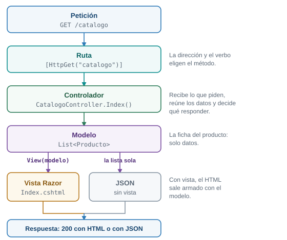{fig-alt="La petición GET /catalogo llega a una ruta con el atributo HttpGet, que lleva a CatalogoController.Index. El controlador toma el modelo, una lista de Producto. Si devuelve View con el modelo, la vista Index.cshtml arma el HTML. Si devuelve la lista sin vista, la respuesta es JSON. Las dos terminan en la respuesta."}

El recorrido de una petición por MVC. El controlador decide si la respuesta sale de una vista o es JSON.
:::

::: {.callout-tip}
## Predice antes de seguir

La vista `Pedir.cshtml` tiene un formulario con `method="post"`. En todo el archivo no escribirás una sola línea sobre antifalsificación. Cuando abras la página en el navegador y mires su HTML, ¿habrá un campo con un token antifalsificación?
:::

::: {.callout-note collapse="true"}
## Respuesta

Sí. Razor agrega solo un campo oculto llamado `__RequestVerificationToken`, con un valor largo (unos 155 caracteres en la prueba). Lo agrega porque el formulario usa `asp-action`, que arma el formulario por ti. Es la protección que la etapa 6 tuvo que apagar con `.DisableAntiforgery()`.
:::

### El código

Esta etapa reemplaza dos archivos, agrega uno a `wwwroot` y crea los demás. `ProductosController`, los modelos y el resto de `wwwroot` quedan igual.

**`Program.cs`**, con `AddControllersWithViews` en lugar de `AddControllers`:

```csharp
// Etapa 8: además de JSON, el servidor responde páginas armadas con vistas Razor.
var builder = WebApplication.CreateBuilder(args);

// AddControllersWithViews = AddControllers + el motor de vistas Razor.
builder.Services.AddControllersWithViews();

var app = builder.Build();

app.UseDefaultFiles();
app.UseStaticFiles();

app.MapControllers();

app.Run();
```

**`Controllers/CatalogoController.cs`**, el controlador de las páginas. Es el primero que hereda de `Controller`:

```csharp
using Microsoft.AspNetCore.Mvc;
using Plaza.Models;

namespace Plaza.Controllers;

// Controller (y no ControllerBase): un controlador que puede devolver vistas con View().
// Sin [ApiController]: una vista no recibe JSON, recibe formularios.
public class CatalogoController : Controller
{
    // GET /catalogo
    // View(modelo) busca Views/Catalogo/Index.cshtml: carpeta = controlador, archivo = método.
    [HttpGet("catalogo")]
    public IActionResult Index()
    {
        return View(ProductosController.Lista);
    }

    // GET /catalogo/2
    [HttpGet("catalogo/{id:int}")]
    public IActionResult Detalle(int id)
    {
        var producto = ProductosController.Lista.FirstOrDefault(p => p.Id == id);

        if (producto is null)
        {
            return NotFound();
        }

        return View(producto);
    }

    // GET /catalogo/2/pedir: muestra el formulario con el producto ya elegido.
    [HttpGet("catalogo/{id:int}/pedir")]
    public IActionResult Pedir(int id)
    {
        var producto = ProductosController.Lista.FirstOrDefault(p => p.Id == id);

        if (producto is null)
        {
            return NotFound();
        }

        return View(new NuevoPedido("", producto.Nombre, 1));
    }

    // POST /catalogo/pedir: recibe el formulario de la vista Pedir.
    // [ValidateAntiForgeryToken] rechaza con 400 un POST que no trae el token que Razor puso en el formulario.
    [HttpPost("catalogo/pedir")]
    [ValidateAntiForgeryToken]
    public IActionResult Confirmar(NuevoPedido nuevo)
    {
        var error = PedidosController.Validar(nuevo);

        if (error is not null)
        {
            ViewBag.Error = error;
            return View("Pedir", nuevo);
        }

        var pedido = PedidosController.Guardar(nuevo);

        // Post/Redirect/Get otra vez: el POST termina en un GET a la página de gracias.
        return RedirectToAction(nameof(Gracias), new { id = pedido.Id });
    }

    // GET /catalogo/gracias/1
    [HttpGet("catalogo/gracias/{id:int}")]
    public IActionResult Gracias(int id)
    {
        var pedido = PedidosController.Todos.FirstOrDefault(p => p.Id == id);

        if (pedido is null)
        {
            return NotFound();
        }

        return View(pedido);
    }
}
```

**`Controllers/PedidosController.cs`**, reemplaza el de la etapa 7. La lista y los métodos `Validar` y `Guardar` pasaron a `public static` porque `CatalogoController` los necesita:

```csharp
using Microsoft.AspNetCore.Mvc;
using Plaza.Models;

namespace Plaza.Controllers;

// Sin [Route] en la clase: cada método declara su dirección completa.
// Son las mismas direcciones de la etapa 6, así que las páginas de wwwroot siguen funcionando.
[ApiController]
public class PedidosController : ControllerBase
{
    // Ahora CatalogoController también necesita guardar pedidos, así que esta lista y los
    // métodos Validar y Guardar pasaron a public static. Otro controlador más que depende de este.
    public static readonly List<Pedido> Todos = new();

    // GET /api/pedidos
    [HttpGet("api/pedidos")]
    public List<Pedido> Listar()
    {
        return Todos;
    }

    // POST /api/pedidos con un JSON en el cuerpo.
    [HttpPost("api/pedidos")]
    public IActionResult CrearConJson(NuevoPedido nuevo)
    {
        var error = Validar(nuevo);
        if (error is not null)
        {
            return BadRequest(new { error });
        }

        var pedido = Guardar(nuevo);
        return Created($"/api/pedidos/{pedido.Id}", pedido);
    }

    // POST /pedidos/formulario con los campos del formulario HTML.
    [HttpPost("pedidos/formulario")]
    public IActionResult CrearConFormulario([FromForm] NuevoPedido nuevo)
    {
        var error = Validar(nuevo);
        if (error is not null)
        {
            return BadRequest(new { error });
        }

        Guardar(nuevo);
        return Redirect("/pedidos.html");
    }

    public static string? Validar(NuevoPedido nuevo)
    {
        if (string.IsNullOrWhiteSpace(nuevo.Cliente))
        {
            return "El nombre del cliente es obligatorio";
        }

        // Para saber si el producto existe, este controlador lee la lista de otro controlador.
        if (!ProductosController.Lista.Any(p => p.Nombre == nuevo.Producto))
        {
            return $"No vendemos {nuevo.Producto}";
        }

        if (nuevo.Cantidad < 1 || nuevo.Cantidad > 100)
        {
            return "La cantidad debe estar entre 1 y 100";
        }

        return null;
    }

    public static Pedido Guardar(NuevoPedido nuevo)
    {
        var pedido = new Pedido(Todos.Count + 1, nuevo.Cliente, nuevo.Producto, nuevo.Cantidad);
        Todos.Add(pedido);
        return pedido;
    }
}
```

Crea la carpeta `Views` con una subcarpeta `Catalogo`. El archivo `_ViewImports.cshtml` va en `Views`, y las cuatro vistas en `Views/Catalogo`:

**`Views/_ViewImports.cshtml`**:

```html
@using Plaza.Models
@addTagHelper *, Microsoft.AspNetCore.Mvc.TagHelpers
```

**`Views/Catalogo/Index.cshtml`**, la lista de productos:

```html
@model List<Producto>
<!DOCTYPE html>
<html lang="es">
<head>
    <meta charset="utf-8">
    <meta name="viewport" content="width=device-width, initial-scale=1">
    <title>Catálogo - Plaza Campesina</title>
    <link rel="stylesheet" href="/estilos.css">
</head>
<body>
    <main>
        <h1>Catálogo</h1>

        <ul>
            @foreach (var producto in Model)
            {
                <li>
                    <a asp-action="Detalle" asp-route-id="@producto.Id">@producto.Nombre</a>
                    - $@producto.Precio
                </li>
            }
        </ul>

        <p><a href="/">Volver</a></p>
    </main>
</body>
</html>
```

**`Views/Catalogo/Detalle.cshtml`**, un producto:

```html
@model Producto
<!DOCTYPE html>
<html lang="es">
<head>
    <meta charset="utf-8">
    <meta name="viewport" content="width=device-width, initial-scale=1">
    <title>@Model.Nombre - Plaza Campesina</title>
    <link rel="stylesheet" href="/estilos.css">
</head>
<body>
    <main>
        <h1>@Model.Nombre</h1>
        <p>Precio: $@Model.Precio</p>

        <p><a asp-action="Pedir" asp-route-id="@Model.Id">Pedir este producto</a></p>
        <p><a asp-action="Index">Volver al catálogo</a></p>
    </main>
</body>
</html>
```

**`Views/Catalogo/Pedir.cshtml`**, el formulario de pedido:

```html
@model NuevoPedido
<!DOCTYPE html>
<html lang="es">
<head>
    <meta charset="utf-8">
    <meta name="viewport" content="width=device-width, initial-scale=1">
    <title>Pedir @Model.Producto - Plaza Campesina</title>
    <link rel="stylesheet" href="/estilos.css">
</head>
<body>
    <main>
        <h1>Pedir @Model.Producto</h1>

        @if (ViewBag.Error is not null)
        {
            <p class="error">@ViewBag.Error</p>
        }

        @* asp-action arma la dirección del formulario y agrega solo el token antifalsificación. *@
        <form method="post" asp-action="Confirmar">
            <input type="hidden" name="Producto" value="@Model.Producto">
            <label>
                Cliente
                <input type="text" name="Cliente" value="@Model.Cliente">
            </label>
            <label>
                Cantidad
                <input type="number" name="Cantidad" value="@Model.Cantidad">
            </label>
            <button type="submit">Enviar pedido</button>
        </form>

        <p><a asp-action="Index">Volver al catálogo</a></p>
    </main>
</body>
</html>
```

**`Views/Catalogo/Gracias.cshtml`**, lo que ves al terminar:

```html
@model Pedido
<!DOCTYPE html>
<html lang="es">
<head>
    <meta charset="utf-8">
    <meta name="viewport" content="width=device-width, initial-scale=1">
    <title>Gracias - Plaza Campesina</title>
    <link rel="stylesheet" href="/estilos.css">
</head>
<body>
    <main>
        <h1>Gracias, @Model.Cliente</h1>
        <p>Tu pedido número @Model.Id quedó guardado: @Model.Cantidad de @Model.Producto.</p>

        <p><a asp-action="Index">Volver al catálogo</a></p>
    </main>
</body>
</html>
```

Y en `wwwroot/index.html`, agrega esta línea a la lista, después de la de `Ver los pedidos`:

```html
            <li><a href="/catalogo">Ver el catálogo (vistas Razor)</a></li>
```

::: {.callout-note}
## Por qué las cuatro vistas repiten su HTML

Cada vista empieza con `<!DOCTYPE html>`, el `<head>` y el enlace a `estilos.css`, igual que las otras tres. Es repetición a propósito. El tema de Razor con layouts y vistas parciales enseña el **Layout** y las **vistas parciales**, que ponen esa estructura común en un solo archivo. Aquí sería adelantarse.
:::

### Qué hace cada pieza

**El controlador.**

- **`Controller`, no `ControllerBase`.** `Controller` hereda de `ControllerBase` y agrega lo necesario para devolver vistas con `View(...)`. Los controladores de la etapa 7 responden datos y usan `ControllerBase`.
- **Sin `[ApiController]`.** Una vista recibe formularios, no JSON, y no quieres el rechazo automático de la etapa 7: aquí `Validar` es quien decide y la página vuelve a mostrarse con el mensaje.
- **`View(modelo)`** le entrega un modelo a una vista. Busca el archivo por convención: la carpeta lleva el nombre del controlador sin la palabra `Controller`, y el archivo lleva el nombre del método.
- **`RedirectToAction(nameof(Gracias), new { id = pedido.Id })`** responde `302` hacia la dirección de la acción `Gracias`. Es Post/Redirect/Get otra vez: un POST termina en un GET.

::: {.diagrama}
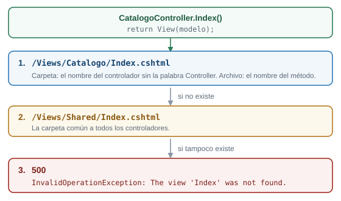{fig-alt="Cuando CatalogoController.Index ejecuta return View con el modelo, MVC busca primero Views/Catalogo/Index.cshtml: la carpeta lleva el nombre del controlador y el archivo el nombre del método. Si no existe, busca Views/Shared/Index.cshtml. Si tampoco existe, la respuesta es 500 con el mensaje The view Index was not found."}

Dónde busca MVC la vista cuando el método ejecuta `return View(modelo);`.
:::

**Las vistas.**

| Razor | Qué hace |
|---|---|
| `@model Producto` | Primera línea de la vista: el tipo del modelo que recibe |
| `@Model.Nombre` | El valor de una propiedad del modelo. `Model` va con mayúscula |
| `@foreach (var producto in Model) { ... }` | Repite su contenido por cada elemento de la lista |
| `@if (ViewBag.Error is not null) { ... }` | Muestra su contenido solo si se cumple la condición |
| `ViewBag.Error` | Un cajón donde el controlador deja un dato suelto para la vista |
| `asp-action="Detalle" asp-route-id="@producto.Id"` | Arma la dirección del enlace desde el nombre del método y su valor: `/catalogo/1` |
| `<form method="post" asp-action="Confirmar">` | Arma la dirección del formulario **y agrega el token antifalsificación** |
| `@* ... *@` | Un comentario de Razor: no llega al navegador |

**`_ViewImports.cshtml`** vale para todas las vistas de su carpeta y sus subcarpetas. `@using Plaza.Models` te deja escribir `Producto` en una vista sin prefijo, y `@addTagHelper` activa los atributos `asp-action`, `asp-route-id` y los demás `asp-*`.

**El formulario y el token.** `asp-action` hace dos cosas en `Pedir.cshtml`. Arma `action="/catalogo/pedir"` y agrega el campo oculto del token. En el método `Confirmar`, el atributo `[ValidateAntiForgeryToken]` exige que el POST lo traiga: si falta, el servidor responde `400` sin ejecutar tu método. El servidor también deja una cookie y el navegador la devuelve solo; con `curl` tendrías que guardarla (`-c`) y enviarla (`-b`).

**Por qué `Confirmar`.** Hay un método `Pedir` que muestra el formulario con GET. El que lo recibe con POST se llama `Confirmar` y no `Pedir` a propósito: así `asp-action` nunca tiene que elegir entre dos acciones con el mismo nombre. No se probó qué dirección armaría con dos acciones `Pedir`, y por eso se evitó la duda.

**Un detalle de los precios.** La vista escribe `$@Model.Precio` y sale `$3500`, sin formato. Dar formato con `N0` depende de la cultura del equipo y cambia de máquina a máquina, así que aquí no se formatea.

::: {.callout-note}
## C# justo a tiempo: lo que usa esta etapa

- **`IActionResult`** es el tipo de lo que devuelve un método de controlador: una vista, un `NotFound()`, una redirección.
- **`nameof(Gracias)`** da el nombre `"Gracias"` como texto, pero el compilador lo comprueba: si renombras el método, te avisa.
- **`new { id = pedido.Id }`** es un objeto anónimo con los valores de la ruta. Aquí llena `{id}` de `catalogo/gracias/{id:int}`.
- **`ViewBag`** guarda datos sueltos con el nombre que le pongas: `ViewBag.Error = error;`.
- **`View("Pedir", nuevo)`** nombra la vista a usar, en vez de buscarla por el nombre del método.
:::

### Un olor que crece

Mira `CatalogoController`. Lee `ProductosController.Lista` y llama a `PedidosController.Validar`, `Guardar` y `Todos`. Tuvimos que volver `public static` cosas de `PedidosController` solo para que otro controlador las alcance. Ahora hay tres controladores que dependen unos de otros. La etapa 9 los desata.

### Ejecutarlo

Abre `http://localhost:5100/catalogo`. Haz clic en **Aguacate**, luego en **Pedir este producto**, escribe un nombre y envía. Llegas a una página que dice `Gracias, Rosa` (tu nombre) y `Tu pedido número 1 quedó guardado: 1 de Aguacate.`, y la dirección termina en `/catalogo/gracias/1`. Después abre `/pedidos.html`: el pedido está en la tabla, porque las dos páginas leen la misma lista.

Las peticiones, con su estado:

| Petición | Estado | Detalle |
|---|---|---|
| `GET /catalogo` | `200` | Los cuatro productos con enlaces `/catalogo/1` a `/catalogo/4` y sus precios: `$3500`, `$6000`, `$2800` y `$4500` |
| `GET /catalogo/2` | `200` | `Aguacate`, `Precio: $6000` y el enlace `/catalogo/2/pedir` |
| `GET /catalogo/99` | `404` | vacío |
| `GET /catalogo/2/pedir` | `200` | El formulario `method="post" action="/catalogo/pedir"` con el campo oculto `__RequestVerificationToken` |
| `POST /catalogo/pedir` sin token | `400` | Rechazado por `[ValidateAntiForgeryToken]` |
| `POST /catalogo/pedir` con token y cookie | `302` | `Location: /catalogo/gracias/1` |
| `GET /catalogo/gracias/1` | `200` | `Gracias, Ana` y `Tu pedido número 1 quedó guardado: 2 de Aguacate.` |
| `POST /catalogo/pedir` con token y `Cliente=` vacío | `200` | Vuelve a mostrar el formulario con `<p class="error">El nombre del cliente es obligatorio</p>` |

El último caso muestra la diferencia con la etapa 7. Sin `[ApiController]`, el texto vacío llega hasta `Validar`, y el controlador responde la misma vista con el mensaje en lugar de un `400`.

Para ver el token en el HTML que sirve el servidor:

```text
$ curl -s http://localhost:5100/catalogo/2/pedir
...
        <form method="post" action="/catalogo/pedir">
            <input type="hidden" name="Producto" value="Aguacate">
            ...
            <button type="submit">Enviar pedido</button>
        <input name="__RequestVerificationToken" type="hidden" value="CfDJ8Df8O3eJDQ5Ll..." /></form>
...

$ curl -i -d "Cliente=Ana&Producto=Aguacate&Cantidad=2" http://localhost:5100/catalogo/pedir
HTTP/1.1 400 Bad Request
```

Razor pone el token justo antes de `</form>`. Su valor es otro en cada carga de la página, y aquí se abrevió con tres puntos, igual que las líneas que se omitieron.

### Qué pasó por dentro

Para `GET /catalogo/2`:

1. El servidor encuentra la ruta `catalogo/{id:int}` de `CatalogoController.Detalle` y guarda `id = 2`.
2. Crea un `CatalogoController` y llama a `Detalle(2)`.
3. El método busca el producto en la lista de `ProductosController`. Lo encuentra y ejecuta `return View(producto);`.
4. MVC busca `Views/Catalogo/Detalle.cshtml`: carpeta igual al controlador, archivo igual al método.
5. Razor ejecuta la plantilla. `@Model.Nombre` se reemplaza por `Aguacate` y `asp-route-id="@Model.Id"` arma la dirección `/catalogo/2/pedir`.
6. La respuesta sale como `200` con tipo `text/html; charset=utf-8` y la página terminada.

Compara con la etapa 4 de la guía de rutas: allí el HTML era un archivo fijo de `wwwroot`, y los datos llegaban después con `fetch`. Aquí el servidor arma la página con los datos adentro.

### Falla provocada: una carpeta mal nombrada

Renombra la carpeta `Views/Catalogo` a `Views/Catalogos`. Detén el servidor y vuelve a ejecutarlo: compila y arranca. Pide `/catalogo`. El servidor responde `500` y la consola dice:

```text
System.InvalidOperationException: The view 'Index' was not found. The following locations were searched:
/Views/Catalogo/Index.cshtml
/Views/Shared/Index.cshtml
```

El mensaje lista los dos lugares donde buscó, los del dibujo de más arriba. Ninguno existe porque la carpeta se llama distinto. Devuelve el nombre `Catalogo`.

### Retos de la etapa 8

::: {.callout-tip}
## Reto 17. Cuántos productos hay

En `Index.cshtml`, cambia el título para que diga `Catálogo (4 productos)`. El número debe salir del modelo, sin escribirlo a mano.
:::

::: {.callout-note collapse="true"}
## Solución del Reto 17

El modelo es una `List<Producto>`, y las listas tienen la propiedad `Count`:

```html
<h1>Catálogo (@Model.Count productos)</h1>
```

Al abrir `/catalogo` el título dice `Catálogo (4 productos)`. Si agregaras un producto a la lista, el título cambiaría solo. Los cambios en una vista también exigen reiniciar con `dotnet run`.
:::

::: {.callout-tip}
## Reto 18. La marca de económico

En `Index.cshtml`, agrega la palabra `(económico)` junto a los productos con precio menor a 4000.
:::

::: {.callout-note collapse="true"}
## Solución del Reto 18

Dentro del `@foreach`, después de la línea del precio:

```html
@if (producto.Precio < 4000)
{
    <span>(económico)</span>
}
```

`/catalogo` marca a Tomate (`$3500`) y a Papa (`$2800`), y no marca a Aguacate ni a Panela. `@if` funciona igual que en C#, y lo que va entre llaves es HTML.
:::

### Cierre de la etapa 8

- **Qué cambió:** el servidor responde páginas HTML armadas con vistas Razor, además del JSON. Hay un `CatalogoController`, una carpeta `Views` con cuatro vistas y un formulario que trae su token antifalsificación.
- **Cómo verificarlo:** recorre `/catalogo`, el detalle, el formulario y la página de gracias, y revisa el token con `curl`.
- **Qué debes ver:** las cuatro páginas con `200`, un `302` al enviar el formulario, un `400` si el POST no trae token y el pedido en `/pedidos.html`.
- **Lo que falta, y de dónde sale la etapa 9:** tres controladores se pasan listas y métodos `static` entre sí. Cada cambio en uno obliga a revisar los otros. La etapa 9 deja que cada controlador pida lo que necesita.

## Etapa 9. Inyección de dependencias

### Qué vas a lograr

Que cada controlador **pida** lo que necesita en su constructor y ASP.NET Core se lo entregue, en lugar de leer listas de otros controladores. Al terminar, cambias de dónde salen los productos con una sola línea de `Program.cs` y sin tocar ningún controlador.

### La idea: la balanza del puesto

Un vendedor necesita una balanza para trabajar. No la fabrica: la plaza se la entrega, y a él le da igual la marca mientras pese. Eso es **inyección de dependencias**. Una clase declara lo que necesita, sus **dependencias**, y alguien más se las entrega ya armadas. Cuatro piezas hacen el trabajo:

| Pieza | Qué es | En la plaza |
|---|---|---|
| **Interfaz** (`ICatalogo`) | Un contrato: lista lo que un catálogo sabe hacer, sin decir cómo | "Una balanza pesa", sin decir de qué marca |
| **Implementación** (`CatalogoEnMemoria`) | Una clase que cumple el contrato | Una balanza concreta |
| **Constructor** | Donde la clase pide lo que necesita, como parámetros | El vendedor dice qué balanza le hace falta |
| **Contenedor de servicios** | Quien arma las clases y entrega lo pedido, según lo que registraste en `Program.cs` | El administrador de la plaza, que reparte las balanzas |

Un **servicio** es una clase que hace un trabajo para los controladores, como guardar pedidos o entregar productos.

::: {.diagrama}
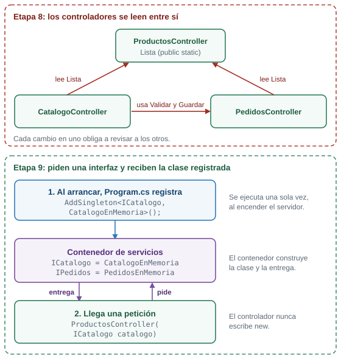{fig-alt="Panel superior, etapa 8: ProductosController guarda la lista de productos como public static, y CatalogoController y PedidosController la leen. CatalogoController también usa Validar y Guardar de PedidosController. Panel inferior, etapa 9: Program.cs registra en el contenedor que ICatalogo es CatalogoEnMemoria. Cuando llega una petición, el controlador pide ICatalogo en su constructor y el contenedor le entrega una CatalogoEnMemoria."}

Arriba, la etapa 8: los controladores se leen entre sí. Abajo, la etapa 9: cada uno pide una interfaz y recibe la clase registrada.
:::

::: {.callout-tip}
## Predice antes de seguir

Al final de la etapa vas a escribir una segunda clase, `CatalogoConOferta`, con precios rebajados un 10 %, y vas a cambiar **una** línea de `Program.cs` para usarla. ¿En cuántos archivos de controladores tendrás que cambiar código para que `/api/productos` y `/catalogo` muestren los precios nuevos?
:::

::: {.callout-note collapse="true"}
## Respuesta

En ninguno. Los controladores piden un `ICatalogo`, y no saben qué clase hay detrás. Si cambia la clase registrada, los tres controladores reciben la nueva sin cambiar una línea.
:::

### El código

Crea la carpeta `Services` y reemplaza los tres controladores. Los modelos, las vistas y `wwwroot` quedan igual, salvo una línea nueva en `index.html`.

**`Services/ICatalogo.cs`**, el contrato:

```csharp
using Plaza.Models;

namespace Plaza.Services;

// El contrato: lo que cualquier catálogo sabe hacer. Quien lo use no sabe de dónde salen los productos.
public interface ICatalogo
{
    List<Producto> Listar();

    Producto? Buscar(int id);

    bool Existe(string nombre);
}
```

**`Services/CatalogoEnMemoria.cs`**, una clase que lo cumple:

```csharp
using Plaza.Models;

namespace Plaza.Services;

// Una implementación del contrato: los productos viven en una lista dentro del programa.
public class CatalogoEnMemoria : ICatalogo
{
    private readonly List<Producto> productos = new()
    {
        new(1, "Tomate", 3500m),
        new(2, "Aguacate", 6000m),
        new(3, "Papa", 2800m),
        new(4, "Panela", 4500m),
    };

    public List<Producto> Listar()
    {
        return productos;
    }

    public Producto? Buscar(int id)
    {
        return productos.FirstOrDefault(p => p.Id == id);
    }

    public bool Existe(string nombre)
    {
        return productos.Any(p => p.Nombre == nombre);
    }
}
```

**`Services/IPedidos.cs`**:

```csharp
using Plaza.Models;

namespace Plaza.Services;

public interface IPedidos
{
    List<Pedido> Listar();

    Pedido? Buscar(int id);

    // Devuelve el mensaje de error, o null si el pedido es válido.
    string? Validar(NuevoPedido nuevo);

    Pedido Guardar(NuevoPedido nuevo);
}
```

**`Services/PedidosEnMemoria.cs`**. Fíjate que también pide algo en su constructor: un `ICatalogo`.

```csharp
using Plaza.Models;

namespace Plaza.Services;

public class PedidosEnMemoria : IPedidos
{
    private readonly ICatalogo catalogo;
    private readonly List<Pedido> pedidos = new();

    // Este servicio también pide lo que necesita: ASP.NET Core arma primero el catálogo y se lo entrega.
    public PedidosEnMemoria(ICatalogo catalogo)
    {
        this.catalogo = catalogo;
    }

    public List<Pedido> Listar()
    {
        return pedidos;
    }

    public Pedido? Buscar(int id)
    {
        return pedidos.FirstOrDefault(p => p.Id == id);
    }

    public string? Validar(NuevoPedido nuevo)
    {
        if (string.IsNullOrWhiteSpace(nuevo.Cliente))
        {
            return "El nombre del cliente es obligatorio";
        }

        if (!catalogo.Existe(nuevo.Producto))
        {
            return $"No vendemos {nuevo.Producto}";
        }

        if (nuevo.Cantidad < 1 || nuevo.Cantidad > 100)
        {
            return "La cantidad debe estar entre 1 y 100";
        }

        return null;
    }

    public Pedido Guardar(NuevoPedido nuevo)
    {
        var pedido = new Pedido(pedidos.Count + 1, nuevo.Cliente, nuevo.Producto, nuevo.Cantidad);
        pedidos.Add(pedido);
        return pedido;
    }
}
```

**`Controllers/ProductosController.cs`**, reemplaza el anterior. La lista `public static` desapareció:

```csharp
using Microsoft.AspNetCore.Mvc;
using Plaza.Models;
using Plaza.Services;

namespace Plaza.Controllers;

[ApiController]
[Route("api/productos")]
public class ProductosController : ControllerBase
{
    private readonly ICatalogo catalogo;

    // El controlador pide un ICatalogo en el constructor y ASP.NET Core se lo entrega.
    // No dice cuál catálogo es ni lo crea con new.
    public ProductosController(ICatalogo catalogo)
    {
        this.catalogo = catalogo;
    }

    // GET /api/productos
    [HttpGet]
    public List<Producto> Listar()
    {
        return catalogo.Listar();
    }

    // GET /api/productos/2
    [HttpGet("{id:int}")]
    public IActionResult Obtener(int id)
    {
        var producto = catalogo.Buscar(id);

        if (producto is null)
        {
            return NotFound(new { error = $"No existe el producto {id}" });
        }

        return Ok(producto);
    }

    // GET /buscar?q=to
    [HttpGet("/buscar")]
    public IEnumerable<Producto> Buscar(string? q)
    {
        var texto = q ?? "";
        return catalogo.Listar().Where(p => p.Nombre.Contains(texto, StringComparison.OrdinalIgnoreCase));
    }
}
```

**`Controllers/PedidosController.cs`**, reemplaza el anterior. Ya no tiene lista, ni `Validar`, ni `Guardar`:

```csharp
using Microsoft.AspNetCore.Mvc;
using Plaza.Models;
using Plaza.Services;

namespace Plaza.Controllers;

[ApiController]
public class PedidosController : ControllerBase
{
    private readonly IPedidos pedidos;

    public PedidosController(IPedidos pedidos)
    {
        this.pedidos = pedidos;
    }

    // GET /api/pedidos
    [HttpGet("api/pedidos")]
    public List<Pedido> Listar()
    {
        return pedidos.Listar();
    }

    // POST /api/pedidos con un JSON en el cuerpo.
    [HttpPost("api/pedidos")]
    public IActionResult CrearConJson(NuevoPedido nuevo)
    {
        var error = pedidos.Validar(nuevo);
        if (error is not null)
        {
            return BadRequest(new { error });
        }

        var pedido = pedidos.Guardar(nuevo);
        return Created($"/api/pedidos/{pedido.Id}", pedido);
    }

    // POST /pedidos/formulario con los campos del formulario HTML.
    [HttpPost("pedidos/formulario")]
    public IActionResult CrearConFormulario([FromForm] NuevoPedido nuevo)
    {
        var error = pedidos.Validar(nuevo);
        if (error is not null)
        {
            return BadRequest(new { error });
        }

        pedidos.Guardar(nuevo);
        return Redirect("/pedidos.html");
    }
}
```

**`Controllers/CatalogoController.cs`**, reemplaza el anterior. Ya no lee a otros controladores:

```csharp
using Microsoft.AspNetCore.Mvc;
using Plaza.Models;
using Plaza.Services;

namespace Plaza.Controllers;

public class CatalogoController : Controller
{
    private readonly ICatalogo catalogo;
    private readonly IPedidos pedidos;

    // Dos dependencias, dos parámetros. Ya no hay controladores que lean listas de otros controladores.
    public CatalogoController(ICatalogo catalogo, IPedidos pedidos)
    {
        this.catalogo = catalogo;
        this.pedidos = pedidos;
    }

    // GET /catalogo
    [HttpGet("catalogo")]
    public IActionResult Index()
    {
        return View(catalogo.Listar());
    }

    // GET /catalogo/2
    [HttpGet("catalogo/{id:int}")]
    public IActionResult Detalle(int id)
    {
        var producto = catalogo.Buscar(id);

        if (producto is null)
        {
            return NotFound();
        }

        return View(producto);
    }

    // GET /catalogo/2/pedir
    [HttpGet("catalogo/{id:int}/pedir")]
    public IActionResult Pedir(int id)
    {
        var producto = catalogo.Buscar(id);

        if (producto is null)
        {
            return NotFound();
        }

        return View(new NuevoPedido("", producto.Nombre, 1));
    }

    // POST /catalogo/pedir
    [HttpPost("catalogo/pedir")]
    [ValidateAntiForgeryToken]
    public IActionResult Confirmar(NuevoPedido nuevo)
    {
        var error = pedidos.Validar(nuevo);

        if (error is not null)
        {
            ViewBag.Error = error;
            return View("Pedir", nuevo);
        }

        var pedido = pedidos.Guardar(nuevo);
        return RedirectToAction(nameof(Gracias), new { id = pedido.Id });
    }

    // GET /catalogo/gracias/1
    [HttpGet("catalogo/gracias/{id:int}")]
    public IActionResult Gracias(int id)
    {
        var pedido = pedidos.Buscar(id);

        if (pedido is null)
        {
            return NotFound();
        }

        return View(pedido);
    }
}
```

**`Program.cs`**, con el registro de los servicios:

```csharp
// Etapa 9: los controladores piden lo que necesitan y el contenedor de servicios se lo entrega.
using Plaza.Services;

var builder = WebApplication.CreateBuilder(args);

builder.Services.AddControllersWithViews();

// Registro de servicios: "cuando alguien pida un ICatalogo, entrégale un CatalogoEnMemoria".
// AddSingleton: se crea una sola vez y todas las peticiones comparten esa instancia.
// Los pedidos viven dentro del servicio, así que tiene que ser uno solo; si fuera nuevo en cada petición, la lista nacería vacía.
builder.Services.AddSingleton<ICatalogo, CatalogoEnMemoria>();
builder.Services.AddSingleton<IPedidos, PedidosEnMemoria>();

// Ciclos de vida, para comparar en /diagnostico.
builder.Services.AddSingleton<ServicioSingleton>();
builder.Services.AddScoped<ServicioScoped>();
builder.Services.AddTransient<ServicioTransient>();
builder.Services.AddTransient<InformeDeCiclos>();

var app = builder.Build();

app.UseDefaultFiles();
app.UseStaticFiles();

app.MapControllers();

app.Run();
```

Las cuatro últimas líneas de registro (`ServicioSingleton`, `ServicioScoped`, `ServicioTransient` e `InformeDeCiclos`) pertenecen a la demostración de ciclos de vida, que viene más abajo. Para que el proyecto compile con este `Program.cs`, crea desde ya sus dos archivos. El docente los explica en la demostración:

**`Services/CiclosDeVida.cs`**:

```csharp
namespace Plaza.Services;

// Tres clases iguales: cada instancia que se crea tiene un identificador propio.
// Lo único que cambia es cómo se registra cada una en Program.cs.
public class ServicioSingleton
{
    public string Id { get; } = Guid.NewGuid().ToString("N")[..6];
}

public class ServicioScoped
{
    public string Id { get; } = Guid.NewGuid().ToString("N")[..6];
}

public class ServicioTransient
{
    public string Id { get; } = Guid.NewGuid().ToString("N")[..6];
}

// Un segundo consumidor dentro de la misma petición, para comparar con lo que ve el controlador.
public class InformeDeCiclos
{
    private readonly ServicioSingleton singleton;
    private readonly ServicioScoped scoped;
    private readonly ServicioTransient transient;

    public InformeDeCiclos(ServicioSingleton singleton, ServicioScoped scoped, ServicioTransient transient)
    {
        this.singleton = singleton;
        this.scoped = scoped;
        this.transient = transient;
    }

    public object Ids()
    {
        return new { singleton = singleton.Id, scoped = scoped.Id, transient = transient.Id };
    }
}
```

**`Controllers/DiagnosticoController.cs`**:

```csharp
using Microsoft.AspNetCore.Mvc;
using Plaza.Services;

namespace Plaza.Controllers;

// Muestra los identificadores de tres servicios con ciclos de vida distintos.
// Recarga /diagnostico varias veces y compara.
[ApiController]
public class DiagnosticoController : ControllerBase
{
    private readonly ServicioSingleton singleton;
    private readonly ServicioScoped scoped;
    private readonly ServicioTransient transient;
    private readonly InformeDeCiclos informe;

    public DiagnosticoController(
        ServicioSingleton singleton,
        ServicioScoped scoped,
        ServicioTransient transient,
        InformeDeCiclos informe)
    {
        this.singleton = singleton;
        this.scoped = scoped;
        this.transient = transient;
        this.informe = informe;
    }

    // GET /diagnostico
    [HttpGet("diagnostico")]
    public object Ver()
    {
        return new
        {
            controlador = new { singleton = singleton.Id, scoped = scoped.Id, transient = transient.Id },
            otroServicio = informe.Ids()
        };
    }
}
```

Y en `wwwroot/index.html`, agrega esta línea a la lista, después de la de `Ver el catálogo`:

```html
            <li><a href="/diagnostico">Diagnóstico de ciclos de vida</a></li>
```

### Cómo funciona

**La interfaz.** `ICatalogo` solo declara métodos, sin cuerpo: `Listar()`, `Buscar(int id)` y `Existe(string nombre)`. Cualquier clase que diga `: ICatalogo` está obligada a escribir esos tres métodos. `CatalogoEnMemoria` los escribe con una lista dentro.

**El constructor.** `ProductosController` declara un campo `private readonly ICatalogo catalogo;` y un constructor con un parámetro `ICatalogo catalogo`. Cuando llega una petición, el framework necesita un `ProductosController`, ve que su constructor pide un `ICatalogo` y lo consigue en el contenedor. El controlador no escribe `new` ni sabe cuál clase recibió.

**El registro.** `builder.Services.AddSingleton<ICatalogo, CatalogoEnMemoria>();` le dice al contenedor: "cuando alguien pida un `ICatalogo`, entrégale un `CatalogoEnMemoria`".

**Dependencias de dependencias.** `PedidosEnMemoria` pide un `ICatalogo` en su constructor, para saber si un producto existe. Cuando un controlador pide un `IPedidos`, el contenedor arma primero el catálogo, se lo pasa a `PedidosEnMemoria` y entrega el servicio terminado. Tú solo registraste las dos parejas.

**Por qué `AddSingleton`.** `AddSingleton` crea **una sola instancia** y todas las peticiones la comparten. Los pedidos viven dentro de `PedidosEnMemoria`, así que tiene que ser una sola. Si el servicio naciera nuevo en cada petición, la lista de pedidos nacería vacía cada vez: la falla provocada de abajo lo muestra. Y aun siendo `Singleton`, los pedidos viven en la memoria del programa. **Se pierden al detener el servidor.** El tema de bases de datos con Entity Framework Core resuelve eso.

**Lo que se logró.** El olor de la etapa 7 desapareció: ningún controlador lee a otro. `Validar` y `Guardar` viven donde corresponde, en el servicio de pedidos, y los tres controladores se parecen entre sí: reciben interfaces y las usan.

::: {.callout-note}
## C# justo a tiempo: lo que usa esta etapa

- **`public interface ICatalogo { ... }`** declara un contrato. Sus métodos no llevan cuerpo, solo la firma.
- **`public class CatalogoEnMemoria : ICatalogo`** dice que la clase cumple el contrato. Si le falta un método del contrato, no compila.
- **`private readonly ICatalogo catalogo;`** es un campo: una variable que pertenece al objeto y que se asigna una sola vez, en el constructor.
- **El constructor** es un método con el nombre de la clase y sin tipo de retorno. **`this.catalogo = catalogo;`** copia el parámetro al campo: `this.catalogo` es el campo y `catalogo` es el parámetro.
- **`Producto?`** como tipo de retorno significa "un producto o `null`", como `string?` en la guía de rutas.
- **`builder.Services.AddSingleton<ICatalogo, CatalogoEnMemoria>();`** usa dos tipos entre `<` y `>`: primero lo que se pide, después lo que se entrega.
:::

### Cambiar de implementación en una línea

Crea una segunda clase que cumple el mismo contrato, con los precios rebajados un 10 %:

**`Services/CatalogoConOferta.cs`**:

```csharp
using Plaza.Models;

namespace Plaza.Services;

// Otra implementación del mismo contrato: todos los precios con 10 % de descuento.
// Para usarla basta cambiar una línea en Program.cs; ningún controlador se toca.
public class CatalogoConOferta : ICatalogo
{
    private readonly List<Producto> productos = new()
    {
        new(1, "Tomate", 3150m),
        new(2, "Aguacate", 5400m),
        new(3, "Papa", 2520m),
        new(4, "Panela", 4050m),
    };

    public List<Producto> Listar()
    {
        return productos;
    }

    public Producto? Buscar(int id)
    {
        return productos.FirstOrDefault(p => p.Id == id);
    }

    public bool Existe(string nombre)
    {
        return productos.Any(p => p.Nombre == nombre);
    }
}
```

En `Program.cs`, cambia `CatalogoEnMemoria` por `CatalogoConOferta` en la línea del catálogo:

```csharp
builder.Services.AddSingleton<ICatalogo, CatalogoConOferta>();
```

Detén el servidor, ejecútalo de nuevo y pide `/api/productos`:

```text
$ curl -s http://localhost:5100/api/productos
[{"id":1,"nombre":"Tomate","precio":3150},{"id":2,"nombre":"Aguacate","precio":5400},{"id":3,"nombre":"Papa","precio":2520},{"id":4,"nombre":"Panela","precio":4050}]
```

Los precios cambiaron en el JSON y también en `/catalogo`, porque la vista recibe lo que le da el mismo servicio (`/catalogo/1` muestra `Precio: $3150`). Ningún controlador cambió. Esa es la ganancia de la inyección: **la decisión de cuál clase usar vive en un solo lugar.** Devuelve `CatalogoEnMemoria` para seguir.

::: {.diagrama}
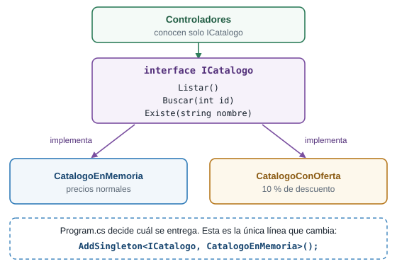{fig-alt="Los controladores conocen solo la interfaz ICatalogo, que tiene los métodos Listar, Buscar y Existe. Dos clases la implementan: CatalogoEnMemoria con los precios normales y CatalogoConOferta con 10 por ciento de descuento. Program.cs elige cuál se registra, cambiando una sola línea."}

Una interfaz, dos implementaciones. `Program.cs` elige cuál se entrega.
:::

### Demostración del docente: ciclos de vida

::: {.callout-important}
## Esta sección la hace el docente

La demostración la ejecuta el docente frente al grupo. No es un paso tuyo. El código ya lo tienes desde la sección anterior, así que puedes repetirla por tu cuenta.
:::

Cuando registras un servicio decides también **cuánto vive** cada instancia. `AddSingleton` fue la primera de tres opciones:

| Registro | Cuánto vive la instancia |
|---|---|
| `AddSingleton` | Todo el proceso: una sola, compartida por todas las peticiones |
| `AddScoped` | Una petición: todos los consumidores de esa petición comparten una, y cada petición recibe la suya |
| `AddTransient` | Una entrega: cada vez que alguien la pide, se crea una nueva |

Para verlo, `CiclosDeVida.cs` tiene tres clases idénticas. Cada instancia que se crea recibe un identificador propio (`Guid.NewGuid()` recortado a seis caracteres). Lo único que las distingue es **cómo se registran** en `Program.cs`. `InformeDeCiclos` es un segundo consumidor dentro de la misma petición, para comparar con lo que ve el controlador. `/diagnostico` muestra los identificadores que reciben los dos.

Pide `/diagnostico` tres veces seguidas:

```text
$ curl -s http://localhost:5100/diagnostico
{"controlador":{"singleton":"6bf7ed","scoped":"2bb4fd","transient":"2586f7"},"otroServicio":{"singleton":"6bf7ed","scoped":"2bb4fd","transient":"5c38f1"}}
$ curl -s http://localhost:5100/diagnostico
{"controlador":{"singleton":"6bf7ed","scoped":"f0ad1b","transient":"0eb97a"},"otroServicio":{"singleton":"6bf7ed","scoped":"f0ad1b","transient":"6e7725"}}
$ curl -s http://localhost:5100/diagnostico
{"controlador":{"singleton":"6bf7ed","scoped":"fbb6af","transient":"c1fe34"},"otroServicio":{"singleton":"6bf7ed","scoped":"fbb6af","transient":"f67164"}}
```

Los identificadores cambian en cada ejecución. Lo que importa es qué se repite:

| Columna | Qué se ve | Por qué |
|---|---|---|
| `singleton` | El mismo en las tres peticiones y en los dos consumidores | Una sola instancia para todo el proceso |
| `scoped` | El mismo para el controlador y el otro servicio dentro de una petición, y distinto en cada petición | Una instancia por petición, compartida dentro de ella |
| `transient` | Distinto en todas partes, incluso entre el controlador y el otro servicio de la misma petición | Una instancia nueva en cada entrega |

::: {.diagrama}
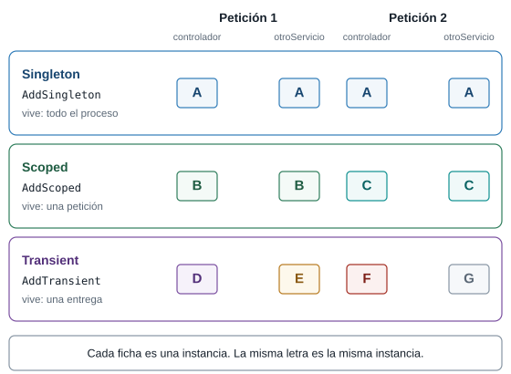{fig-alt="Dos peticiones y, en cada una, dos consumidores: el controlador y otroServicio. Singleton: la misma instancia A en las cuatro entregas. Scoped: la instancia B en los dos consumidores de la petición 1 y la instancia C en los dos de la petición 2. Transient: cuatro instancias distintas, D, E, F y G."}

Cada ficha es una instancia. La misma letra es la misma instancia.
:::

### Fallas provocadas

**Un servicio sin registrar.** Comenta la línea `builder.Services.AddSingleton<IPedidos, PedidosEnMemoria>();` (ponle `//` al comienzo). Detén el servidor y vuelve a ejecutarlo. Compila y **arranca sin quejas**. Pide `/api/productos`: responde `200`, porque ese controlador solo necesita un `ICatalogo`. Pide `/api/pedidos`: responde `500` y la consola dice:

```text
System.InvalidOperationException: Unable to resolve service for type 'Plaza.Services.IPedidos' while attempting to activate 'Plaza.Controllers.PedidosController'.
```

El mensaje dice qué faltaba (`IPedidos`) y quién lo pedía (`PedidosController`). Igual que las rutas repetidas de la guía de rutas, el error no aparece al arrancar: aparece en la primera petición que usa ese controlador. Quita el `//`.

**Un ciclo de vida equivocado.** Cambia `AddSingleton<IPedidos, PedidosEnMemoria>()` por `AddScoped<IPedidos, PedidosEnMemoria>()`. Reinicia y envía un pedido:

```text
$ curl -i -X POST -H "Content-Type: application/json" -d '{"cliente":"Luis","producto":"Papa","cantidad":3}' http://localhost:5100/api/pedidos
HTTP/1.1 201 Created

{"id":1,"cliente":"Luis","producto":"Papa","cantidad":3}

$ curl -s http://localhost:5100/api/pedidos
[]
```

El POST responde `201` y el GET siguiente devuelve la lista vacía. Con `AddScoped`, cada petición recibe un `PedidosEnMemoria` nuevo, con su propia lista, que muere con la petición. Es el mismo síntoma de la falla de la etapa 7, con otra causa: la instancia no vive lo suficiente. Devuelve `AddSingleton`.

### Retos de la etapa 9

::: {.callout-tip}
## Reto 19. Un catálogo de temporada

Crea `CatalogoDeTemporada`, una implementación de `ICatalogo` con solo dos productos: Tomate (id 1, `3500m`) y Papa (id 3, `2800m`). Actívala cambiando una línea de `Program.cs` y predice qué responde `/catalogo/2` y qué responde un pedido de Aguacate.
:::

::: {.callout-note collapse="true"}
## Solución del Reto 19

Crea `Services/CatalogoDeTemporada.cs`:

```csharp
using Plaza.Models;

namespace Plaza.Services;

// Un catálogo más corto: solo lo que hay en temporada.
public class CatalogoDeTemporada : ICatalogo
{
    private readonly List<Producto> productos = new()
    {
        new(1, "Tomate", 3500m),
        new(3, "Papa", 2800m),
    };

    public List<Producto> Listar()
    {
        return productos;
    }

    public Producto? Buscar(int id)
    {
        return productos.FirstOrDefault(p => p.Id == id);
    }

    public bool Existe(string nombre)
    {
        return productos.Any(p => p.Nombre == nombre);
    }
}
```

Y registra `builder.Services.AddSingleton<ICatalogo, CatalogoDeTemporada>();`. `/api/productos` devuelve dos productos y `/catalogo/2` responde `404`. Un pedido de Aguacate responde `400` con `{"error":"No vendemos Aguacate"}`, aunque no tocaste `PedidosEnMemoria`: pregunta `catalogo.Existe(...)` y recibe el catálogo nuevo. Los dos servicios cambiaron de comportamiento por una sola línea.
:::

::: {.callout-tip}
## Reto 20. Un ciclo de vida distinto

En `Program.cs`, cambia `AddScoped<ServicioScoped>()` por `AddTransient<ServicioScoped>()`. Pide `/diagnostico` dos veces. Predice qué pasa con la columna `scoped`.
:::

::: {.callout-note collapse="true"}
## Solución del Reto 20

La columna `scoped` deja de repetirse dentro de la misma petición:

```text
{"controlador":{"singleton":"6d1dd1","scoped":"0039a2","transient":"652828"},"otroServicio":{"singleton":"6d1dd1","scoped":"5e3d4e","transient":"30e3ca"}}
```

El controlador y el otro servicio reciben identificadores `scoped` distintos, como si fuera `transient`. La clase `ServicioScoped` no cambió: el ciclo de vida lo decide el **registro**, no la clase. Devuelve `AddScoped`.
:::

### Cierre de la etapa 9

- **Qué cambió:** hay una carpeta `Services` con dos interfaces y sus implementaciones. Los tres controladores reciben servicios por el constructor y `Program.cs` los registra con `AddSingleton`.
- **Cómo verificarlo:** repite las peticiones de las etapas 6 a 8, cambia el catálogo a `CatalogoConOferta` y pide `/diagnostico`.
- **Qué debes ver:** los mismos resultados de las etapas anteriores, otros precios al cambiar de implementación y los tres comportamientos en `/diagnostico`.
- **Lo que falta, y de dónde sale la etapa 10:** tu servidor ordena sus piezas, pero no controla lo que le pasa a **toda** petición antes de llegar a una ruta. ¿Cómo anotas cada petición que entra, o cierras `/admin` a quien no tiene clave, sin copiar código en cada controlador? La etapa 10 responde eso.

## Etapa 10. Middleware

### Qué vas a lograr

Que **toda** petición pase por piezas tuyas antes de llegar a una ruta. Escribes dos: una que anota cada petición con el tiempo que tardó, y una portería que corta el paso a `/admin` si no traen la clave. Primero las escribes en línea, dentro de `Program.cs` (parte A), y después como clases, con un servicio inyectado (parte B).

### La idea: los controles de la entrada

Antes de llegar a un puesto, todo comprador pasa por controles: alguien anota quién entra, y alguien en la portería decide si lo deja seguir. Ninguno vende nada y todos ven a todos. Un **middleware** es una de esas piezas: una función por la que pasa toda petición, que puede mirarla, cambiarla, responderla ella misma o entregársela a la siguiente. La cadena completa de piezas se llama **pipeline**.

Cada middleware recibe dos cosas: el `HttpContext` (la petición y la respuesta de este momento) y `next`, el siguiente paso de la cadena. Hay dos decisiones posibles:

- **Llamar a `next`.** La petición sigue. Lo que el middleware escribió **antes** de llamarlo se ejecuta a la **ida**. Lo que escribió **después** se ejecuta a la **vuelta**, cuando la respuesta ya está lista.
- **No llamar a `next`.** El middleware responde él mismo y la petición **se corta**: nada más abajo se ejecuta. Es un **cortocircuito**.

::: {.callout-tip}
## Predice antes de seguir

Pones un middleware de registro como **primera** pieza del pipeline. Pides `/noexiste`, una dirección que ninguna ruta atiende y que responde `404`. ¿Se imprime la línea de vuelta del registro? Si se imprime, ¿con qué estado?
:::

::: {.callout-note collapse="true"}
## Respuesta

Se imprime, y dice `404`. El `404` es una respuesta como cualquier otra: nace más abajo, vuelve por el mismo camino y el registro la ve pasar antes de que salga hacia el navegador. Verás `-> GET /noexiste` y `<- 404 en 0 ms` en la consola.
:::

### Parte A. Middleware en línea

#### El código

Reemplaza `Program.cs` y crea `Controllers/AdminController.cs`. Si dejaste `CatalogoConOferta.cs` de la etapa 9, puede quedarse: no estorba.

**`Program.cs`**:

```csharp
// Etapa 10 (parte A): middleware en línea. Cada app.Use es un paso por el que pasa TODA petición.
using System.Diagnostics;
using Plaza.Services;

var builder = WebApplication.CreateBuilder(args);

builder.Services.AddControllersWithViews();
builder.Services.AddSingleton<ICatalogo, CatalogoEnMemoria>();
builder.Services.AddSingleton<IPedidos, PedidosEnMemoria>();
builder.Services.AddSingleton<ServicioSingleton>();
builder.Services.AddScoped<ServicioScoped>();
builder.Services.AddTransient<ServicioTransient>();
builder.Services.AddTransient<InformeDeCiclos>();

var app = builder.Build();

// Middleware 1: registro. Lo que escribe antes de next se ejecuta a la ida; lo que escribe después, a la vuelta.
app.Use(async (context, next) =>
{
    var reloj = Stopwatch.StartNew();
    Console.WriteLine($"-> {context.Request.Method} {context.Request.Path}");

    // Entrega la petición al siguiente paso y espera a que la respuesta esté lista.
    await next(context);

    Console.WriteLine($"<- {context.Response.StatusCode} en {reloj.ElapsedMilliseconds} ms");
});

// Middleware 2: la puerta de /admin. Si falta la clave, responde aquí y NO llama a next:
// la petición se corta y nunca llega a los pasos siguientes.
// Es una demostración del cortocircuito, no seguridad real: una clave en la dirección se puede ver y copiar.
app.Use(async (context, next) =>
{
    var esAdmin = context.Request.Path.StartsWithSegments("/admin");

    if (esAdmin && context.Request.Query["clave"] != "plaza")
    {
        context.Response.StatusCode = StatusCodes.Status401Unauthorized;
        await context.Response.WriteAsync("Falta la clave");
        return;
    }

    await next(context);
});

// UseDefaultFiles y UseStaticFiles también son middleware: ya usabas dos sin saberlo.
app.UseDefaultFiles();
app.UseStaticFiles();

app.MapControllers();

app.Run();
```

**`Controllers/AdminController.cs`**, una ruta nueva que la portería va a proteger:

```csharp
using Microsoft.AspNetCore.Mvc;
using Plaza.Services;

namespace Plaza.Controllers;

[ApiController]
public class AdminController : ControllerBase
{
    private readonly ICatalogo catalogo;
    private readonly IPedidos pedidos;

    public AdminController(ICatalogo catalogo, IPedidos pedidos)
    {
        this.catalogo = catalogo;
        this.pedidos = pedidos;
    }

    // GET /admin/resumen?clave=plaza
    [HttpGet("admin/resumen")]
    public object Resumen()
    {
        return new
        {
            productos = catalogo.Listar().Count,
            pedidos = pedidos.Listar().Count
        };
    }
}
```

Y en `wwwroot/index.html`, agrega esta línea a la lista, después de la de `Diagnóstico`:

```html
            <li><a href="/admin/resumen?clave=plaza">Resumen de administración (clave en la dirección)</a></li>
```

Lo que hace cada parte de `Program.cs`:

- **`app.Use(async (context, next) => { ... });`** agrega una pieza al pipeline. Cada `app.Use` queda **detrás** de los anteriores.
- **Primera pieza, el registro.** Arranca un cronómetro (`Stopwatch.StartNew()`), imprime `-> GET /ruta` (la ida), llama a `await next(context)` y, cuando la respuesta vuelve, imprime `<- 200 en 40 ms` (la vuelta).
- **Segunda pieza, la portería.** Revisa si la ruta empieza por `/admin` y si la `clave` del query string **no** es `plaza`. Si es así, responde `401` con el texto `Falta la clave` y ejecuta `return;` **sin llamar a `next`**: la petición se corta aquí. Si no, llama a `next` y sigue.
- **`UseDefaultFiles` y `UseStaticFiles`** vienen de la guía de rutas, y ya eran middleware sin que lo supieras. Quedan **después** del registro y de la portería.

::: {.callout-warning}
## La clave en la dirección no es seguridad

Una clave que viaja en la dirección se ve en la barra, en el historial y en cualquier enlace que copies. Esta portería existe para ver un **cortocircuito**, no para proteger nada. La autenticación real no hace parte de esta guía.
:::

::: {.callout-note}
## C# justo a tiempo: lo que usa esta etapa

- **`async` y `await`** permiten esperar algo que tarda, como la respuesta de la siguiente pieza, sin detener el servidor. `await next(context)` significa "entrégale la petición a la siguiente pieza y espera a que termine".
- **`(context, next) => { ... }`** es una lambda con dos parámetros. `context` es el `HttpContext` y `next` es el siguiente paso.
- **`context.Request.Method`** y **`context.Request.Path`** dan el método (`GET`) y la ruta (`/admin/resumen`). La consulta, como `?clave=plaza`, no forma parte de `Path`.
- **`context.Request.Path.StartsWithSegments("/admin")`** pregunta si la ruta empieza por el segmento `admin`.
- **`context.Request.Query["clave"]`** lee un valor del query string.
- **`StatusCodes.Status401Unauthorized`** es el número `401` con un nombre legible.
- **`await context.Response.WriteAsync("...")`** escribe un texto en el cuerpo de la respuesta.
- **`Stopwatch.StartNew()`** arranca un cronómetro; `reloj.ElapsedMilliseconds` da los milisegundos que pasaron.
- **`return;`** dentro de la lambda termina la pieza sin llamar a `next`.
:::

#### Ejecutarlo

Ejecuta el servidor, pide estas direcciones y mira la consola:

| Petición | Estado | Detalle |
|---|---|---|
| `GET /api/productos` | `200` | la lista de productos |
| `GET /admin/resumen` | `401` | `Falta la clave` |
| `GET /admin/resumen?clave=x` | `401` | `Falta la clave` |
| `GET /admin/resumen?clave=plaza` | `200` | `{"productos":4,"pedidos":0}` |
| `GET /noexiste` | `404` | vacío |
| `GET /estilos.css` | `200` | el archivo de estilos |

La consola escribe una línea de ida y otra de vuelta por petición, incluso para el `401` y el `404`. Los milisegundos cambian en cada ejecución, y la primera petición es más lenta:

```text
-> GET /api/productos
<- 200 en 41 ms
-> GET /admin/resumen
<- 401 en 0 ms
-> GET /admin/resumen
<- 401 en 2 ms
-> GET /admin/resumen
<- 200 en 4 ms
-> GET /noexiste
<- 404 en 0 ms
-> GET /estilos.css
<- 200 en 9 ms
```

Fíjate en lo que ya mostró el registro: anota la ruta (`/admin/resumen`) pero no la clave, porque `Path` no incluye el query string, y anota el `401` a pesar de que la portería cortó la petición. La portería está **después** del registro, así que el registro ve pasar de regreso el `401` de la portería.

::: {.diagrama}
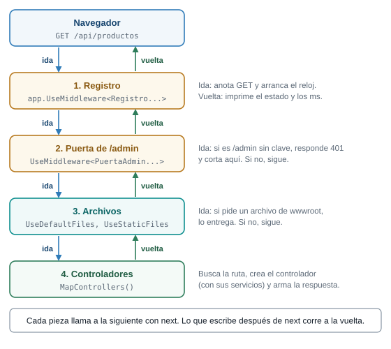{fig-alt="De arriba abajo: navegador, middleware de registro, middleware puerta de admin, UseDefaultFiles y UseStaticFiles, y los controladores de MapControllers. La petición baja pasando por cada pieza. La respuesta sube por las mismas piezas. El registro anota la línea de ida y, al volver, la línea con el estado y los milisegundos."}

La petición baja por las piezas y la respuesta sube por las mismas.
:::

::: {.diagrama}
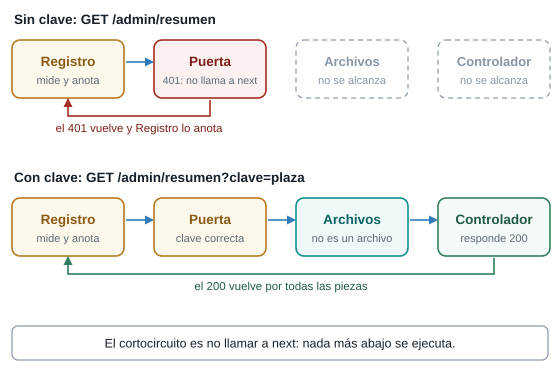{fig-alt="Dos peticiones. Sin clave: GET /admin/resumen pasa por Registro, llega a la Puerta, que responde 401 y no llama a next. Archivos y Controlador no se alcanzan, y el 401 vuelve por Registro, que lo anota. Con clave igual a plaza: la Puerta llama a next, Archivos deja pasar, el Controlador responde 200 con el JSON y la respuesta vuelve por todas las piezas."}

Sin clave, la portería responde y la petición no llega ni a los archivos ni al controlador.
:::

#### El orden importa

El orden de las líneas de `Program.cs` es el orden del pipeline. Dos experimentos lo muestran. Después de cada uno, devuelve `Program.cs` a su forma original.

**Experimento 1: los archivos antes del registro.** Mueve `app.UseDefaultFiles();` y `app.UseStaticFiles();` a una posición **anterior** al primer `app.Use`. Reinicia y pide `/estilos.css` y `/api/productos`. En la consola solo aparece la segunda:

```text
-> GET /api/productos
<- 200 en 35 ms
```

`/estilos.css` no deja ninguna línea. `UseStaticFiles` responde el archivo y **no llama a `next`**: la petición se corta ahí y nunca llega al registro. Desde la guía de rutas, los archivos estáticos hacen un cortocircuito propio.

**Experimento 2: la portería antes del registro.** Cambia de lugar los dos `app.Use`, de modo que la portería quede primero. Pide `/admin/resumen` sin clave y después con `?clave=plaza`. La primera responde `401` y **no deja ninguna línea en la consola**. La segunda responde `200` y deja las dos:

```text
-> GET /admin/resumen
<- 200 en 28 ms
```

Con la portería primero, el corte ocurre antes de que el registro vea la petición. Lo que un middleware ve depende de qué piezas lo preceden.

#### Falla provocada: olvidar `next`

Borra la línea `await next(context);` del registro (la primera pieza). Detén el servidor y vuelve a ejecutarlo. No compila. El error aparece en la línea de `app.Use(`, no en la que borraste:

```text
error CS0121: La llamada es ambigua entre los métodos o las propiedades siguientes: 'Microsoft.AspNetCore.Builder.UseExtensions.Use(Microsoft.AspNetCore.Builder.IApplicationBuilder, System.Func<Microsoft.AspNetCore.Http.HttpContext, System.Func<System.Threading.Tasks.Task>, System.Threading.Tasks.Task>)' y 'Microsoft.AspNetCore.Builder.UseExtensions.Use(Microsoft.AspNetCore.Builder.IApplicationBuilder, System.Func<Microsoft.AspNetCore.Http.HttpContext, Microsoft.AspNetCore.Http.RequestDelegate, System.Threading.Tasks.Task>)'
```

`app.Use` tiene dos versiones: una donde `next` se llama sin argumentos (`next()`) y otra donde recibe el contexto (`next(context)`). Con `await next(context);` el compilador sabe cuál quieres. Sin esa línea, tu lambda encaja en las dos y no puede elegir. Devuelve la línea.

### Parte B. Middleware como clase

Dos piezas de una línea caben en `Program.cs`. Cuando una pieza crece, o necesita servicios, conviene darle su propia clase. El comportamiento es el mismo, con dos novedades: el siguiente paso llega por el **constructor**, y la clase también puede pedir servicios, igual que un controlador en la etapa 9.

::: {.diagrama}
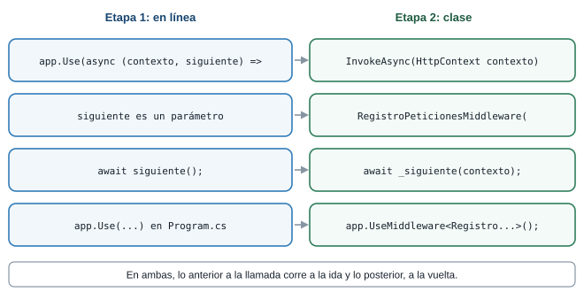{fig-alt="Tabla de cinco filas que compara el middleware en línea con el middleware como clase. Dónde vive: Program.cs o la carpeta Middleware. El siguiente paso: el parámetro next o el constructor con RequestDelegate siguiente. Cada petición: el cuerpo de la lambda o el método InvokeAsync. Llamar al siguiente: await next(context) o await siguiente(context). Cómo se registra: app.Use o app.UseMiddleware."}

El mismo middleware, de las dos formas.
:::

#### El código

Crea la carpeta `Middleware` con dos archivos y reemplaza `Program.cs`. `AdminController` queda igual.

**`Middleware/RegistroPeticionesMiddleware.cs`**:

```csharp
using System.Diagnostics;

namespace Plaza.Middleware;

// El mismo registro de la parte A, ahora como clase propia.
public class RegistroPeticionesMiddleware
{
    private readonly RequestDelegate siguiente;
    private readonly ILogger<RegistroPeticionesMiddleware> logger;

    // El constructor recibe el siguiente paso (lo da ASP.NET Core) y los servicios que pida, igual que un controlador.
    public RegistroPeticionesMiddleware(RequestDelegate siguiente, ILogger<RegistroPeticionesMiddleware> logger)
    {
        this.siguiente = siguiente;
        this.logger = logger;
    }

    // ASP.NET Core llama a este método con cada petición.
    public async Task InvokeAsync(HttpContext context)
    {
        var reloj = Stopwatch.StartNew();
        logger.LogInformation("-> {Metodo} {Ruta}", context.Request.Method, context.Request.Path);

        await siguiente(context);

        logger.LogInformation("<- {Estado} en {Ms} ms", context.Response.StatusCode, reloj.ElapsedMilliseconds);
    }
}
```

**`Middleware/PuertaAdminMiddleware.cs`**:

```csharp
namespace Plaza.Middleware;

// La puerta de /admin de la parte A, como clase. Demostración del cortocircuito, no seguridad real.
public class PuertaAdminMiddleware
{
    private readonly RequestDelegate siguiente;

    public PuertaAdminMiddleware(RequestDelegate siguiente)
    {
        this.siguiente = siguiente;
    }

    public async Task InvokeAsync(HttpContext context)
    {
        var esAdmin = context.Request.Path.StartsWithSegments("/admin");

        if (esAdmin && context.Request.Query["clave"] != "plaza")
        {
            context.Response.StatusCode = StatusCodes.Status401Unauthorized;
            await context.Response.WriteAsync("Falta la clave");
            return;
        }

        await siguiente(context);
    }
}
```

**`Program.cs`**, el pipeline completo del proyecto:

```csharp
// Etapa 10 (parte B): el pipeline completo del proyecto, con el middleware en clases.
using Plaza.Middleware;
using Plaza.Services;

var builder = WebApplication.CreateBuilder(args);

builder.Services.AddControllersWithViews();
builder.Services.AddSingleton<ICatalogo, CatalogoEnMemoria>();
builder.Services.AddSingleton<IPedidos, PedidosEnMemoria>();
builder.Services.AddSingleton<ServicioSingleton>();
builder.Services.AddScoped<ServicioScoped>();
builder.Services.AddTransient<ServicioTransient>();
builder.Services.AddTransient<InformeDeCiclos>();

var app = builder.Build();

// El orden de estas líneas es el orden del pipeline: la petición pasa por ellas de arriba abajo.
app.UseMiddleware<RegistroPeticionesMiddleware>();
app.UseMiddleware<PuertaAdminMiddleware>();
app.UseDefaultFiles();
app.UseStaticFiles();
app.MapControllers();

app.Run();
```

- **`RequestDelegate siguiente`** es el `next` de la parte A, entregado por el constructor. Lo llama `await siguiente(context);`.
- **`InvokeAsync(HttpContext context)`** es el método que ASP.NET Core llama con cada petición. Su cuerpo es el de la lambda.
- **`ILogger<RegistroPeticionesMiddleware> logger`** es un servicio que el registro **pide en su constructor**, y el contenedor se lo entrega: la misma inyección de la etapa 9, ahora en un middleware. Reemplaza a `Console.WriteLine`.
- **`app.UseMiddleware<RegistroPeticionesMiddleware>();`** agrega la clase al pipeline, en el lugar donde escribas la línea.
- **`logger.LogInformation("-> {Metodo} {Ruta}", ...)`** escribe un mensaje de nivel informativo. Lo que va entre llaves son marcadores que se llenan con los valores que siguen.

::: {.callout-note}
## C# justo a tiempo: lo que usa esta etapa

- **`ILogger<T>`** es el servicio de mensajes del framework. El tipo `T` (aquí el nombre de la clase) aparece en cada línea que escribe, para saber quién la generó.
- **`{Metodo}` y `{Ruta}`** en un mensaje de `LogInformation` son marcadores, no una cadena interpolada: no llevan `$`. Los valores se pasan después, en orden.
- **`Task`** es el tipo de lo que devuelve un método `async`: una operación que puede tardar.
:::

#### Ejecutarlo

Ejecuta el servidor y repite las peticiones de la parte A. Los estados son los mismos: `401` sin clave, `200` con `clave=plaza`. Cambia la forma de la consola, porque ahora escribe el servicio de mensajes del framework:

```text
info: Plaza.Middleware.RegistroPeticionesMiddleware[0]
      -> GET /
info: Plaza.Middleware.RegistroPeticionesMiddleware[0]
      <- 200 en 20 ms
info: Plaza.Middleware.RegistroPeticionesMiddleware[0]
      -> GET /admin/resumen
info: Plaza.Middleware.RegistroPeticionesMiddleware[0]
      <- 401 en 0 ms
info: Plaza.Middleware.RegistroPeticionesMiddleware[0]
      -> GET /admin/resumen
info: Plaza.Middleware.RegistroPeticionesMiddleware[0]
      <- 200 en 31 ms
```

Cada línea trae el nivel (`info`), la clase que la escribió y el número de evento (`[0]`), y debajo el mensaje. El número `0` es el evento por defecto.

#### Qué pasó por dentro

Para `GET /admin/resumen?clave=plaza` en el pipeline completo:

1. El navegador envía la petición.
2. `RegistroPeticionesMiddleware.InvokeAsync` arranca el cronómetro, escribe `-> GET /admin/resumen` y llama a `siguiente`.
3. `PuertaAdminMiddleware` ve que la ruta es de `/admin` y que la clave es `plaza`. Llama a `siguiente`.
4. `UseDefaultFiles` y `UseStaticFiles` no encuentran ningún archivo con esa ruta, así que siguen.
5. `MapControllers` encuentra `admin/resumen`. Crea un `AdminController` con su catálogo y su servicio de pedidos inyectados, y responde `{"productos":4,"pedidos":0}`.
6. La respuesta sube por las mismas piezas. Al llegar al registro, este escribe `<- 200 en 31 ms` y la respuesta sale hacia el navegador.

Sin clave, el paso 3 responde `401` y no llama a `siguiente`. Los pasos 4 y 5 no ocurren. El registro, que está antes, igual ve pasar el `401` en el paso 6.

### Retos de la etapa 10

::: {.callout-tip}
## Reto 21. Una marca en todas las respuestas

En la parte A, agrega un middleware que ponga el encabezado `X-Plaza: abierta` en **todas** las respuestas. Compruébalo con `curl -i` en dos direcciones distintas.
:::

::: {.callout-note collapse="true"}
## Solución del Reto 21

Agrega este `app.Use` antes de `UseDefaultFiles`:

```csharp
app.Use(async (context, next) =>
{
    context.Response.Headers["X-Plaza"] = "abierta";
    await next(context);
});
```

Fija el encabezado a la **ida**, antes de llamar a `next`. Con `curl -i http://localhost:5100/api/productos` aparece `X-Plaza: abierta` entre los encabezados, y también en cualquier otra dirección que pidas. Un encabezado se escribe antes de que la respuesta empiece a enviarse, y por eso va antes de `next`.
:::

::: {.callout-tip}
## Reto 22. Una segunda portería

En la parte A, agrega una pieza que responda `503` con el texto `Catálogo cerrado por inventario` a toda ruta que empiece por `/catalogo`, y que deje pasar las demás. Predice qué responde `/catalogo/1` y qué responde `/api/productos`.
:::

::: {.callout-note collapse="true"}
## Solución del Reto 22

Es el mismo cortocircuito de la portería de `/admin`, con otra condición:

```csharp
app.Use(async (context, next) =>
{
    if (context.Request.Path.StartsWithSegments("/catalogo"))
    {
        context.Response.StatusCode = StatusCodes.Status503ServiceUnavailable;
        await context.Response.WriteAsync("Catálogo cerrado por inventario");
        return;
    }

    await next(context);
});
```

Ponla antes de `UseDefaultFiles`. `/catalogo` y `/catalogo/1` responden `503` con ese texto, porque la pieza corta la petición y el controlador nunca se ejecuta. `/api/productos` responde `200`: la condición no se cumple y la pieza llama a `next`.
:::

### El pipeline completo

Con la parte B terminada, `Program.cs` declara el pipeline entero. De arriba abajo, esa es la cadena que recorre toda petición:

| Orden | Pieza | Qué hace | Quién la puso |
|---|---|---|---|
| 1 | `UseMiddleware<RegistroPeticionesMiddleware>()` | Anota la ida y la vuelta de cada petición | Etapa 10 |
| 2 | `UseMiddleware<PuertaAdminMiddleware>()` | Corta `/admin` si falta la clave | Etapa 10 |
| 3 | `UseDefaultFiles()` | Convierte `/` en `/index.html` | La guía de rutas |
| 4 | `UseStaticFiles()` | Entrega los archivos de `wwwroot` | La guía de rutas |
| 5 | `MapControllers()` | Lleva la petición al controlador que declaró la ruta | Etapa 7 |

Las piezas 3 y 4 son las mismas dos líneas que escribiste en la etapa 4 de la guía de rutas. Ya eras usuario de middleware sin saberlo. El pipeline real de ASP.NET Core tiene además piezas internas que no escribes tú: aquí el pipeline es lo que lees en `Program.cs`.

### Cierre de la etapa 10

- **Qué cambió:** todas las peticiones pasan por un registro y por una portería, primero escritos en línea y luego como clases. Hay un `AdminController` con una ruta protegida.
- **Cómo verificarlo:** pide `/api/productos`, `/admin/resumen` con y sin clave, `/noexiste` y `/estilos.css`, y mira la consola.
- **Qué debes ver:** `401` sin clave y `200` con `clave=plaza`, una línea de ida y otra de vuelta para cada petición que llega al registro, y ninguna para `/estilos.css` si moviste los archivos antes del registro.

## El mapa completo: el recorrido de una petición

Este es el hilo de toda la guía, de principio a fin. Sigue una petición, `GET /catalogo/2`, desde que sale del navegador hasta que vuelve convertida en página:

::: {.diagrama}
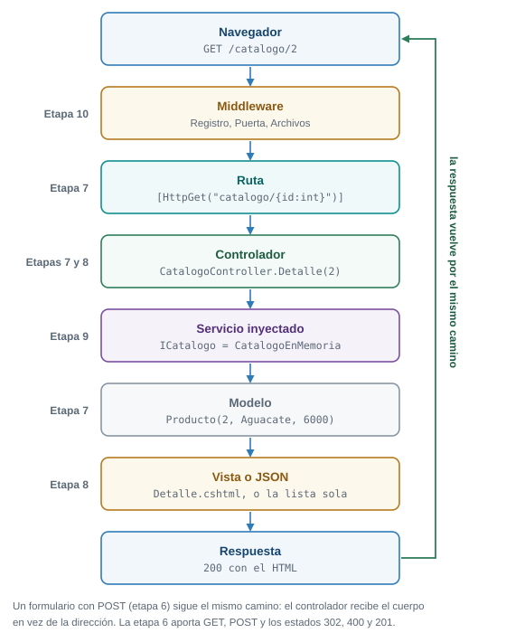{fig-alt="De arriba abajo, el recorrido de GET /catalogo/2. El navegador envía la petición. Los middleware (etapa 10) la reciben: registro, puerta y archivos. La ruta con atributo HttpGet (etapa 7) elige el método. El controlador CatalogoController (etapas 7 y 8) pide el servicio ICatalogo, que el contenedor le inyecta (etapa 9). El servicio entrega el modelo Producto (etapa 7). La vista Detalle.cshtml (etapa 8), o un JSON, arma la respuesta. La respuesta 200 vuelve por los middleware hasta el navegador. Los formularios con POST (etapa 6) siguen el mismo camino."}

El pipeline completo de Plaza, con la etapa en que nació cada pieza.
:::

Cada pieza responde una pregunta distinta:

| Pieza | Pregunta que responde | En la plaza | Etapa |
|---|---|---|---|
| Petición | ¿Qué pide el cliente y cómo? (método, dirección, cuerpo) | El comprador que llega y dice qué quiere | 6 |
| Middleware | ¿Qué le pasa a toda petición antes de la ruta? | Los controles de la entrada: registro y portería | 10 |
| Ruta | ¿Qué método atiende esta dirección? | El pasillo | 7 |
| Controlador | ¿Qué hago con lo que piden? | El vendedor que atiende | 7 y 8 |
| Servicio inyectado | ¿Quién me entrega los datos o hace el trabajo? | La balanza que le dan al puesto | 9 |
| Modelo | ¿Qué forma tiene el dato? | La ficha del producto | 7 |
| Vista o JSON | ¿Cómo se lo muestro al cliente? | El letrero, o la lista en papel | 8 |
| Respuesta | ¿Cómo le fue al servidor? (estado, tipo y cuerpo) | La bolsa con su etiqueta, y la cara del vendedor | 6 |

Un formulario con POST sigue el mismo camino: el controlador recibe el cuerpo en lugar de la dirección, y el POST termina en un `302` que lo manda a un GET. En la guía de rutas armaste la ruta y la respuesta. Aquí sumaste lo que la rodea.

### Lo que queda abierto, y dónde se cierra

| Tema | Dónde quedó en esta guía | Dónde se cierra |
|---|---|---|
| Layout y vistas parciales | Las cuatro vistas repiten su HTML completo | El tema de Razor con layouts y vistas parciales |
| Validaciones con atributos y mensajes en el navegador | La validación es una función `Validar` que escribes tú, más lo que hace `[ApiController]` | El tema de validaciones |
| Base de datos | Los datos viven en la memoria y se pierden al detener el servidor | El tema de bases de datos con Entity Framework Core |
| Autenticación real | La clave de `/admin` va en la dirección y solo muestra el cortocircuito | No está en los temas del curso |

## Errores que te van a pasar

Cada uno de estos tropiezos apareció de verdad al preparar el material. Los errores de la [guía de rutas](index.qmd#errores-que-te-van-a-pasar) siguen valiendo: reiniciar tras cambiar código, el puerto ocupado y las tildes rotas con `curl`.

| Qué ves | Por qué pasa | Cómo se arregla |
|---|---|---|
| `500` al enviar un formulario, y la consola dice `contains anti-forgery metadata` (etapa 6) | Una ruta con `[FromForm]` exige el token antifalsificación y un formulario de `wwwroot` no puede traerlo | La ruta lleva `.DisableAntiforgery()`. La solución de fondo es la etapa 8: Razor agrega el token solo |
| `400 Bad Request` con el cuerpo vacío al enviar un formulario (etapa 6) | El servidor no pudo armar el `NuevoPedido`: un campo no tiene `name` y no viaja, o un valor no encaja con su tipo, como `cantidad=abc` para un `int`. Ni siquiera llegó a tu `Validar` | Revisa que cada campo tenga `name` y que coincida con una propiedad del modelo |
| `415 Unsupported Media Type` al enviar JSON con `curl` (etapa 6) | `curl -d` envía por defecto el formato de un formulario y la ruta espera JSON | Agrega `-H "Content-Type: application/json"` |
| El pedido responde `201` y la lista aparece vacía, o los pedidos de antes ya no están (etapas 6, 7 y 9) | Tres causas: detuviste el servidor, y los datos viven en la memoria; la lista está dentro de un controlador sin `static`, y el framework crea un controlador nuevo en cada petición; el servicio está con `AddScoped`, y cada petición recibe uno nuevo | `static` en la etapa 7 y `AddSingleton` en la etapa 9. El tema de bases de datos con Entity Framework Core guarda los datos en una base de datos |
| `400` al enviar un POST a `/catalogo/pedir` con `curl`, aunque desde el navegador funciona (etapa 8) | `Confirmar` tiene `[ValidateAntiForgeryToken]` y tu `curl` no trae el token ni la cookie | Prueba esa ruta desde el navegador. Con `curl`, pide primero el formulario guardando la cookie (`-c`) y envía el token y la cookie (`-b`) |
| `500` y la consola dice `The view 'Index' was not found` (etapa 8) | MVC no encontró `Views/<Controlador>/<Método>.cshtml` ni `Views/Shared/<Método>.cshtml`: el nombre de la carpeta o del archivo no coincide | Compara los nombres con los dos lugares que lista el mensaje |
| El servidor arranca, pero una petición responde `500` con `Unable to resolve service for type` (etapa 9) | Un controlador pide un servicio que no registraste en `Program.cs`. El error aparece en la primera petición que usa ese controlador, no al arrancar | Agrega la línea de registro que falta, por ejemplo `AddSingleton<IPedidos, PedidosEnMemoria>()` |
| No compila: `error CS0121: La llamada es ambigua` en la línea de `app.Use(` (etapa 10) | Falta `await next(context);` y el compilador no sabe cuál de las dos versiones de `app.Use` quieres | Llama a `await next(context);` en toda ruta de la lambda que no corte la petición |
| La consola no escribe ninguna línea para `/estilos.css` (etapa 10) | `UseStaticFiles` está antes del registro y responde sin llamar a `next`. Las piezas que van después no ven la petición | Pon el registro antes de los archivos estáticos. La pieza que corta decide quién se queda sin ver la petición |
| Editaste una página de `wwwroot` y el navegador muestra la versión anterior | El navegador guardó una copia. En la prueba, `curl` ya mostraba el cambio mientras el navegador seguía con la versión vieja | Recarga sin la copia guardada con `Ctrl+F5`. Para ver lo que entrega el servidor, usa `curl` |

## Qué se probó y qué no

::: {.callout-warning}
## Qué se probó y qué no

Los comandos y las salidas de esta guía se ejecutaron en una máquina con Windows 11 y el SDK `10.0.302`, con `curl` desde Git Bash. Cada etapa se ejecutó con `dotnet run --no-launch-profile --urls http://localhost:5100`, que deja el entorno en `Production`: un error sin controlar responde `500` sin detalle y el motivo solo aparece en la consola. Las seis carpetas de código (`etapa-6` a `etapa-10b`) compilan con 0 advertencias y 0 errores. Se probó cada etapa con `curl`, las fallas provocadas de cada etapa (el token antifalsificación, la lista sin `static`, la vista no encontrada, el servicio sin registrar, el ciclo de vida `AddScoped`, el cambio de implementación, el orden del pipeline y el error de compilación al olvidar `next`) y los retos con sus soluciones. Las páginas de la etapa 6 y el recorrido del catálogo de la etapa 8 se abrieron en un navegador automatizado.

No se probó: PowerShell como terminal (todo se hizo con Git Bash); los navegadores de los estudiantes, Firefox, Safari ni un teléfono con las páginas de las etapas; `dotnet watch` con cambios en controladores y vistas (todas las pruebas fueron con `dotnet run`); una cultura distinta de la del equipo de pruebas, que puede cambiar cómo se escribe un precio; y qué dirección armaría `asp-action` con dos acciones llamadas igual, por eso la acción de envío se llama `Confirmar`. Cuando algo no se probó, la guía lo dice.
:::

## Preguntas para comprobar

Para comprobar lo que aprendiste, responde con tus palabras. Si alguna se te enreda, vuelve a la etapa que se indica.

1. ¿En qué se diferencian GET y POST: dónde viaja el dato y para qué usarías cada uno? (etapa 6)
2. ¿Qué hace el atributo `name` de un campo de formulario y qué pasa si falta? (etapa 6)
3. ¿Qué es Post/Redirect/Get, qué estado usa y qué problema evita? (etapa 6)
4. ¿Cuándo responde una ruta que recibe un pedido `201`, `302`, `400` o `415`? (etapa 6)
5. ¿Qué hacen `AddControllers` y `MapControllers`, y por qué las páginas de `wwwroot` no cambiaron al pasar a controladores? (etapa 7)
6. ¿Por qué la lista de pedidos del controlador de la etapa 7 es `static`, y qué pasa si no lo es? (etapa 7)
7. ¿Qué pieza de MVC es el modelo, cuál el controlador y cuál la vista, y qué hace cada una por un `GET /catalogo/2`? (etapas 7 y 8)
8. ¿Cómo encuentra MVC la vista de `return View(modelo);` y qué error ves si no está? (etapa 8)
9. ¿Qué agrega Razor a un formulario con `asp-action` y qué exige `[ValidateAntiForgeryToken]`? (etapa 8)
10. ¿Qué problema resuelve la inyección de dependencias, y cómo cambias `CatalogoEnMemoria` por otra clase sin tocar un controlador? (etapa 9)
11. ¿En qué se diferencian `AddSingleton`, `AddScoped` y `AddTransient`, y cuál usaste para los pedidos y por qué? (etapa 9)
12. ¿Qué es un middleware, qué significa llamar o no llamar a `next`, y por qué importa el orden? (etapa 10)
13. ¿Por qué `UseDefaultFiles` y `UseStaticFiles` ya eran middleware desde la guía de rutas? (etapa 10)
14. Dibuja de memoria el recorrido de `GET /catalogo/2`: de qué pieza a cuál pasa la petición y por dónde vuelve la respuesta. (el mapa completo)

## Trabajo independiente

Esta es la **parte 2: sobre el mismo proyecto** del trabajo independiente. La parte 1, rutas y respuestas, está en la [guía de rutas](index.qmd#trabajo-independiente). El pacto pide un **servidor del proyecto respondiendo a sus rutas base**: la parte 1 lo empezó y esta parte lo termina. Trabaja sobre el **mismo proyecto**, el servidor de tu tema que ya tiene sus rutas, su JSON y su página. Este trabajo no tiene porcentaje.

1. **Un formulario con POST** que cree un registro de tu tema (un pedido, una reserva, un producto, lo que corresponda a tu proyecto). Una página en `wwwroot` con `method="post"` y una ruta POST que valide. Si el dato está mal, responde `400` con un mensaje. Si está bien, responde `201` (si lo envía `fetch`) o redirige con `302` (si lo envía el formulario).
2. **Tus rutas de datos en controladores,** con sus modelos en `Models/` y `AddControllers` y `MapControllers` en `Program.cs`.
3. **Una vista Razor** que liste los datos de tu tema, con un enlace al detalle de cada uno. Necesita un controlador que herede de `Controller` y `AddControllersWithViews`.
4. **Un servicio con interfaz,** registrado con `AddSingleton` e inyectado en tus controladores. Ningún controlador debe leer la lista de otro.
5. **Un middleware propio, en una clase,** que registre cada petición (método, ruta y estado), agregado con `UseMiddleware`.
6. **Un `README.md` final** con la tabla de tus rutas (ruta, método, quién responde y estado), el orden de tu pipeline y el comando para ejecutar el servidor.

**Entregable:** la carpeta del proyecto con el `README.md`, en tu repositorio y con el historial de Git. **Criterio:** cada ruta de la tabla responde lo que dice la tabla.

## Recursos

- Presentación interactiva: [Abrir la presentación](presentacion-interactiva-mvc.html){.btn-doc target="_blank"}
- Guía de rutas y respuestas, de la que parte esta: [Semana 10. Mi servidor responde](index.qmd)
- MDN, enviar y recibir datos de formularios: [Enviar y recibir datos de formularios](https://developer.mozilla.org/es/docs/Learn_web_development/Extensions/Forms/Sending_and_retrieving_form_data)
- MDN, la etiqueta `form`: [form](https://developer.mozilla.org/es/docs/Web/HTML/Reference/Elements/form)
- MDN, el método GET: [GET](https://developer.mozilla.org/es/docs/Web/HTTP/Reference/Methods/GET)
- MDN, el método POST: [POST](https://developer.mozilla.org/es/docs/Web/HTTP/Reference/Methods/POST)
- MDN, el estado `302`: [302 Found](https://developer.mozilla.org/es/docs/Web/HTTP/Reference/Status/302)
- Microsoft Learn, resumen de MVC: [MVC overview](https://learn.microsoft.com/en-us/aspnet/core/mvc/overview)
- Microsoft Learn, enrutamiento a acciones de controladores: [Routing to controller actions](https://learn.microsoft.com/en-us/aspnet/core/mvc/controllers/routing)
- Microsoft Learn, enlace de modelos: [Model binding](https://learn.microsoft.com/en-us/aspnet/core/mvc/models/model-binding)
- Microsoft Learn, vistas: [Views in ASP.NET Core MVC](https://learn.microsoft.com/en-us/aspnet/core/mvc/views/overview)
- Microsoft Learn, sintaxis de Razor: [Razor syntax](https://learn.microsoft.com/en-us/aspnet/core/mvc/views/razor)
- Microsoft Learn, ayudantes de etiquetas: [Tag helpers](https://learn.microsoft.com/en-us/aspnet/core/mvc/views/tag-helpers/intro)
- Microsoft Learn, protección contra falsificación de peticiones: [Anti-request forgery](https://learn.microsoft.com/en-us/aspnet/core/security/anti-request-forgery)
- Microsoft Learn, inyección de dependencias: [Dependency injection](https://learn.microsoft.com/en-us/aspnet/core/fundamentals/dependency-injection)
- Microsoft Learn, middleware: [Middleware](https://learn.microsoft.com/en-us/aspnet/core/fundamentals/middleware/)
- Microsoft Learn, escribir middleware propio: [Write custom middleware](https://learn.microsoft.com/en-us/aspnet/core/fundamentals/middleware/write)
- Microsoft Learn, mensajes de registro: [Logging](https://learn.microsoft.com/en-us/aspnet/core/fundamentals/logging/)

::: {.pie-doc}
Programación Web (IF2003). Institución Universitaria de Envigado. Facultad de Ingenierías. Semestre 2026-02.

**Transparencia.** La redacción de esta guía contó con el apoyo de inteligencia artificial, usando el modelo Claude Sonnet 5.5 de Anthropic. Todo el contenido fue revisado y validado. Las salidas de terminal son registros reales tomados durante la preparación del material.
:::
