::: {.ficha}
|                 |                                                                                     |
|-----------------|-------------------------------------------------------------------------------------|
| Qué construyes  | Plaza publicada en una dirección pública de internet, con su base de datos PostgreSQL también en la nube, creada paso a paso desde el portal de Azure |
| Prerrequisitos  | Plaza (o tu proyecto) funcionando en local con PostgreSQL y Entity Framework Core, una cuenta de GitHub, una cuenta de **Azure for Students** activa con tu correo institucional y las herramientas que se comprueban en la sección *Antes de empezar* |
| Herramientas    | Un navegador, el portal de Azure (portal.azure.com), una cuenta de GitHub, .NET SDK 10, Git y PowerShell. No se usa Visual Studio: la publicación se hace desde GitHub |
:::

::: {.callout-note}
## Cómo usar esta guía

- Las capturas son del portal de Azure en español. El portal cambia de aspecto con frecuencia: si un botón no está donde lo muestra la imagen, guíate por su **nombre**.
- En las capturas se taparon con gris o azul los datos personales: el correo, el identificador de la suscripción y otros códigos. En tu pantalla sí los verás.
- Cada etapa termina con una sección **Comprueba**. No sigas a la etapa siguiente hasta que se cumpla.
- Los recursos de Azure consumen el crédito de tu suscripción. La última etapa enseña a borrarlos todos de una vez.
:::

## Antes de empezar

### Lo que necesitas instalado y activo

Comprueba cada punto **antes** de la etapa 1. Los comandos se escriben en PowerShell. Si no sabes abrirlo dentro de la carpeta de tu proyecto: en el Explorador de archivos abre la carpeta, haz clic derecho en un espacio vacío y elige **Abrir en Terminal**. También sirve abrir PowerShell desde el menú Inicio y escribir `cd "C:\ruta\a\tu\carpeta"`.

| Qué | Cómo comprobarlo | Qué debes ver |
|---|---|---|
| .NET SDK 10 | `dotnet --version` | Un número que empieza por `10.`, por ejemplo `10.0.302` |
| Git | `git --version` | Una línea como `git version 2.50.0.windows.2` |
| Herramienta de Entity Framework | `dotnet ef --version` | El texto *Entity Framework Core .NET Command-line Tools* y una versión `10.x` |
| Tu proyecto compila | `dotnet build`, dentro de la carpeta de tu proyecto | Termina sin errores |
| Cuenta de GitHub | Entra a [github.com](https://github.com) e inicia sesión | Ves tu página de inicio |
| Cuenta de Azure for Students | Se verifica en la etapa 1 | Estado *Activo* |

Si `dotnet ef --version` dice que el comando no existe o no se reconoce, instala la herramienta. Tiene que ser la versión 10 para que coincida con tu .NET:

```powershell
dotnet tool install --global dotnet-ef --version 10.*
```

Si ya la tenías instalada pero en otra versión, en lugar de `install` usa `update`:

```powershell
dotnet tool update --global dotnet-ef --version 10.*
```

Después **cierra PowerShell y ábrelo de nuevo** y repite `dotnet ef --version`.

### Tu hoja de datos

En esta guía vas a inventar varios nombres y una contraseña, y los vas a necesitar de nuevo en etapas posteriores. Abre un bloc de notas **fuera de la carpeta de tu proyecto** (por ejemplo en el Escritorio) y copia esta tabla. Irás completando la columna *Mi valor* a medida que avances.

| Dato | Qué es | Se define en | Mi valor |
|---|---|---|---|
| Grupo de recursos | La carpeta de Azure donde vive todo | Etapa 2 | `rg-plaza` |
| Nombre del servidor | Nombre de tu servidor PostgreSQL. Debe ser único en todo Azure | Etapa 3 | `plaza-pg-` más algo tuyo |
| Punto de conexión | La dirección del servidor en internet | Etapa 3 | `<nombre del servidor>.postgres.database.azure.com` |
| Usuario administrador | El usuario con el que se entra a la base | Etapa 3 | `plazaadmin` |
| Contraseña del servidor | La que escribes al crear el servidor. Azure no la vuelve a mostrar | Etapa 3 | Solo tú la conoces |
| Base de datos | Donde se guardan las tablas | Etapa 3 | `plaza_campesina` |
| Nombre de la aplicación web | Forma parte de tu dirección pública. Debe ser único en todo Azure | Etapa 4 | `plaza-` más algo tuyo |
| Dirección pública | La URL con la que se abre tu aplicación | Etapa 4 | `https://...azurewebsites.net` |
| Repositorio de GitHub | Dónde está tu código | Etapa 5 | `<tu-usuario>/<tu-repositorio>` |

::: {.callout-important}
## Esa hoja no es para compartir ni para subir

La contraseña y la cadena de conexión que armarás en la etapa 6 son secretos. No los pegues en chats, no los escribas en archivos dentro de tu proyecto y no los subas a GitHub.
:::

### Si trabajas con tu propio proyecto y no con Plaza

La guía usa Plaza como ejemplo. Puedes seguirla con tu proyecto si es ASP.NET Core en .NET 10, usa Entity Framework Core con PostgreSQL (Npgsql), tiene al menos una migración y lee su cadena de conexión con `GetConnectionString`. Cada vez que veas un dato de Plaza, cámbialo por el de tu proyecto:

| En la guía (Plaza) | En tu proyecto |
|---|---|
| Carpeta `Plaza` y archivo `Plaza.csproj` | La carpeta de tu proyecto y su archivo `.csproj` |
| Cadena de conexión llamada `Plaza` | El texto que aparece dentro de `GetConnectionString("...")` en tu `Program.cs` |
| Base de datos `plaza_campesina` | El valor de `Database=` en tu `appsettings.Development.json` |
| Ruta `/catalogo` | Una ruta de tu proyecto que lea datos de la base |
| Archivo `Views/Catalogo/Listar.cshtml` | Cualquier vista tuya |

## Lo que vas a lograr

| Etapa | Qué haces |
|---|---|
| 1 | Entrar al portal de Azure y verificar que tu suscripción de estudiante está activa |
| 2 | Crear el grupo de recursos `rg-plaza`, el contenedor de todo lo que vas a crear |
| 3 | Crear el servidor PostgreSQL gratuito (B1ms) y abrir su firewall para tu equipo y para Azure |
| 4 | Crear la aplicación web (App Service) con el plan gratuito y resolver los errores de cuota y de región |
| 5 | Preparar Plaza en tu equipo y subirla a GitHub |
| 6 | Guardar la cadena de conexión en la aplicación web para que llegue a la base de datos |
| 7 | Aplicar la migración de Plaza para crear las tablas en la base de Azure |
| 8 | Enlazar la aplicación con tu repositorio de GitHub para publicar con cada push |
| 9 | Comprobar que Plaza está publicada y ver un cambio llegar a internet |
| 10 | Borrar todos los recursos de Azure al terminar, y qué hacer con el flujo de trabajo de GitHub |

Al final hay un apéndice para cambiar la contraseña del servidor, un glosario con los términos y una tabla con los problemas más frecuentes y su solución.

## Etapa 1. Entrar al portal y verificar la suscripción

### Qué vas a lograr

Confirmar que tu cuenta de Azure for Students está activa y que eres el propietario de la suscripción. Sin esto no puedes crear recursos.

### Entra al portal

1. Abre [portal.azure.com](https://portal.azure.com) en el navegador.
2. Inicia sesión con tu **correo institucional**. Azure for Students se activa con ese correo, no con uno personal.
3. Llegarás a la página de **Inicio**. Si es tu primera vez, no tienes recursos: la sección *Recursos* aparece vacía.

::: {.callout-note}
## Si todavía no tienes la cuenta de Azure for Students

Actívala en [azure.microsoft.com/free/students](https://azure.microsoft.com/free/students) con tu correo institucional. Si la página no reconoce tu correo o no te deja continuar, avisa a tu docente antes de seguir: sin la suscripción no puedes hacer el resto de la guía.
:::

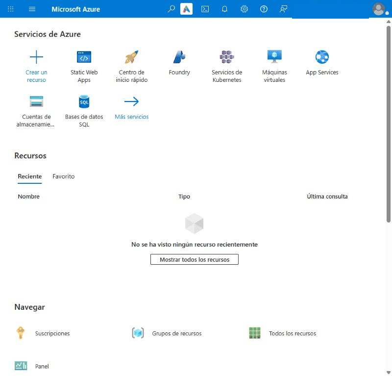{fig-alt="Página de inicio del portal de Azure. Arriba, la lista de servicios de Azure con Crear un recurso, App Services, Bases de datos SQL y otros. En el centro, la sección Recursos vacía con el mensaje No se ha visto ningún recurso recientemente. Abajo, el bloque Navegar con Suscripciones, Grupos de recursos y Todos los recursos."}

### Verifica la suscripción

1. En el bloque **Navegar**, al fondo de la página de inicio, haz clic en **Suscripciones**.
2. Verás una lista con una sola suscripción llamada **Azure for Students**.

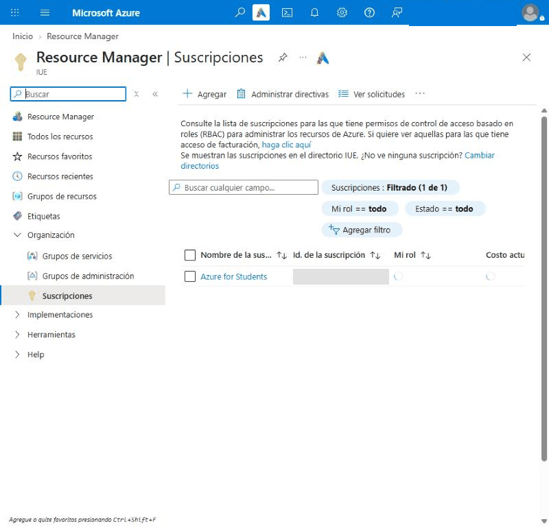{fig-alt="Lista de suscripciones del directorio IUE. Hay una sola fila, Azure for Students. Sus columnas son nombre, identificador, rol y costo actual."}

3. Haz clic en el nombre **Azure for Students** para abrir su detalle.
4. En *Información esencial* revisa tres datos: **Estado** debe decir *Activo*, **Mi rol** debe decir *Propietario* y **Directorio** debe ser el de la institución.

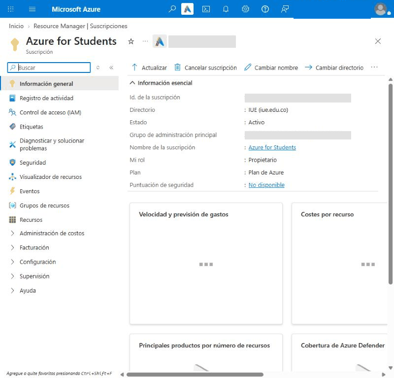{fig-alt="Detalle de la suscripción Azure for Students. En Información esencial aparecen el directorio IUE, el estado Activo, el rol Propietario y el plan Plan de Azure. Debajo, los paneles de velocidad y previsión de gastos y costes por recurso."}

### Comprueba

- El estado de la suscripción es **Activo**.
- Tu rol es **Propietario**.
- Los paneles de costes muestran **0.00**: todavía no has creado nada.

Si el estado no es *Activo* o no ves ninguna suscripción, tu cuenta de estudiante aún no se activó. Revisa el correo de verificación de Azure for Students antes de continuar.

## Etapa 2. Crear el grupo de recursos

### Qué vas a lograr

Un **grupo de recursos** llamado `rg-plaza`.

### Qué es un grupo de recursos

Es un contenedor lógico. Todo lo que crees para Plaza (la base de datos, la aplicación web) va dentro del mismo grupo. Esto sirve para algo muy práctico: al terminar la clase borras el grupo y desaparece todo lo que contiene, sin dejar recursos olvidados que sigan gastando tu crédito.

### Los pasos

1. En la página de **Inicio**, en el bloque *Navegar*, haz clic en **Grupos de recursos**.
2. La lista está vacía. Haz clic en **Crear**.

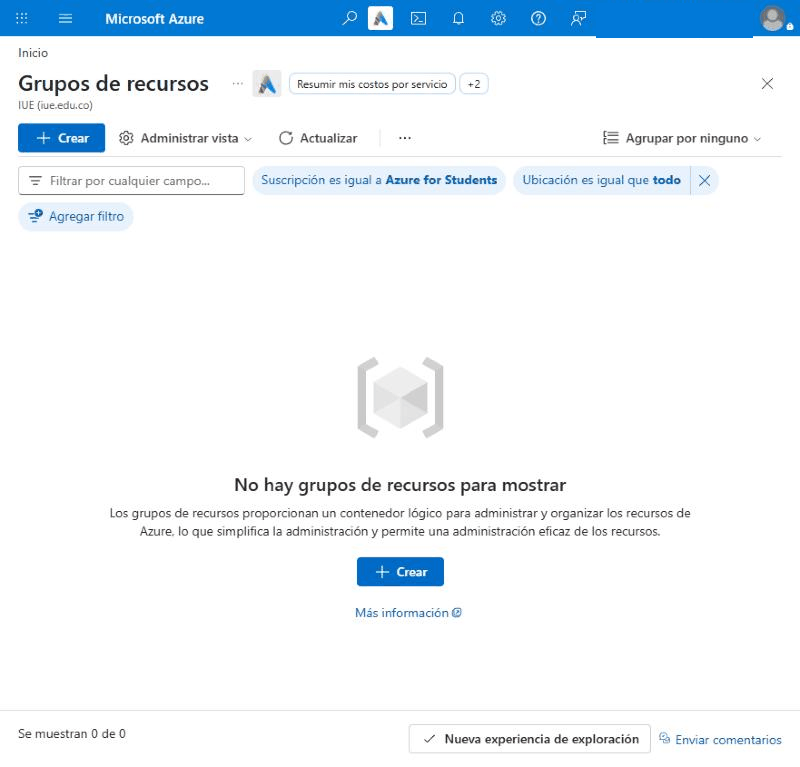{fig-alt="Página Grupos de recursos con el mensaje No hay grupos de recursos para mostrar. Arriba a la izquierda, el botón azul Crear, y otro botón Crear en el centro de la página."}

3. Se abre el formulario **Crear un grupo de recursos**, en la pestaña *Datos básicos*. Tiene tres campos:
   - **Suscripción**: ya viene con *Azure for Students*.
   - **Nombre del grupo de recursos**: está vacío.
   - **Región**: viene con *(US) East US*.

{fig-alt="Formulario Crear un grupo de recursos en la pestaña Datos básicos. La suscripción es Azure for Students, el nombre del grupo está vacío y la región es (US) East US. Abajo, los botones Anterior, Siguiente y Revisar y crear."}

4. Escribe `rg-plaza` en **Nombre del grupo de recursos**. El prefijo `rg-` es una convención: indica que el recurso es un *resource group*.
5. Deja la **Región** en *(US) East US*. Si abres la lista, verás todas las regiones disponibles.

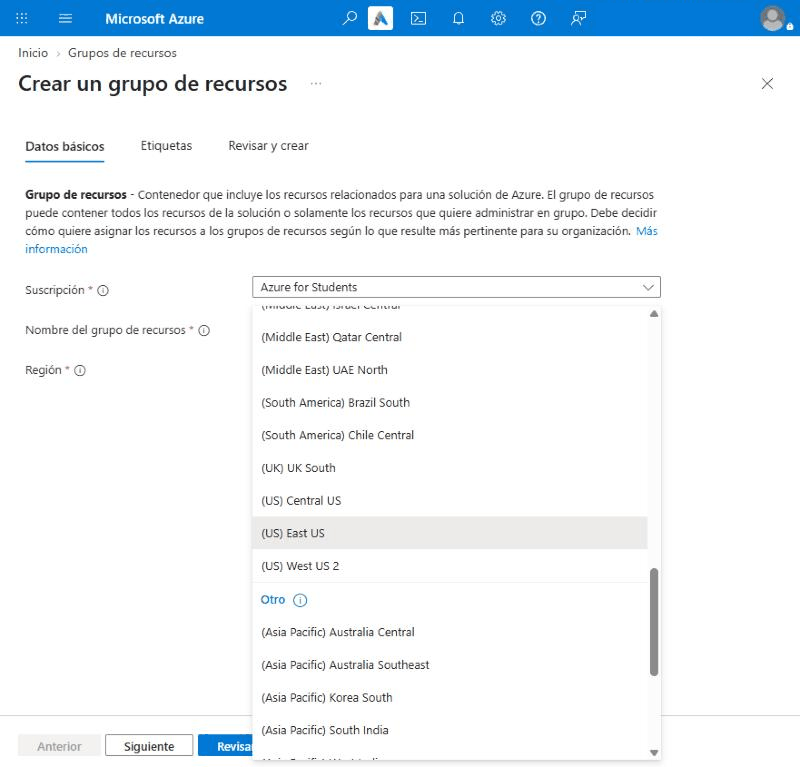{fig-alt="Lista desplegable de regiones abierta. Se ven entre otras Brazil South, Chile Central, UK South, Central US, East US y West US 2. East US aparece resaltada."}

::: {.callout-tip}
## La región del grupo no ata a sus recursos

La región del grupo solo indica dónde se guardan los metadatos del propio grupo. Los recursos que pongas dentro pueden estar en otra región. Más adelante, al crear la base de datos y la aplicación, elegirás la región según lo que tu suscripción de estudiante permita.
:::

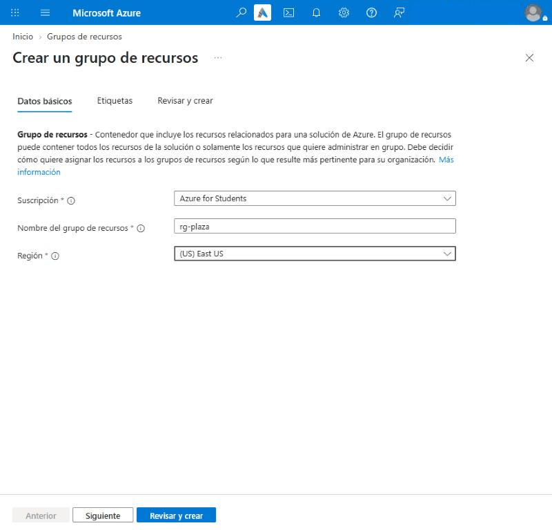{fig-alt="Formulario con el nombre rg-plaza escrito y la región (US) East US seleccionada."}

6. Haz clic en **Revisar y crear**. Azure valida los datos y te muestra un resumen: suscripción, nombre, región y etiquetas (ninguna).

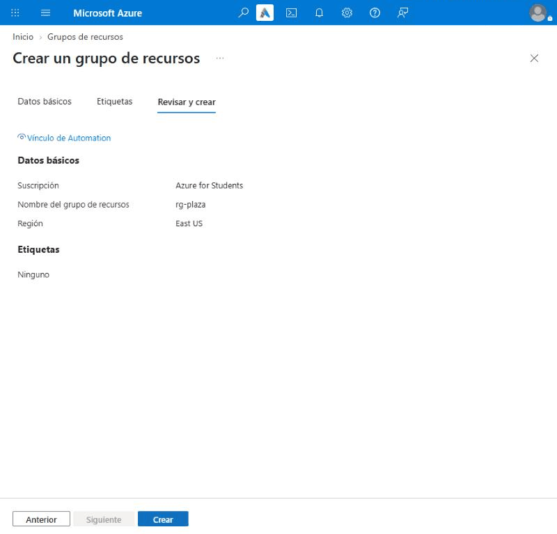{fig-alt="Pestaña Revisar y crear. Resume los datos básicos: suscripción Azure for Students, nombre rg-plaza y región East US. Etiquetas: ninguno. Abajo, el botón azul Crear."}

7. Haz clic en **Crear**.
8. Después de unos instantes, aparece una notificación verde: **Grupo de recursos creado**. La lista de grupos ya muestra `rg-plaza`.

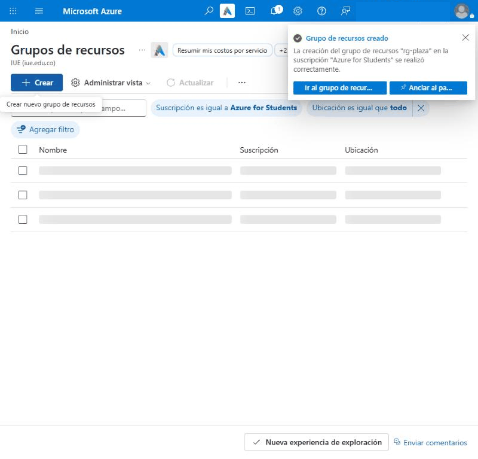{fig-alt="Página Grupos de recursos con una notificación verde arriba a la derecha que dice Grupo de recursos creado: la creación de rg-plaza en la suscripción Azure for Students se realizó correctamente. Tiene los botones Ir al grupo de recursos y Anclar al panel."}

### Comprueba

- Recibiste la notificación **Grupo de recursos creado**.
- En **Grupos de recursos** aparece `rg-plaza` con la suscripción *Azure for Students*.
- Sigues con costo **0.00**: un grupo de recursos vacío no cuesta nada.

## Etapa 3. Crear el servidor PostgreSQL

### Qué vas a lograr

Un servidor **Azure Database for PostgreSQL, servidor flexible**, dentro de `rg-plaza`. Es la base de datos que usará Plaza cuando esté publicada.

### Por qué hace falta

En tu equipo, Plaza se conecta a un PostgreSQL local (`localhost`). Cuando la aplicación viva en internet, ese `localhost` no existe: la aplicación necesita una base de datos que también esté en la nube. Azure la ofrece administrada: tú no instalas ni actualizas nada, solo la configuras.

### Abre el formulario de creación

1. Haz clic en el buscador de la parte superior del portal (el icono de la lupa), escribe `PostgreSQL` y, en la sección **Servicios** de los resultados, elige **Servidores flexibles de Azure Database for PostgreSQL**. Ignora los resultados de *Microsoft Entra ID* y de *Marketplace*.

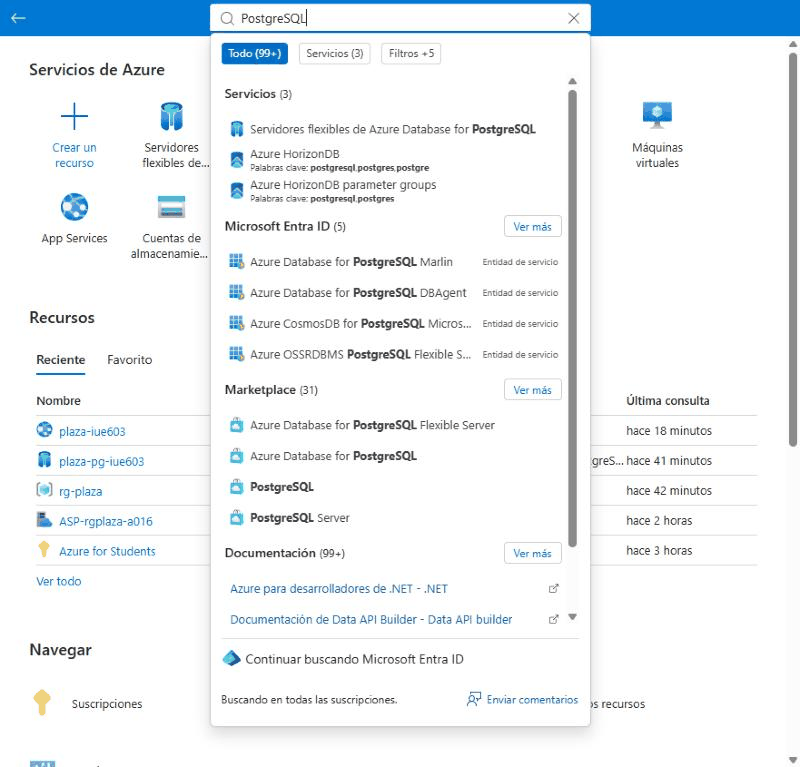{fig-alt="Cuadro de búsqueda del portal con la palabra PostgreSQL escrita. En la sección Servicios, el primer resultado es Servidores flexibles de Azure Database for PostgreSQL. Debajo hay otros resultados de Microsoft Entra ID, Marketplace y documentación."}

2. Se abre la lista de tus servidores PostgreSQL. Haz clic en **+ Crear**, el botón azul de arriba a la izquierda. En la captura ya aparece el servidor de este ejemplo; en tu pantalla la lista estará vacía.

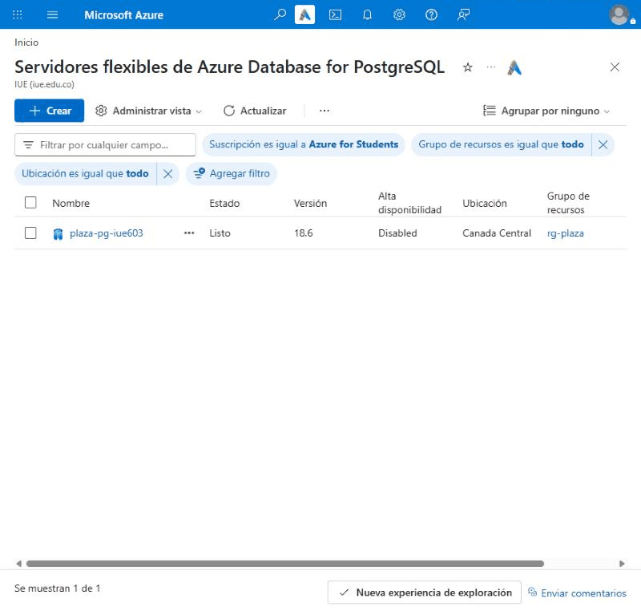{fig-alt="Página Servidores flexibles de Azure Database for PostgreSQL con el botón azul Crear arriba a la izquierda. La tabla muestra un servidor de ejemplo, plaza-pg-iue603, en estado Listo, versión 18.6, en Canada Central y en el grupo rg-plaza."}

3. Se abre el formulario de creación, con cinco pestañas: *Básico*, *Redes*, *Seguridad*, *Etiquetas* y *Revisar y crear*.

### Pestaña Básico: proyecto y servidor

1. **Suscripción**: *Azure for Students*, ya viene elegida.
2. **Grupo de recursos**: abre la lista y elige `rg-plaza`, el que creaste en la etapa anterior.
3. **Nombre del servidor**: debe ser único en todo Azure, porque pasa a formar parte de una dirección pública (`<nombre>.postgres.database.azure.com`). Usa `plaza-pg-` seguido de algo propio, por ejemplo tus iniciales o tu grupo. Solo admite letras minúsculas, números y guiones. Cuando el nombre sirve, el formulario marca tres checks verdes.

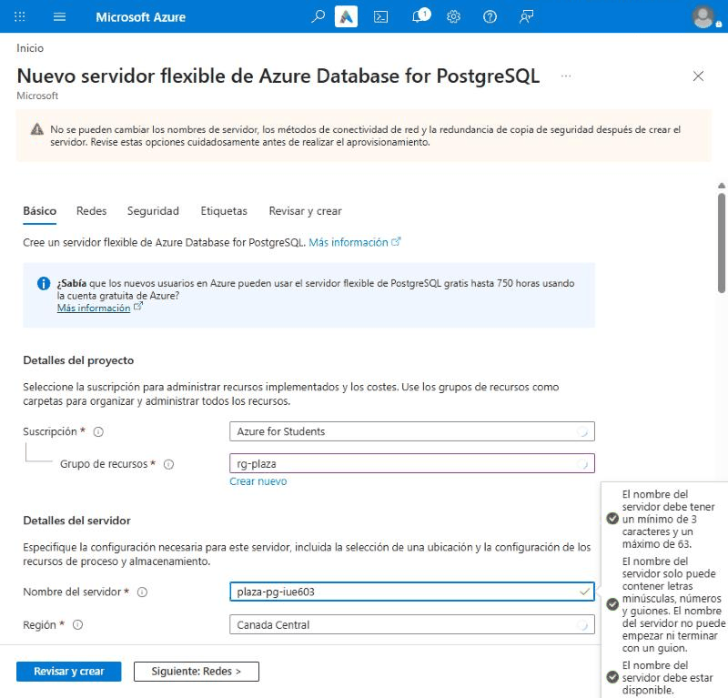{fig-alt="Parte superior del formulario del servidor PostgreSQL. La suscripción es Azure for Students, el grupo de recursos es rg-plaza y el nombre del servidor es plaza-pg-iue603. A la derecha, tres reglas del nombre con un check verde cada una, incluida la de que el nombre debe estar disponible."}

4. **Región**: deja la que trae el formulario (*Canada Central* en la cuenta de este ejemplo). Las suscripciones de estudiante solo permiten algunas regiones y la que el formulario propone suele ser una de ellas. Si al crear Azure rechaza la región, elige otra de la lista.
5. **Versión de PostgreSQL**: *18*, la misma que usas en local.

::: {.callout-warning}
## Los valores por defecto gastan crédito

El formulario propone **Producción** con un servidor de 4 núcleos (*D4ads_v5*). Ese tamaño consume tu crédito de estudiante en pocos días. Para Plaza elige **Desarrollo/pruebas** y el tamaño más pequeño, como se explica a continuación.
:::

6. En **Tipo de carga de trabajo** elige **Desarrollo/pruebas**. El formulario cambia el proceso a *B2s*, con dos núcleos. Todavía no es el nivel gratuito.

{fig-alt="Formulario con el tipo de carga de trabajo Desarrollo/pruebas seleccionado. En Proceso y almacenamiento aparece Con capacidad de ráfaga, B2s, 2 núcleos virtuales, 4 GiB de RAM y 32 GiB de almacenamiento."}

7. En **Proceso y almacenamiento** haz clic en **Configurar servidor**. Se abre un panel lateral.
8. Abre la lista **Tamaño de proceso** y elige **Standard_B1ms** (1 núcleo virtual, 2 GiB de memoria).

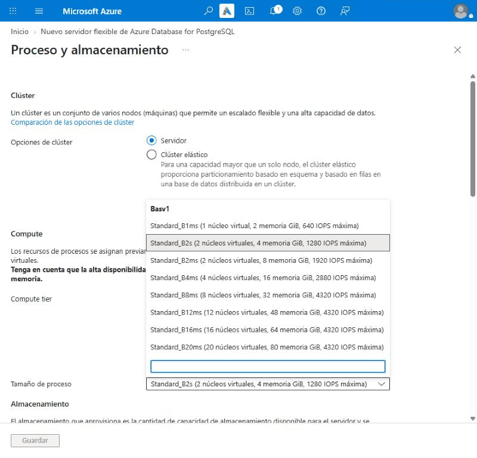{fig-alt="Panel Proceso y almacenamiento con la lista Tamaño de proceso abierta. La primera opción es Standard_B1ms con 1 núcleo virtual y 2 GiB de memoria; después Standard_B2s, B2ms, B4ms y tamaños mayores."}

9. Baja por el panel. El almacenamiento debe quedar en **32 GiB**, con *Crecimiento automático* sin marcar, copia de seguridad de **7** días y *Redundancia geográfica* sin marcar.

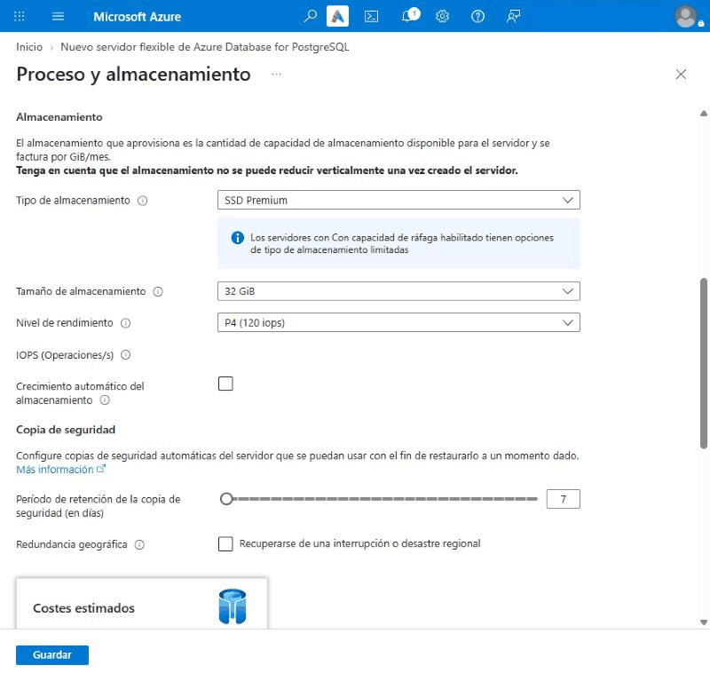{fig-alt="Sección Almacenamiento del panel. Tipo SSD Premium, tamaño 32 GiB, nivel de rendimiento P4 de 120 IOPS, crecimiento automático sin marcar, retención de la copia de seguridad de 7 días y redundancia geográfica sin marcar."}

10. Baja hasta el cuadro **Costes estimados**. Debe decir **Liberar hasta 750 horas** para *Standard_B1ms* y **Liberar hasta 32 GB** para el almacenamiento. Esa es la confirmación de que el servidor entra en la capa gratuita para estudiantes y cuentas nuevas.

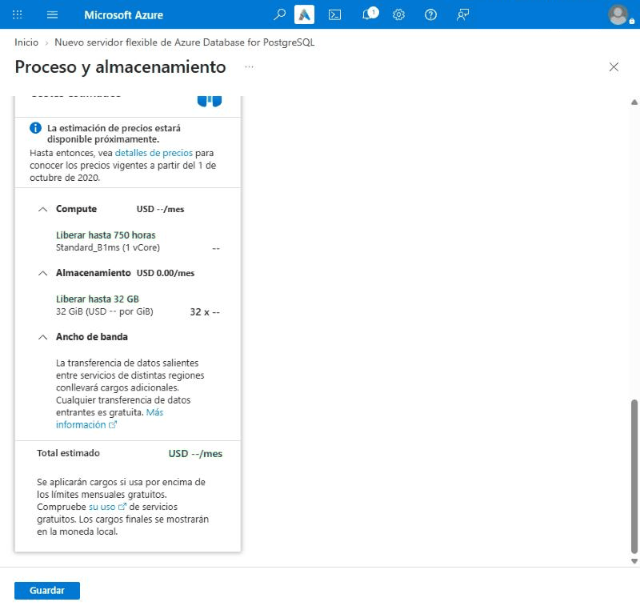{fig-alt="Cuadro Costes estimados. En Compute dice Liberar hasta 750 horas con Standard_B1ms de 1 vCore. En Almacenamiento dice Liberar hasta 32 GB y USD 0.00 por mes."}

11. Haz clic en **Guardar**. Regresas al formulario y *Proceso y almacenamiento* ahora dice **B1ms, 1 núcleo, 2 GiB de RAM, 32 GiB**.

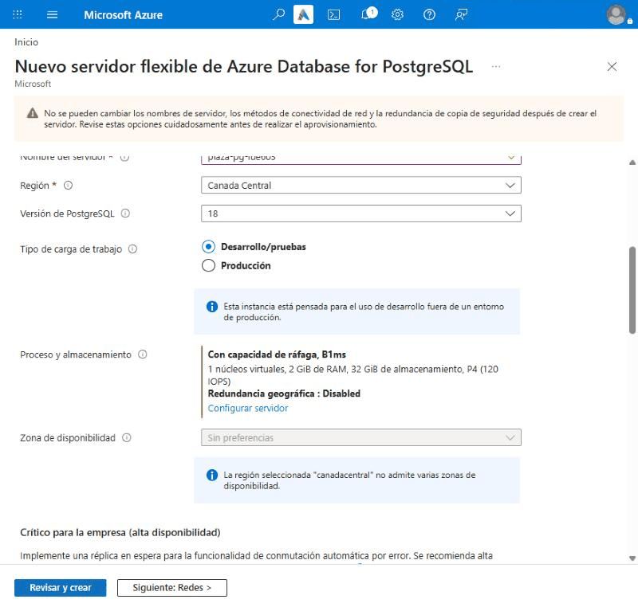{fig-alt="Formulario con Desarrollo/pruebas seleccionado y, en Proceso y almacenamiento, Con capacidad de ráfaga B1ms, 1 núcleo virtual, 2 GiB de RAM y 32 GiB de almacenamiento."}

### Pestaña Básico: autenticación

El formulario propone *PostgreSQL y autenticación de Microsoft Entra*, que obliga a designar un administrador de Entra. Para esta guía usamos solo usuario y contraseña.

1. En **Método de autenticación** elige **Autenticación de PostgreSQL**.
2. **Inicio de sesión del administrador**: escribe `plazaadmin`. Es el usuario con el que se conectará `dotnet ef` y la aplicación.
3. **Contraseña** y **Confirmar contraseña**: escribe la misma contraseña en los dos campos.

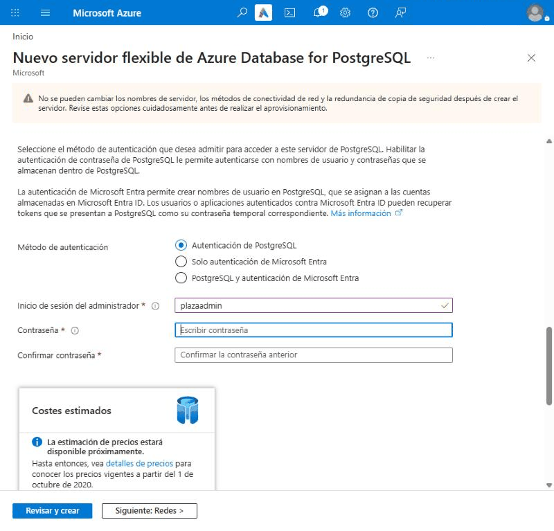{fig-alt="Sección de autenticación con el método Autenticación de PostgreSQL seleccionado. El inicio de sesión del administrador es plazaadmin y los campos de contraseña están vacíos."}

La contraseña debe tener entre 8 y 128 caracteres y combinar al menos tres de estas cuatro categorías: mayúsculas, minúsculas, números y símbolos. Si no cumple, el formulario lo marca en rojo y no te deja crear el servidor.

Además, para evitar problemas en las etapas 6 y 7, **no uses estos caracteres en la contraseña**: punto y coma `;`, comillas `"` o `'`, signo de dólar `$`, acento grave `` ` ``, signo igual `=` ni espacios. Tienen un significado especial dentro de la cadena de conexión o en PowerShell y la romperían. Usa letras, números y símbolos como `-`, `_`, `.`, `!` o `#`.

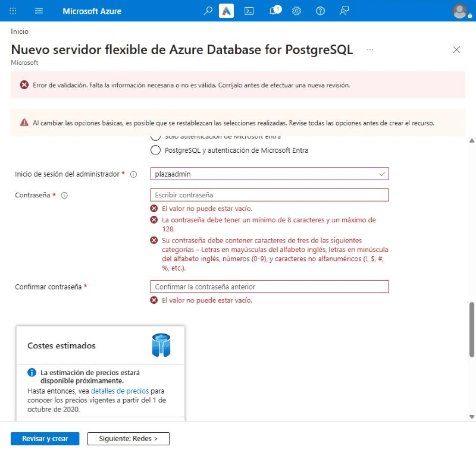{fig-alt="Campos de contraseña vacíos con tres errores en rojo: el valor no puede estar vacío, la contraseña debe tener un mínimo de 8 caracteres y un máximo de 128, y debe contener caracteres de tres de las cuatro categorías de mayúsculas, minúsculas, números y símbolos."}

::: {.callout-important}
## Guarda esta contraseña

Azure no la vuelve a mostrar. **Cópiala ahora en tu hoja de datos** (el bloc de notas que está fuera de tu proyecto). La necesitarás en la cadena de conexión de la aplicación y para aplicar la migración desde tu equipo. En esta guía aparece como `<tu-contraseña>`: nunca la escribas en el repositorio ni en un archivo que subas a GitHub. Si la pierdes, no pasa nada grave: se puede cambiar (apéndice al final de la guía).
:::

### Pestaña Redes

1. En **Método de conectividad** deja **Acceso público (direcciones IP permitidas) y puntos de conexión privados**, que es el valor por defecto. Mantén marcada la casilla de permitir el acceso público.

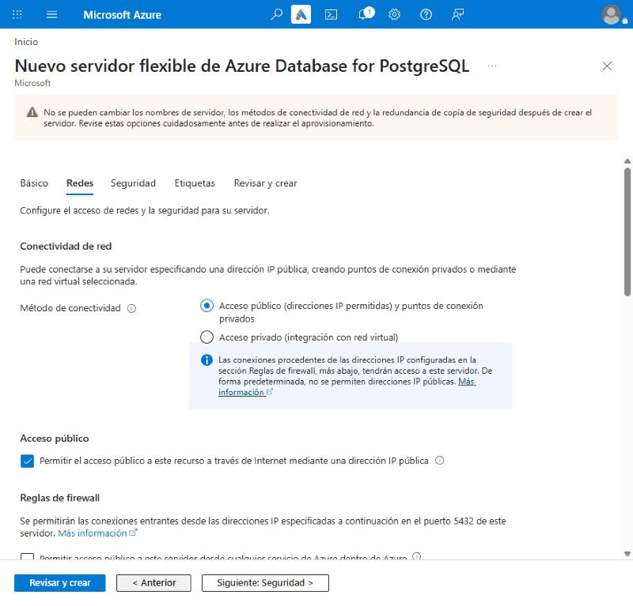{fig-alt="Pestaña Redes. Método de conectividad con Acceso público y puntos de conexión privados seleccionado. Más abajo, la casilla Permitir el acceso público a este recurso a través de Internet mediante una dirección IP pública marcada, y el título Reglas de firewall."}

2. Baja hasta **Reglas de firewall**. Por defecto nadie puede entrar al servidor: hay que abrir dos puertas.
   - Marca **Permitir acceso público a este servidor desde cualquier servicio de Azure dentro de Azure**. Es la puerta por la que entrará tu aplicación publicada.
   - Haz clic en **Agregar dirección IP del cliente actual**. Azure agrega una regla con la IP pública de tu equipo. Es la puerta por la que entrarás tú para aplicar la migración.

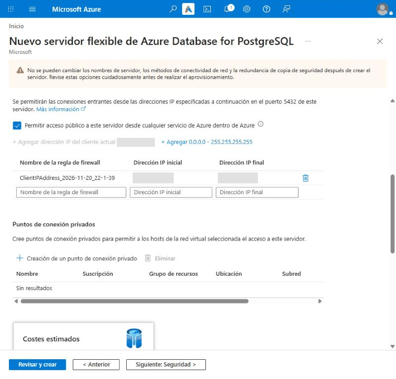{fig-alt="Reglas de firewall con la casilla Permitir acceso público desde cualquier servicio de Azure marcada. Debajo, una regla ClientIPAddress con la fecha de creación y la dirección IP del equipo, tapada en la captura."}

::: {.callout-warning}
## No uses el rango completo

Al lado de *Agregar dirección IP del cliente actual* hay otro enlace, **Agregar 0.0.0.0 - 255.255.255.255**. No lo uses: abre la base de datos a todo internet.
:::

::: {.callout-note}
## Si cambias de red, cambia tu IP

Tu IP pública cambia si te conectas desde otra red, por ejemplo la de la universidad o la de tu casa. Si más adelante `dotnet ef` no logra conectar, vuelve a esta regla en el servidor y agrega la IP nueva.
:::

### Pestaña Seguridad

No cambies nada. La *Clave de cifrado de datos* queda como **Clave administrada por el servicio**.

### Revisar y crear

1. Haz clic en **Revisar y crear**. Azure valida todos los datos. Si algo falla, la pestaña con el problema aparece marcada en rojo.
2. Revisa el resumen: grupo `rg-plaza`, tu nombre de servidor, usuario `plazaadmin`, versión 18, **B1ms** y almacenamiento de 32 GiB.

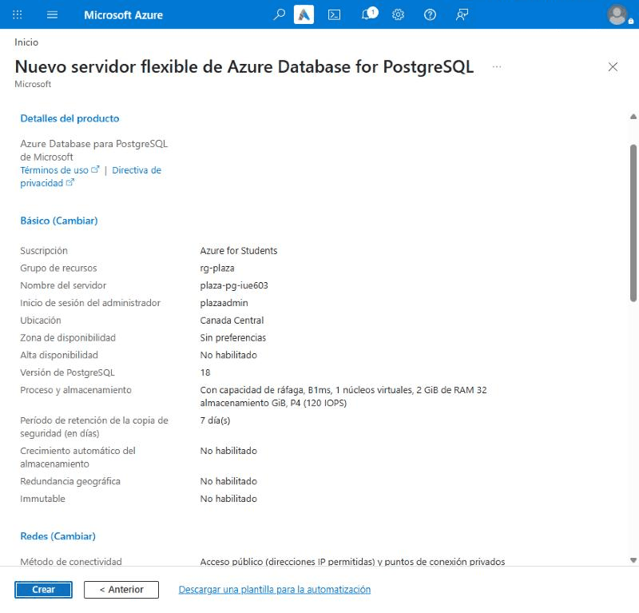{fig-alt="Pestaña Revisar y crear con el resumen: suscripción Azure for Students, grupo de recursos rg-plaza, servidor plaza-pg-iue603, usuario plazaadmin, ubicación Canada Central, PostgreSQL 18, B1ms de 1 núcleo y 2 GiB, copia de seguridad de 7 días, crecimiento automático y redundancia geográfica no habilitados."}

3. Haz clic en **Crear**.
4. El portal abre la página de la implementación con el mensaje **La implementación está en curso**. Espera: el servidor tarda en aprovisionarse. No cierres la pestaña.

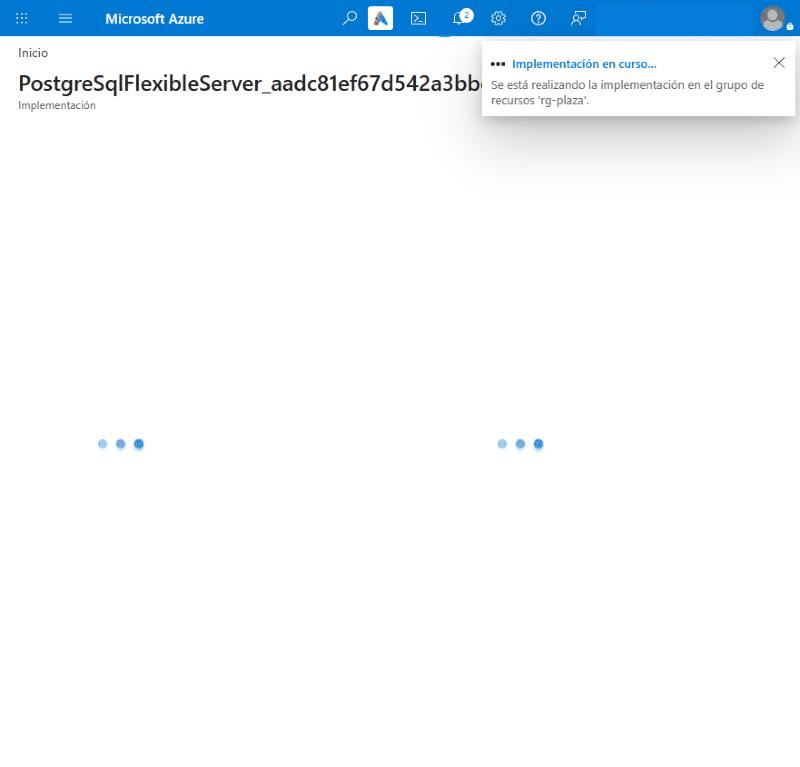{fig-alt="Página de implementación del servidor PostgreSQL con una notificación que dice Implementación en curso: se está realizando la implementación en el grupo de recursos rg-plaza."}

5. La página no siempre se actualiza sola. Haz clic en **Actualizar** de vez en cuando. Cuando termine, el estado cambia a **Se completó la implementación**.

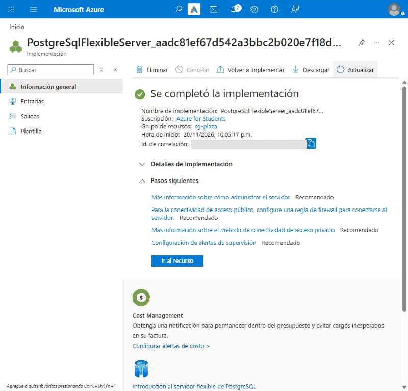{fig-alt="Página de la implementación con un check verde y el mensaje Se completó la implementación. Debajo, el bloque Pasos siguientes y el botón azul Ir al recurso."}

### Revisa el servidor

1. Haz clic en **Ir al recurso**. Se abre la página del servidor.
2. En *Información esencial* comprueba que **Estado** dice **Ready**, que el servidor está en tu grupo `rg-plaza` y que el **Inicio de sesión del administrador** es `plazaadmin`.
3. Fíjate en el **Punto de conexión**. Es la dirección de tu servidor en internet y siempre tiene la forma `<nombre-del-servidor>.postgres.database.azure.com`; por ejemplo, si tu servidor se llama `plaza-pg-abc`, su punto de conexión es `plaza-pg-abc.postgres.database.azure.com`. En la pantalla se ve **cortado** con puntos suspensivos. Para copiarlo completo, pasa el cursor sobre el valor: a la derecha aparece un **icono de copiar** (dos hojas). Haz clic en él y pega el valor en tu hoja de datos.

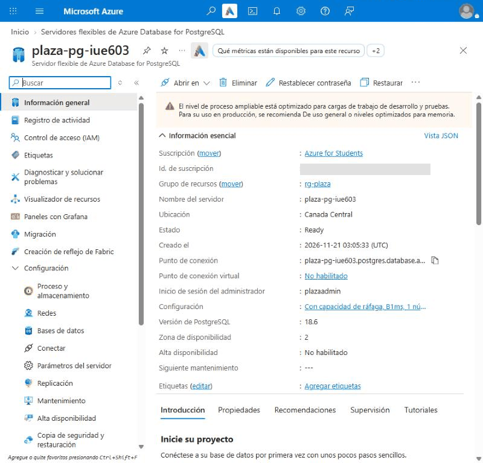{fig-alt="Página del servidor flexible plaza-pg-iue603. Estado Ready, ubicación Canada Central, nombre del servidor plaza-pg-iue603, punto de conexión plaza-pg-iue603.postgres.database.a seguido de puntos suspensivos y, a su derecha, el icono de copiar. Más abajo, el inicio de sesión del administrador plazaadmin, la configuración B1ms y la versión de PostgreSQL 18.6."}

Esta misma pantalla te sirve para consultar después tres datos de tu hoja: el **nombre del servidor**, el **punto de conexión** y el **inicio de sesión del administrador**. La contraseña es la única que Azure no muestra.

El aviso naranja de arriba dice que el nivel de proceso ampliable es para desarrollo y pruebas. Es correcto: Plaza es un proyecto de clase, no una aplicación con usuarios reales.

### Crea la base de datos

El servidor ya existe, pero está vacío: solo trae bases de datos del sistema y una llamada `postgres`. Plaza necesita la suya.

1. En el menú de la izquierda abre la sección **Configuración** y haz clic en **Bases de datos**.

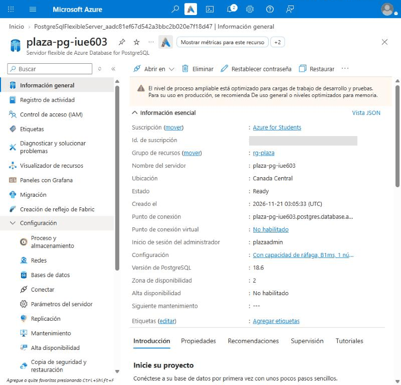{fig-alt="Menú lateral del servidor con la sección Configuración desplegada. Sus opciones son Proceso y almacenamiento, Redes, Bases de datos, Conectar, Parámetros del servidor, Replicación y Mantenimiento."}

2. La lista muestra tres bases: `azure_maintenance` y `azure_sys`, que son del sistema y no se pueden borrar, y `postgres`.

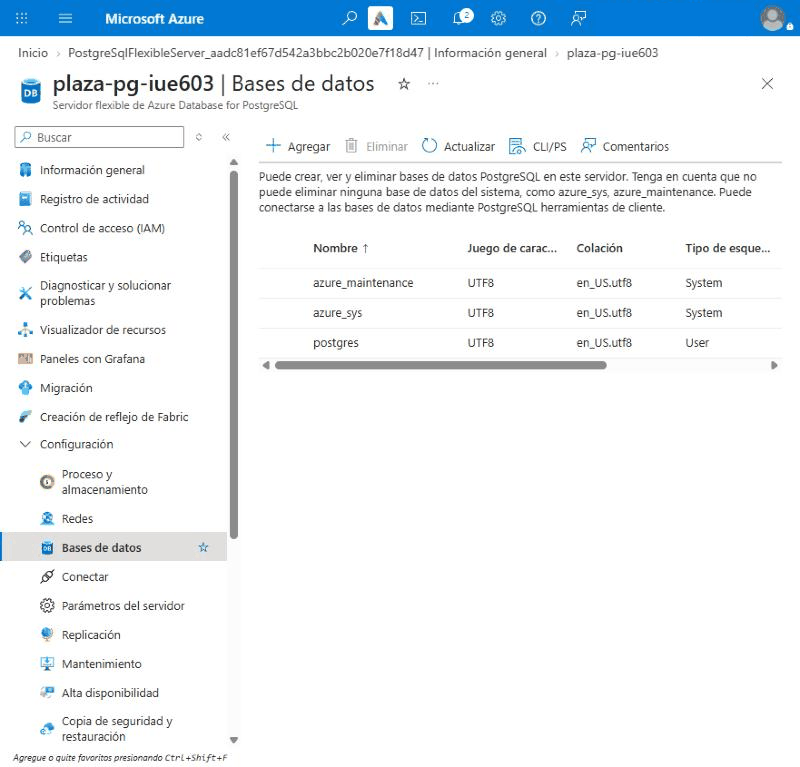{fig-alt="Página Bases de datos del servidor con una tabla de tres filas: azure_maintenance y azure_sys de tipo System, y postgres de tipo User. Arriba, los botones Agregar, Eliminar y Actualizar."}

3. Haz clic en **Agregar**. Se abre el panel **Crear base de datos**.
4. En **Nombre** escribe `plaza_campesina`. Es el mismo nombre que Plaza usa en tu equipo, en `appsettings.Development.json`, así que la cadena de conexión de la nube solo cambia el servidor y las credenciales. Deja el juego de caracteres y la colación como vienen (*UTF8* y *en_US.utf8*).

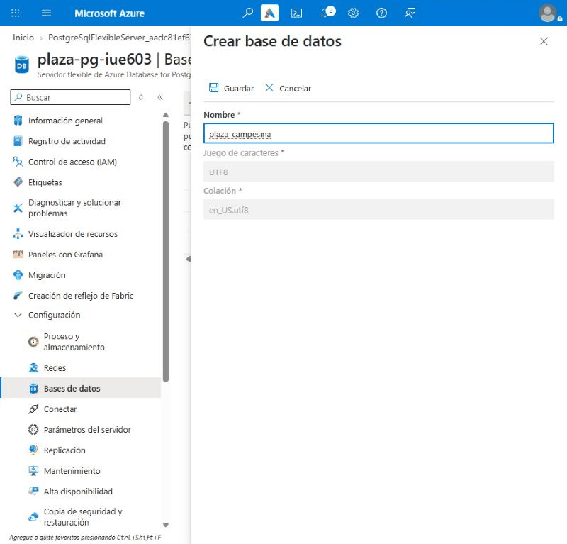{fig-alt="Panel Crear base de datos con el nombre plaza_campesina escrito. El juego de caracteres es UTF8 y la colación es en_US.utf8, ambos bloqueados. Arriba, los botones Guardar y Cancelar."}

5. Haz clic en **Guardar**. Aparece una notificación verde: **Se creó correctamente PostgreSQL base de datos**.
6. Si la lista no cambia, haz clic en **Actualizar**. Ahora aparece `plaza_campesina` con tipo *User*.

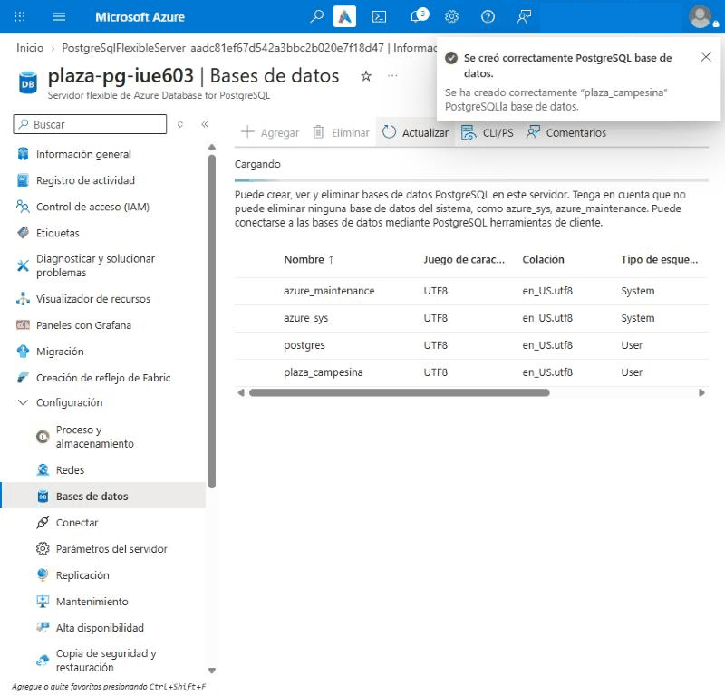{fig-alt="Página Bases de datos con una notificación verde que dice Se creó correctamente PostgreSQL base de datos, se ha creado correctamente plaza_campesina. La tabla ahora tiene cuatro filas, y la nueva es plaza_campesina de tipo User."}

### Comprueba

- El servidor está en estado **Ready**.
- La lista de bases de datos incluye `plaza_campesina`.
- Tu **hoja de datos** tiene completos estos cinco datos: nombre del servidor, punto de conexión, usuario `plazaadmin`, base de datos `plaza_campesina` y tu contraseña. Sin ellos no puedes hacer la etapa 6.
- El grupo `rg-plaza` ya contiene un recurso. Si abres el grupo, lo verás en la lista.

Con esto la base de datos está lista, pero todavía está vacía: no tiene las tablas de Plaza. Esas se crean en la etapa de migraciones.

## Etapa 4. Crear la aplicación web

### Qué vas a lograr

Una **aplicación web de App Service** dentro de `rg-plaza`, con el runtime de .NET 10 y el plan gratuito. Al terminar tendrá una dirección pública que responde con la página de bienvenida de Azure. Todavía no contiene Plaza: eso llega en las etapas siguientes.

### Qué es App Service

App Service es el servicio de Azure que ejecuta tu aplicación web: recibe las peticiones de internet, arranca tu programa ASP.NET Core y devuelve las respuestas. Tú no administras el servidor ni el sistema operativo. Cada aplicación web vive dentro de un **plan de App Service**, que es el que define cuánta máquina te toca y cuánto cuesta.

### Abre el formulario de creación

1. En la página de **Inicio** del portal haz clic en **Crear un recurso**, escribe `Aplicación web` (en inglés, *Web App*) en el buscador de esa pantalla y elige **Aplicación web** de Microsoft. Otra forma: en **Inicio**, abre **App Services** (o búscalo con la lupa), haz clic en **Crear** y elige **Aplicación web**. Los nombres de los menús pueden variar un poco; lo que buscas es el formulario titulado **Crear aplicación web**.
2. Se abre ese formulario, con siete pestañas: *Datos básicos*, *Base de datos*, *Implementación*, *Redes*, *Supervisión y protección*, *Etiquetas* y *Revisar y crear*.

### Pestaña Datos básicos

1. **Suscripción**: *Azure for Students*.
2. **Grupo de recursos**: abre la lista y elige `rg-plaza`.
3. **Nombre**: es único en todo Azure y forma tu dirección pública. Usa `plaza-` seguido de algo propio, por ejemplo `plaza-iue603`. Solo admite letras, números y guiones.

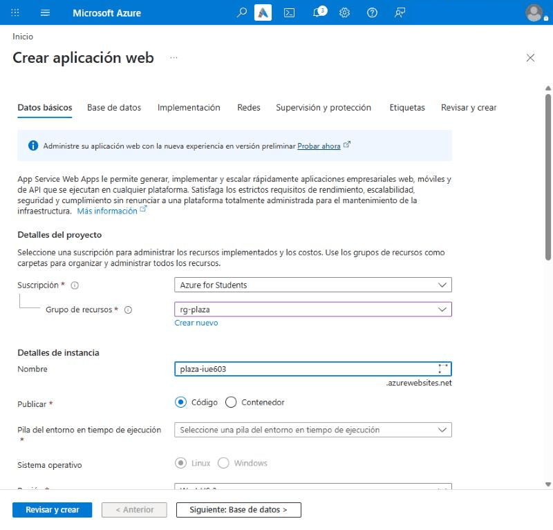{fig-alt="Formulario Crear aplicación web en la pestaña Datos básicos. La suscripción es Azure for Students, el grupo de recursos es rg-plaza y el nombre es plaza-iue603 con el sufijo .azurewebsites.net. Publicar está en Código."}

4. **Publicar**: deja **Código**. La otra opción, *Contenedor*, es para aplicaciones empaquetadas con Docker.
5. **Pila del entorno en tiempo de ejecución**: abre la lista y elige **.NET 10 (LTS)**, la misma versión con la que construiste Plaza. Si eliges otra, la aplicación no arranca.

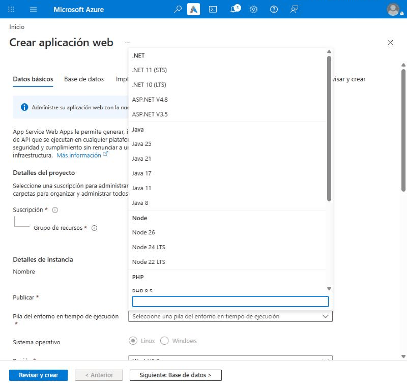{fig-alt="Lista desplegable de la pila de tiempo de ejecución abierta. En la sección .NET aparecen .NET 11 (STS), .NET 10 (LTS), ASP.NET V4.8 y ASP.NET V3.5. Más abajo hay opciones de Java, Node y PHP."}

6. **Sistema operativo**: **Linux**, que es lo que propone el formulario.

### Región y plan: los valores por defecto cuestan dinero

Baja por el formulario hasta **Planes de precios**. Aquí hay dos cosas que revisar.

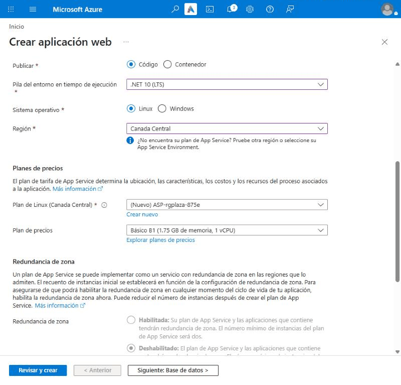{fig-alt="Formulario con la pila .NET 10 LTS, el sistema operativo Linux y la región Canada Central. En Planes de precios aparece un plan de Linux nuevo y el plan de precios Básico B1 con 1.75 GB de memoria y 1 vCPU."}

El plan que propone el formulario es **Básico B1**, que cuesta alrededor de 13 a 15 USD al mes y sale de tu crédito. Para esta guía elige el plan gratuito:

1. Abre la lista **Plan de precios**.
2. Elige **Gratis F1 (1 GB de memoria)**. En la lista dice *0.00 USD/mes*.

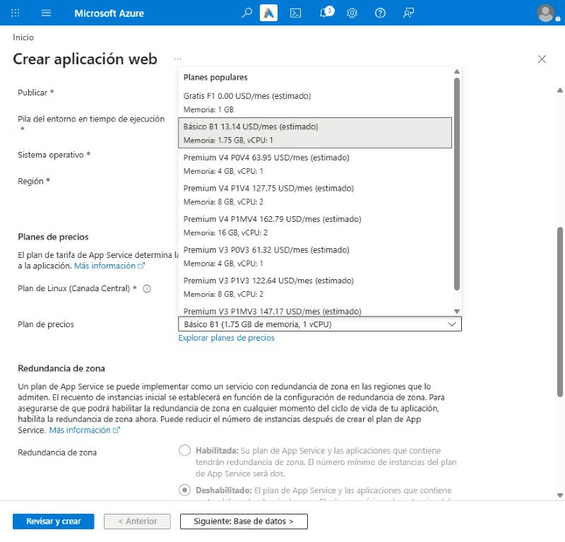{fig-alt="Lista de planes de precios. Gratis F1 con 0.00 USD al mes y 1 GB de memoria, Básico B1 con 13.14 USD al mes, y varios planes Premium con precios entre 61 y 162 USD al mes."}

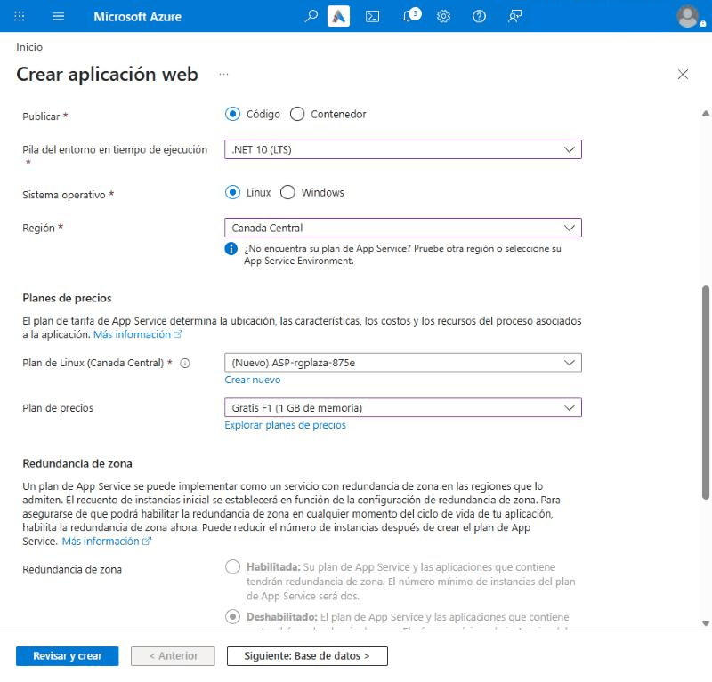{fig-alt="Formulario con el plan de precios Gratis F1 de 1 GB de memoria ya seleccionado."}

::: {.callout-note}
## Qué te da el plan gratuito, y qué no

F1 es suficiente para una aplicación de clase, pero tiene límites: comparte la máquina con otras aplicaciones, tiene una cuota diaria de tiempo de CPU, no tiene *Always On* (la aplicación se duerme si nadie la visita y la primera petición después de un rato tarda más) y no tiene garantía de disponibilidad. Para la demo de la clase es lo correcto.
:::

### Las pestañas Base de datos, Implementación, Redes y Supervisión

Las cuatro se quedan como vienen. Hay un detalle que explicar en cada una.

- **Base de datos**: no marques *Crear una base de datos*. Ya creaste la tuya en la etapa 3, y esta opción solo está disponible en planes de pago.

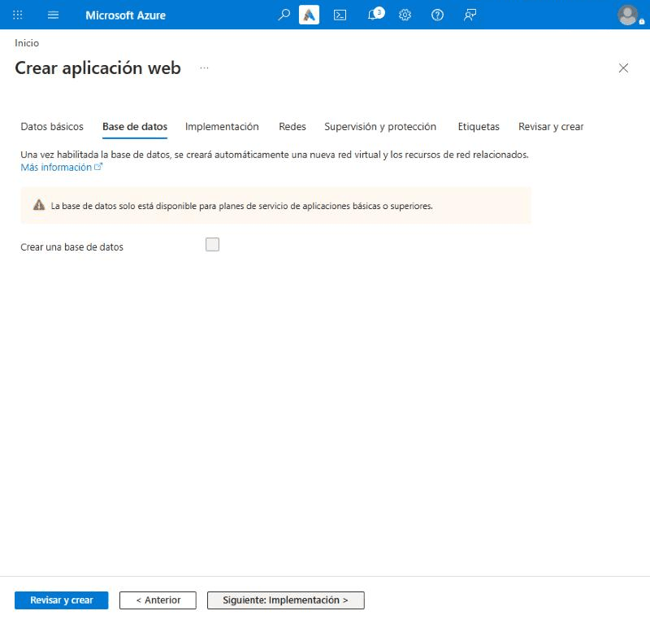{fig-alt="Pestaña Base de datos con un aviso que dice que la base de datos solo está disponible para planes de App Service básicos o superiores. La casilla Crear una base de datos está desmarcada y bloqueada."}

- **Implementación**: aquí aparece la *implementación continua* con GitHub, deshabilitada. El portal avisa que con Linux y este plan no se puede configurar durante la creación. Se hace después, desde el *Deployment Center* de la aplicación ya creada, en una etapa posterior.

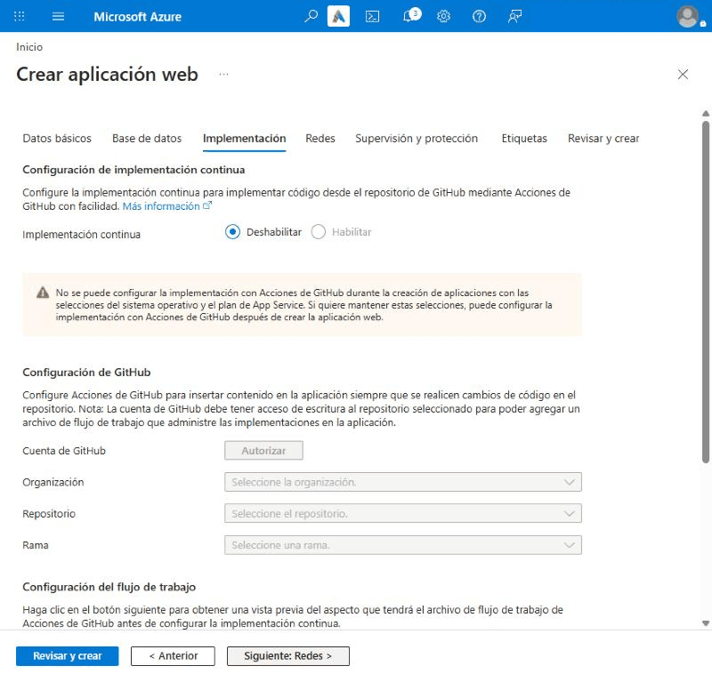{fig-alt="Pestaña Implementación con la implementación continua en Deshabilitar y un aviso naranja que dice que no se puede configurar la implementación con Acciones de GitHub durante la creación con las selecciones de sistema operativo y plan de App Service. Debajo, los campos de cuenta, organización, repositorio y rama de GitHub, bloqueados."}

- **Redes**: deja el **acceso público activado**. Sin él nadie podría abrir tu aplicación desde internet.
- **Supervisión y protección**: deja **Application Insights en No** y **Defender sin marcar**. El propio formulario avisa que ambos se facturan por separado.

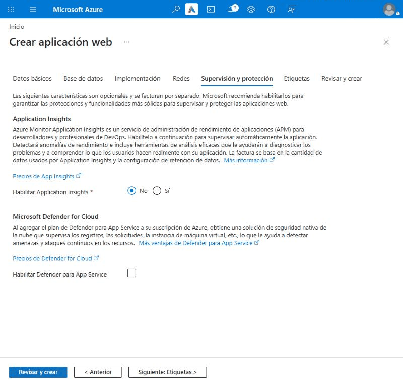{fig-alt="Pestaña Supervisión y protección. Habilitar Application Insights está en No y la casilla Habilitar Defender para App Service está sin marcar. Un texto arriba dice que estas características son opcionales y se facturan por separado."}

### Revisar y crear

1. Haz clic en **Revisar y crear**. El resumen debe mostrar: *SKU Gratis*, tu grupo `rg-plaza`, tu nombre, la pila **.NET 10 (LTS)**, sistema operativo **Linux** y *Application Insights: Sin habilitar*.

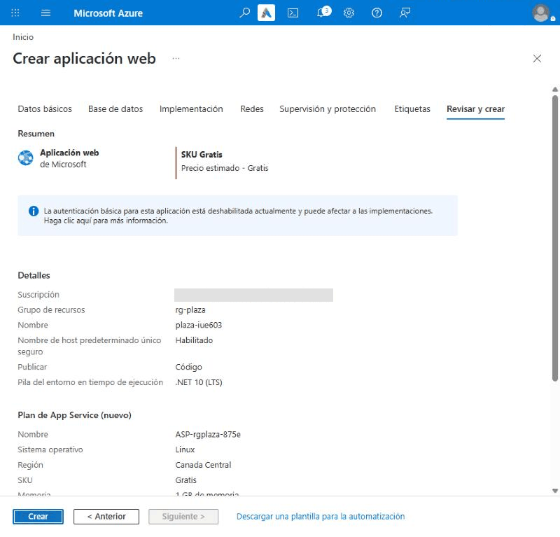{fig-alt="Pestaña Revisar y crear. El resumen indica SKU Gratis con precio estimado Gratis, el grupo de recursos rg-plaza, el nombre plaza-iue603, la pila .NET 10 LTS y el plan de App Service nuevo con Linux y región Canada Central."}

2. En el resumen aparece un aviso: *la autenticación básica está deshabilitada*. Es lo normal en Azure hoy. Significa que no puedes publicar con un usuario y una contraseña de despliegue. No te afecta: en esta guía la publicación se hace desde GitHub, y de esa conexión se encarga el *Deployment Center* de la aplicación en una etapa posterior.
3. Haz clic en **Crear**.

### Si Azure rechaza la creación: cuota y regiones

Aquí es donde más estudiantes se atascan. Al pulsar **Crear**, Azure puede rechazar el despliegue con uno de estos dos errores. Los dos le pasaron al docente al preparar esta guía.

**Error 1: cuota insuficiente.** El mensaje empieza con *Operation cannot be completed without additional quota* y dice que el límite actual de instancias F1 en esa región es **0**. Quiere decir que tu suscripción no tiene permitido ningún plan gratuito en la región que elegiste.

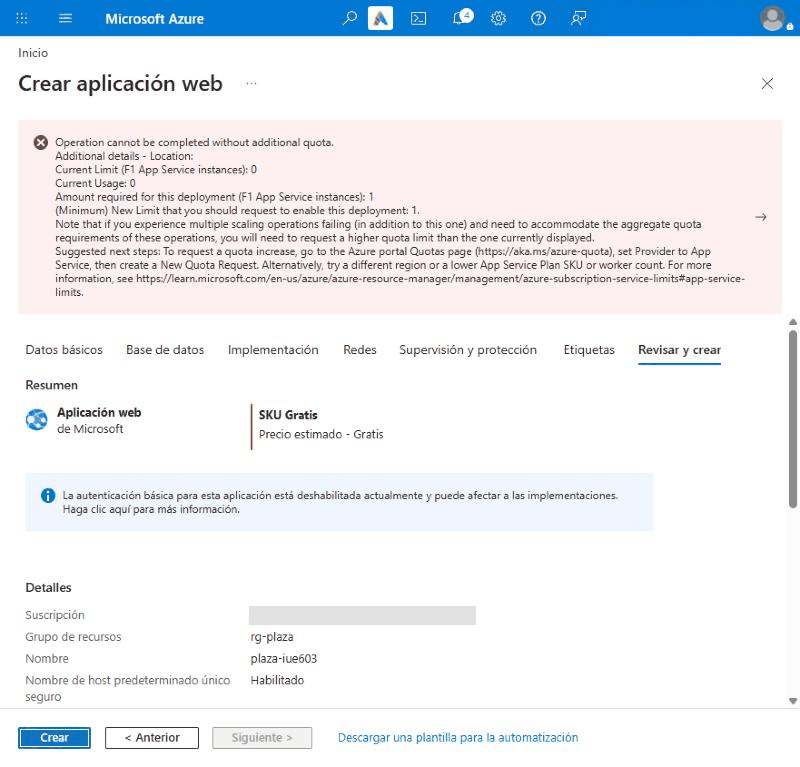{fig-alt="Banner rojo de error con el texto Operation cannot be completed without additional quota. Detalles: Current Limit F1 App Service instances 0, Current Usage 0, Amount required for this deployment 1. Sugiere solicitar un aumento de cuota o probar otra región o un SKU menor."}

**Error 2: región no permitida.** El mensaje dice *Resource was disallowed by Azure: this policy maintains a set of best available regions*. Quiere decir que la región elegida no está en la lista que tu suscripción de estudiante permite.

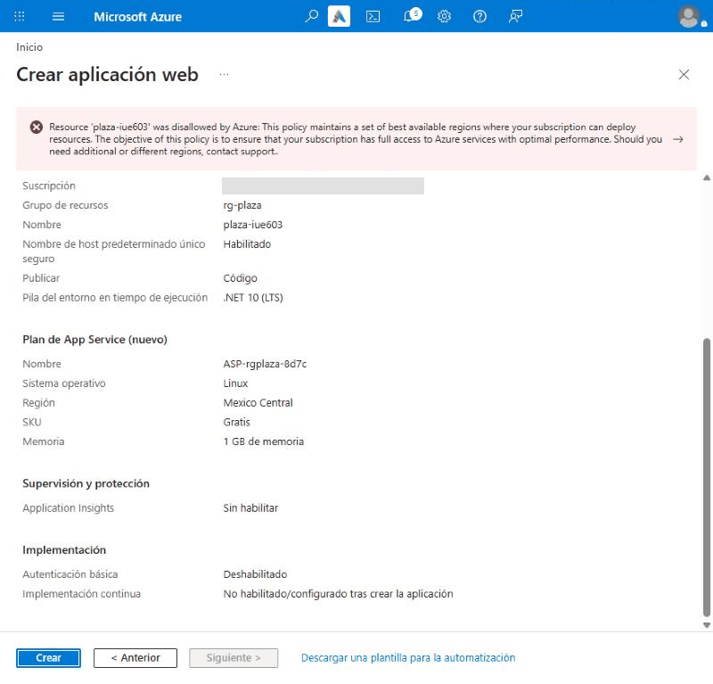{fig-alt="Banner rojo de error que dice que el recurso fue rechazado por Azure y que la política mantiene un conjunto de mejores regiones disponibles donde la suscripción puede implementar recursos."}

La solución es **probar otra región**. Pero no vale cualquiera: tu suscripción solo permite unas pocas, y esa lista la define una directiva de Azure. Puedes verla tú mismo:

1. En el buscador superior escribe `Directiva` y entra al servicio.
2. En *Tareas* verás una asignación llamada **Allowed resource deployment regions**. Ábrela.

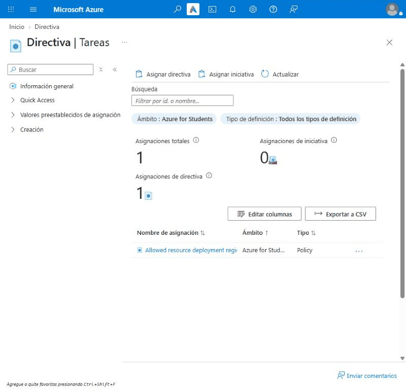{fig-alt="Página Directiva, Tareas, con una asignación de directiva llamada Allowed resource deployment regions, con ámbito Azure for Students y tipo Policy."}

3. En la pestaña *Parámetros* la fila **Allowed locations** muestra la lista de regiones permitidas.

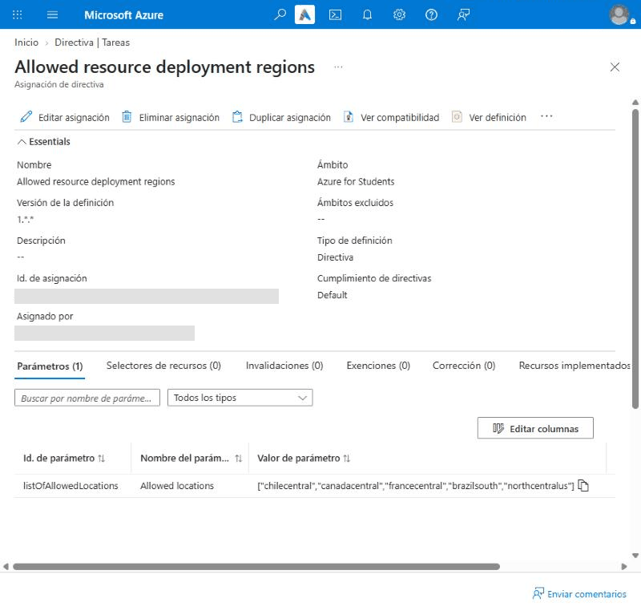{fig-alt="Detalle de la asignación Allowed resource deployment regions. El parámetro listOfAllowedLocations tiene el valor chilecentral, canadacentral, francecentral, brazilsouth y northcentralus."}

En esta suscripción son cinco: **Chile Central, Canada Central, France Central, Brazil South y North Central US**. La base de datos de la etapa 3 funcionó en Canada Central, pero ahí la cuota de F1 era 0. La aplicación web se creó con éxito en **Brazil South**.

Para probar otra región:

1. Vuelve a la pestaña **Datos básicos** del formulario y cambia la **Región** por otra de la lista permitida. Al cambiar de región, el plan de precios vuelve a **Básico B1**.
2. Elige otra vez **Gratis F1**, haz clic en **Revisar y crear** y luego en **Crear**.
3. Si falla de nuevo, repite con la siguiente región de la lista.

::: {.callout-warning}
## Si ninguna región te deja usar el plan gratuito

Puedes crear la aplicación con el plan **Básico B1**, que cuesta alrededor de 13 a 15 USD al mes. Sale de tu crédito de estudiante. Si la usas solo durante la clase y luego borras el grupo `rg-plaza`, el gasto es una fracción pequeña de ese valor. También puedes pedir un aumento de cuota desde la página *Cuotas* del portal, pero la respuesta puede tardar.
:::

::: {.callout-note}
## La aplicación y la base de datos pueden estar en regiones distintas

En este ejemplo la base de datos está en Canada Central y la aplicación en Brazil South. Funciona, pero cada consulta viaja entre dos regiones, así que la aplicación responde un poco más lenta. Para una aplicación de clase no importa. En un proyecto real se ponen en la misma región.
:::

### Comprueba

1. Cuando el despliegue termina, el portal muestra **Se completó la implementación**.

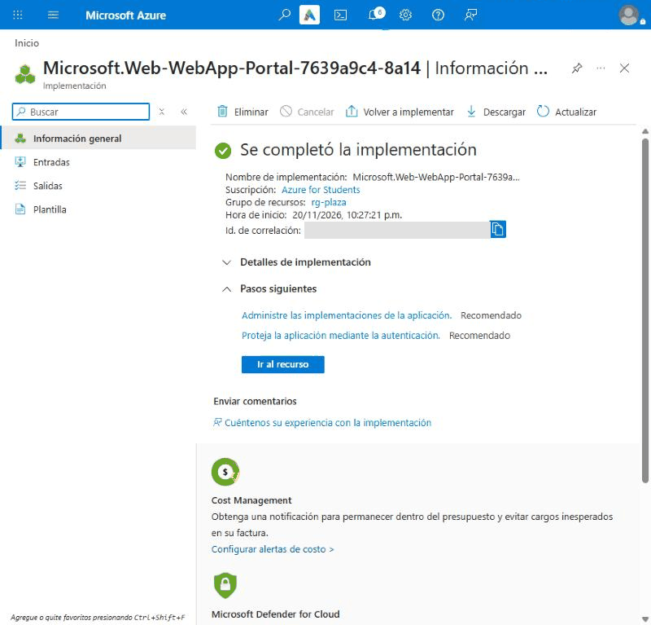{fig-alt="Página de la implementación con un check verde y el mensaje Se completó la implementación. Debajo, el grupo de recursos rg-plaza y el botón azul Ir al recurso."}

2. Haz clic en **Ir al recurso**. En *Essentials* verifica que el **Estado** es *En ejecución*, que la **Ubicación** es la región donde se creó y que el **Plan de App Service** termina en *(F1: 1)*. En **Dominio predeterminado** está la dirección pública de tu aplicación, con la forma `<nombre>-<código>.<región>-01.azurewebsites.net`. Más abajo, en *Propiedades*, la **Pila en tiempo de ejecución** debe decir *.NET - 10.0*.

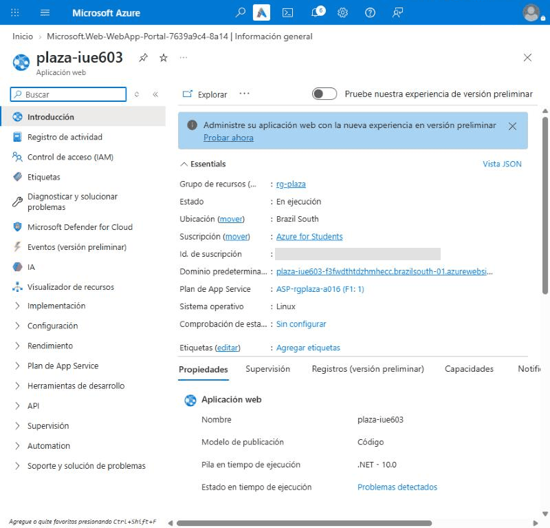{fig-alt="Página de la aplicación web plaza-iue603. Estado En ejecución, ubicación Brazil South, plan de App Service con F1, sistema operativo Linux y un dominio predeterminado azurewebsites.net. En Propiedades, la pila en tiempo de ejecución es .NET 10.0."}

3. Haz clic en el dominio predeterminado. Se abre una página de Azure que dice **Your web app is running and waiting for your content**. Eso significa que el servidor de la aplicación ya está vivo y esperando a que le publiques tu código.

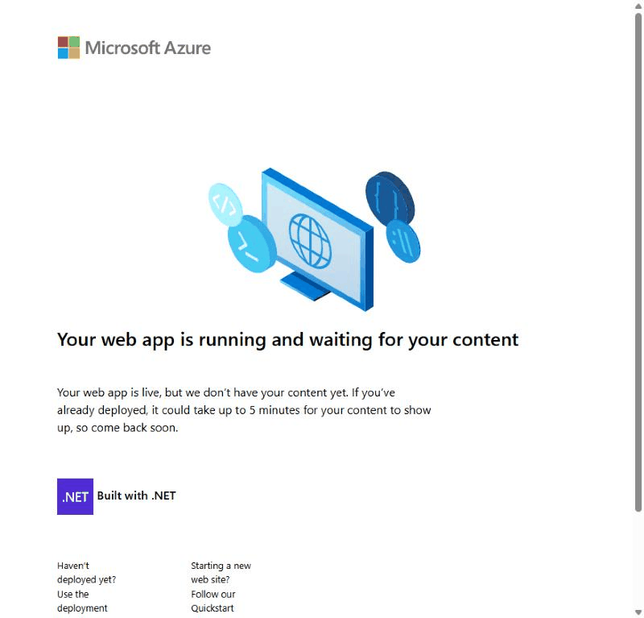{fig-alt="Página de bienvenida de Microsoft Azure App Service en el navegador. Dice Your web app is running and waiting for your content, con un icono de monitor y el distintivo Built with .NET."}

Si ves esa página, la etapa 4 está terminada. Plaza todavía no está ahí: lo que ves es el contenido de relleno que Azure pone mientras tanto.

## Etapa 5. Preparar Plaza y subirla a GitHub

### Qué vas a lograr

Plaza en un repositorio de GitHub, comprobada y limpia, lista para que Azure la tome desde ahí. En las etapas siguientes enlazarás la aplicación web de Azure con ese repositorio.

### Por qué GitHub y no copiar la carpeta

Azure no recibe tu carpeta del equipo. Cuando enlazas la aplicación web con un repositorio, GitHub compila y publica el código **cada vez que subes cambios a la rama `main`**, mediante una herramienta llamada *GitHub Actions*. Por eso lo que está en GitHub es lo que se publica: si no está en el repositorio, no llega a Azure.

### Qué cambia en el proyecto y qué no

**Nada de código.** Plaza no necesita ningún cambio para publicarse. Lo único que cambia es de dónde sale la cadena de conexión a la base de datos:

| | En tu equipo | En Azure |
|---|---|---|
| Dónde está la cadena `Plaza` | `appsettings.Development.json`, con el servidor `localhost` | La variable de entorno `Plaza` de la aplicación web (etapa 6) |
| Quién la lee | `GetConnectionString("Plaza")` en `Program.cs` | El mismo `GetConnectionString("Plaza")` |

El código es idéntico en los dos sitios. Por eso la contraseña de la base de datos nunca debe estar en el repositorio: en Azure vive en la configuración de la aplicación, fuera del código.

### Comprueba que Plaza compila y publica en Release

GitHub Actions va a ejecutar lo mismo que ejecutas tú ahora: compilar en modo **Release** y generar la carpeta de publicación. Si falla aquí, fallaría allí.

1. Abre PowerShell **dentro de la carpeta `Plaza`**, la que contiene `Plaza.csproj`.
2. Ejecuta el comando. Le pedimos que escriba la salida en una carpeta temporal, para no ensuciar el proyecto:

```powershell
dotnet publish Plaza.csproj -c Release -o "$env:TEMP\plaza-publish"
```

3. Debe terminar sin errores y mostrar una línea como esta, con la ruta de la carpeta temporal:

```text
Plaza -> C:\Users\...\Temp\plaza-publish\
```

4. En esa carpeta debe estar `Plaza.dll`. Puedes borrarla después.

### Revisa que el repositorio esté limpio

Tres comprobaciones antes de subir. Todas se ejecutan en la carpeta de tu proyecto y **necesitan que la carpeta ya sea un repositorio**. Si `git status` te sale con `fatal: not a git repository` (Caso C, que se explica más abajo en *Sube el proyecto*), haz primero solo `git init -b main` y `git add .`, ejecuta estas tres revisiones y recién después haz el `git commit`.

1. **Que no se hayan subido archivos de compilación.** No debe imprimir nada:

```powershell
git ls-files | Select-String -Pattern '(^|/)(bin|obj)/'
```

2. **Que no haya contraseñas en el código.** No debe imprimir nada:

```powershell
git grep -niE 'password=|pwd='
```

3. **Qué cambios hay por subir.** Antes de subir es normal que `git status` liste archivos modificados o nuevos: los subirás en el paso siguiente. Lo que **no** debe aparecer en esa lista son carpetas `bin/` u `obj/` ni archivos que contengan contraseñas:

```powershell
git status
```

Si el primer comando imprime algo, `bin/` u `obj/` se subieron por error: el archivo `.gitignore` de la plantilla de .NET ya los excluye, así que revisa que no lo hayas borrado. Si el segundo imprime algo, quita esa contraseña del archivo **antes** de subirlo. Una contraseña que llegó a GitHub se considera comprometida aunque la borres después: queda en el historial.

::: {.callout-warning}
## Esto incluye los comentarios

Es un error frecuente copiar la cadena de conexión o el comando de migración a un archivo como recordatorio, por ejemplo como comentario al final de `Program.cs`. Un comentario también se sube. En el repositorio de esta práctica ocurrió: la cadena con la contraseña quedó escrita en un comentario y se subió a un repositorio público. Guarda esos datos en un bloc de notas **fuera** de la carpeta del proyecto y ejecuta siempre `git grep` antes de cada `git push`. Si ya te pasó, mira la sección *Si algo sale mal*.
:::

### Sube el proyecto

Lo que tienes que hacer depende de en qué situación estés. Averígualo con estos dos comandos, dentro de la carpeta de tu proyecto:

```powershell
git status
git remote -v
```

| Lo que ves | Qué significa | Sigue en |
|---|---|---|
| `git status` empieza con `On branch main` (o `En la rama main`) y `git remote -v` muestra una línea con `origin` y una dirección de github.com | Ya tienes repositorio local **y** está enlazado con GitHub | Caso A |
| `git status` empieza con `On branch main`, pero `git remote -v` no imprime nada | Tienes repositorio local, pero **no** está enlazado con GitHub | Caso B |
| `git status` dice `fatal: not a git repository` | Tu carpeta **todavía no es un repositorio** | Caso C |

**Caso A: ya está enlazado.** Si `git status` mostró cambios, súbelos. Cambia el mensaje por uno que describa lo que hiciste:

```powershell
git add .
git commit -m "prepara el proyecto para publicar en Azure"
git push origin main
```

**Caso B: hay repositorio local pero no está en GitHub.** Primero crea el repositorio vacío en GitHub (ver más abajo) y luego, con la dirección que te muestra GitHub, ejecuta:

```powershell
git remote add origin https://github.com/<tu-usuario>/<tu-repositorio>.git
git branch -M main
git push -u origin main
```

**Caso C: la carpeta no es un repositorio.** La primera vez que usas Git en un equipo debes decirle quién eres, con tu nombre y tu correo (se hace una sola vez por equipo):

```powershell
git config --global user.name "Tu Nombre"
git config --global user.email "tu-correo@ejemplo.com"
```

Después convierte la carpeta en repositorio y haz el primer commit. El comando `dotnet new gitignore` crea el archivo `.gitignore` que evita subir `bin/` y `obj/`; ejecútalo solo si tu carpeta no tiene ya un `.gitignore`:

```powershell
git init -b main
dotnet new gitignore
git add .
git commit -m "primer commit"
```

Y sigue con el Caso B: crear el repositorio vacío en GitHub y enlazarlo.

**Crear el repositorio vacío en GitHub** (casos B y C):

1. Entra a [github.com](https://github.com), haz clic en el botón **+** de la esquina superior derecha y elige **New repository**.
2. En **Repository name** escribe un nombre, por ejemplo `iue-web-plaza`.
3. Elige **Public** o **Private**. Si es público, cualquier persona puede leer lo que subas: por eso importa la revisión de contraseñas de más arriba. Con un repositorio privado el Centro de implementación de Azure también funciona.
4. **No marques** *Add a README file*, *Add .gitignore* ni *Choose a license*: el repositorio debe nacer **vacío**.
5. Haz clic en **Create repository**. GitHub muestra la dirección del repositorio, con la forma `https://github.com/<tu-usuario>/<tu-repositorio>.git`. Esa es la dirección que va en `git remote add origin`.

La primera vez que ejecutes `git push`, Git normalmente abre una ventana del navegador para que inicies sesión en GitHub y autorices el acceso. Acéptala; solo ocurre una vez.

### Comprueba

- `dotnet publish` en Release terminó sin errores.
- Los dos primeros comandos de revisión no imprimieron nada.
- Después de subir, `git status` dice *nothing to commit, working tree clean* y que tu rama está al día con `origin/main`.
- Al abrir tu repositorio en github.com, la rama es `main` y ves las carpetas `Controllers`, `Models`, `Views`, `Migrations` y el archivo `Plaza.csproj`.

## Etapa 6. Conectar la aplicación con la base de datos

### Qué vas a lograr

Que la aplicación web de Azure sepa dónde está la base de datos y con qué usuario entrar. Para eso le guardas una **cadena de conexión** en su configuración.

### Qué es la cadena de conexión y de dónde sale

Una **cadena de conexión** es una sola línea de texto con los datos que un programa necesita para entrar a una base de datos: en qué servidor está, cómo se llama la base, con qué usuario entrar y con qué contraseña. Está escrita como una lista de pares `nombre=valor` separados por punto y coma.

Nadie te la entrega hecha: **la armas tú con los datos de tu hoja de datos**, que salieron de la etapa 3. El formato lo define Npgsql, la biblioteca que usa tu proyecto para hablar con PostgreSQL; por eso los nombres (`Host`, `Port`, `Database`, `Username`, `Password` y `SSL Mode`) son siempre esos, escritos igual.

En tu equipo, el proyecto lee una línea así de `appsettings.Development.json`, con el servidor `localhost`. En Azure ese archivo no tiene tus datos, y la contraseña no puede estar en el repositorio. Por eso guardas la misma línea, pero con los datos de Azure, en la configuración de la aplicación web, fuera del código.

### Los datos que necesitas

La línea lleva seis datos. Cuatro salen de tu hoja de datos y dos son fijos. Antes de seguir, ten abierta tu hoja y comprueba que los cuatro están completos:

| Dato | Qué escribirás | De dónde sale | Ejemplo de esta guía |
|---|---|---|---|
| Punto de conexión | La dirección completa de tu servidor | Etapa 3, sección *Revisa el servidor*, con el icono de copiar | `plaza-pg-abc.postgres.database.azure.com` |
| Base de datos | El nombre de la base que creaste | Etapa 3, sección *Crea la base de datos* | `plaza_campesina` |
| Usuario | El administrador del servidor | Etapa 3, sección *Pestaña Básico: autenticación* | `plazaadmin` |
| Contraseña | La que escribiste al crear el servidor | Tú la escribiste en la etapa 3. Azure no la muestra; si la perdiste, mira el apéndice | La tuya, no la de este ejemplo |
| Puerto | Siempre `5432` | Fijo: es el puerto estándar de PostgreSQL | `5432` |
| Modo SSL | Siempre `Require` | Fijo: Azure rechaza las conexiones sin cifrar | `Require` |

Si te falta alguno de los cuatro, vuelve a la etapa 3: ahí está. No sigas hasta tenerlos todos.

### Arma la línea en tu bloc de notas

Haz esto en el bloc de notas de tu hoja de datos, **no** en el portal ni en un archivo de tu proyecto.

1. Copia esta plantilla. Tiene cuatro textos en MAYÚSCULAS entre `<` y `>` que debes reemplazar:

```text
Host=<PUNTO-DE-CONEXION>;Port=5432;Database=<BASE-DE-DATOS>;Username=<USUARIO>;Password=<CONTRASENA>;SSL Mode=Require
```

2. Reemplaza cada texto en MAYÚSCULAS, **incluidos los signos `<` y `>`**, por el dato que le corresponde:

| Reemplaza | Por |
|---|---|
| `<PUNTO-DE-CONEXION>` | Tu punto de conexión, completo, con `.postgres.database.azure.com` al final |
| `<BASE-DE-DATOS>` | El nombre de tu base de datos |
| `<USUARIO>` | Tu usuario administrador |
| `<CONTRASENA>` | Tu contraseña |

3. Así debe verse la línea **ya completa**. Este ejemplo usa un servidor llamado `plaza-pg-abc` y una contraseña inventada solo para el ejemplo:

```text
Host=plaza-pg-abc.postgres.database.azure.com;Port=5432;Database=plaza_campesina;Username=plazaadmin;Password=ClaveDeEjemplo.2026;SSL Mode=Require
```

4. Antes de seguir, revísala punto por punto contra esta lista:

- Ya **no queda ningún** signo `<` ni `>` ni texto en MAYÚSCULAS de la plantilla.
- Empieza con `Host=` y termina con `SSL Mode=Require`.
- El valor de `Host=` termina en `.postgres.database.azure.com`.
- Es **una sola línea**: tú no pusiste ningún salto de línea. Si el bloc de notas la parte en varios renglones solo porque la ventana es angosta, está bien.
- **No tiene comillas** al principio, al final ni alrededor de ningún valor.
- No hay espacios al principio ni al final, ni alrededor de los signos `=` y `;`. El único espacio que debe existir está dentro de `SSL Mode`.
- Hay seis pares, separados por cinco punto y coma.

Los errores más comunes y lo que provocan:

| Error | Qué pasa después |
|---|---|
| Dejar los signos `<` `>` en un dato | La aplicación no encuentra el servidor o rechaza el usuario |
| Escribir mal el punto de conexión o dejarlo sin `.postgres.database.azure.com` | `Host desconocido` al conectarse |
| Contraseña distinta a la del servidor | `password authentication failed` |
| Olvidar `SSL Mode=Require` | El servidor rechaza la conexión por no estar cifrada |
| Poner comillas alrededor de la línea o de un valor | Los valores incluyen las comillas y no coinciden |

Si te equivocas en un dato, la aplicación **no falla al guardar**: falla después, cuando intenta conectarse. Por eso conviene revisar la línea ahora.

### Los pasos

1. Abre tu aplicación web en el portal. En el menú de la izquierda abre la sección **Configuración** y haz clic en **Variables de entorno**.

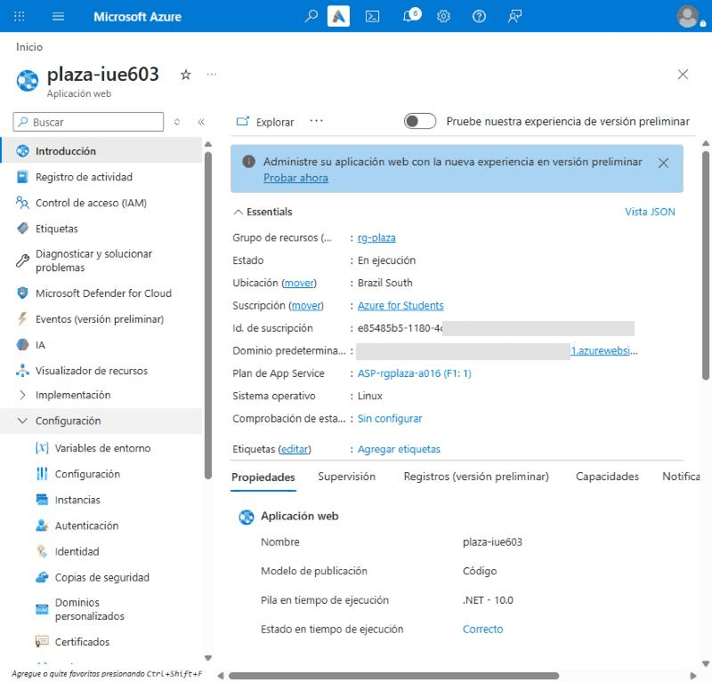{fig-alt="Página de la aplicación web plaza-iue603 con el menú lateral. La sección Configuración está desplegada y muestra Variables de entorno, Configuración, Instancias, Autenticación, Identidad, Copias de seguridad, Dominios personalizados y Certificados."}

2. Se abre la página con dos pestañas: *Configuración de aplicación* y *Cadenas de conexión*. Haz clic en **Cadenas de conexión**.

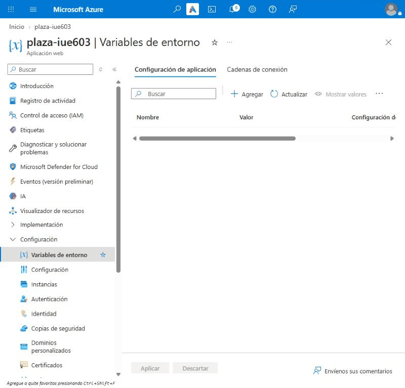{fig-alt="Página Variables de entorno de la aplicación web. Tiene dos pestañas, Configuración de aplicación y Cadenas de conexión. La pestaña activa es Configuración de aplicación y la tabla está vacía."}

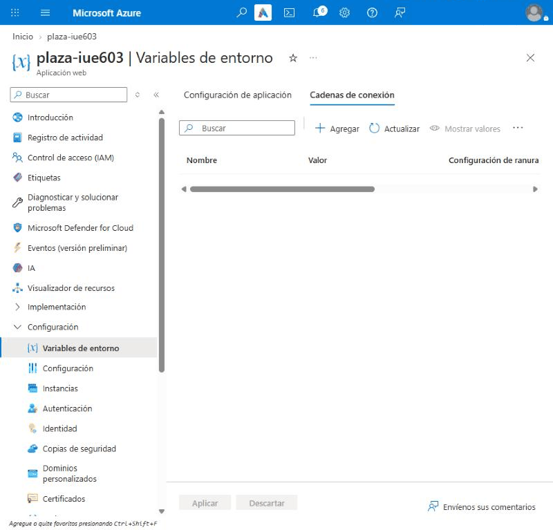{fig-alt="Pestaña Cadenas de conexión con una tabla vacía de columnas Nombre, Valor y Configuración de ranura. Arriba, los botones Agregar, Actualizar y Mostrar valores."}

3. Haz clic en **Agregar**. Se abre el panel **Agregar o editar una cadena de conexión**, con tres campos: *Nombre*, *Valor* y *Tipo*.

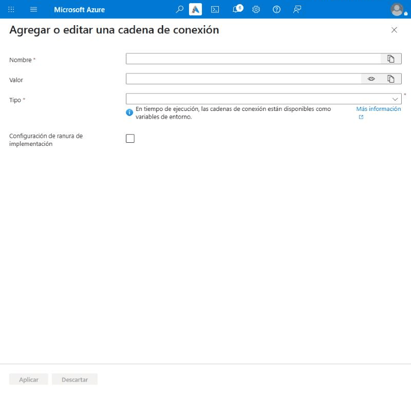{fig-alt="Panel Agregar o editar una cadena de conexión con los campos Nombre, Valor y Tipo vacíos y la casilla de configuración de ranura de implementación sin marcar. Abajo, los botones Aplicar y Descartar."}

4. En **Nombre** escribe exactamente `Plaza`, con la P mayúscula. Es el nombre que Plaza busca en `Program.cs`, en la línea `GetConnectionString("Plaza")`: si lo escribes distinto, la aplicación no encuentra la cadena. Si trabajas con tu propio proyecto, abre tu `Program.cs`, busca `GetConnectionString(` y usa el texto que aparece entre comillas, escrito igual, con las mismas mayúsculas.
5. En **Tipo** abre la lista y elige **PostgreSQL**. No elijas *Custom* ni *SQLServer*: el tipo hace que Azure le ponga a la variable un prefijo que .NET reconoce como cadena de conexión.

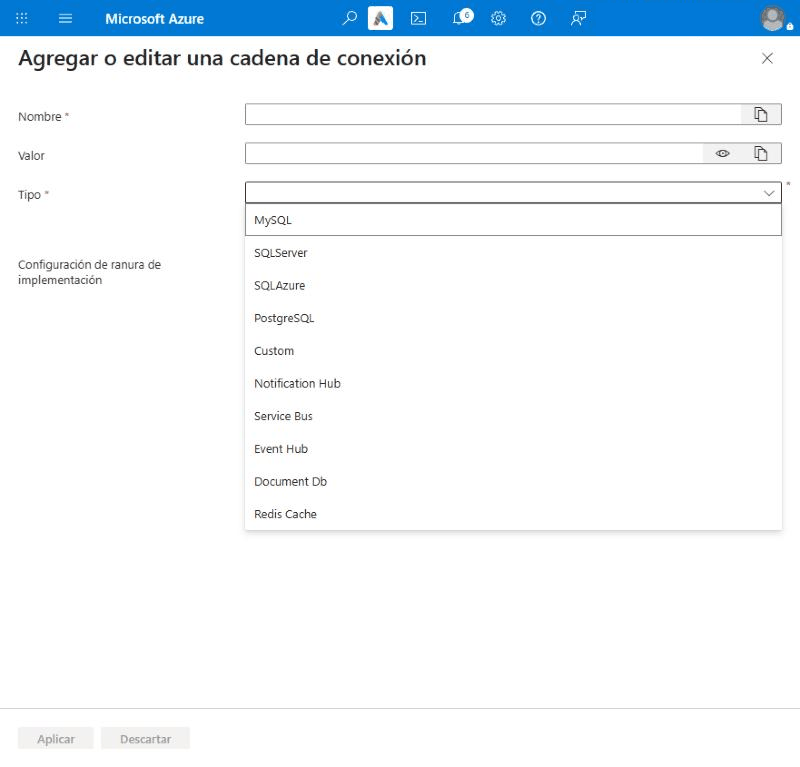{fig-alt="Lista desplegable del tipo de cadena de conexión con las opciones MySQL, SQLServer, SQLAzure, PostgreSQL, Custom, Notification Hub, Service Bus, Event Hub, Document Db y Redis Cache."}

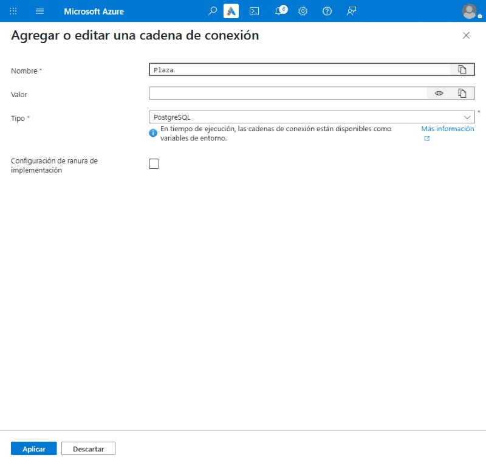{fig-alt="Panel con el nombre Plaza escrito, el valor todavía vacío y el tipo PostgreSQL seleccionado."}

6. En **Valor** pega la línea completa que armaste en tu bloc de notas:
    1. En el bloc de notas, haz clic dentro de la línea, pulsa **Ctrl+A** para seleccionarla toda y **Ctrl+C** para copiarla.
    2. En el panel, haz clic dentro del campo **Valor** y pulsa **Ctrl+V** para pegar.
    3. El campo muestra **puntos** en lugar de texto, como en la captura, porque se trata como una contraseña. Además es angosto: la línea tiene unos 140 caracteres y solo cabe una parte. Es normal.
    4. Para comprobar lo que pegaste, haz clic en el icono del **ojo** que está a la derecha del campo. El texto se muestra y el aviso del icono pasa a *Ocultar contraseña*. Para ver el final de la línea, haz clic dentro del campo y pulsa la tecla **Fin** (*End*). Comprueba que empieza con `Host=` y termina con `SSL Mode=Require`.
    5. Haz otro clic en el ojo para volver a ocultarla. Hazlo siempre sin nadie mirando tu pantalla, porque al mostrarla se ve tu contraseña.

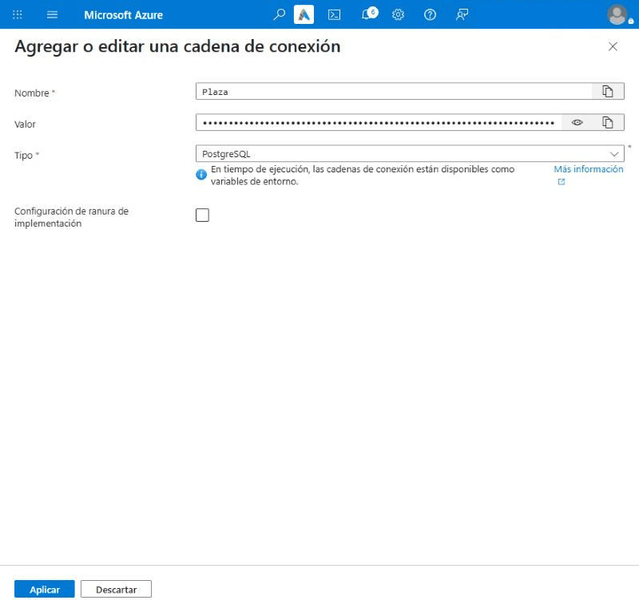{fig-alt="Panel con el nombre Plaza, el tipo PostgreSQL y el campo Valor lleno de puntos que ocultan la cadena de conexión. Al lado del campo hay un icono de ojo y uno de copiar."}

7. Haz clic en **Aplicar**. El panel se cierra y la tabla muestra una fila con el nombre `Plaza` y el valor oculto.

{fig-alt="Pestaña Cadenas de conexión con una fila nueva, Plaza, y el valor oculto detrás del texto Mostrar valor. Abajo, los botones Aplicar y Descartar de la página, ahora activos."}

8. Todavía **no está guardada**. Haz clic en el botón **Aplicar** de la parte inferior de la página. Azure avisa que la aplicación puede reiniciarse al actualizar las cadenas de conexión. Haz clic en **Confirmar**.

{fig-alt="Ventana Guardar cambios que dice que la aplicación puede reiniciarse si está actualizando cadenas de conexión y pregunta si se quiere continuar. Tiene los botones Confirmar y Cancelar."}

9. Aparece una notificación verde: **Se han actualizado correctamente las cadenas de conexión**.

{fig-alt="Notificación verde que dice Actualizando cadenas de conexión: se han actualizado correctamente las cadenas de conexión. Debajo, la tabla con la fila Plaza."}

::: {.callout-note}
## Dos botones que se llaman Aplicar

Hay dos: el del **panel**, que añade la fila a la lista, y el de la **parte inferior de la página**, que guarda los cambios en Azure. Si solo pulsas el primero, la cadena se pierde al salir de la página.
:::

### Si algo no sale como esperabas

**El panel dice *Los nombres de las cadenas de conexión deben ser únicos*.** Ya existe una cadena con ese nombre, porque la guardaste antes. No crees otra: edita la que ya está. En la tabla haz clic sobre el nombre `Plaza` para abrir su panel, reemplaza el contenido de **Valor** con la línea correcta y repite desde el paso 7.

{fig-alt="Panel Agregar o editar una cadena de conexión con el nombre Plaza escrito y un mensaje de error en rojo que dice que los nombres de las cadenas de conexión deben ser únicos. El campo Valor muestra puntos y el tipo está vacío con un error."}

**Te equivocaste en un dato después de guardar.** El procedimiento es el mismo: haz clic en el nombre `Plaza` en la tabla, corrige **Valor**, pulsa **Aplicar** en el panel, **Aplicar** en la parte inferior de la página y **Confirmar**.

**No recuerdas qué escribiste en Valor.** En la tabla, el enlace *Mostrar valor* o el icono del ojo del panel lo muestran. Hazlo sin nadie mirando tu pantalla.

**Nombre distinto al de tu código.** Si el nombre de la cadena no coincide exactamente con el de `GetConnectionString("...")`, la aplicación no encuentra la cadena y falla al consultar la base de datos. Corrige el nombre en la tabla y guarda de nuevo.

### Cómo llega la cadena a tu código

Para el tipo PostgreSQL, Azure crea una variable de entorno llamada `POSTGRESQLCONNSTR_Plaza`. .NET reconoce ese prefijo y la entrega a tu código como si fuera `ConnectionStrings:Plaza`, de modo que la línea de `Program.cs` no cambia:

```csharp
opciones.UseNpgsql(builder.Configuration.GetConnectionString("Plaza"))
```

### Comprueba

- En la pestaña **Cadenas de conexión** hay una fila llamada `Plaza`.
- La notificación de guardado salió en verde.
- Los datos de la línea coinciden con los de tu hoja de datos de la etapa 3: mismo punto de conexión, mismo usuario, misma base de datos y la misma contraseña.
- Puedes explicar con tus palabras de dónde salió cada uno de los seis datos de la línea.

Todavía no hay forma de comprobar que la conexión funciona: la base de datos está vacía y la aplicación todavía no tiene tu código. La primera prueba real de esta cadena llega en la etapa 9, cuando abras tu aplicación publicada. Si algo está mal, se verá entonces.

## Etapa 7. Crear las tablas en la base de datos

### Qué vas a lograr

Que la base `plaza_campesina` de Azure tenga las tablas de Plaza. Hoy está vacía: solo existe la base, sin ninguna tabla.

### Qué es una migración y por qué se aplica desde tu equipo

Una **migración** es un archivo del proyecto que describe cómo crear o cambiar las tablas. Plaza ya tiene una, llamada `Inicial`, en la carpeta `Migrations`: define la tabla `Productos` y cuatro productos de ejemplo. Entity Framework Core la ejecuta contra la base de datos que le indiques.

Azure no aplica las migraciones por su cuenta: `Program.cs` no las ejecuta al arrancar. Las aplicas tú, **desde tu equipo**, apuntando a la base de Azure. Eso es posible porque en la etapa 3 abriste el firewall del servidor para tu dirección IP.

### Antes del comando

Comprueba estos cuatro puntos. Si alguno falla, el comando también fallará:

1. **La herramienta de Entity Framework está instalada.** En PowerShell, `dotnet ef --version` debe mostrar una versión `10.x`. Si no, instálala como se explica en *Antes de empezar*.
2. **Tu proyecto está restaurado.** Si acabas de descargar o clonar el proyecto y nunca lo compilaste, ejecuta una vez `dotnet restore` dentro de su carpeta. Sin eso, `dotnet ef` falla con un error que menciona `NETSDK1004` y `project.assets.json`.
3. **Tu IP está permitida en el firewall del servidor.** Se agregó en la etapa 3, pero cambia si usas otra red. Si no estás seguro, mira *Si tu IP no está permitida*, más abajo.
4. **Tienes a mano la línea de conexión** que armaste en la etapa 6, en tu bloc de notas.

### El comando

Abre PowerShell **dentro de la carpeta de tu proyecto**, la que contiene el archivo `.csproj`. Vas a ejecutar este comando, que usa **la misma línea de conexión de la etapa 6**:

```powershell
dotnet ef database update --connection '<TU-LINEA-DE-CONEXION>'
```

Para armarlo:

1. Escribe `dotnet ef database update --connection '` (termina con una comilla simple, sin cerrarla).
2. Pega, sin cambiar nada, la línea completa de tu bloc de notas.
3. Cierra con otra comilla simple `'` y pulsa Enter.

Con la línea de ejemplo de la etapa 6, el comando completo se ve así (con tus datos y tu contraseña en lugar de los del ejemplo):

```powershell
dotnet ef database update --connection 'Host=plaza-pg-abc.postgres.database.azure.com;Port=5432;Database=plaza_campesina;Username=plazaadmin;Password=ClaveDeEjemplo.2026;SSL Mode=Require'
```

Usa **comillas simples** (`'`), no dobles. En PowerShell las comillas simples entregan el texto tal cual; con comillas dobles, un símbolo como `$` en la contraseña se interpretaría y la cadena llegaría rota.

La opción `--connection` le dice a `dotnet ef` que use **esa base** en lugar de la de `appsettings.Development.json`, que apunta a `localhost`. Sin ella, las tablas se crearían en tu PostgreSQL local y la base de Azure seguiría vacía.

::: {.callout-warning}
## La contraseña queda en el historial de PowerShell

El comando lleva tu contraseña escrita, y PowerShell guarda lo que escribes. Para esta práctica, con una base que borrarás al terminar, es aceptable. En un proyecto real no se hace así: se usa una variable de entorno o un gestor de secretos, como verás en la semana de configuración de entornos.
:::

### Qué debes ver

El comando tarda unos segundos y escribe mucho texto. Estas son las líneas que importan, en el orden en que salen:

```text
Build succeeded.
fail: Microsoft.EntityFrameworkCore.Database.Command[20102]
      Failed executing DbCommand
      SELECT "MigrationId", "ProductVersion" FROM "__EFMigrationsHistory" ...
info: Microsoft.EntityFrameworkCore.Database.Command[20101]
      CREATE TABLE IF NOT EXISTS "__EFMigrationsHistory" ( ... );
info: Microsoft.EntityFrameworkCore.Migrations[20402]
      Applying migration '20261107145524_Inicial'.
      CREATE TABLE "Productos" ( ... );
      INSERT INTO "Productos" ("Id", "Nombre", "Precio") VALUES (1, 'Tomate', 3500.0);
      ...
Done.
```

::: {.callout-note}
## El `fail:` del principio es normal

Lo primero que hace EF Core es leer la tabla `__EFMigrationsHistory`, donde anota qué migraciones ya aplicó. En una base nueva esa tabla todavía no existe, así que la lectura falla y aparece una línea con `fail:`. Enseguida EF Core la crea (`CREATE TABLE IF NOT EXISTS`) y sigue. Lo que importa es el final: si termina con **`Done.`**, todo salió bien.
:::

El identificador de la migración (`20261107145524_Inicial` en este ejemplo) cambia en tu proyecto, porque lleva la fecha y la hora en que se creó.

### Si falla

| Lo que ves | Qué significa | Qué hacer |
|---|---|---|
| `Host desconocido` | Tu equipo no pudo traducir el nombre del servidor a una dirección: suele ser una caché de DNS vieja, de cuando el servidor era nuevo. | Ejecuta `ipconfig /flushdns` y repite el comando. Revisa también que el nombre del servidor esté bien escrito. |
| Un mensaje con `pg_hba.conf` o que la conexión se agota | El firewall del servidor no deja entrar a tu IP. Tu IP pública cambia si cambias de red. | Agrega tu IP actual, como se explica en *Si tu IP no está permitida*, justo debajo. |
| `password authentication failed` | El usuario o la contraseña no coinciden con los del servidor. | Revisa `Username=` y `Password=`. Si olvidaste la contraseña, el botón **Restablecer contraseña** del servidor te deja poner otra. |
| `database "plaza_campesina" does not exist` | La base de datos no existe en el servidor. | Créala como en la etapa 3. |
| `dotnet ef` no se reconoce, o dice que no encontró el comando o archivo | La herramienta de Entity Framework no está instalada, o PowerShell se abrió antes de instalarla. | Instálala (sección *Antes de empezar*), cierra PowerShell, ábrelo de nuevo y repite. |
| Un error con `NETSDK1004` y `project.assets.json` | El proyecto no está restaurado. | Ejecuta `dotnet restore` en la carpeta del proyecto y repite. |
| `No project was found` o no encuentra el proyecto | PowerShell no está dentro de la carpeta correcta. | Muévete con `cd` a la carpeta que contiene el `.csproj` y repite. |

### Si tu IP no está permitida

El firewall del servidor solo deja entrar a las direcciones IP que le indicaste. Tu IP pública cambia cuando te conectas desde otra red (la de la universidad, la de tu casa, los datos del celular). Para agregar tu IP actual:

1. En el portal abre tu servidor PostgreSQL. En el menú de la izquierda, dentro de **Configuración**, haz clic en **Redes**.
2. Baja hasta **Reglas de firewall** y haz clic en **+ Agregar dirección IP del cliente actual**. Entre paréntesis aparece tu IP actual, y se agrega una fila nueva a la tabla. En la captura el enlace aparece en gris porque ese ejemplo ya tenía su IP agregada; en tu pantalla estará activo.
3. Haz clic en **Guardar**, arriba a la izquierda de la página, y espera la confirmación. Sin este paso la regla no queda guardada.
4. Repite el comando de migración.

{fig-alt="Página Redes del servidor plaza-pg-iue603. Muestra la sección Acceso público, con la casilla marcada, y Reglas de firewall, con la casilla de permitir acceso desde servicios de Azure marcada. Debajo, el enlace para agregar la dirección IP del cliente actual y una tabla con una regla de firewall cuyas direcciones IP están tapadas en la captura. Arriba, los botones Guardar y Descartar."}

### Comprueba

- El comando terminó con `Done.`.
- En la salida aparece `Applying migration` con el nombre de tu migración y el `CREATE TABLE "Productos"`.
- Aparecen los cuatro `INSERT INTO "Productos"`: Tomate, Aguacate, Papa y Panela.

Ya tienes la base de datos lista con sus tablas y datos. Falta lo más importante: llevar el código de Plaza a la aplicación web, desde GitHub.

## Etapa 8. Enlazar la aplicación con GitHub

### Qué vas a lograr

Que cada vez que subas cambios a la rama `main` de tu repositorio, GitHub compile Plaza y la publique en la aplicación web de Azure, sin que tengas que hacer nada más. Eso se llama **publicación continua** (CI/CD).

### Resumen de lo que vas a hacer

Necesitas tener hecha la etapa 4 (la aplicación web) y la etapa 5 (tu proyecto en un repositorio de GitHub). Los pasos de esta etapa son cinco:

1. Habilitar la autenticación básica de SCM en tu aplicación web.
2. Abrir el Centro de implementación de la aplicación web.
3. Autorizar a Azure en tu cuenta de GitHub.
4. Elegir tu repositorio, la rama `main` y la opción de flujo de trabajo.
5. Elegir *Autenticación básica* y guardar.

Antes de los pasos viene una explicación de por qué se usa la autenticación básica y no la opción que el portal propone. Puedes saltarla si solo quieres ejecutar los pasos, pero te ayudará a entender el error que verás si eliges la otra opción.

### Cómo funciona

Azure agrega al repositorio un archivo de **flujo de trabajo** (`.github/workflows/main_<tu-aplicación>.yml`) que le dice a GitHub Actions qué hacer en cada push: instalar .NET, compilar, publicar y desplegar en tu aplicación web. Para que GitHub pueda desplegar en tu nombre, necesita una forma de autenticarse en Azure. El Centro de implementación ofrece dos.

| Tipo de autenticación | Cómo funciona | Estado en esta guía |
|---|---|---|
| **Identidad asignada por el usuario** (OIDC) | Azure crea una identidad y GitHub la usa sin contraseñas. | **Falla** con repositorios nuevos (ver más abajo). |
| **Autenticación básica** | Azure guarda en GitHub un *perfil de publicación* como secreto del repositorio. | **Funciona.** Es la que usamos. |

### Por qué no usamos la identidad asignada por el usuario

Es la opción que el portal propone por defecto y la más segura, pero con un repositorio recién creado falla al guardar con este mensaje: *"No pudimos verificar cómo GitHub Actions emite tokens OIDC para este repositorio"*.

{fig-alt="Panel de notificaciones del portal con dos errores de Guardar configuración de código. El primero dice que no se pudo configurar la implementación porque el rol ya existe. El segundo dice que no se pudo verificar cómo GitHub Actions emite tokens OIDC para el repositorio y que se compruebe la conexión de GitHub."}

La causa más probable es un cambio de GitHub: los repositorios creados después del **15 de julio de 2026** usan de forma obligatoria un formato nuevo de identidad para los tokens OIDC, que incluye los números internos del propietario y del repositorio. Los repositorios anteriores a esa fecha conservan el formato clásico. En esta práctica el portal falló con un repositorio nuevo; no está confirmado que el origen del fallo esté en Azure, pero lo cierto es que **no se puede volver al formato clásico** en un repositorio nuevo, así que esa ruta no sirve para la clase. Es posible que Azure lo corrija más adelante: si con tu repositorio funciona la identidad asignada por el usuario, también es válida.

::: {.callout-warning}
## El primer intento fallido deja restos

Si pulsas **Guardar** con la identidad asignada y falla, Azure ya creó una identidad (con un nombre como `oidc-msi-xxxx`) y su permiso. Un segundo intento con la misma opción da otro error: *"The role assignment already exists"*. No lo reintentes: cambia a **Autenticación básica** como se explica abajo. La identidad sobrante se borra junto con el grupo de recursos en la etapa final.
:::

### Paso 1. Habilitar la autenticación básica de SCM

La autenticación básica viene **deshabilitada** en las aplicaciones nuevas. Si la eliges en el Centro de implementación sin habilitarla, el portal te lo avisa y no te deja guardar:

{fig-alt="Sección Configuración de autenticación del Centro de implementación con Autenticación básica seleccionada y un mensaje de error en rojo que dice que la autenticación básica de SCM está deshabilitada para su aplicación y que se debe habilitar en Opciones de configuración o elegir identidad asignada por el usuario."}

Para habilitarla:

1. En tu aplicación web, abre **Configuración** y luego la pestaña **Configuración general**.
2. Fíjate en **Credenciales de publicación de autenticación básica de SCM**: está sin marcar.

{fig-alt="Página Configuración, pestaña Configuración general, de la aplicación web. Las casillas de credenciales de publicación de autenticación básica de SCM y de FTP están sin marcar. Debajo, el estado de FTP en Solo FTPS, HTTP 1.1, SSH y HTTPS solamente marcados."}

3. Marca la casilla de **SCM**. La de **FTP** déjala sin marcar: no la necesitas.
4. Haz clic en **Aplicar** al pie de la página. Si el portal pide confirmar el cambio, haz clic en **Confirmar**. El portal avisa: **La configuración general se actualizó correctamente**.

{fig-alt="Configuración general con la casilla de credenciales de publicación de autenticación básica de SCM marcada y la de FTP sin marcar. Los botones Aplicar y Descartar al pie están desactivados porque no quedan cambios pendientes."}

::: {.callout-important}
## Qué estás aceptando al hacer esto

Habilitar la autenticación básica permite publicar con un usuario y una contraseña de despliegue, que es menos seguro que una identidad sin contraseñas. Para una aplicación de clase que borrarás al terminar es una decisión razonable. En un proyecto real conviene usar la identidad asignada, cuando funcione con tu repositorio.
:::

### Paso 2. Abrir el Centro de implementación

1. En el menú de tu aplicación web abre **Implementación** y luego **Centro de implementación**.
2. Deja seleccionada **Implementación continua (CI/CD)**. En **Origen** elige **GitHub**. La compilación es con *Acciones de GitHub*.

{fig-alt="Centro de implementación de la aplicación web con la opción Implementación continua CI/CD seleccionada, el origen GitHub y la compilación con Acciones de GitHub. Más abajo, el apartado GitHub con el texto Sesión iniciada como y el enlace Autorizar."}

### Paso 3. Autorizar a Azure en GitHub

1. Haz clic en **Autorizar**. Se abre una ventana o pestaña de GitHub. Si no se abre, tu navegador probablemente bloqueó las ventanas emergentes: permítelas para el portal de Azure y vuelve a hacer clic.
2. Inicia sesión con **tu** cuenta de GitHub y acepta el acceso que pide Azure. Esa pantalla pide permisos sobre tu cuenta: léela antes de aceptar.
3. Al volver al portal, junto a **Sesión iniciada como** aparece tu nombre de usuario de GitHub.

{fig-alt="Centro de implementación con Sesión iniciada como y el nombre de usuario de GitHub. Debajo, los campos Organización, Repositorio y Rama, todavía por elegir."}

### Paso 4. Elegir organización, repositorio y rama

1. **Organización**: tu cuenta personal de GitHub es la única opción, a menos que pertenezcas a organizaciones.

{fig-alt="Lista de organizaciones con una sola opción, el nombre de usuario de GitHub."}

2. **Repositorio**: la lista muestra todos tus repositorios. Escribe parte del nombre del tuyo en el cuadro de búsqueda (en el ejemplo, `plaza`) y elige **el repositorio donde subiste tu proyecto en la etapa 5**. Si eliges otro, Azure publicaría un código distinto.

{fig-alt="Lista de repositorios filtrada por la palabra plaza, con una sola opción: iue-web-plaza."}

3. **Rama**: elige `main`. Es la rama que el flujo de trabajo vigilará.

{fig-alt="Lista de ramas con una sola opción: main."}

4. **Opción de flujo de trabajo**: deja **Agregar un flujo de trabajo**. Azure creará el archivo `main_<tu-aplicación>.yml` en tu repositorio.

{fig-alt="Formulario con el repositorio iue-web-plaza y la rama main elegidos. La opción Agregar un flujo de trabajo está marcada y dice que agregará el archivo main_plaza-iue603.yml. Más abajo, la información de compilación con la pila .NET y la versión 10.0, y la configuración de autenticación."}

### Paso 5. Elegir la autenticación y guardar

1. Baja hasta **Configuración de autenticación** y elige **Autenticación básica**. Ya no debe aparecer el mensaje de error en rojo.

{fig-alt="Configuración de autenticación con la opción Autenticación básica seleccionada y sin mensajes de error. Debajo, Configuración del flujo de trabajo con el botón Vista previa de archivo."}

2. Sube al inicio de la página y haz clic en **Guardar**.
3. Espera unos segundos. Aparece una notificación verde: **Se configuró correctamente la canalización de compilación e implementación de Acciones de GitHub**. Si en cambio aparece un error en rojo, busca su texto en la tabla *Si algo sale mal*, al final de la guía.

{fig-alt="Panel de notificaciones con dos avisos verdes: Guardar configuración de código, se configuró correctamente la canalización de compilación e implementación de Acciones de GitHub, y Actualizar la configuración general, la configuración general se actualizó correctamente. Más abajo, los dos errores anteriores de OIDC."}

### Qué hizo Azure en tu repositorio

Al guardar, Azure hizo dos cosas en tu repositorio de GitHub y lanzó la primera publicación:

1. **Agregó un commit** con el archivo `.github/workflows/main_<tu-aplicación>.yml`.
2. **Creó un secreto** de Actions llamado `AZUREAPPSERVICE_PUBLISHPROFILE_<código>`, con las credenciales de publicación. Es lo que permite a GitHub desplegar en tu aplicación.

Este es el contenido del archivo, con los comentarios iniciales quitados:

```yaml
name: Build and deploy ASP.Net Core app to Azure Web App - plaza-iue603

on:
  push:
    branches:
      - 'main'
  workflow_dispatch:

jobs:
  build:
    runs-on: ubuntu-latest
    permissions:
      contents: read

    steps:
      - uses: actions/checkout@v4

      - name: Set up .NET Core
        uses: actions/setup-dotnet@v4
        with:
          dotnet-version: '10.x'

      - name: Build with dotnet
        run: dotnet build --configuration Release

      - name: dotnet publish
        run: dotnet publish -c Release -o ${{env.DOTNET_ROOT}}/myapp

      - name: Upload artifact for deployment job
        uses: actions/upload-artifact@v4
        with:
          name: .net-app
          path: ${{env.DOTNET_ROOT}}/myapp

  deploy:
    runs-on: ubuntu-latest
    needs: build

    steps:
      - name: Download artifact from build job
        uses: actions/download-artifact@v4
        with:
          name: .net-app

      - name: Deploy to Azure Web App
        id: deploy-to-webapp
        uses: azure/webapps-deploy@v3
        with:
          app-name: 'plaza-iue603'
          slot-name: 'Production'
          package: .
          publish-profile: ${{ secrets.AZUREAPPSERVICE_PUBLISHPROFILE_<código> }}
```

Se lee de arriba hacia abajo:

| Parte | Qué hace |
|---|---|
| `on: push: branches: main` | Se ejecuta cada vez que subes cambios a `main`. |
| `workflow_dispatch` | Permite ejecutarlo a mano desde la pestaña *Actions* de GitHub. |
| `build` | Descarga tu código, instala .NET 10, ejecuta `dotnet build` y `dotnet publish` en Release, y guarda el resultado. Es lo mismo que comprobaste en la etapa 5. |
| `deploy` | Toma lo que dejó `build` y lo envía a tu aplicación web con el perfil de publicación guardado como secreto. |

### Comprueba

- Apareció la notificación verde de la canalización.
- En GitHub, tu repositorio tiene la carpeta `.github/workflows` con el archivo del flujo de trabajo.
- En GitHub, en **Settings, Secrets and variables, Actions**, existe el secreto `AZUREAPPSERVICE_PUBLISHPROFILE_...`.

## Etapa 9. Comprobar que Plaza está publicada

### Qué vas a lograr

Ver Plaza funcionando en una dirección pública de internet, con los datos que salen de la base de Azure.

### La primera publicación

Al guardar la etapa anterior, el commit de Azure disparó el flujo de trabajo. Para verlo, abre tu repositorio en GitHub y entra a la pestaña **Actions**. Aparece una ejecución llamada *Add or update the Azure App Service build and deployment workflow config*. Un check verde indica que terminó bien.

{fig-alt="Pestaña Actions del repositorio iue-web-plaza en GitHub. Hay una ejecución del flujo de trabajo Build and deploy ASP.Net Core app to Azure Web App, llamada Add or update the Azure App Service build and deployment workflow config, con un check verde y la rama main."}

Si haces clic en la ejecución, verás los dos trabajos, **build** y **deploy**, cada uno con sus pasos en verde. Pueden aparecer avisos amarillos que dicen *Node.js 20 is deprecated*: son advertencias de GitHub sobre las versiones de las acciones y no impiden la publicación.

### Abre Plaza

1. En el portal, abre tu aplicación web (en **Inicio**, en *Recursos*, o en **App Services**). En *Información esencial* busca **Dominio predeterminado**: es la dirección pública de tu aplicación, un enlace que termina en `azurewebsites.net`. Es el mismo enlace que usaste al final de la etapa 4.
2. Ábrela en el navegador agregando al final `/catalogo`, porque esa es la ruta de Plaza que muestra los productos (si trabajas con tu propio proyecto, usa una ruta tuya que lea datos de la base):

```text
https://<tu-dominio>.azurewebsites.net/catalogo
```

3. Debe aparecer la lista de productos con sus precios. Esos datos **vienen de la base de datos de Azure**: son los que creó la migración de la etapa 7. Esta es la primera prueba real de la cadena de conexión de la etapa 6.

{fig-alt="Página Catálogo de Plaza abierta desde la dirección pública azurewebsites.net. Muestra el título Catálogo y una lista con cuatro productos y sus precios: Aguacate 6000, Panela 4500, Papa 2800 y Tomate 3500."}

::: {.callout-note}
## Dos cosas normales que pueden asustarte

- **Si abres solo la dirección, sin `/catalogo`, ves un error 404.** Plaza no define una página en la raíz: las rutas de tu proyecto son las que declaraste en los controladores. No es un problema de Azure.
- **La primera petición después de un rato tarda más.** El plan gratuito F1 duerme la aplicación cuando nadie la usa, y la primera visita la vuelve a despertar. Las siguientes responden rápido.
:::

### Si la página da error 500 o sale en blanco

Un error `500` o una página en blanco al abrir una ruta que lee datos casi siempre significa que la aplicación **no pudo conectarse a la base de datos**. Las causas más comunes, en este orden:

1. La cadena de conexión tiene un dato mal escrito (etapa 6).
2. La contraseña de la cadena no es la del servidor, por ejemplo porque la cambiaste en el servidor y no en la aplicación (apéndice).
3. El nombre de la cadena en el portal no coincide con el de `GetConnectionString("...")` de tu código.
4. Las tablas no existen porque no se aplicó la migración (etapa 7).

Para ver el motivo exacto, mira el registro de la aplicación en vivo:

1. En tu aplicación web, abre en el menú de la izquierda la sección **Supervisión** y haz clic en **Secuencia de registro**.
2. Deja esa pantalla abierta y, en otra pestaña, recarga la página que da error. Aparecen líneas nuevas en el registro cada vez que la aplicación escribe algo.
3. Escribe una palabra en el cuadro de búsqueda del registro, por ejemplo `authentication`, para filtrar las líneas. Si las líneas tienen texto como *password authentication failed*, el problema es la contraseña o el usuario de la cadena.

{fig-alt="Pantalla Secuencia de registro de la aplicación web. Arriba, el intervalo de tiempo En vivo, un cuadro para buscar mensajes y los botones Filtros y Pantalla. En el centro, un panel negro con el texto Esperando entradas de registro: las nuevas entradas aparecerán aquí a medida que la aplicación las genere."}

Cuando corrijas la causa, vuelve a cargar la página. Tras cambiar una cadena de conexión, la aplicación se reinicia y puede tardar unos segundos en responder.

### Haz un cambio y míralo publicarse

Esta es la parte que da sentido a la publicación continua. Vas a cambiar algo en Plaza y verlo aparecer en internet sin tocar el portal.

::: {.callout-warning}
## Primero actualiza tu copia local

Azure agregó un commit a tu repositorio (el archivo del flujo de trabajo), pero **tu carpeta local no lo tiene**. Si intentas subir un cambio sin traerlo, Git rechaza el push con un mensaje como *rejected* o *fetch first*. Antes de cualquier cambio, ejecuta en la carpeta `Plaza`:

```powershell
git pull origin main
```
:::

1. Abre en tu editor un archivo de vista que se vea en el navegador. En Plaza es `Views/Catalogo/Listar.cshtml`, y puedes cambiar el título `<h1>Catálogo</h1>` por otro texto, por ejemplo `<h1>Catálogo de la plaza</h1>`. En tu proyecto, elige cualquier vista tuya y cambia un texto que se note.
2. Guarda el archivo y sube el cambio. Antes de subir, ejecuta otra vez `git grep -niE 'password=|pwd='` (no debe imprimir nada):

```powershell
git add .
git commit -m "cambia el titulo del catalogo"
git push origin main
```

3. En GitHub, abre la pestaña **Actions**: aparece una ejecución nueva. Cuando termine en verde, recarga `/catalogo` en el navegador: el título cambió.

El cambio puede ser tan grande como quieras. Esta captura es Plaza después de subir una plantilla completa con estilos, el mismo mecanismo: un `git push` y, cuando termina la ejecución, el sitio público ya es otro.

{fig-alt="Plaza Campesina abierta desde la dirección pública, con una plantilla de estilos. Un encabezado verde con el título Frescos, locales y llenos de sabor, y debajo el Catálogo de productos con tarjetas que muestran Aguacate por 6000 y Panela por 4500."}

### Comprueba

- La pestaña *Actions* muestra la ejecución con un check verde.
- `/catalogo` muestra los productos de la base de datos.
- Un cambio subido a `main` se refleja en la dirección pública después de que termina la ejecución.

## Etapa 10. Borrar los recursos al terminar

### Qué vas a lograr

Eliminar todo lo que creaste en Azure para que no siga consumiendo tu crédito de estudiante y para cerrar el acceso a la base de datos.

### Por qué hay que hacerlo

Los recursos de Azure siguen existiendo y cobrando (o gastando horas gratuitas) mientras no los borres, aunque nadie los use. Como todo está dentro del grupo `rg-plaza`, borrar ese grupo elimina todo de una vez: no tienes que ir recurso por recurso.

::: {.callout-warning}
## Esto no se puede deshacer

Al borrar el grupo desaparecen la aplicación web, la base de datos **con sus datos** y la dirección pública. Borra los recursos solo después de que tu docente haya revisado tu publicación.
:::

### Los pasos

1. En el portal abre **Grupos de recursos** y entra a `rg-plaza`. La pestaña **Recursos** muestra lo que contiene. Deben ser cuatro: el plan de App Service, la identidad `oidc-msi-...` (la que quedó del intento fallido de la etapa 8), la aplicación web y el servidor PostgreSQL.

{fig-alt="Página del grupo de recursos rg-plaza con la pestaña Recursos. La tabla lista cuatro recursos: ASP-rgplaza-a016, un plan de App Service en Brazil South; oidc-msi-8ecc, una identidad administrada en Brazil South; plaza-iue603, una aplicación web en Brazil South; y plaza-pg-iue603, un servidor flexible en Canada Central."}

2. Haz clic en los tres puntos (**...**) de la barra de arriba y elige **Eliminar grupo de recursos**.

{fig-alt="Menú desplegable de la barra del grupo de recursos con las opciones Administrar vista, Eliminar grupo de recursos, Actualizar, Exportar a CSV, Abrir consulta y Compartir con dispositivo móvil."}

3. Se abre un panel que dice que el grupo y **todos sus recursos dependientes se eliminarán permanentemente**, con la lista de los cuatro recursos. Para confirmar, escribe el nombre del grupo (`rg-plaza`) en el campo de abajo y haz clic en **Eliminar**.

{fig-alt="Panel Eliminar un grupo de recursos que advierte que el grupo y todos sus recursos dependientes se eliminarán permanentemente. Lista cuatro recursos que se eliminan: el plan, la identidad administrada, la aplicación web y el servidor flexible. Abajo, un campo para escribir el nombre del grupo y los botones Eliminar, desactivado, y Cancelar."}

4. El portal muestra una notificación mientras elimina. Cuando termina, `rg-plaza` ya no aparece en la lista de grupos de recursos.

### Lo que queda en GitHub

Borrar el grupo de Azure **no toca tu repositorio**. Siguen ahí el archivo `.github/workflows/main_<tu-aplicación>.yml` y el secreto del perfil de publicación. Desde ese momento, cada `git push` a `main` ejecutará el flujo de trabajo y fallará en el paso **deploy**, porque la aplicación de destino ya no existe. Para evitarlo tienes dos opciones:

- Borrar el archivo `.github/workflows/main_<tu-aplicación>.yml` de tu repositorio y subir el cambio.
- O, en GitHub, desactivar el flujo de trabajo desde la pestaña **Actions**.

Si quieres además eliminar el secreto, está en **Settings, Secrets and variables, Actions** de tu repositorio.

### Comprueba

- `rg-plaza` ya no aparece en **Grupos de recursos**.
- La dirección pública de la aplicación ya no responde.
- Decidiste qué hacer con el flujo de trabajo en tu repositorio.

## Apéndice. Cambiar la contraseña del servidor

Necesitas este procedimiento si la contraseña se subió a GitHub por error, si la compartiste sin querer o si la olvidaste. El orden importa: si solo cambias la contraseña en el servidor, **Plaza deja de mostrar datos**, porque la aplicación web sigue usando la antigua.

### Paso 1. Restablecerla en el servidor

1. Abre el servidor PostgreSQL en el portal. En la barra de la página **Información general** haz clic en **Restablecer contraseña**.
2. Escribe la contraseña nueva en los dos campos. Debe cumplir los mismos requisitos de la etapa 3: entre 8 y 128 caracteres y tres de las cuatro categorías.
3. Haz clic en **Guardar**.

{fig-alt="Panel Restablecer contraseña de administrador del servidor plaza-pg-iue603, con los campos Contraseña y Confirmar contraseña vacíos y los botones Guardar y Descartar arriba."}

### Paso 2. Actualizar la cadena de la aplicación web

1. En la aplicación web abre **Configuración, Variables de entorno** y la pestaña **Cadenas de conexión**.
2. Haz clic en la fila `Plaza` para editarla y reemplaza el valor por la línea de la etapa 6 con la **contraseña nueva**.
3. Haz clic en **Aplicar** del panel, luego en **Aplicar** de la parte inferior de la página y **Confirmar**.

### Paso 3. Comprobar

Abre `/catalogo` en la dirección pública. Si muestra los productos, la aplicación se conecta con la contraseña nueva. Si aparece un error, revisa que la cadena no tenga espacios ni la contraseña vieja.

### Paso 4. Quitar la contraseña vieja del repositorio

Borra del código cualquier línea que contenga la contraseña, ejecuta `git grep -niE 'password=|pwd='` (no debe imprimir nada) y sube el cambio. Que no quede en el código **no la hace secreta otra vez**: la versión anterior sigue en el historial de Git. Por eso el primer paso, cambiar la contraseña, es el que cuenta.

## Glosario

Los términos que aparecen en la guía, explicados en una línea. Si alguno no te queda claro, vuelve aquí.

| Término | Qué significa |
|---|---|
| **Suscripción** | Tu cuenta de Azure con su crédito. Todo lo que creas se cobra de ahí. |
| **Grupo de recursos** | Una carpeta lógica de Azure que reúne todo lo de un proyecto. Al borrarla se borra todo lo que contiene. |
| **Región** | El lugar físico, por ejemplo Brazil South o Canada Central, donde Azure ejecuta tu recurso. |
| **Servidor flexible de PostgreSQL** | El servicio de Azure que ejecuta una base de datos PostgreSQL por ti, sin que instales nada. |
| **Firewall** | La lista de direcciones IP a las que el servidor deja entrar. Las demás son rechazadas. |
| **Punto de conexión** | La dirección de tu servidor en internet, con la forma `<nombre>.postgres.database.azure.com`. |
| **Cadena de conexión** | Una línea de texto con servidor, base, usuario y contraseña para que un programa entre a la base. |
| **Variable de entorno** | Un valor que se guarda fuera del código, en la configuración del equipo o del servidor, y que el programa lee al arrancar. |
| **Migración** | Un archivo del proyecto que describe cómo crear o cambiar las tablas de la base de datos. |
| **App Service** | El servicio de Azure que ejecuta tu aplicación web: recibe peticiones de internet y devuelve respuestas. |
| **Plan de App Service** | La máquina que usa tu aplicación y su precio. El plan *Gratis F1* no cuesta. |
| **DNS** | El sistema que traduce un nombre como `mi-app.azurewebsites.net` en la dirección numérica del servidor. |
| **Publicación continua (CI/CD)** | Que cada cambio que subes a GitHub se compile y se publique solo, sin pasos manuales. |
| **GitHub Actions y flujo de trabajo** | La herramienta de GitHub que ejecuta tareas automáticas, y el archivo `.yml` que describe cuáles. |
| **Secreto de GitHub** | Un valor guardado en el repositorio que los flujos de trabajo pueden usar pero que nadie puede leer. |
| **Autenticación básica (SCM)** | Publicar en Azure con un usuario y una contraseña de despliegue. Viene desactivada y hay que habilitarla en esta guía. |
| **OIDC e identidad asignada** | La alternativa sin contraseñas para autenticar a GitHub en Azure. Con repositorios nuevos falló en esta práctica. |

## Si algo sale mal

Estos son los problemas que aparecieron al preparar esta guía, con la causa y la solución de cada uno. Si algo te falla, busca aquí primero.

::: {.tabla-ancha}

| Dónde | Lo que ves | Causa | Solución |
|---|---|---|---|
| Antes de empezar | `dotnet`, `git` o `dotnet ef` no se reconocen | No están instalados, o PowerShell se abrió antes de instalarlos | Instala el SDK de .NET 10 desde dotnet.microsoft.com/download y Git desde git-scm.com/download/win, o la herramienta de EF con el comando de *Antes de empezar*, y abre PowerShell de nuevo |
| Etapa 3, servidor | El formulario propone *Producción* con 4 núcleos y, al cambiarlo, *B2s* | Los valores por defecto no son los gratuitos | Elige *Desarrollo/pruebas*, luego *Configurar servidor* y el tamaño **B1ms** |
| Etapa 3, contraseña | Errores rojos en los campos de contraseña | Campo vacío o contraseña que no cumple: 8 a 128 caracteres, tres de cuatro categorías | Escribe la contraseña en los dos campos y revisa los requisitos |
| Etapa 3, servidor | El nombre del servidor se marca en rojo o no aparecen los tres checks verdes | El nombre ya existe en Azure, o tiene mayúsculas, símbolos, o menos de 3 caracteres | Elige otro: solo letras minúsculas, números y guiones, entre 3 y 63 caracteres, sin guion al principio ni al final. Agrega algo propio, como tus iniciales |
| Etapa 3, contraseña | Más adelante la cadena falla aunque la contraseña es la correcta | La contraseña tiene `;`, comillas, `$`, `=` o espacios, que rompen la cadena o PowerShell | Cámbiala por otra sin esos caracteres, con el apéndice *Cambiar la contraseña del servidor* |
| Etapa 4, plan | El formulario propone *Básico B1* | Plan de pago por defecto | Elige **Gratis F1** después de elegir la región: al cambiar de región el plan vuelve a B1 |
| Etapa 4, creación | *Operation cannot be completed without additional quota*, límite F1 igual a 0 | Tu suscripción no tiene cuota gratuita en esa región | Cambia a otra región de la lista permitida (etapa 4) |
| Etapa 4, creación | *Resource was disallowed by Azure*, política de regiones | La región no está entre las permitidas para tu suscripción | Consulta la directiva *Allowed resource deployment regions* y elige una de esas |
| Etapa 4, nombre | El nombre de la aplicación web se marca en rojo | Ya existe una aplicación con ese nombre en Azure, o tiene caracteres no permitidos | Elige otro nombre: letras, números y guiones, con algo propio |
| Etapa 5, Git | `fatal: not a git repository` | La carpeta todavía no es un repositorio | Sigue el Caso C de *Sube el proyecto* |
| Etapa 5, Git | *Author identity unknown* o *Please tell me who you are* | Git no sabe tu nombre y correo | Ejecuta `git config --global user.name "Tu Nombre"` y `git config --global user.email "tu-correo@ejemplo.com"` y repite el commit |
| Etapa 5, Git | `error: remote origin already exists` | Ya habías enlazado un repositorio con el nombre `origin` | Mira cuál es con `git remote -v`. Si quieres cambiarlo: `git remote set-url origin <nueva-dirección>` |
| Etapa 5, Git | `git push` termina con un error de autenticación o de permisos | Git no está autorizado en tu cuenta de GitHub, o iniciaste sesión con otra cuenta | Acepta la ventana del navegador que abre Git e inicia sesión con la cuenta dueña del repositorio. Comprueba la dirección con `git remote -v` |
| Etapa 6, cadena | La cadena desaparece al salir de la página | Solo pulsaste *Aplicar* del panel, no el de la página | Pulsa también el **Aplicar** del pie de la página y confirma |
| Etapa 6, cadena | *Los nombres de las cadenas de conexión deben ser únicos* | Ya existe una cadena con ese nombre, porque la guardaste antes | No crees otra: haz clic en el nombre `Plaza` de la tabla, corrige **Valor** y guarda de nuevo |
| Etapa 7, migración | `Host desconocido` | Caché de DNS vieja en tu equipo | `ipconfig /flushdns` y repite el comando |
| Etapa 7, migración | Una línea con `fail:` al principio, pero termina en `Done.` | EF Core lee una tabla que aún no existe en una base nueva | Nada: es normal |
| Etapa 7, migración | `pg_hba.conf` o conexión que se agota | Tu IP no está en el firewall del servidor | Agrega tu IP actual en **Redes** del servidor |
| Etapa 7, migración | `password authentication failed` | El usuario o la contraseña del comando no son los del servidor | Revisa tu línea de conexión. Si olvidaste la contraseña, restablécela con el apéndice |
| Etapa 7, herramienta | `dotnet ef` no se reconoce o no encuentra el comando | La herramienta de Entity Framework no está instalada, o PowerShell se abrió antes de instalarla | Instálala (sección *Antes de empezar*), cierra y abre PowerShell y repite |
| Etapa 7, proyecto | Un error con `NETSDK1004` y `project.assets.json` | El proyecto no está restaurado | Ejecuta `dotnet restore` dentro de la carpeta del proyecto y repite |
| Etapa 8, guardar | *No pudimos verificar cómo GitHub Actions emite tokens OIDC* | Repositorio nuevo con el formato inmutable de identidad | Usa **Autenticación básica** (paso 1 a 5) |
| Etapa 8, guardar | *The role assignment already exists* | Un intento anterior con identidad asignada dejó restos | No reintentes con identidad: cambia a autenticación básica |
| Etapa 8, autenticación | *La autenticación básica de SCM está deshabilitada* | Viene deshabilitada en las aplicaciones nuevas | Habilítala en **Configuración general** (paso 1) |
| Etapa 9, navegador | La dirección no abre o dice que el servidor no se encuentra | Caché de DNS en tu equipo, porque el nombre es nuevo | `ipconfig /flushdns` y recarga |
| Etapa 9, Plaza | Error 404 en la dirección sin `/catalogo` | Plaza no tiene página en la raíz | Abre `/catalogo` |
| Etapa 9, Plaza | Error 500 o página en blanco al abrir una ruta que lee datos | La aplicación no logra conectarse a la base de datos | Sigue la sección *Si la página da error 500 o sale en blanco* de la etapa 9 |
| Etapa 9, Plaza | La primera visita tarda | El plan F1 duerme la aplicación | Espera: las siguientes responden rápido |
| Etapa 9, cambio | `git push` rechazado, *fetch first* | Azure agregó un commit que tu copia local no tiene | `git pull origin main` y vuelve a subir |
| Apéndice, contraseña | Después de cambiar la contraseña del servidor, `/catalogo` responde con error 500 y la página queda en blanco | La aplicación web sigue usando la contraseña vieja en su cadena `Plaza` | Actualiza la cadena `Plaza` con la contraseña nueva (apéndice, paso 2) y vuelve a abrir `/catalogo` |
| Etapa 10, GitHub | Después de borrar los recursos, las ejecuciones de Actions fallan en *deploy* | La aplicación de destino ya no existe | Borra el archivo del flujo de trabajo del repositorio o desactívalo desde la pestaña *Actions* |
| Etapa 9, Actions | Avisos amarillos de *Node.js 20 is deprecated* | GitHub avisa de versiones de acciones | Ignóralos: no bloquean la publicación |
| Etapa 5 o 9, GitHub | Subiste la cadena de conexión o la contraseña a tu repositorio, por ejemplo en un comentario | `git grep` no se ejecutó antes del `git push`, o el dato se copió a un archivo del proyecto | Considera la contraseña **comprometida**. Cámbiala de inmediato siguiendo el apéndice *Cambiar la contraseña del servidor*: restablécela en el servidor, actualiza la cadena `Plaza` de la aplicación web y borra el texto del archivo. Borrarlo no basta: queda en el historial de Git de un repositorio público |

:::

::: {.callout-tip}
## Cuando algo falla y no está aquí

Lee el mensaje completo antes de buscar. En el portal, la campana de **Notificaciones** guarda los errores con su texto. En GitHub, la pestaña **Actions** muestra en qué paso exacto falló una publicación, y al hacer clic en el paso ves el detalle.
:::
